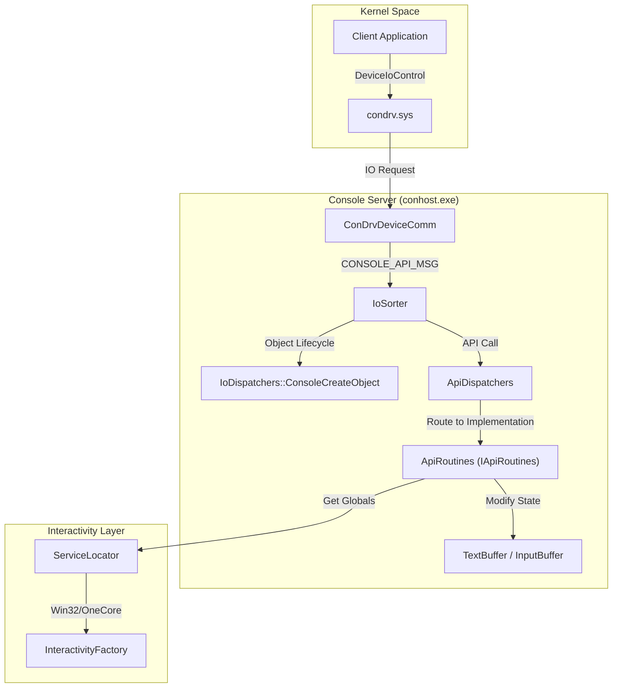
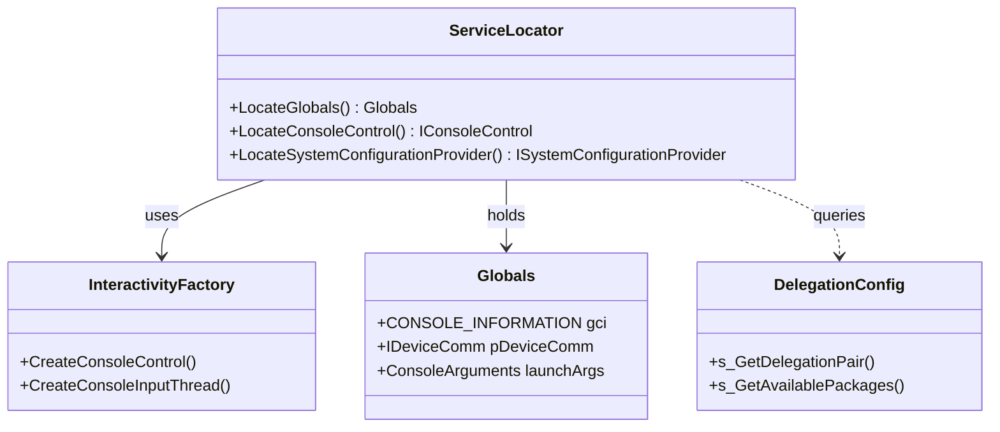

<!-- source: DeepWiki mcp.deepwiki.com · repo microsoft/intelligent-terminal · page 8.3 Console Server and API Dispatch · fetched 2026-10-26 -->

# Console Server and API Dispatch

Relevant source files

The following files were used as context for generating this wiki page:

- [.github/actions/spelling/candidate.patterns](.github/actions/spelling/candidate.patterns)
- [src/host/ApiRoutines.h](src/host/ApiRoutines.h)
- [src/host/directio.cpp](src/host/directio.cpp)
- [src/host/exe/CConsoleHandoff.h](src/host/exe/CConsoleHandoff.h)
- [src/host/exe/exemain.cpp](src/host/exe/exemain.cpp)
- [src/host/exe/sources](src/host/exe/sources)
- [src/host/ft_uia/sources](src/host/ft_uia/sources)
- [src/host/globals.h](src/host/globals.h)
- [src/host/precomp.h](src/host/precomp.h)
- [src/host/proxy/IConsoleHandoff.idl](src/host/proxy/IConsoleHandoff.idl)
- [src/host/readData.hpp](src/host/readData.hpp)
- [src/host/srvinit.cpp](src/host/srvinit.cpp)
- [src/host/ut_host/ApiRoutinesTests.cpp](src/host/ut_host/ApiRoutinesTests.cpp)
- [src/host/writeData.cpp](src/host/writeData.cpp)
- [src/host/writeData.hpp](src/host/writeData.hpp)
- [src/inc/conint.h](src/inc/conint.h)
- [src/inc/til/u8u16convert.h](src/inc/til/u8u16convert.h)
- [src/interactivity/base/InteractivityFactory.cpp](src/interactivity/base/InteractivityFactory.cpp)
- [src/interactivity/base/InteractivityFactory.hpp](src/interactivity/base/InteractivityFactory.hpp)
- [src/interactivity/base/PseudoConsoleWindowAccessibilityProvider.cpp](src/interactivity/base/PseudoConsoleWindowAccessibilityProvider.cpp)
- [src/interactivity/base/PseudoConsoleWindowAccessibilityProvider.hpp](src/interactivity/base/PseudoConsoleWindowAccessibilityProvider.hpp)
- [src/interactivity/base/ServiceLocator.cpp](src/interactivity/base/ServiceLocator.cpp)
- [src/interactivity/inc/IInteractivityFactory.hpp](src/interactivity/inc/IInteractivityFactory.hpp)
- [src/interactivity/inc/ServiceLocator.hpp](src/interactivity/inc/ServiceLocator.hpp)
- [src/internal/stubs.cpp](src/internal/stubs.cpp)
- [src/propslib/DelegationConfig.cpp](src/propslib/DelegationConfig.cpp)
- [src/server/ApiDispatchers.cpp](src/server/ApiDispatchers.cpp)
- [src/server/ApiMessage.cpp](src/server/ApiMessage.cpp)
- [src/server/ApiMessage.h](src/server/ApiMessage.h)
- [src/server/ConDrvDeviceComm.cpp](src/server/ConDrvDeviceComm.cpp)
- [src/server/ConDrvDeviceComm.h](src/server/ConDrvDeviceComm.h)
- [src/server/DeviceComm.h](src/server/DeviceComm.h)
- [src/server/IApiRoutines.h](src/server/IApiRoutines.h)
- [src/server/IWaitRoutine.h](src/server/IWaitRoutine.h)
- [src/server/IoDispatchers.cpp](src/server/IoDispatchers.cpp)
- [src/server/WaitBlock.cpp](src/server/WaitBlock.cpp)
- [src/server/WaitBlock.h](src/server/WaitBlock.h)
- [src/server/WaitQueue.cpp](src/server/WaitQueue.cpp)
- [src/server/WaitQueue.h](src/server/WaitQueue.h)
- [src/server/lib/server.vcxproj](src/server/lib/server.vcxproj)
- [src/server/lib/server.vcxproj.filters](src/server/lib/server.vcxproj.filters)
- [src/server/sources.inc](src/server/sources.inc)
- [src/terminal/parser/tracing.cpp](src/terminal/parser/tracing.cpp)
- [src/terminal/parser/tracing.hpp](src/terminal/parser/tracing.hpp)
- [src/til/ut_til/u8u16convertTests.cpp](src/til/ut_til/u8u16convertTests.cpp)
- [src/tools/U8U16Test/U8U16Test.hpp](src/tools/U8U16Test/U8U16Test.hpp)
- [src/types/ColorFix.cpp](src/types/ColorFix.cpp)
- [src/types/inc/ColorFix.hpp](src/types/inc/ColorFix.hpp)

The Console Server and API Dispatch layer acts as the communication backbone of the console host (`conhost.exe`). It is responsible for routing requests from the Windows Console Driver (`condrv.sys`) or LPC/ALPC ports to the appropriate internal routines, managing process lifecycles, and abstracting environment-specific behaviors (Win32 vs. OneCore).

## Console Server Architecture

The console server operates by listening for messages from the driver and dispatching them through a hierarchy of sorters and dispatchers. This architecture ensures that API calls from client applications (like `cmd.exe` or `powershell.exe`) are translated into state changes within the console host's buffers.

### Core Components and Data Flow

1.  **ConDrvDeviceComm**: The primary communication channel that interfaces with the kernel-mode console driver. It receives `CD_IO_OPERATION` packets [src/server/ApiMessage.cpp:80-86]().
2.  **IoDispatchers**: Handles high-level I/O operations such as creating or closing console handles [src/server/IoDispatchers.cpp:36-108]().
3.  **ApiDispatchers**: Routes specific Console API calls (e.g., `GetConsoleMode`, `WriteConsoleInput`) to the implementation in `IApiRoutines` [src/server/ApiDispatchers.cpp:62-87]().
4.  **ServiceLocator**: A singleton provider used to resolve environmental dependencies like the window manager or system configuration [src/interactivity/inc/ServiceLocator.hpp:30-112]().

### API Dispatch Flow Diagram

The following diagram illustrates how a Console API call from a client process reaches the internal implementation.

**Sources:** [src/server/IoDispatchers.cpp:36-108](), [src/server/ApiDispatchers.cpp:46-60](), [src/server/ApiMessage.cpp:80-87](), [src/interactivity/base/ServiceLocator.cpp:185-209]()

## API Message and Wait Infrastructure

Console operations are often asynchronous (e.g., reading from an empty input buffer). The server uses a "Wait Block" mechanism to suspend requests until the required data is available.

### ApiMessage (`_CONSOLE_API_MSG`)
The `_CONSOLE_API_MSG` structure encapsulates the state of a single API request, including input/output buffers and the originating process/thread information [src/server/ApiMessage.h:13-67]().
*   **Buffer Management**: It lazily allocates and manages memory for input and output payloads using `GetInputBuffer` and `GetOutputBuffer` [src/server/ApiMessage.cpp:98-174]().
*   **Reply Handling**: Once an operation is complete, `ReleaseMessageBuffers` is called to sync the results back to the driver [src/server/ApiMessage.cpp:183-196]().

### WaitBlock and Async Waits
When an API routine (like `GetConsoleInputImpl`) cannot be fulfilled immediately, it returns `CONSOLE_STATUS_WAIT` [src/host/directio.cpp:80-86]().
*   **Wait Creation**: The server creates a `WaitBlock` and adds it to the `ConsoleWaitQueue` [src/host/directio.cpp:84]().
*   **Wait Completion**: When new data arrives (e.g., a keypress), the `WaitQueue` is signaled, and the original `ApiMessage` is re-dispatched to complete the call.

**Sources:** [src/server/ApiMessage.cpp:98-174](), [src/host/directio.cpp:54-89](), [src/server/WaitBlock.h:1-20]()

## Interactivity and Service Location

Intelligent Terminal supports both standard Win32 Desktop environments and OneCore (IoT/Server) environments. The `ServiceLocator` abstracts these differences.

### ServiceLocator and InteractivityFactory
The `ServiceLocator` provides a unified interface to access global state (`LocateGlobals`) and environmental abstractions [src/interactivity/base/ServiceLocator.cpp:185-209]().
*   **InteractivityFactory**: This factory detects the current OS capabilities via `ApiDetector::DetectNtUserWindow` and instantiates the correct implementation of `IConsoleControl`, `IConsoleWindow`, and `IConsoleInputThread` [src/interactivity/base/InteractivityFactory.cpp:32-114]().

### Environment Abstraction Table

| Interface | Win32 Implementation | OneCore Implementation |
| :--- | :--- | :--- |
| `IConsoleControl` | `Win32::ConsoleControl` | `OneCore::ConsoleControl` |
| `IConsoleInputThread` | `Win32::ConsoleInputThread` | `OneCore::ConsoleInputThread` |
| `IWindowMetrics` | `Win32::WindowMetrics` | `OneCore::WindowMetrics` |
| `ISystemConfiguration` | `Win32::SystemConfigurationProvider` | `OneCore::SystemConfigurationProvider` |

**Sources:** [src/interactivity/base/InteractivityFactory.cpp:32-240](), [src/interactivity/inc/ServiceLocator.hpp:30-81]()

## Console Initialization and Handoff

When `conhost.exe` starts, it performs a series of checks to determine if it should host the console itself or hand off the connection to a terminal like Windows Terminal.

### Initialization Sequence
1.  **Entrypoint**: `wwinMain` in `exemain.cpp` validates the server handle [src/host/exe/exemain.cpp:55-73]().
2.  **Server Init**: `ConsoleServerInitialization` sets up global state, font defaults, and delegation pairs [src/host/srvinit.cpp:31-79]().
3.  **Delegation Check**: The host checks `DelegationConfig` to see if a default terminal (like Windows Terminal) is registered to handle the connection [src/host/srvinit.cpp:53-75]().

### Terminal Handoff Logic
The function `_shouldAttemptHandoff` determines if the current console session should be redirected [src/server/IoDispatchers.cpp:157-200](). redirection is skipped if:
*   The console is already initialized [src/server/IoDispatchers.cpp:185-189]().
*   The host is already a target for another handoff [src/server/IoDispatchers.cpp:176-179]().

**Sources:** [src/host/srvinit.cpp:31-79](), [src/server/IoDispatchers.cpp:157-200](), [src/propslib/DelegationConfig.cpp:158-169](), [src/host/exe/exemain.cpp:55-73]()

---

