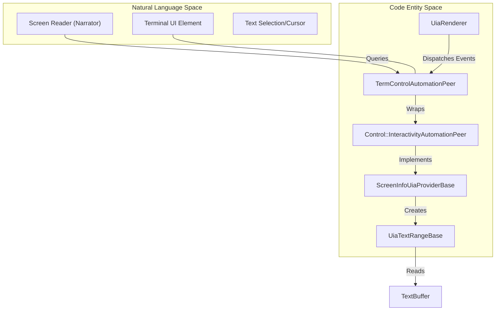
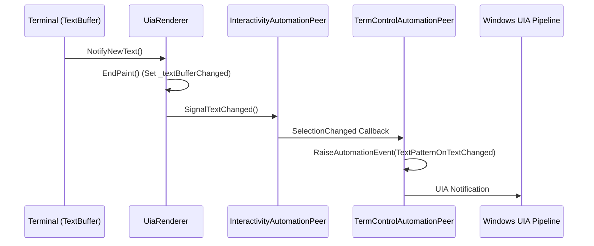

<!-- source: DeepWiki mcp.deepwiki.com · repo microsoft/intelligent-terminal · page 9 Accessibility (UIA) · fetched 2026-10-26 -->

# Accessibility (UIA)

Relevant source files

The following files were used as context for generating this wiki page:

- [src/cascadia/TerminalControl/InteractivityAutomationPeer.cpp](src/cascadia/TerminalControl/InteractivityAutomationPeer.cpp)
- [src/cascadia/TerminalControl/InteractivityAutomationPeer.h](src/cascadia/TerminalControl/InteractivityAutomationPeer.h)
- [src/cascadia/TerminalControl/InteractivityAutomationPeer.idl](src/cascadia/TerminalControl/InteractivityAutomationPeer.idl)
- [src/cascadia/TerminalControl/TermControlAutomationPeer.cpp](src/cascadia/TerminalControl/TermControlAutomationPeer.cpp)
- [src/cascadia/TerminalControl/TermControlAutomationPeer.h](src/cascadia/TerminalControl/TermControlAutomationPeer.h)
- [src/cascadia/TerminalControl/XamlUiaTextRange.cpp](src/cascadia/TerminalControl/XamlUiaTextRange.cpp)
- [src/interactivity/onecore/BgfxEngine.cpp](src/interactivity/onecore/BgfxEngine.cpp)
- [src/interactivity/onecore/BgfxEngine.hpp](src/interactivity/onecore/BgfxEngine.hpp)
- [src/interactivity/win32/screenInfoUiaProvider.cpp](src/interactivity/win32/screenInfoUiaProvider.cpp)
- [src/interactivity/win32/screenInfoUiaProvider.hpp](src/interactivity/win32/screenInfoUiaProvider.hpp)
- [src/interactivity/win32/uiaTextRange.cpp](src/interactivity/win32/uiaTextRange.cpp)
- [src/interactivity/win32/uiaTextRange.hpp](src/interactivity/win32/uiaTextRange.hpp)
- [src/interactivity/win32/ut_interactivity_win32/GeneratedUiaTextRangeMovementTests.g.cpp](src/interactivity/win32/ut_interactivity_win32/GeneratedUiaTextRangeMovementTests.g.cpp)
- [src/interactivity/win32/ut_interactivity_win32/UiaTextRangeTests.cpp](src/interactivity/win32/ut_interactivity_win32/UiaTextRangeTests.cpp)
- [src/renderer/base/RenderEngineBase.cpp](src/renderer/base/RenderEngineBase.cpp)
- [src/renderer/base/renderer.cpp](src/renderer/base/renderer.cpp)
- [src/renderer/base/renderer.hpp](src/renderer/base/renderer.hpp)
- [src/renderer/gdi/gdirenderer.hpp](src/renderer/gdi/gdirenderer.hpp)
- [src/renderer/gdi/paint.cpp](src/renderer/gdi/paint.cpp)
- [src/renderer/gdi/state.cpp](src/renderer/gdi/state.cpp)
- [src/renderer/inc/IRenderEngine.hpp](src/renderer/inc/IRenderEngine.hpp)
- [src/renderer/inc/RenderEngineBase.hpp](src/renderer/inc/RenderEngineBase.hpp)
- [src/renderer/uia/UiaRenderer.cpp](src/renderer/uia/UiaRenderer.cpp)
- [src/renderer/uia/UiaRenderer.hpp](src/renderer/uia/UiaRenderer.hpp)
- [src/renderer/wddmcon/WddmConRenderer.cpp](src/renderer/wddmcon/WddmConRenderer.cpp)
- [src/renderer/wddmcon/WddmConRenderer.hpp](src/renderer/wddmcon/WddmConRenderer.hpp)
- [src/types/IControlAccessibilityInfo.h](src/types/IControlAccessibilityInfo.h)
- [src/types/ScreenInfoUiaProviderBase.cpp](src/types/ScreenInfoUiaProviderBase.cpp)
- [src/types/ScreenInfoUiaProviderBase.h](src/types/ScreenInfoUiaProviderBase.h)
- [src/types/TermControlUiaProvider.cpp](src/types/TermControlUiaProvider.cpp)
- [src/types/TermControlUiaProvider.hpp](src/types/TermControlUiaProvider.hpp)
- [src/types/TermControlUiaTextRange.cpp](src/types/TermControlUiaTextRange.cpp)
- [src/types/TermControlUiaTextRange.hpp](src/types/TermControlUiaTextRange.hpp)
- [src/types/UiaTextRangeBase.cpp](src/types/UiaTextRangeBase.cpp)
- [src/types/UiaTextRangeBase.hpp](src/types/UiaTextRangeBase.hpp)
- [tools/TestTableWriter/GenerateTests.ps1](tools/TestTableWriter/GenerateTests.ps1)
- [tools/TestTableWriter/README.md](tools/TestTableWriter/README.md)
- [tools/TestTableWriter/UiaTests.csv](tools/TestTableWriter/UiaTests.csv)

The Intelligent Terminal implements the **UI Automation (UIA)** framework to provide deep accessibility support for screen readers (like Narrator and NVDA) and automation testing. This implementation bridges the low-level character grid of the terminal buffer to the standard `ITextProvider` and `ITextRangeProvider` interfaces.

## Architectural Overview

The UIA architecture is divided into providers (representing the terminal window) and text ranges (representing spans of text).

### Code-to-System Mapping: UIA Provider Hierarchy

The following diagram illustrates how WinRT/XAML entities map to the internal UIA implementation.

**Sources:** [src/cascadia/TerminalControl/TermControlAutomationPeer.cpp:69-86](), [src/types/ScreenInfoUiaProviderBase.cpp:34-43](), [src/renderer/uia/UiaRenderer.cpp:16-26]()

## UiaTextRangeBase and Movement Units

`UiaTextRangeBase` is the core implementation of `ITextRangeProvider`. It manages coordinates in the `TextBuffer` space using `til::point` for `_start` and `_end` [src/types/UiaTextRangeBase.hpp:131-136]().

### Movement Units
The implementation supports standard `TextUnit` movements:
*   **Character**: Moves by individual cells, handling wide glyphs.
*   **Word**: Uses `_wordDelimiters` to identify boundaries [src/types/UiaTextRangeBase.cpp:35]().
*   **Line**: Moves vertically within the buffer, respecting the viewport [src/interactivity/win32/ut_interactivity_win32/UiaTextRangeTests.cpp:74-107]().
*   **Document**: Moves to the absolute start or end of the scrollback buffer.

### Key Functions
*   `ExpandToEnclosingUnit`: Expands a degenerate (empty) range to the boundaries of the specified `TextUnit` [src/types/UiaTextRangeBase.hpp:86]().
*   `GetText`: Retrieves a `BSTR` of the text within the range, including newline handling for wrapped rows [src/types/UiaTextRangeBase.cpp:99-101]().
*   `GetBoundingRectangles`: Returns the screen coordinates for the range, used by screen readers to draw focus rectangles [src/types/UiaTextRangeBase.hpp:97]().

**Sources:** [src/types/UiaTextRangeBase.cpp:19-120](), [src/types/UiaTextRangeBase.hpp:45-115]()

## ScreenInfoUiaProviderBase

`ScreenInfoUiaProviderBase` implements `IRawElementProviderSimple` and `ITextProvider`. It acts as the root accessibility node for the terminal content [src/types/ScreenInfoUiaProviderBase.cpp:34-43]().

| Property | Value / Source |
| :--- | :--- |
| **Control Type** | `UIA_DocumentControlTypeId` [src/types/ScreenInfoUiaProviderBase.cpp:94]() |
| **Name** | "Text Area" [src/types/ScreenInfoUiaProviderBase.cpp:99]() |
| **Runtime ID** | Generated via `UiaAppendRuntimeId` [src/types/ScreenInfoUiaProviderBase.cpp:169]() |
| **Selection Support** | Returns `UiaTextRange` objects via `GetSelection` [src/types/ScreenInfoUiaProviderBase.cpp:198-211]() |

**Sources:** [src/types/ScreenInfoUiaProviderBase.cpp:89-149]()

## TermControlAutomationPeer

This class is the XAML bridge. It inherits from `FrameworkElementAutomationPeer` and wraps the internal `InteractivityAutomationPeer` [src/cascadia/TerminalControl/TermControlAutomationPeer.cpp:69-75]().

### Event Dispatching Pipeline
When the terminal state changes, the `UiaRenderer` triggers events that eventually bubble up through the Automation Peer to the OS.

**Sources:** [src/renderer/uia/UiaRenderer.cpp:147-161](), [src/cascadia/TerminalControl/TermControlAutomationPeer.cpp:161-179]()

## High Contrast and Color Algorithms

The terminal supports High Contrast Mode by ensuring text remains readable regardless of the user's color scheme.

### Delta-E Contrast
The renderer uses a Delta-E color contrast algorithm to calculate the perceptual difference between foreground and background colors. If the contrast falls below a specific threshold (especially in High Contrast Mode), the terminal automatically adjusts the colors to meet accessibility standards.

### High Contrast Mode Handling
In `UiaTextRangeBase::GetAttributeValue`, the system reports text attributes like `UIA_ForegroundColorAttributeId` [src/types/UiaTextRangeBase.cpp:95-96](). When High Contrast is active, the `RenderSettings` (via `IRenderData`) provides the system-defined contrast colors instead of the terminal's SGR-defined colors.

**Sources:** [src/types/UiaTextRangeBase.cpp:11-15](), [src/renderer/base/renderer.cpp:26-37]()

## UIA Notification Payloads

To improve the experience for screen readers during high-velocity output, the terminal uses `UIA_NotificationEventId`.

*   **New Output**: When `UiaEngine::NotifyNewText` is called, text is buffered [src/renderer/uia/UiaRenderer.cpp:147-161]().
*   **Payload Construction**: The `TermControlAutomationPeer` receives these updates and can sanitize the string (removing control characters) before sending it to the screen reader via `NotifyNewOutput` [src/cascadia/TerminalControl/TermControlAutomationPeer.cpp:84]().
*   **Sanitization**: The `Sanitize` function removes non-printable control characters while preserving newlines to ensure the screen reader doesn't encounter "garbage" VT sequences [src/cascadia/TerminalControl/TermControlAutomationPeer.cpp:38-46]().

**Sources:** [src/renderer/uia/UiaRenderer.cpp:190-202](), [src/cascadia/TerminalControl/TermControlAutomationPeer.cpp:32-65]()

---

