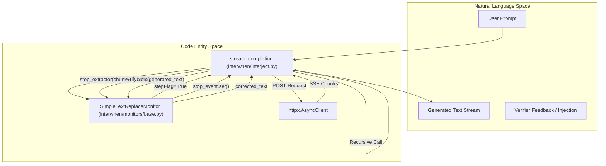

<!-- source: DeepWiki mcp.deepwiki.com · repo microsoft/interwhen · page 1.1 Getting Started · fetched 2026-10-26 -->

# Getting Started

<details>
<summary>Relevant source files</summary>

The following files were used as context for generating this wiki page:

- [environment.yml](environment.yml)
- [examples/text_replacement_example.py](examples/text_replacement_example.py)
- [interwhen/interject.py](interwhen/interject.py)
- [pyproject.toml](pyproject.toml)
- [text_replacement.mp4](text_replacement.mp4)

</details>


This page provides the necessary instructions to install, configure, and run the `interwhen` library. It covers environment setup using `conda` or `pip`, dependency management via optional extras, and a minimal working example using the `SimpleTextReplaceMonitor`.

## Installation and Dependencies

`interwhen` requires Python 3.9 or higher [pyproject.toml:11-11](). The core library depends on `openai`, `pydantic`, `regex`, `tiktoken`, and `vllm` [pyproject.toml:22-28]().

### Optional Extras
Depending on the specific reasoning tasks and monitors you intend to use, you may need to install optional dependencies defined in `pyproject.toml` [pyproject.toml:30-44]():

| Extra | Dependencies | Purpose |
| :--- | :--- | :--- |
| `math` | `sympy`, `numpy` | Used for mathematical verification (e.g., Game of 24) |
| `logic` | `z3-solver` | Required for SMT-based reasoning (e.g., Spatial Map, ZebraLogic) |
| `dev` | `pytest`, `black`, `isort`, `mypy` | Tools for library development and testing |

### Environment Setup
A comprehensive `environment.yml` is provided for setting up a development environment with `conda` [environment.yml:1-219]().

```bash
# Create environment from file
conda env create -f environment.yml
conda activate inter

# Or install via pip with specific extras
pip install .[math,logic]
```

**Sources:** [pyproject.toml:11-44](), [environment.yml:1-219]()

---

## Minimal Working Example

The following example demonstrates how to use `stream_completion` with a `SimpleTextReplaceMonitor`. This monitor listens for a specific "IsCheck" trigger and injects a replacement string (e.g., `</think>`) into the generation stream.

### Logic Flow: Text Replacement
The diagram below illustrates how the `stream_completion` loop interacts with the `Monitor` interface to intercept and modify LLM output.

**Title: Interjection Loop Data Flow**

**Sources:** [interwhen/interject.py:18-82](), [examples/text_replacement_example.py:47-54]()

### Implementation: text_replacement_example.py
The example script configures a local LLM server (compatible with `vLLM` or `OpenAI` API formats) and attaches a monitor.

1.  **Server Initialization**: The `init_llm_server` function defines the endpoint and payload for the SSE stream [examples/text_replacement_example.py:10-25]().
2.  **Monitor Attachment**: A `SimpleTextReplaceMonitor` is instantiated with a trigger string ("IsCheck") and a replacement [examples/text_replacement_example.py:50-50]().
3.  **Execution**: `stream_completion` manages the asynchronous tasks and handles the recursive "fix" loop if the monitor triggers an early stop [interwhen/interject.py:18-22]().

```python
# Minimal snippet from examples/text_replacement_example.py
result = await stream_completion(
    text,
    llm_server=llm_server,
    monitors=(SimpleTextReplaceMonitor("IsCheck", "</think>"),),
    async_execution=True
)
```

**Sources:** [examples/text_replacement_example.py:10-60](), [interwhen/interject.py:18-82]()

---

## Core Execution Model

The `stream_completion` function in `interwhen/interject.py` is the entry point for the closed-loop control system.

### Key Functions and Classes

| Entity | Role | File Reference |
| :--- | :--- | :--- |
| `stream_completion` | Orchestrates the SSE stream, monitor task creation, and recursion. | [interwhen/interject.py:18-82]() |
| `SimpleTextReplaceMonitor` | Reference monitor that triggers based on substring matching. | [interwhen/monitors/base.py]() |
| `stop_event` | `asyncio.Event` used to signal all tasks to halt when a monitor fails. | [interwhen/interject.py:20-20]() |
| `stop_info` | Shared dictionary containing metadata about the failure (feedback, token index). | [interwhen/interject.py:21-21]() |

### Token-by-Token Processing
As chunks arrive via SSE [interwhen/interject.py:31-41](), the system:
1.  Appends the chunk to `generated_text` [interwhen/interject.py:48-48]().
2.  Calls `monitors[0].step_extractor` to determine if a reasoning step is complete [interwhen/interject.py:52-52]().
3.  If `stepFlag` is true, it spawns an asynchronous `verify` task [interwhen/interject.py:55-55]().
4.  If `stop_event` is set during verification, it cancels pending tasks and invokes `monitors[0].fix()` to prepare the prompt for the next iteration [interwhen/interject.py:64-75]().

**Sources:** [interwhen/interject.py:18-82](), [examples/text_replacement_example.py:4-5]()

---

