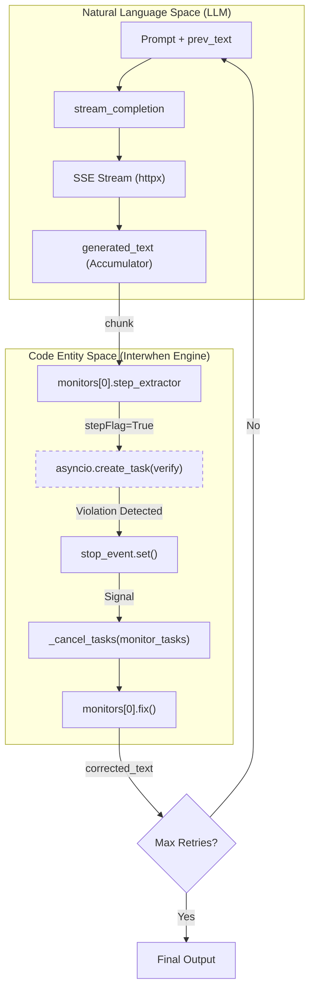
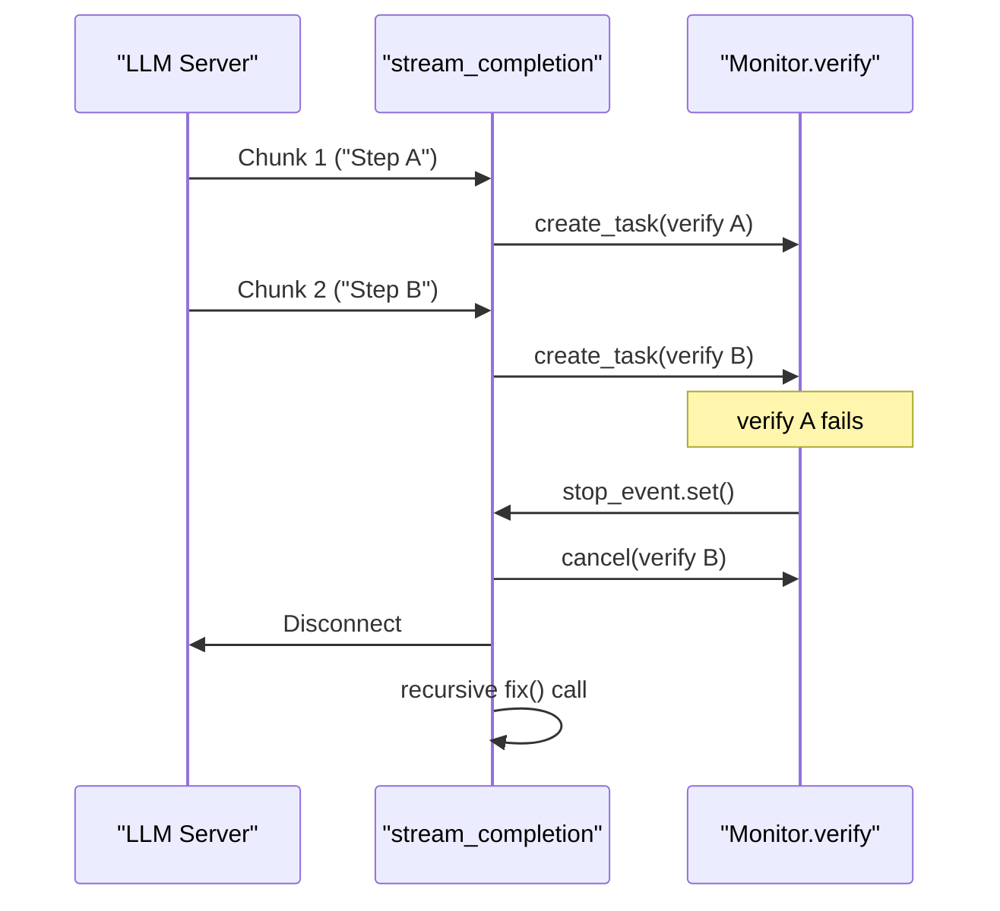

<!-- source: DeepWiki mcp.deepwiki.com · repo microsoft/interwhen · page 1.2 Architecture Overview · fetched 2026-10-26 -->

# Architecture Overview

Relevant source files

The following files were used as context for generating this wiki page:

- [README.md](README.md)
- [examples/README.md](examples/README.md)
- [interwhen/__init__.py](interwhen/__init__.py)
- [interwhen/interject.py](interwhen/interject.py)
- [pyproject.toml](pyproject.toml)

The `interwhen` framework implements a **closed-loop control architecture** for Large Language Models (LLMs). It shifts from the traditional open-loop "prompt-and-generate" paradigm to a system where the model's output stream is treated as a continuous signal subject to real-time verification and intervention [README.md:23-28]().

## System Architecture

The core of the system is the `stream_completion` engine, which manages the lifecycle of a request from initial prompt to a verified final response. It coordinates between the LLM server (via SSE streaming), the `Monitor` suite, and a recursive correction loop [interwhen/interject.py:18-22]().

### High-Level Data Flow
The following diagram illustrates how the system bridges the gap between raw text generation and structured verification logic.

**Diagram: Verifier-Guided Reasoning Loop**

Sources: [interwhen/interject.py:18-82](), [README.md:71-79]()

## Core Components

### 1. The Interjection Loop (`stream_completion`)
The `stream_completion` function is the primary entry point. It establishes an asynchronous HTTP connection to an OpenAI-compatible API server [interwhen/interject.py:29-30](). 

- **Streaming Management**: It processes server-sent events (SSE). As each text `chunk` arrives, it is appended to the `generated_text` buffer [interwhen/interject.py:31-48]().
- **Task Orchestration**: For every chunk, it invokes the `step_extractor` of the active monitor. If a logical "step" is identified, it spawns a background `asyncio.Task` to run `verify()` [interwhen/interject.py:51-56]().
- **Early Termination**: If any verification task detects a violation, it sets a shared `asyncio.Event` (`stop_event`). This causes the engine to immediately stop consuming the stream and cancel all other pending verification tasks [interwhen/interject.py:64-66]().

### 2. Monitors and Verifiers
Monitors are the "sensors" and "actuators" of the framework. A monitor typically wraps a domain-specific verifier (e.g., a Z3 solver for logic or a Lean 4 compiler for code) [README.md:78-79]().

| Component | Responsibility | Code Reference |
| :--- | :--- | :--- |
| **`step_extractor`** | Parses the raw stream to identify verify-able units (e.g., a line of math, a move in a game). | [interwhen/interject.py:52]() |
| **`verify`** | An async function that checks the validity of a step. It updates `stop_info` on failure. | [interwhen/interject.py:55]() |
| **`fix`** | Generates the intervention text (feedback) to be injected back into the LLM's context. | [interwhen/interject.py:75]() |

Sources: [interwhen/interject.py:50-60](), [README.md:110-112]()

## Execution Model

The framework supports both `async_execution=True` (default) and synchronous execution. 

### Asynchronous Pipeline
In the default mode, verification tasks run concurrently with the LLM's generation. This minimizes the latency impact of slow verifiers (like formal solvers). The engine only blocks if a violation is found or the stream ends [interwhen/interject.py:63-69]().

**Diagram: Async Task Lifecycle**

Sources: [interwhen/interject.py:55-68](), [README.md:76-77]()

### Recursive Correction
When a monitor triggers a stop, the system does not simply fail. It enters a recursive loop:
1. The `fix()` method appends feedback to the current reasoning trace [interwhen/interject.py:75]().
2. `stream_completion` is called again with the `corrected_text` as the new `prev_text` (prefix) [interwhen/interject.py:80]().
3. A safety guard (`num_calls_index`) prevents infinite loops, defaulting to a maximum of 50 correction attempts [interwhen/interject.py:71-73]().

Sources: [interwhen/interject.py:70-82]()

---

