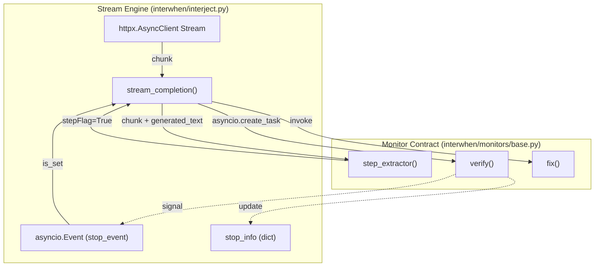
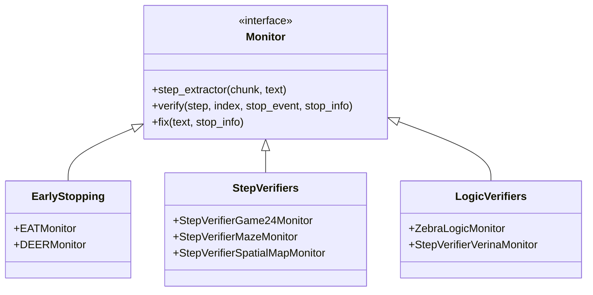

<!-- source: DeepWiki mcp.deepwiki.com · repo microsoft/interwhen · page 2 Core Engine · fetched 2026-10-26 -->

# Core Engine

Relevant source files

The following files were used as context for generating this wiki page:

- [interwhen/interject.py](interwhen/interject.py)
- [interwhen/monitors/__init__.py](interwhen/monitors/__init__.py)
- [pyproject.toml](pyproject.toml)

The **Core Engine** of `interwhen` provides the fundamental infrastructure for real-time monitoring and interjection during Large Language Model (LLM) generation. It implements a closed-loop control system where streaming output is intercepted, analyzed by domain-specific monitors, and potentially corrected via recursive feedback loops.

The engine is composed of three primary pillars:
1.  **The Interjection Loop**: An asynchronous streaming engine that manages SSE (Server-Sent Events) and coordinates monitor execution.
2.  **Monitor Abstraction Layer**: A set of base classes that define the contract for verification, extraction, and correction.
3.  **Monitor Registry**: A structured package that exposes specialized monitors for math, logic, and early stopping.

## System Architecture

The following diagram illustrates how the Core Engine components bridge the gap between the raw LLM stream and the structured verification logic.

### Data Flow: Stream to Verification
This diagram shows the relationship between the `stream_completion` function and the `Monitor` interface.

**Sources:** [interwhen/interject.py:18-82](), [interwhen/monitors/base.py:1-50]() (Note: base.py implied by structure).

## Component Overview

### 1. stream_completion and the Interjection Loop
The `stream_completion` function in `interwhen/interject.py` is the entry point for the library. It handles the low-level `httpx` streaming from an OpenAI-compatible API and manages the lifecycle of `asyncio` tasks that perform verification.

*   **Recursive Correction**: If a monitor triggers a `stop_event`, the engine calls `fix()` and recursively calls `stream_completion` with the corrected text [interwhen/interject.py:75-80]().
*   **Safety Guards**: A `num_calls_index` tracks the number of interjections to prevent infinite loops, capping at 50 attempts [interwhen/interject.py:71-73]().

For details, see [stream_completion and the Interjection Loop](#2.1).

### 2. Monitor Base Classes
The library relies on a strict interface for monitors to ensure compatibility with the async loop. Every monitor must implement logic to extract meaningful "steps" from a stream and determine if those steps warrant an interjection.

| Method | Role |
| :--- | :--- |
| `step_extractor` | Identifies boundaries in the text (e.g., newlines, LaTeX boxes) to trigger verification. |
| `verify` | An `async` method that runs domain logic and signals the `stop_event` if an error is found. |
| `fix` | Generates the feedback string or modified text to be injected back into the prompt. |

For details, see [Monitor Base Classes](#2.2).

### 3. Monitor Package Structure
The `interwhen.monitors` package serves as a registry, organizing monitors by their functional purpose. This structure allows users to easily swap between simple text replacement, complex Z3-based logic verification, or entropy-based early stopping.

**Key Groupings in `interwhen/monitors/__init__.py`:**
*   **Early Stopping**: `EATMonitor`, `DEERMonitor` [interwhen/monitors/__init__.py:4-4]().
*   **Step Verifiers**: `StepVerifierGame24Monitor`, `StepVerifierMazeMonitor`, `StepVerifierSpatialMapMonitor` [interwhen/monitors/__init__.py:3-3]().
*   **Formal Verification**: `StepVerifierVerinaMonitor` (Lean 4) [interwhen/monitors/__init__.py:9-9]().

For details, see [Monitor Package Structure](#2.3).

## Class Hierarchy and Registry

The following diagram maps the logical categories of monitors to their specific implementation classes exported by the package.

**Sources:** [interwhen/monitors/__init__.py:1-10](), [interwhen/interject.py:52-55]().

## Dependencies and Installation
The core engine requires `vllm` or an OpenAI-compatible server for streaming. Logic-based monitors require optional dependencies defined in `pyproject.toml`.

*   **Core**: `openai`, `httpx`, `vllm` [pyproject.toml:22-28]().
*   **Logic (Z3)**: `z3-solver` [pyproject.toml:42-44]().
*   **Math**: `sympy`, `numpy` [pyproject.toml:38-41]().

**Sources:** [pyproject.toml:22-44]().

---

