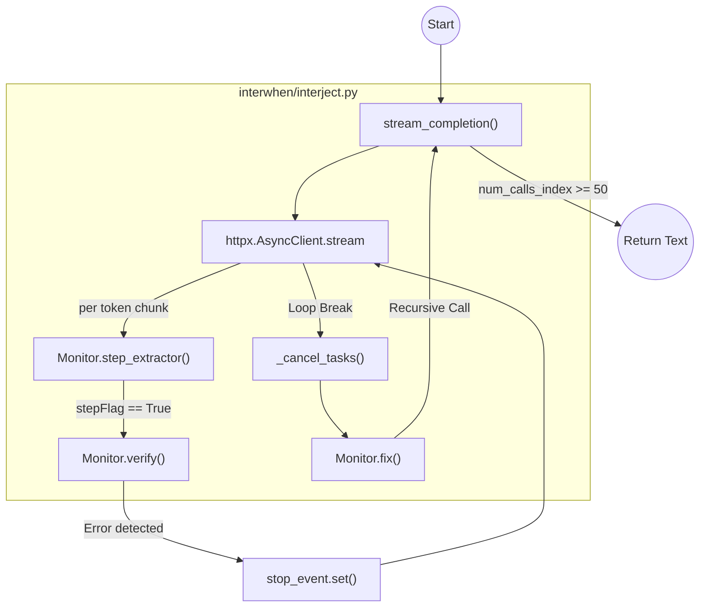
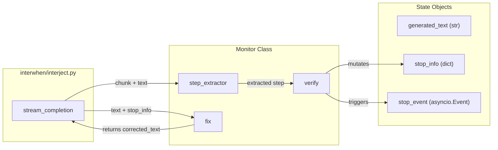

<!-- source: DeepWiki mcp.deepwiki.com · repo microsoft/interwhen · page 2.1 stream_completion and the Interjection Loop · fetched 2026-10-26 -->

# stream_completion and the Interjection Loop

Relevant source files

The following files were used as context for generating this wiki page:

- [interwhen/__init__.py](interwhen/__init__.py)
- [interwhen/interject.py](interwhen/interject.py)
- [pyproject.toml](pyproject.toml)

This page provides a detailed technical walkthrough of the core streaming engine and the recursive interjection loop implemented in `interwhen/interject.py`. This subsystem is responsible for managing the lifecycle of an LLM generation, coordinating real-time monitor verification, and handling recursive corrections when reasoning errors are detected.

## Overview of stream_completion

The `stream_completion` function is the primary entry point for the `interwhen` library [interwhen/__init__.py:1](). It manages an asynchronous Server-Sent Events (SSE) stream from an LLM server and orchestrates "monitors" that inspect the text in real-time.

### Data Flow and Task Management

When `stream_completion` is invoked, it initializes a synchronization primitive, `asyncio.Event` (referred to as `stop_event`), and a shared dictionary, `stop_info`, to capture metadata from monitors when they trigger an interjection [interwhen/interject.py:20-21]().

The function utilizes `httpx.AsyncClient` to maintain a persistent connection to the LLM provider [interwhen/interject.py:29-30](). As chunks (tokens) arrive, they are appended to the `generated_text` buffer. For every chunk received, the engine invokes the `step_extractor` of the active monitor to determine if a logical "step" has been completed [interwhen/interject.py:51-52]().

**Key Execution Parameters:**
| Parameter | Role |
| :--- | :--- |
| `num_calls_index` | Tracks the recursion depth of the interjection loop to prevent infinite loops [interwhen/interject.py:19](). |
| `async_execution` | Boolean flag. If `True`, monitor `verify` calls run as background tasks. If `False`, the stream blocks until verification completes [interwhen/interject.py:55-58](). |
| `stop_event` | An `asyncio.Event` shared across all monitor tasks to signal an immediate halt to the stream [interwhen/interject.py:20](). |

**Sources:**
- [interwhen/interject.py:18-61]()
- [interwhen/__init__.py:1]()

## The Interjection Loop Logic

The "Interjection Loop" is a recursive pattern where the system catches an error, modifies the prompt/history, and restarts the generation.

### Step Extraction and Verification
As the LLM streams, the engine checks for reasoning steps. If `step_extractor` returns a `stepFlag`, the engine spawns a `verify` task [interwhen/interject.py:52-55]().

1.  **Extraction**: `monitors[0].step_extractor(chunk, generated_text)` is called for every token.
2.  **Verification**: If a step is found, `monitors[0].verify(...)` is executed. It receives the current `stop_event` and `stop_info` to signal if the reasoning is flawed [interwhen/interject.py:55]().
3.  **Early Exit**: If `stop_event.is_set()` becomes true during streaming, the engine breaks the SSE loop and ignores subsequent chunks [interwhen/interject.py:44-46]().

### Task Cleanup
If an early stop is triggered, the engine calls `_cancel_tasks` to immediately terminate any pending background verification tasks that have not yet completed [interwhen/interject.py:63-66](). If no stop was triggered, it waits for all tasks to finish via `asyncio.gather` before proceeding [interwhen/interject.py:68]().

### Recursive Correction
If the `stop_event` was set by a monitor, the engine enters the correction phase:
1.  **Fix**: It calls `monitors[0].fix(generated_text, stop_info)` to append feedback or truncate the erroneous reasoning [interwhen/interject.py:75]().
2.  **Recursion**: It calls `stream_completion` again, passing the `corrected_text` as `prev_text` and incrementing `num_calls_index` [interwhen/interject.py:80]().
3.  **Guard**: The loop is hard-capped at 50 calls to prevent infinite recursion [interwhen/interject.py:71-73]().

**Sources:**
- [interwhen/interject.py:9-17]()
- [interwhen/interject.py:43-80]()

## Code Entity Map: Streaming and Control

The following diagram maps the logical flow of the interjection loop to the specific functions and objects in `interwhen/interject.py`.

**Figure 1: stream_completion Control Flow**

**Sources:**
- [interwhen/interject.py:18-82]()

## Data Interaction Map

This diagram illustrates how data structures are passed between the core engine and the monitor instances during the verification lifecycle.

**Figure 2: Data Flow and State Management**

**Sources:**
- [interwhen/interject.py:20-21]()
- [interwhen/interject.py:52-55]()
- [interwhen/interject.py:75-80]()

## Implementation Details: stream_completion

| Feature | Implementation Detail |
| :--- | :--- |
| **SSE Parsing** | Parses lines starting with `data: ` and handles the `[DONE]` signal [interwhen/interject.py:32-35](). |
| **JSON Handling** | Extracts text from `choices[0][text]` and provides debug logging for malformed data [interwhen/interject.py:39-42](). |
| **Task Cancellation** | Uses `asyncio.gather` with `return_exceptions=True` to safely swallow `CancelledError` [interwhen/interject.py:16](). |
| **Feedback Handling** | Specific checks for `no solution` feedback or `final_answer_correct` phase to terminate early without further recursion [interwhen/interject.py:76-79](). |

**Sources:**
- [interwhen/interject.py:9-17]()
- [interwhen/interject.py:31-42]()
- [interwhen/interject.py:76-79]()

---

