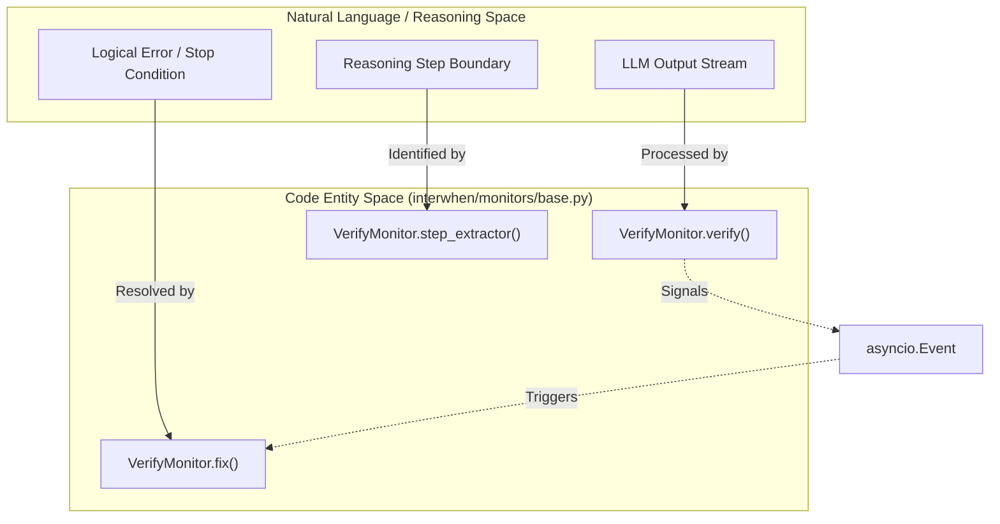
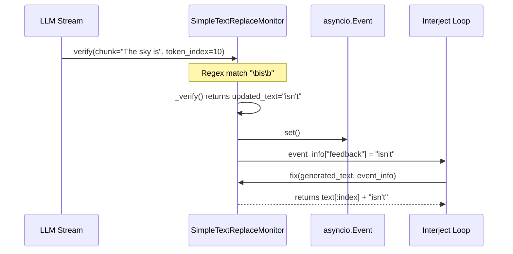

<!-- source: DeepWiki mcp.deepwiki.com · repo microsoft/interwhen · page 2.2 Monitor Base Classes · fetched 2026-10-26 -->

# Monitor Base Classes

Relevant source files

The following files were used as context for generating this wiki page:

- [interwhen/monitors/_common.py](interwhen/monitors/_common.py)
- [interwhen/monitors/base.py](interwhen/monitors/base.py)
- [interwhen/monitors/textReplacement.py](interwhen/monitors/textReplacement.py)

The `interwhen` library employs a closed-loop control architecture where partial LLM outputs are monitored in real-time. This monitoring logic is encapsulated in abstract base classes that define how the system should evaluate streaming text, signal for interruptions, and perform corrections.

## Monitor Abstractions

The library provides two primary base classes in [interwhen/monitors/base.py](): `Monitor` and `VerifyMonitor`. While `Monitor` is a general-purpose interface, the majority of the library's functionality (including early stopping and step verification) is built upon the `VerifyMonitor` pattern.

### Monitor Class
The `Monitor` class is the most basic abstraction for analyzing partial text output.

*   **Role**: Analyzes partial text and suggests improvements.
*   **Key Method**: `evaluate` [interwhen/monitors/base.py:30-44](). This method is intended to return suggested actions based on the current `chunk`, `token_index`, and `generated_text`.

### VerifyMonitor Class
The `VerifyMonitor` class defines the interface for the **Verify/Fix** pattern used by the `interject` loop. It coordinates with the streaming engine to pause generation when a condition is met and provide a mechanism to rewrite or append to the prompt.

*   **Role**: Detects domain-specific errors or stopping conditions during streaming and provides the logic to "fix" the state before resuming.
*   **Key Methods**:
    *   `verify(...)`: Analyzes streaming chunks and signals an `asyncio.Event` if an interjection is required [interwhen/monitors/base.py:72-83]().
    *   `fix(...)`: Implements the logic to modify the `generated_text` once an interjection is triggered [interwhen/monitors/base.py:85-98]().
    *   `step_extractor(...)`: Determines the boundaries of reasoning steps or identifies when to stop generating based on specific tokens [interwhen/monitors/base.py:100-112]().

### Relationship between Base Classes and Code Entities

The following diagram maps the conceptual "Closed-Loop" logic to the specific code entities defined in the base classes.

**Monitor Interface Mapping**

Sources: [interwhen/monitors/base.py:53-112]()

---

## The Verify/Fix Interface Contract

The `VerifyMonitor` relies on a specific signaling pattern using `asyncio.Event` and a shared `event_info` dictionary to communicate between the asynchronous streaming task and the interjection loop.

### Signaling Pattern
1.  **Detection**: Inside `verify()`, the monitor checks the `chunk`. If a violation is found, it populates the `event_info` dictionary with metadata (e.g., error type, required feedback, or index of the error).
2.  **Signaling**: The monitor calls `event.set()` [interwhen/monitors/textReplacement.py:28-28]().
3.  **Interruption**: The `interject` loop (see Section 2.1) detects the event, stops the stream, and passes the `event_info` to the `fix()` method.

### event_info Schema
While the schema is flexible, common keys used across implementations include:
| Key | Description |
| :--- | :--- |
| `generated_text` | The chunk or text that triggered the event. |
| `feedback` | The correction string or [VERIFIER FEEDBACK] to be injected. |
| `correction_index` | The integer position in the string where the fix should be applied. |

Sources: [interwhen/monitors/base.py:73-83](), [interwhen/monitors/textReplacement.py:19-29]()

---

## Reference Implementation: SimpleTextReplaceMonitor

The `SimpleTextReplaceMonitor` [interwhen/monitors/textReplacement.py:7-37]() serves as the reference implementation for the `VerifyMonitor` interface. It demonstrates a basic "find and replace" correction during streaming.

### Data Flow and Logic
When the monitor encounters the word "is" in a streaming chunk, it signals for a correction to change "is" to "isn't".

**SimpleTextReplaceMonitor Data Flow**

### Implementation Details
*   **`verify`**: Uses `re.search(r'\bis\b', chunk)` to find the target word [interwhen/monitors/textReplacement.py:14-17](). If found, it populates `event_info` and sets the event [interwhen/monitors/textReplacement.py:24-28]().
*   **`fix`**: Performs a slice-and-concatenate operation to replace the original text with the feedback [interwhen/monitors/textReplacement.py:30-31]().
*   **`step_extractor`**: Checks for the `answer_start_token`. If the token (e.g., `\nFinal Answer:`) is found, it returns `False` to signal the end of step generation [interwhen/monitors/textReplacement.py:33-36]().

Sources: [interwhen/monitors/textReplacement.py:7-37]()

---

## Shared Utilities

The library provides shared utilities in [interwhen/monitors/_common.py]() to assist monitors in parsing complex LLM outputs, particularly LaTeX-style reasoning.

### find_complete_boxed
A critical utility for mathematical and logical monitors is `find_complete_boxed(text)` [interwhen/monitors/_common.py:9-51](). Unlike standard regular expressions, this function uses a brace-counting algorithm to correctly handle nested structures within LaTeX `\boxed{...}` commands, such as `\boxed{12\frac{1}{2}}`.

Sources: [interwhen/monitors/_common.py:9-51]()

---

