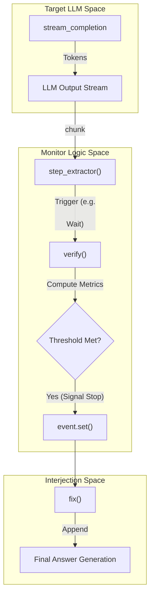
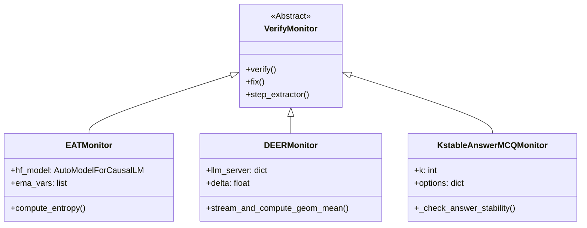

<!-- source: DeepWiki mcp.deepwiki.com · repo microsoft/interwhen · page 3 Early Stopping Monitors · fetched 2026-10-26 -->

# Early Stopping Monitors

Relevant source files

The following files were used as context for generating this wiki page:

- [examples/EarlyStopping/README.md](examples/EarlyStopping/README.md)
- [examples/TTSwithVerification/README.md](examples/TTSwithVerification/README.md)
- [interwhen/monitors/earlyStopping.py](interwhen/monitors/earlyStopping.py)
- [interwhen/monitors/k_stable.py](interwhen/monitors/k_stable.py)
- [interwhen/utils/DEER_helper.py](interwhen/utils/DEER_helper.py)
- [interwhen/utils/EAT_helper.py](interwhen/utils/EAT_helper.py)

Early stopping monitors reduce inference costs and latency by detecting when a reasoning model has reached sufficient confidence in its answer, allowing the system to terminate generation early. Instead of waiting for the model to exhaust its maximum token budget, these monitors analyze intermediate signals—such as token entropy, geometric mean confidence, or answer stability—and inject a `</think>` token to force the transition to the final answer phase [examples/EarlyStopping/README.md:1-5]().

All early stopping monitors are integrated via the `stream_completion` engine, which handles the asynchronous loop of generation, step extraction, and potential early termination [examples/EarlyStopping/README.md:7-19]().

## System Architecture: Reasoning to Early Exit

The following diagram illustrates how early stopping monitors interface with the streaming engine to intercept reasoning before the model naturally concludes.

**Early Stopping Control Flow**

Sources: [interwhen/monitors/earlyStopping.py:101-114](), [interwhen/monitors/earlyStopping.py:75-91](), [examples/EarlyStopping/README.md:3-5]()

---

## EATMonitor — Entropy After Think

The `EATMonitor` uses entropy-based heuristics to determine if a model's internal uncertainty has stabilized. It computes the entropy of the next token at specific boundaries (triggered by `\n\nWait`) using a local HuggingFace model. It tracks the Exponential Moving Average (EMA) and Exponential Moving Variance (EMV) of these entropy values [interwhen/monitors/earlyStopping.py:11-17]().

When the EMV drops below a defined `delta` threshold after a `min_steps` count, the monitor triggers an early stop by calling `fix()`, which appends the `</think>` token [interwhen/monitors/earlyStopping.py:67-71]().

For implementation details on entropy calculation and EMA/EMV logic, see **[EATMonitor — Entropy After Think (#3.1)]**.

Sources: [interwhen/monitors/earlyStopping.py:11-40](), [interwhen/utils/EAT_helper.py:146-175]()

---

## DEERMonitor — Dynamic Early Exit in Reasoning

The `DEERMonitor` (Dynamic Early Exit in Reasoning) focuses on answer confidence rather than internal entropy. At every `\n\nWait` boundary, it performs a "probe": it appends a `</think>` token and sends the partial reasoning to a remote `llm_server` to compute the geometric mean confidence of the predicted answer tokens [interwhen/monitors/earlyStopping.py:117-122]().

If the geometric mean confidence exceeds the `delta` threshold (default `0.995`), the monitor signals the main streaming loop to terminate the thinking phase [interwhen/monitors/earlyStopping.py:144-145]().

For details on the `GeometricMeanTracker` and remote probing, see **[DEERMonitor — Dynamic Early Exit in Reasoning (#3.2)]**.

Sources: [interwhen/monitors/earlyStopping.py:117-147](), [interwhen/utils/DEER_helper.py:10-27]()

---

## K-Stable Monitors

The K-stable family of monitors looks for convergence within the model's own reasoning trace. They assume that if a model repeats the same conclusion `k` times consecutively during its thinking process, it has reached a stable state [interwhen/monitors/k_stable.py:8-14]().

*   **KstableAnswerMCQMonitor**: Specialized for Multiple Choice Questions. It normalizes extracted answers (e.g., mapping "A" to its option value) and checks for stability while ignoring negation or restatements of the problem [interwhen/monitors/k_stable.py:16-28]().
*   **KstableAnswerGame24Monitor**: Specialized for the "Game of 24" task. It monitors for stable arithmetic equations and can optionally validate that the equation uses the correct input numbers [examples/EarlyStopping/README.md:109-121]().

For details on answer normalization and stability criteria, see **[K-Stable Monitors (#3.3)]**.

Sources: [interwhen/monitors/k_stable.py:8-28](), [examples/EarlyStopping/README.md:84-112]()

---

## Comparison of Strategies

The following table summarizes when to use each early stopping strategy based on the available infrastructure and task type.

| Monitor | Primary Metric | Trigger Mechanism | Requirement | Best For |
| :--- | :--- | :--- | :--- | :--- |
| **EAT** | Token Entropy | `\n\nWait` token | Local HF Model | General reasoning (DeepSeek-R1 style) |
| **DEER** | Geometric Mean Prob | `\n\nWait` token | Remote LLM Server | High-precision confidence exits |
| **K-Stable** | Textual Convergence | Line-by-line parsing | `k` repeats | MCQ, Math, and Logic puzzles |

**Monitor Logic to Code Entity Mapping**

Sources: [interwhen/monitors/earlyStopping.py:11](), [interwhen/monitors/earlyStopping.py:117](), [interwhen/monitors/k_stable.py:8]()

---

