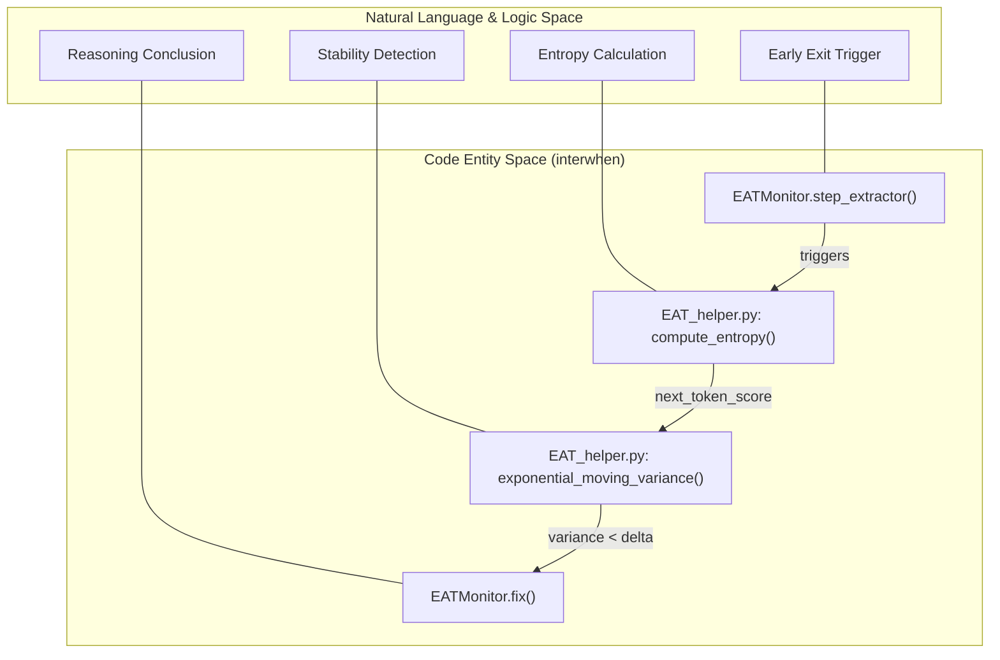
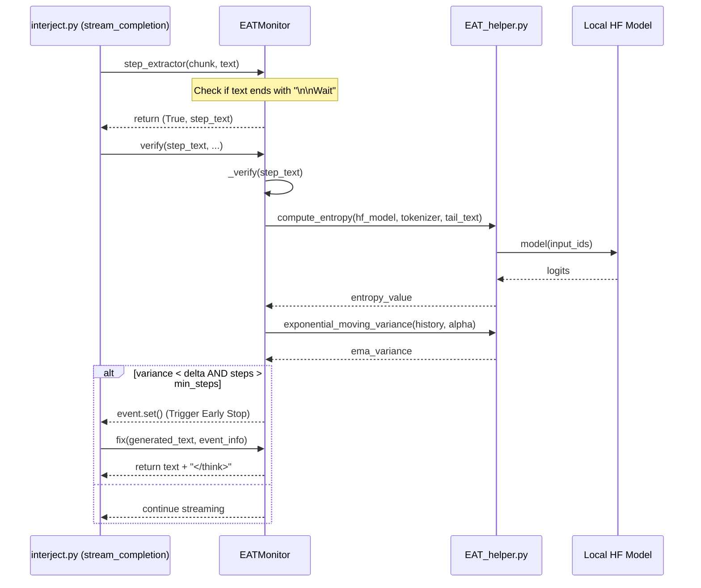

<!-- source: DeepWiki mcp.deepwiki.com · repo microsoft/interwhen · page 3.1 EATMonitor — Entropy After Think · fetched 2026-10-26 -->

# EATMonitor — Entropy After Think

<details>
<summary>Relevant source files</summary>

The following files were used as context for generating this wiki page:

- [examples/EarlyStopping/README.md](examples/EarlyStopping/README.md)
- [examples/TTSwithVerification/README.md](examples/TTSwithVerification/README.md)
- [interwhen/monitors/earlyStopping.py](interwhen/monitors/earlyStopping.py)
- [interwhen/utils/DEER_helper.py](interwhen/utils/DEER_helper.py)
- [interwhen/utils/EAT_helper.py](interwhen/utils/EAT_helper.py)

</details>


The `EATMonitor` (Entropy After Think) is an early-stopping monitor designed to reduce inference costs by detecting when a reasoning model has reached sufficient internal stability to provide an answer. It analyzes the entropy of the next token at specific boundaries and terminates the reasoning phase by injecting a `</think>` token when uncertainty stabilizes.

## Overview and Purpose

`EATMonitor` operates on the principle that as a model reasons, its uncertainty regarding the final answer fluctuates. By monitoring the **Exponential Moving Variance (EMV)** of the next-token entropy, the system can identify "plateaus" in reasoning where additional tokens are unlikely to change the final outcome [examples/EarlyStopping/README.md:23-26]().

Key features include:
*   **Local Entropy Computation**: Uses a local HuggingFace model to compute logits and entropy, avoiding extra network round-trips for probing [interwhen/monitors/earlyStopping.py:29-34]().
*   **Wait-Step Trigger**: Specifically triggers whenever the string `\n\nWait` is detected in the stream [interwhen/monitors/earlyStopping.py:111-112]().
*   **Statistical Guardrails**: Employs a `min_steps` guard to prevent premature termination before the model has performed sufficient initial reasoning [interwhen/monitors/earlyStopping.py:64-65]().

Sources: [examples/EarlyStopping/README.md:23-38](), [interwhen/monitors/earlyStopping.py:11-27]()

## Architecture and Data Flow

The `EATMonitor` integrates into the `stream_completion` loop as a `VerifyMonitor`. It intercepts the stream at specific "Wait" tokens and uses a secondary local model to evaluate the state of the reasoning trace.

### System Components to Code Entities
The following diagram maps the logical components of the Entropy After Think strategy to their specific implementations in the `interwhen` codebase.

**Logic to Code Mapping**

Sources: [interwhen/utils/EAT_helper.py:146-175](), [interwhen/monitors/earlyStopping.py:101-114](), [interwhen/monitors/earlyStopping.py:93-99]()

### Detailed Execution Flow
The monitor follows a specific sequence of operations during the streaming process:

1.  **Step Extraction**: The `step_extractor` looks for the `\n\nWait` suffix in the generated text [interwhen/monitors/earlyStopping.py:111-112]().
2.  **Context Preparation**: It appends a standardized tail (`\n\n</think>\n\nFinal answer is \boxed{`) to the current reasoning trace to simulate the transition to an answer [interwhen/monitors/earlyStopping.py:49-54]().
3.  **Entropy Probing**: The `hf_model` computes the entropy of the next token following this simulated tail [interwhen/utils/EAT_helper.py:165-167]().
4.  **Statistical Analysis**: The new entropy value is added to a history used to calculate the Exponential Moving Average (EMA) and EMV [interwhen/monitors/earlyStopping.py:57-61]().
5.  **Termination**: If `len(entropy) >= min_steps` and `ema_variance < delta`, the monitor signals an intervention by setting the `asyncio.Event` [interwhen/monitors/earlyStopping.py:68-73]().

Sources: [interwhen/monitors/earlyStopping.py:42-73](), [interwhen/monitors/earlyStopping.py:101-114]()

## Implementation Details

### EATMonitor Class
Defined in `interwhen/monitors/earlyStopping.py`, this class manages the local model lifecycle and the statistical state.

| Parameter | Type | Default | Description |
| :--- | :--- | :--- | :--- |
| `model_name` | `str` | — | The HuggingFace model path used for local logit computation [interwhen/monitors/earlyStopping.py:22]() |
| `alpha` | `float` | `0.2` | Smoothing factor for the EMA/EMV calculations [interwhen/monitors/earlyStopping.py:23]() |
| `delta` | `float` | `0.0001` | The variance threshold. Lower means more conservative stopping [interwhen/monitors/earlyStopping.py:24]() |
| `min_steps` | `int` | `4` | Minimum `\n\nWait` tokens required before stopping is possible [interwhen/monitors/earlyStopping.py:25]() |

Sources: [interwhen/monitors/earlyStopping.py:11-40]()

### EAT_helper.py Utilities
The helper file provides optimized numerical functions for entropy and moving statistics.

*   **`compute_entropy`**: Performs a forward pass on the local model (with `torch.no_grad()`) to get logits for the last token and applies a custom `numpy_softmax` before calculating Shannon entropy [interwhen/utils/EAT_helper.py:146-175]().
*   **`exponential_moving_variance`**: Computes the variance of the entropy sequence using the smoothing factor `alpha`. It determines if the model's "confidence" (as measured by entropy) has flattened [interwhen/utils/EAT_helper.py:206-218]().
*   **`numpy_softmax`**: A numerically stable softmax implementation using double precision (`np.float64`) and max-subtraction to prevent overflow [interwhen/utils/EAT_helper.py:20-27]().

Sources: [interwhen/utils/EAT_helper.py:20-27](), [interwhen/utils/EAT_helper.py:146-175](), [interwhen/utils/EAT_helper.py:206-218]()

## The Fix Mechanism
When the variance threshold is met, the `fix()` method is called by the interjection loop. 

```python
async def fix(self, generated_text, event_info, fix_method=None):
    fixed_text = generated_text[:event_info['correction_index']] + "\n\n</think>"
    return fixed_text
```
[interwhen/monitors/earlyStopping.py:93-99]()

This mechanism effectively "cuts off" the model's reasoning at the last valid step and forces the start of the answer phase by appending the `</think>` tag. Because the `stream_completion` loop is recursive, the model will resume generation immediately after the injected `</think>` token to provide the final answer.

Sources: [interwhen/monitors/earlyStopping.py:93-99](), [interwhen/monitors/earlyStopping.py:166-172]() (Note: DEER uses a similar pattern).

## Sequence Diagram: Entropy Probing Loop

This diagram illustrates the interaction between the `interject.py` streaming loop and the `EATMonitor` during a "Wait" step.

**Interjection and Probing Sequence**

Sources: [interwhen/monitors/earlyStopping.py:42-91](), [interwhen/monitors/earlyStopping.py:101-114](), [interwhen/utils/EAT_helper.py:146-175]()

---

