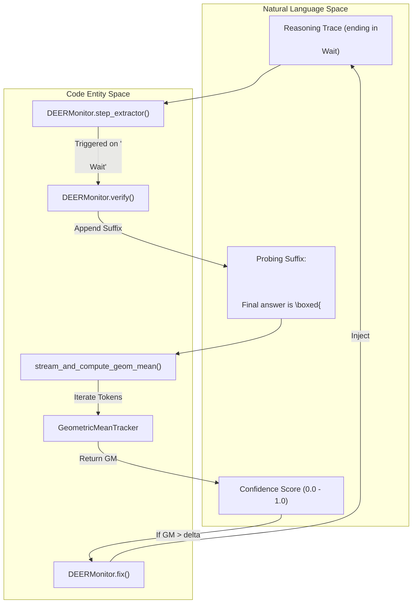
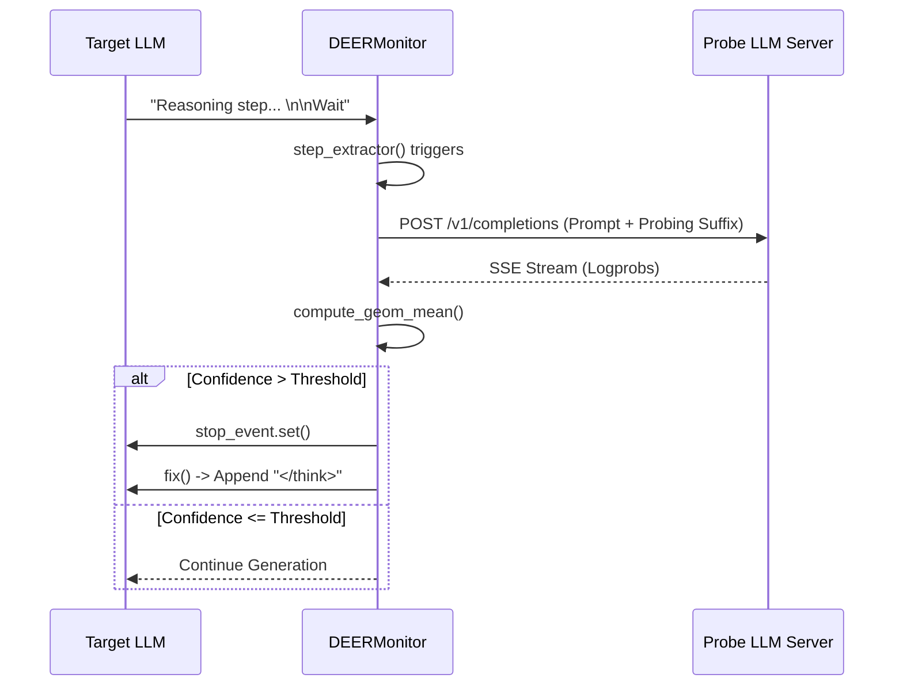

<!-- source: DeepWiki mcp.deepwiki.com · repo microsoft/interwhen · page 3.2 DEERMonitor — Dynamic Early Exit in Reasoning · fetched 2026-10-26 -->

# DEERMonitor — Dynamic Early Exit in Reasoning

Relevant source files

The following files were used as context for generating this wiki page:

- [examples/EarlyStopping/README.md](examples/EarlyStopping/README.md)
- [examples/TTSwithVerification/README.md](examples/TTSwithVerification/README.md)
- [interwhen/monitors/earlyStopping.py](interwhen/monitors/earlyStopping.py)
- [interwhen/utils/DEER_helper.py](interwhen/utils/DEER_helper.py)
- [interwhen/utils/EAT_helper.py](interwhen/utils/EAT_helper.py)

The **DEERMonitor** (Dynamic Early Exit in Reasoning) is an early-stopping monitor designed to reduce inference costs and latency by detecting when a model has reached sufficient internal confidence to produce an answer [examples/EarlyStopping/README.md:55-57](). Unlike the **EATMonitor**, which uses local entropy calculations, **DEERMonitor** probes the model's confidence by simulating an answer and computing the geometric mean of token probabilities via a remote LLM server [interwhen/monitors/earlyStopping.py:121-123]().

## Overview and Implementation

The DEERMonitor operates on the principle of **confidence probing**. At specific trigger points in the reasoning trace (identified by the `\n\nWait` token), the monitor temporarily halts the primary generation, appends an answer-forcing suffix, and queries an auxiliary model to see how "certain" it is about the final result [interwhen/monitors/earlyStopping.py:138-141]().

### Geometric Mean Confidence Probing

The core metric for DEER is the **Geometric Mean Confidence**. This is calculated by taking the log-probabilities of the predicted tokens and converting them back to a normalized probability space [interwhen/utils/DEER_helper.py:10-26]().

*   **GeometricMeanTracker**: A utility class that maintains a running sum of log-probabilities to compute the geometric mean without numerical underflow [interwhen/utils/DEER_helper.py:10-26]().
*   **Confidence Calculation**: $GM = \exp(\frac{1}{N} \sum_{i=1}^{N} \ln(p_i))$, where $p_i$ is the probability of the $i$-th token [interwhen/utils/DEER_helper.py:22-26]().

### Data Flow Diagram: Confidence Probing Loop

This diagram illustrates how the `DEERMonitor` interacts with the `llm_server` to determine if generation should exit early.

**Sources:** [interwhen/monitors/earlyStopping.py:132-184](), [interwhen/utils/DEER_helper.py:10-51]()

## Key Components and Functions

### DEERMonitor Class
Defined in `interwhen/monitors/earlyStopping.py`, this class inherits from `VerifyMonitor` and manages the early exit state [interwhen/monitors/earlyStopping.py:117-123]().

| Attribute | Description |
| :--- | :--- |
| `llm_server` | Configuration dictionary containing the `url`, `headers`, and `payload` for the remote confidence probe [interwhen/monitors/earlyStopping.py:125](). |
| `delta` | The confidence threshold (default `0.995`). If the geometric mean exceeds this, the monitor triggers an early exit [interwhen/monitors/earlyStopping.py:126, 144-145](). |
| `answer_start_token` | The token used to identify the end of reasoning, usually `</think>` [interwhen/monitors/earlyStopping.py:129](). |

### Geometric Mean Tracking (`DEER_helper.py`)
The helper file provides the logic for extracting probabilities from the LLM server's SSE (Server-Sent Events) stream.

*   **`extract_max_prob(token_json)`**: Extracts the highest log-probability from the `top_logprobs` provided by the server and converts it to a normal probability [interwhen/utils/DEER_helper.py:5-8]().
*   **`stream_and_compute_geom_mean(llm_server)`**: Opens a streaming connection to the probe model. It appends tokens until a termination character (like `.`) is reached, updating the `GeometricMeanTracker` at each step [interwhen/utils/DEER_helper.py:28-51]().

## Comparison: DEER vs. EAT

While both monitors provide early stopping, their mechanisms for determining "readiness" differ significantly:

| Feature | EAT (Entropy After Think) | DEER (Dynamic Early Exit) |
| :--- | :--- | :--- |
| **Metric** | Variance of next-token entropy [interwhen/monitors/earlyStopping.py:15-16]() | Geometric mean of answer token probabilities [interwhen/monitors/earlyStopping.py:121]() |
| **Compute Location** | Local (requires HuggingFace model in memory) [interwhen/monitors/earlyStopping.py:30-34]() | Remote (queries an external LLM server) [interwhen/monitors/earlyStopping.py:125]() |
| **Trigger Point** | Every `\n\nWait` boundary [interwhen/monitors/earlyStopping.py:103]() | Every `\n\nWait` boundary [interwhen/monitors/earlyStopping.py:176]() |
| **Stop Condition** | `ema_variance < delta` [interwhen/monitors/earlyStopping.py:68]() | `confidence > delta` [interwhen/monitors/earlyStopping.py:144]() |

**Sources:** [interwhen/monitors/earlyStopping.py:11-184](), [examples/EarlyStopping/README.md:23-81]()

## Execution Logic

### Step Extraction
The `step_extractor` monitors the stream for the string `\n\nWait`. When found, it strips the wait token and passes the preceding reasoning trace to the verification logic [interwhen/monitors/earlyStopping.py:182-183](). If the `answer_start_token` (e.g., `</think>`) is already present in the text, extraction is disabled to prevent redundant probing during the final answer phase [interwhen/monitors/earlyStopping.py:179-180]().

### Verification and Feedback
The `_verify` method performs the following:
1.  Constructs a `partial_answer` prompt by appending `\n\n</think>\n\nFinal answer is \boxed{` to the current reasoning [interwhen/monitors/earlyStopping.py:139]().
2.  Calls `stream_and_compute_geom_mean` using the auxiliary `llm_server` [interwhen/monitors/earlyStopping.py:141]().
3.  If the resulting confidence is above `delta`, it returns `False` (invalid), which signals the `interwhen` loop to stop the current generation [interwhen/monitors/earlyStopping.py:144-145]().

### Correction (The Exit)
When the exit condition is met, the `fix` method is called. It truncates the generated text at the point where the `\n\nWait` was detected and appends the `</think>` token [interwhen/monitors/earlyStopping.py:171](). This effectively forces the model to transition from the "Thinking" phase to the "Answer" phase immediately [interwhen/monitors/earlyStopping.py:168]().

**Sources:** [interwhen/monitors/earlyStopping.py:132-184](), [interwhen/utils/DEER_helper.py:28-51](), [examples/EarlyStopping/README.md:55-81]()

---

