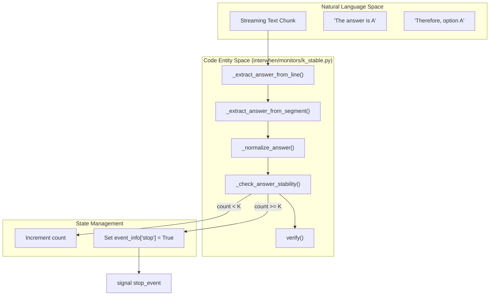
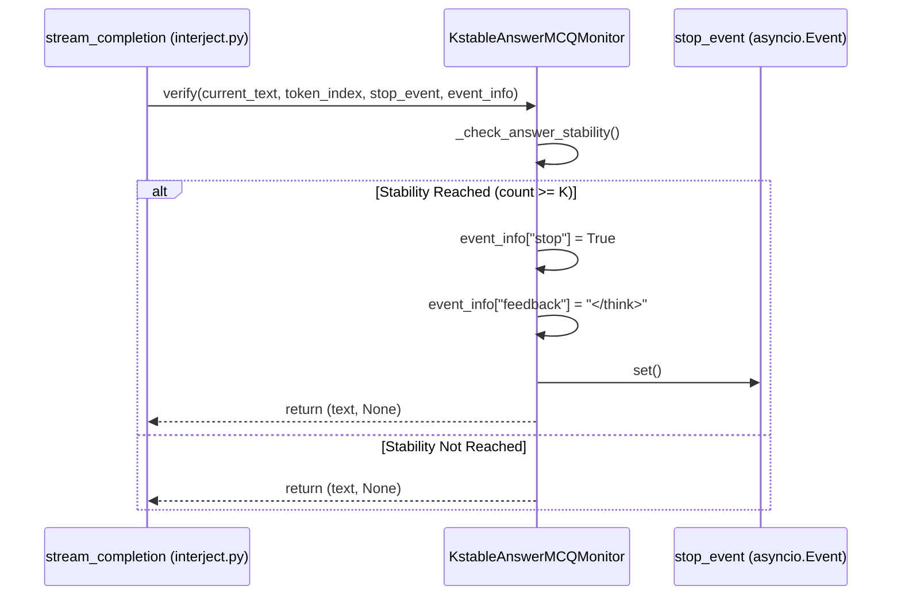

<!-- source: DeepWiki mcp.deepwiki.com · repo microsoft/interwhen · page 3.3 K-Stable Monitors · fetched 2026-10-26 -->

# K-Stable Monitors

<details>
<summary>Relevant source files</summary>

The following files were used as context for generating this wiki page:

- [examples/EarlyStopping/game24_example.py](examples/EarlyStopping/game24_example.py)
- [examples/EarlyStopping/maze_example.py](examples/EarlyStopping/maze_example.py)
- [interwhen/monitors/k_stable.py](interwhen/monitors/k_stable.py)

</details>


K-Stable monitors are a family of early-stopping mechanisms designed to detect when a model's reasoning has converged on a consistent answer before it reaches the maximum token limit or natural termination. By monitoring the "stability" of the generated output—specifically the recurrence of a normalized answer $K$ consecutive times—these monitors can trigger an early exit from the reasoning phase, significantly reducing token consumption while maintaining accuracy.

Sources: [interwhen/monitors/k_stable.py:8-14](), [interwhen/monitors/k_stable.py:205-212]()

## Architecture and Data Flow

K-Stable monitors operate within the `stream_completion` loop. Unlike step verifiers that inject feedback for correction, K-Stable monitors use the `VerifyMonitor` interface to signal a stop event once the stability criterion is met.

### Logic Flow Diagram

The following diagram illustrates how the `KstableAnswerMCQMonitor` processes streaming text to identify stable answers.

"K-Stable MCQ Logic Flow"

Sources: [interwhen/monitors/k_stable.py:145-176](), [interwhen/monitors/k_stable.py:194-218]()

## Answer Normalization and Negation Detection

A critical component of the K-stable logic is ensuring that the monitor is not fooled by the model merely restating the problem or expressing uncertainty.

### Negation Detection
The monitor checks for `NEGATION_WORDS` such as "not", "isn't", "cannot", or "never" [interwhen/monitors/k_stable.py:4-5](). If a segment containing the keyword "answer" also contains a negation, the monitor ignores that line to avoid stabilizing on a rejected hypothesis [interwhen/monitors/k_stable.py:80-82]().

### Answer Normalization
The `_normalize_answer` function maps various string representations to a canonical form using the provided `options` dictionary [interwhen/monitors/k_stable.py:49-74]():
*   **Pattern Matching**: Detects formats like "A.2" or "C.0" [interwhen/monitors/k_stable.py:55-58]().
*   **Dictionary Lookup**: Maps "A" to its corresponding value (e.g., "Yes") or vice versa [interwhen/monitors/k_stable.py:61-68]().
*   **Cleaning**: Strips quotes, whitespace, and handles case-insensitivity [interwhen/monitors/k_stable.py:51-52]().

Sources: [interwhen/monitors/k_stable.py:30-33](), [interwhen/monitors/k_stable.py:49-74]()

## Monitor Variants

### KstableAnswerMCQMonitor
Designed for Multiple Choice Questions. It requires an `options` dictionary to resolve letter choices to values.

*   **`options`**: A map such as `{"A": "Yes", "B": "No"}` [interwhen/monitors/k_stable.py:21]().
*   **`answer_start_token`**: Defaults to `</think>`, allowing the monitor to ignore initial brainstorming and focus on the concluding reasoning phase [interwhen/monitors/k_stable.py:22]().
*   **`_contains_all_options`**: A safety check that prevents the monitor from triggering if the model is simply listing all possible choices (restating the prompt) [interwhen/monitors/k_stable.py:35-47]().

### KstableAnswerGame24Monitor
Specialized for the Game of 24, where the "answer" is a mathematical expression rather than a fixed MCQ option.

*   **Expression Extraction**: Uses `extract_solution` (similar to the utility in `game24_example.py`) to parse LaTeX and Unicode math operators into standard Python-evaluable strings [examples/EarlyStopping/game24_example.py:115-185]().
*   **Stability Check**: Compares the mathematical result of the expressions across $K$ occurrences [interwhen/monitors/k_stable.py:246-270]().

Sources: [interwhen/monitors/k_stable.py:16-28](), [interwhen/monitors/k_stable.py:205-220]()

## Integration with Streaming Loop

The K-stable monitors are passed into `stream_completion` via the `monitors` list. During execution, the monitor's `verify` method is called periodically.

"Integration with interject.py"


### Key Parameters
| Parameter | Description | File Reference |
| :--- | :--- | :--- |
| `k` | Number of consecutive identical answers required to stop. | [interwhen/monitors/k_stable.py:25]() |
| `event_info["stop"]` | Boolean flag used to signal the outer loop to break. | [interwhen/monitors/k_stable.py:206]() |
| `event_info["feedback"]` | In K-stable, this is often set to `</think>` to force-close the reasoning block. | [interwhen/monitors/k_stable.py:203]() |

Sources: [interwhen/monitors/k_stable.py:194-212](), [interwhen/interject.py:116-125]()

## Usage Example

In the `maze_example.py` script, the `KstableAnswerMCQMonitor` is initialized to watch for the same MCQ choice appearing 3 times consecutively:

```python
# From examples/EarlyStopping/maze_example.py
monitor = KstableAnswerMCQMonitor(
    name="Kstable", 
    k=3, 
    options={"A": "...", "B": "...", "C": "...", "D": "..."}
)
```
The monitor will scan the streaming reasoning trace for lines containing "answer" (case-insensitive), normalize the found choice, and trigger an early exit once the internal counter hits 3.

Sources: [examples/EarlyStopping/maze_example.py:15-16](), [interwhen/monitors/k_stable.py:16-28]()

---

