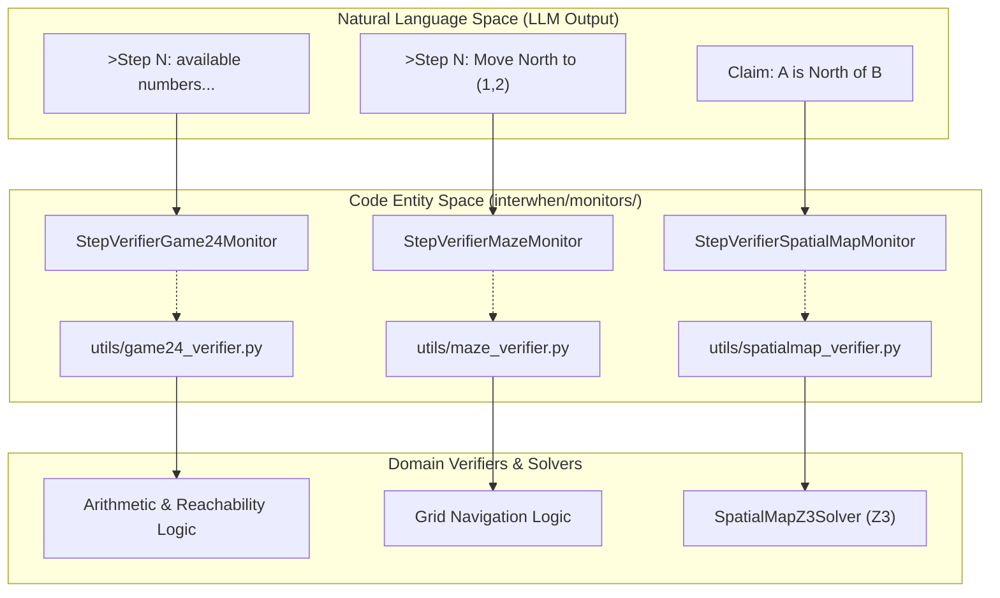
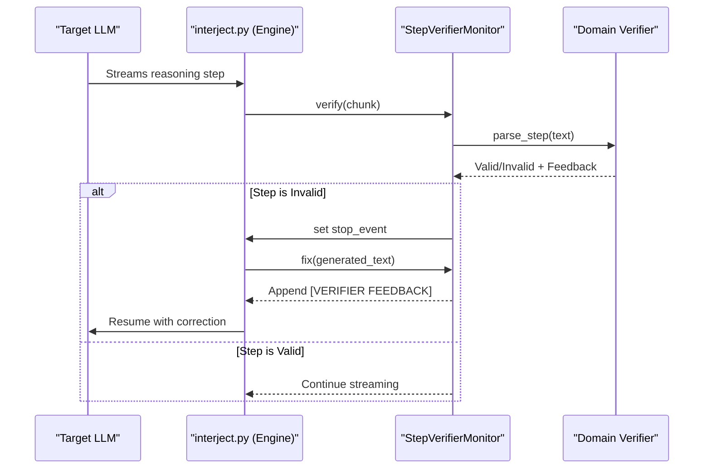

<!-- source: DeepWiki mcp.deepwiki.com · repo microsoft/interwhen · page 4 Step Verification Monitors · fetched 2026-10-26 -->

# Step Verification Monitors

Relevant source files

The following files were used as context for generating this wiki page:

- [examples/EarlyStopping/README.md](examples/EarlyStopping/README.md)
- [examples/TTSwithVerification/README.md](examples/TTSwithVerification/README.md)
- [interwhen/monitors/__init__.py](interwhen/monitors/__init__.py)
- [interwhen/monitors/stepVerifier.py](interwhen/monitors/stepVerifier.py)

Step Verification Monitors provide a real-time, closed-loop feedback mechanism for reasoning models. Unlike early stopping monitors that only determine when to terminate generation, step verifiers actively parse the model's intermediate reasoning steps, validate them against domain-specific ground truths (such as physics engines, math verifiers, or formal logic solvers), and inject corrective feedback directly into the context window if an error is detected [examples/TTSwithVerification/README.md:1-6]().

## System Architecture

The verification system operates within the `stream_completion` loop. When a monitor identifies a completed reasoning step, it triggers a domain-specific verifier. If the step is invalid, the monitor halts the current generation and appends a `[VERIFIER FEEDBACK]` block, prompting the model to reconsider its last step [interwhen/monitors/stepVerifier.py:167-172]().

### From Natural Language to Code Entities

The following diagram illustrates how natural language reasoning steps are mapped to internal verification logic and state management classes.

**Reasoning to Verification Mapping**

Sources: [interwhen/monitors/stepVerifier.py:25-151](), [interwhen/monitors/__init__.py:3-8]()

## Core Components

### Step Parsing and State Recovery
Most step verifiers are designed to be stateless relative to the class instance; they reconstruct the problem state by parsing the `generated_text` history. For example, `StepVerifierGame24Monitor` scans previous valid steps to determine which numbers are currently available for the step being verified [interwhen/monitors/stepVerifier.py:43-57]().

### Thinking-Phase Variants
The library supports "Thinking-Phase" variants for models like DeepSeek-R1 that use `<think>` tags. These monitors (e.g., `ThinkingPhaseStepVerifierGame24Monitor`) operate inside the reasoning block and typically trigger verification on specific delimiters like `\n\nWait` or `\n\nStep` [interwhen/monitors/__init__.py:5-7]().

### Feedback Injection
When a `VerifyMonitor` detects an error, it calls `format_feedback` to generate a structured string. This string is appended to the prompt, and the `fix()` method is used to steer the model back to the last valid state [interwhen/monitors/stepVerifier.py:167-172]().

**Verification Flow**

Sources: [interwhen/monitors/stepVerifier.py:167-200](), [examples/TTSwithVerification/README.md:25-28]()

## Domain-Specific Verifiers

The system includes specialized monitors for different reasoning domains:

| Monitor Class | Domain | Verification Logic |
| :--- | :--- | :--- |
| `StepVerifierGame24Monitor` | Arithmetic | Validates operations and remaining numbers using exhaustive search [Game of 24 Verifier](#4.1). |
| `StepVerifierMazeMonitor` | Navigation | Checks walkability, turn types, and position coordinates against a grid [Maze Verifier](#4.2). |
| `StepVerifierSpatialMapMonitor` | Spatial Logic | Compiles directional claims into Z3 constraints to check for contradictions [Spatial Map Verifier (Z3-based)](#4.3). |
| `ZebraLogicMonitor` | Constraint Satisfaction | Parses house assignments into IR and uses Z3 to verify logical consistency [ZebraLogic Verifier](#4.4). |

---

## Child Pages

*   **[Game of 24 Verifier](#4.1)**: Arithmetic validation, `can_reach_24` search, and floating-point tolerance.
*   **[Maze Verifier](#4.2)**: Grid parsing, movement validation, and turn-count tracking.
*   **[Spatial Map Verifier (Z3-based)](#4.3)**: Diagonal coordinate systems and Z3-based entailment checking.
*   **[ZebraLogic Verifier](#4.4)**: Shadow LLM state extraction and house-assignment logic.

Sources: [interwhen/monitors/__init__.py:3-10](), [examples/TTSwithVerification/README.md:1-172]()

---

