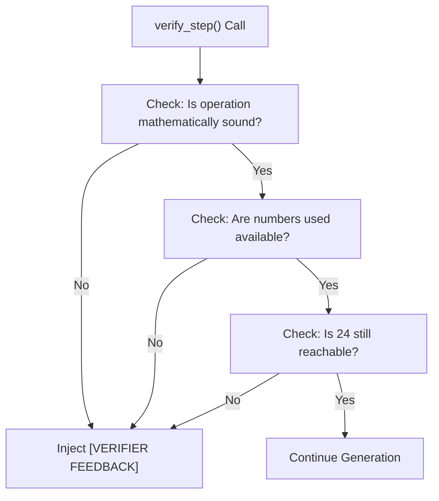

<!-- source: DeepWiki mcp.deepwiki.com · repo microsoft/interwhen · page 4.1 Game of 24 Verifier · fetched 2026-10-26 -->

# Game of 24 Verifier

Relevant source files

The following files were used as context for generating this wiki page:

- [examples/TTSwithVerification/interwhen/game24_example.py](examples/TTSwithVerification/interwhen/game24_example.py)
- [interwhen/monitors/stepVerifier.py](interwhen/monitors/stepVerifier.py)
- [interwhen/monitors/thinkingPhaseVerifierGame24.py](interwhen/monitors/thinkingPhaseVerifierGame24.py)
- [interwhen/utils/game24_verifier.py](interwhen/utils/game24_verifier.py)
- [interwhen/utils/spatialmap_verifier.py](interwhen/utils/spatialmap_verifier.py)

The Game of 24 Verifier is a specialized subsystem designed to monitor, validate, and guide Large Language Models (LLMs) as they solve arithmetic puzzles. It ensures that the model adheres to the rules of the game: using four given numbers exactly once with basic arithmetic operators to reach a total of 24.

The system supports two primary modes of operation:
1.  **Step-by-Step Verification**: Validates explicit reasoning steps (available numbers, operation, remaining numbers) as they are generated.
2.  **Thinking-Phase Verification**: Periodically probes the model's internal reasoning during ` The expression that I found till now is {` `[interwhen/monitors/thinkingPhaseVerifierGame24.py:44-46]()`.
- It captures the model's completion to extract a candidate expression.
- If the expression is a **dead end** (cannot reach 24), it injects feedback directly into the thinking trace to force the model to pivot `[interwhen/monitors/thinkingPhaseVerifierGame24.py:13-14]()`.

### Dead-End Detection (Exhaustive Search)
The function `can_reach_24` (and its helpers `can_reach_24_from_two/three/four`) performs an exhaustive search of all possible expression trees using the remaining numbers `[interwhen/utils/game24_verifier.py:54-210]()`.

| Numbers Remaining | Possible Combinations (approx) | Implementation |
| :--- | :--- | :--- |
| 2 | 8 | `can_reach_24_from_two` |
| 3 | 192 | `can_reach_24_from_three` |
| 4 | 7,680 | `can_reach_24_from_four` |

If the search returns `False`, the monitor informs the model that its current path is a dead end `[interwhen/utils/game24_verifier.py:383-390]()`.

**Sources:** `interwhen/monitors/thinkingPhaseVerifierGame24.py:9-21`(), `interwhen/utils/game24_verifier.py:148-162`()

## Feedback Injection

When a step is invalid, the verifier generates a `[VERIFIER FEEDBACK]` block.

### Feedback Logic Flow
The monitor uses `format_feedback` to construct natural language corrections.

### Final Answer Extraction
After the reasoning is complete, `extract_solution` (found in example utilities) cleans LaTeX formatting:
- Converts `\frac{a}{b}` to `(a/b)` `[examples/TTSwithVerification/interwhen/game24_example.py:159-161]()`.
- Replaces LaTeX symbols like `\times` and `\div` with `*` and `/` `[examples/TTSwithVerification/interwhen/game24_example.py:164-171]()`.
- Normalizes Unicode dashes and multiplication signs used by models like QwQ `[examples/TTSwithVerification/interwhen/game24_example.py:173-174]()`.

**Sources:** `interwhen/utils/game24_verifier.py:408-450`(), `examples/TTSwithVerification/interwhen/game24_example.py:119-189`()

---

