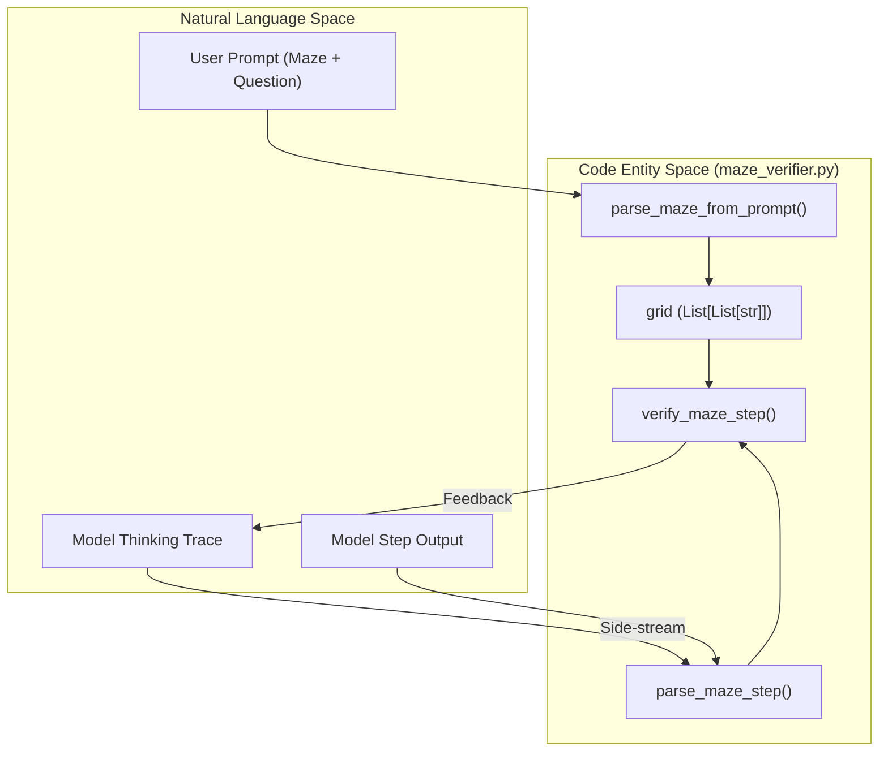
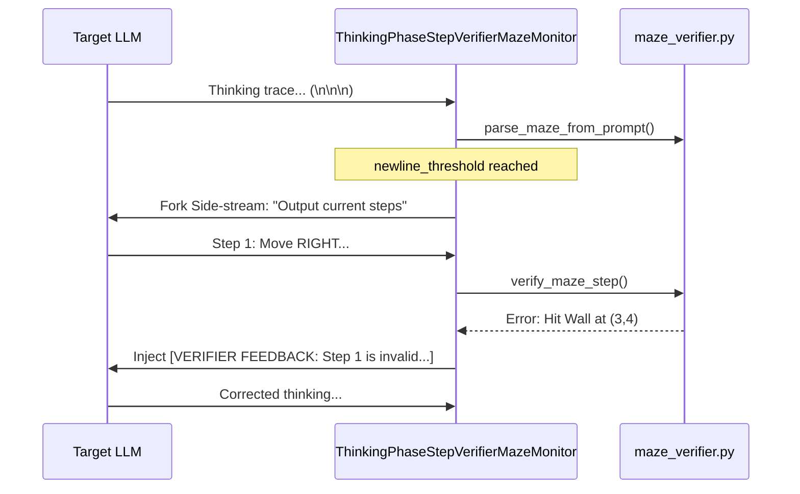

<!-- source: DeepWiki mcp.deepwiki.com · repo microsoft/interwhen · page 4.2 Maze Verifier · fetched 2026-10-26 -->

# Maze Verifier

Relevant source files

The following files were used as context for generating this wiki page:

- [examples/TTSwithVerification/interwhen/maze_example.py](examples/TTSwithVerification/interwhen/maze_example.py)
- [interwhen/monitors/stepVerifier.py](interwhen/monitors/stepVerifier.py)
- [interwhen/monitors/thinkingPhaseVerifierMaze.py](interwhen/monitors/thinkingPhaseVerifierMaze.py)
- [interwhen/utils/maze_verifier.py](interwhen/utils/maze_verifier.py)

The Maze Verifier provides a real-time validation system for Large Language Models (LLMs) solving grid-based navigation problems. It ensures that the model's reasoning trace—whether during a thinking phase or a structured output phase—adheres to the physical constraints of the maze grid, correctly identifies turn types, and maintains accurate running counts of movements.

## Overview

The system is implemented across two primary layers:
1.  **`maze_verifier.py`**: A stateless utility module that handles grid parsing, movement logic, turn-type rules, and individual step validation [interwhen/utils/maze_verifier.py:1-10]().
2.  **Monitor Classes**: State-aware classes in `stepVerifier.py` and `thinkingPhaseVerifierMaze.py` that interface with the `stream_completion` loop to inject feedback or structured templates [interwhen/monitors/thinkingPhaseVerifierMaze.py:134-155]().

### Maze Representation and Detection
The verifier represents the maze as a 2D grid where `#` denotes walls, ` ` (space) or `X` denotes walkable paths, `S` is the starting position, and `E` is the exit [interwhen/utils/maze_verifier.py:148-184]().

The `from_prompt` factory logic (specifically `parse_maze_from_prompt`) extracts the maze grid directly from the input prompt by scanning for lines composed of valid maze characters [interwhen/utils/maze_verifier.py:133-142](). It specifically targets the **last** maze found in the prompt to ensure it validates the correct problem instance [interwhen/utils/maze_verifier.py:172-173]().

### Question Types
The verifier supports three distinct question types, which determine the validation logic for running counts and the structure of the injected templates:
*   **`right_turns`**: Validates the count of 90-degree right turns [interwhen/monitors/thinkingPhaseVerifierMaze.py:165]().
*   **`total_turns`**: Validates the sum of both left and right turns [interwhen/monitors/thinkingPhaseVerifierMaze.py:173]().
*   **`relative_position`**: Validates the spatial relationship (Above/Below/Left/Right) between the Start and Exit [interwhen/monitors/thinkingPhaseVerifierMaze.py:55-68]().

---

## Technical Architecture

The following diagram illustrates how natural language prompts and model outputs are transformed into structured verification data.

### Diagram: From Prompt to Verification State
| Phase | Entity | Role |
| :--- | :--- | :--- |
| **Parsing** | `parse_maze_from_prompt` | Extracts `grid`, `start_pos`, and `exit_pos` from the raw prompt [interwhen/utils/maze_verifier.py:133-135](). |
| **Detection** | `question_type` | Identified via CLI or prompt analysis to set `newline_threshold` and template [interwhen/monitors/thinkingPhaseVerifierMaze.py:178-179](). |
| **Extraction** | `parse_maze_step` | Uses Regex to convert LLM text into a `dict` containing `from_pos`, `to_pos`, and `direction` [interwhen/utils/maze_verifier.py:187-217](). |
| **Validation** | `verify_maze_step` | Compares parsed step against `DIRECTION_DELTAS` and `grid` [interwhen/utils/maze_verifier.py:34-39](). |

*Sources: [interwhen/utils/maze_verifier.py:133-184](), [interwhen/utils/maze_verifier.py:187-217](), [interwhen/monitors/thinkingPhaseVerifierMaze.py:143-155]()*

---

## Implementation Details

### Movement and Turn Validation
Movement is validated by applying `DIRECTION_DELTAS` to the `from_pos` and checking if the resulting `to_pos` matches the model's claim and is not a wall (`#`) in the `grid` [interwhen/utils/maze_verifier.py:41-46]().

Turn types are determined by comparing the `prev_dir` and `curr_dir`. The verifier uses hardcoded sets to define these transitions:
*   **Right Turns**: `(UP, RIGHT)`, `(RIGHT, DOWN)`, `(DOWN, LEFT)`, `(LEFT, UP)` [interwhen/utils/maze_verifier.py:26-31]().
*   **Left Turns**: `(UP, LEFT)`, `(LEFT, DOWN)`, `(DOWN, RIGHT)`, `(RIGHT, UP)` [interwhen/utils/maze_verifier.py:33-38]().

### ThinkingPhaseStepVerifierMazeMonitor
This monitor implements a dual-phase verification strategy [interwhen/monitors/thinkingPhaseVerifierMaze.py:7-22]():

1.  **Thinking Phase (Phase 1)**: Every `N` newlines (defined by `newline_threshold`), the monitor forks a side-stream to ask the model to summarize its current path in a structured format [interwhen/monitors/thinkingPhaseVerifierMaze.py:143-147](). If errors are found, feedback is injected directly into the `` tag, the monitor injects a `_structured_prompt` (a template) that forces the model to output steps in a parsable format [interwhen/monitors/thinkingPhaseVerifierMaze.py:186-191]().

### Diagram: Monitor Control Flow

*Sources: [interwhen/monitors/thinkingPhaseVerifierMaze.py:134-155](), [interwhen/utils/maze_verifier.py:187-217]()*

---

## Feedback and Correction

When a step fails validation, the `format_maze_feedback` function generates a structured error message. This message is injected into the stream to trigger the model's recursive correction logic [interwhen/utils/maze_verifier.py:9]().

### Validation Checks
| Check | Logic | Error Message Example |
| :--- | :--- | :--- |
| **Position Continuity** | `from_pos` must match previous `to_pos`. | "Step N: from_pos (r,c) does not match expected (r,c)" |
| **Wall Collision** | `grid[r][c]` must not be `#`. | "Step N: to_pos (r,c) is a WALL" |
| **Direction Logic** | `to_pos` must be `from_pos` + `delta(dir)`. | "Step N: Move DIR from (r1,c1) leads to (r2,c2), not (r3,c3)" |
| **Turn Type** | `claimed_turn` must match `get_expected_turn_type`. | "Step N: Turn type should be STRAIGHT, not RIGHT_TURN" |
| **Running Count** | `claimed_count` must match internal tracker. | "Step N: Total turns should be X, not Y" |

*Sources: [interwhen/utils/maze_verifier.py:4-9](), [interwhen/utils/maze_verifier.py:187-230](), [interwhen/monitors/thinkingPhaseVerifierMaze.py:34-39]()*

---

