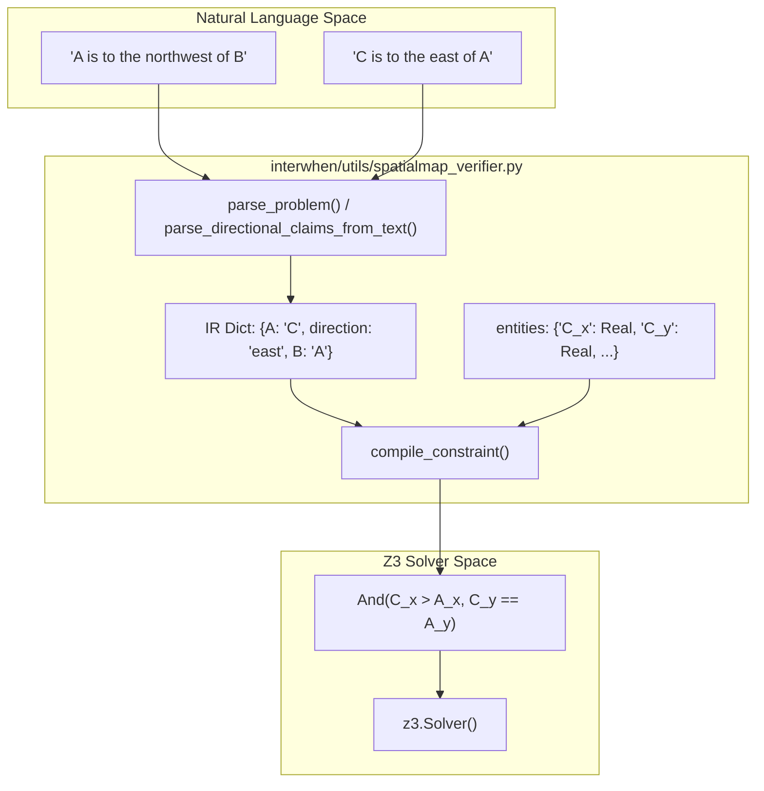
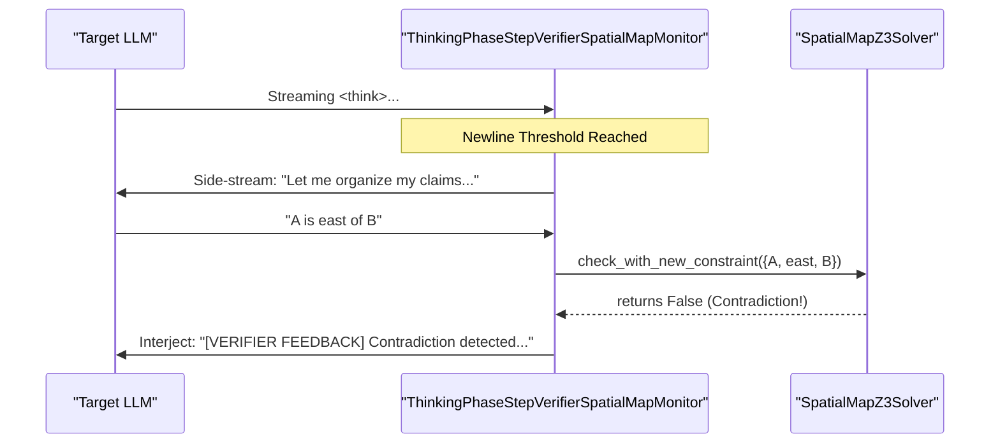

<!-- source: DeepWiki mcp.deepwiki.com · repo microsoft/interwhen · page 4.3 Spatial Map Verifier (Z3-based) · fetched 2026-10-26 -->

# Spatial Map Verifier (Z3-based)

Relevant source files

The following files were used as context for generating this wiki page:

- [examples/TTSwithVerification/interwhen/spatialmap_example.py](examples/TTSwithVerification/interwhen/spatialmap_example.py)
- [interwhen/monitors/stepVerifier.py](interwhen/monitors/stepVerifier.py)
- [interwhen/monitors/thinkingPhaseVerifierSpatialMap.py](interwhen/monitors/thinkingPhaseVerifierSpatialMap.py)
- [interwhen/utils/game24_verifier.py](interwhen/utils/game24_verifier.py)
- [interwhen/utils/spatialmap_verifier.py](interwhen/utils/spatialmap_verifier.py)

The Spatial Map Verifier provides real-time verification of spatial reasoning tasks by translating natural language directional claims into formal logic constraints. It utilizes the **Z3 Theorem Prover** to maintain a consistent geometric model of entities in a 2D coordinate system, allowing the system to detect contradictions in the LLM's reasoning and filter invalid MCQ options.

## Overview and Purpose

The Spatial Map Verifier is implemented primarily in `spatialmap_verifier.py` and integrated into the streaming loop via two specialized monitors: `StepVerifierSpatialMapMonitor` and `ThinkingPhaseStepVerifierSpatialMapMonitor`. 

Its primary goals are:
1.  **Consistency Checking**: Ensure that derived spatial relationships (e.g., "A is northeast of B") do not contradict the initial problem constraints.
2.  **Abbreviation Resolution**: Mapping LLM shorthand (e.g., "PSS") back to full entity names (e.g., "Police Supply Store") to maintain variable integrity in the solver [interwhen/monitors/thinkingPhaseVerifierSpatialMap.py:64-70]().
3.  **MCQ Option Filtering**: Using the solver to determine which MCQ options are logically possible given the known constraints [interwhen/utils/spatialmap_verifier.py:218-220]().

### Coordinate System
The verifier uses a diagonal-biased coordinate system to represent the `SpatialMap` dataset characteristics:
*   **North/Up**: $y$ increases [interwhen/utils/spatialmap_verifier.py:8-8]().
*   **South/Down**: $y$ decreases [interwhen/utils/spatialmap_verifier.py:9-9]().
*   **East/Right**: $x$ increases [interwhen/utils/spatialmap_verifier.py:10-10]().
*   **West/Left**: $x$ decreases [interwhen/utils/spatialmap_verifier.py:11-11]().

Sources: `interwhen/utils/spatialmap_verifier.py:1-12`(), `interwhen/monitors/thinkingPhaseVerifierSpatialMap.py:1-25`()

---

## SpatialMapZ3Solver Implementation

The `SpatialMapZ3Solver` class manages the lifecycle of the Z3 solver instance and the mapping of entities to Z3 `Real` variables.

### Data Flow: Problem to Constraints
The solver follows a pipeline from raw text to satisfiability checks:

1.  **Parsing**: `parse_problem` extracts entities and initial relations from the prompt [interwhen/utils/spatialmap_verifier.py:37-43]().
2.  **Variable Setup**: `setup_vars` creates `_x` and `_y` Z3 `Real` variables for every named entity [interwhen/utils/spatialmap_verifier.py:83-89]().
3.  **IR Compilation**: `compile_constraint` converts an Internal Representation (IR) dictionary into Z3 `BoolRef` objects [interwhen/utils/spatialmap_verifier.py:97-113]().
4.  **Satisfiability**: The solver uses `solver.check() == sat` to validate the state [interwhen/utils/spatialmap_verifier.py:176-177]().

### Constraint Compilation Logic
The verifier handles both cardinal and intercardinal (diagonal) directions. In the SpatialMap dataset, constraints are typically diagonal (e.g., Northwest).

| Direction | Z3 Constraint Logic | Code Reference |
| :--- | :--- | :--- |
| **North** | `A_y > B_y` | [spatialmap_verifier.py:131-132]() |
| **South** | `A_y < B_y` | [spatialmap_verifier.py:133-134]() |
| **East** | `A_x > B_x` | [spatialmap_verifier.py:135-136]() |
| **West** | `A_x < B_x` | [spatialmap_verifier.py:137-138]() |
| **Northwest** | `And(A_y > B_y, A_x < B_x)` | [spatialmap_verifier.py:109-109]() |

**System Architecture: Natural Language to Z3 Logic**

Sources: `interwhen/utils/spatialmap_verifier.py:19-142`()

---

## Verification Monitors

### ThinkingPhaseStepVerifierSpatialMapMonitor
This monitor operates in two distinct phases to provide proactive feedback during the model's internal reasoning.

#### Phase 1: Thinking Interjection
During the `` is detected, the monitor injects a structured format template [interwhen/monitors/thinkingPhaseVerifierSpatialMap.py:124-132](). This forces the model to follow a Step 1 (Parse) -> Step 2 (Analyze) -> Step 3 (Answer) sequence, which the monitor verifies token-by-token.

**Monitor Logic Flow**

Sources: `interwhen/monitors/thinkingPhaseVerifierSpatialMap.py:146-168`(), `interwhen/monitors/thinkingPhaseVerifierSpatialMap.py:56-85`()

---

## Specialized Queries

The verifier supports complex spatial queries beyond simple directional consistency:

### Counting Queries
For questions asking "How many objects are North of X?", the solver implements `count_objects_in_direction` [interwhen/utils/spatialmap_verifier.py:179-181]().
*   **Strict vs. Diagonal**: Since the dataset uses diagonal constraints, no two objects share an axis. The solver checks for `A_y > B_y` for "north" in this context [interwhen/utils/spatialmap_verifier.py:191-195]().
*   **Range Filtering**: `get_possible_count_range` determines the minimum and maximum possible counts consistent with the current constraints to validate the model's numerical answer [interwhen/utils/spatialmap_verifier.py:236-240]().

### MCQ Option Filtering
The function `get_consistent_object_options` iterates through the MCQ options (A, B, C, D) and performs an entailment check [interwhen/utils/spatialmap_verifier.py:218-220]().
1.  For each option, it creates a temporary constraint.
2.  It checks if `Solver.check()` remains `sat`.
3.  If an option is logically impossible, it is excluded from the "Valid Options" feedback provided to the LLM.

Sources: `interwhen/utils/spatialmap_verifier.py:179-245`(), `interwhen/monitors/stepVerifier.py:12-20`()

---

