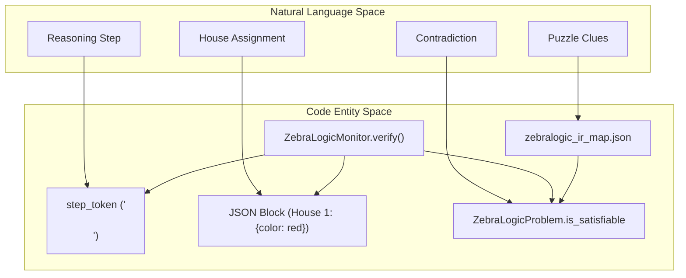
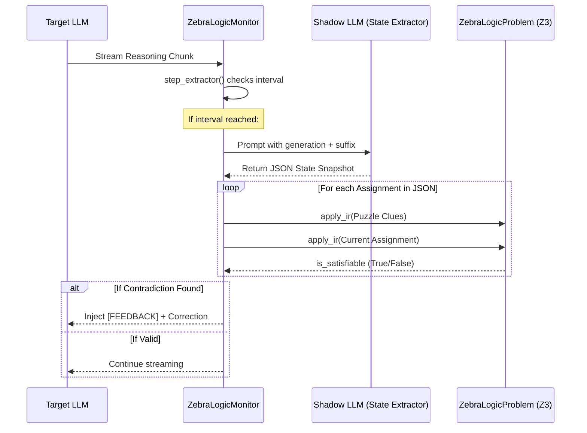

<!-- source: DeepWiki mcp.deepwiki.com · repo microsoft/interwhen · page 4.4 ZebraLogic Verifier · fetched 2026-10-26 -->

# ZebraLogic Verifier

Relevant source files

The following files were used as context for generating this wiki page:

- [examples/TTSwithVerification/interwhen/zebralogic_example.py](examples/TTSwithVerification/interwhen/zebralogic_example.py)
- [interwhen/data/__init__.py](interwhen/data/__init__.py)
- [interwhen/data/zebralogic_ir_map.json](interwhen/data/zebralogic_ir_map.json)
- [interwhen/monitors/zebralogic_monitor.py](interwhen/monitors/zebralogic_monitor.py)
- [interwhen/utils/zebralogic_helper.py](interwhen/utils/zebralogic_helper.py)
- [interwhen/utils/zebralogic_verifier.py](interwhen/utils/zebralogic_verifier.py)

The ZebraLogic Verifier is a real-time monitoring system designed to validate logic puzzle reasoning steps. It extracts the current state of a "house grid" puzzle from an LLM's reasoning trace, parses it into a JSON format, and uses a Z3-based constraint solver to detect contradictions against the original puzzle clues.

## Overview

The system operates by periodically interrupting the LLM's generation to "shadow" its internal state. It uses a specialized extraction prompt to elicit a structured JSON snapshot of current house assignments. These assignments are then verified against a symbolic representation of the puzzle. If a contradiction is found, the monitor injects corrective feedback into the prompt, forcing the LLM to revise its reasoning.

### Key Components
*   **`ZebraLogicMonitor`**: The main monitor class that orchestrates state extraction, Z3 verification, and feedback injection `[interwhen/monitors/zebralogic_monitor.py:12-39]()`.
*   **`ZebraLogicProblem`**: A Z3-based solver that encodes puzzle clues into boolean constraints `[interwhen/utils/zebralogic_verifier.py:18-28]()`.
*   **`zebralogic_ir_map.json`**: A data file containing the Intermediate Representation (IR) of clues for the ZebraLogic dataset `[interwhen/data/zebralogic_ir_map.json:1-10]()`.
*   **State Extraction**: A secondary LLM call used to "read the mind" of the primary LLM by summarizing its reasoning into JSON `[interwhen/monitors/zebralogic_monitor.py:76-87]()`.

## Code Entity Space Mapping

The following diagram illustrates how natural language concepts in the ZebraLogic domain map to specific code entities within the system.

### Domain to Code Mapping

Sources: `[interwhen/monitors/zebralogic_monitor.py:12-149]()`, `[interwhen/utils/zebralogic_verifier.py:18-166]()`, `[interwhen/data/zebralogic_ir_map.json:1-32]()`

## Implementation Details

### ZebraLogicMonitor
The `ZebraLogicMonitor` inherits from `VerifyMonitor` and implements the `step_extractor` and `verify` loop. It triggers verification every `step_interval` occurrences of a `step_token` (usually `\n\n`) `[interwhen/monitors/zebralogic_monitor.py:147-147]()`.

1.  **Step Extraction**: It checks if the generation is currently inside a `<think>` block before triggering `[interwhen/monitors/zebralogic_monitor.py:142-145]()`.
2.  **State Snapshot**: It appends a `suffix` to the current generation to prompt the LLM to output its current certain assignments in JSON format `[interwhen/monitors/zebralogic_monitor.py:174-175]()`.
3.  **Validation**: It iterates through the extracted JSON. For each assignment, it creates a fresh `ZebraLogicProblem` instance, applies the puzzle clues, and then applies the specific house assignment as a new constraint `[interwhen/monitors/zebralogic_monitor.py:97-106]()`.
4.  **Feedback**: If `is_satisfiable` returns `False`, it generates a `[FEEDBACK]` block detailing which house/feature assignment is incorrect `[interwhen/monitors/zebralogic_monitor.py:202-212]()`.

### Z3 Constraint Solver
The `ZebraLogicProblem` class translates puzzle clues into Z3 boolean variables using the naming convention `{feature_name}={value}@{house_index}` `[interwhen/utils/zebralogic_verifier.py:47-47]()`.

| Constraint Type | IR Key | Logic |
| :--- | :--- | :--- |
| **Place** | `place` | Sets a specific feature/value/house variable to True `[interwhen/utils/zebralogic_verifier.py:80-83]()`. |
| **Not Place** | `not_place` | Sets a specific feature/value/house variable to False `[interwhen/utils/zebralogic_verifier.py:85-88]()`. |
| **Same House** | `same_house` | Asserts equality between two feature/value pairs across all houses `[interwhen/utils/zebralogic_verifier.py:90-96]()`. |
| **Relative Position** | `pos_relation` | Uses `Or` across possible house indices to satisfy "left", "right", or "any" direction `[interwhen/utils/zebralogic_verifier.py:98-142]()`. |

Sources: `[interwhen/monitors/zebralogic_monitor.py:12-212]()`, `[interwhen/utils/zebralogic_verifier.py:18-166]()`

## Data Flow: Verification Loop

The following diagram describes the sequence of events when the monitor intercepts an LLM stream.

### Verification and Correction Flow

Sources: `[interwhen/monitors/zebralogic_monitor.py:149-215]()`, `[interwhen/utils/zebralogic_verifier.py:146-166]()`, `[interwhen/monitors/zebralogic_monitor.py:76-87]()`

## Max Corrections Guard
To prevent infinite loops where the LLM repeatedly fails to correct its logic, the monitor tracks the number of `[FEEDBACK]` blocks in the text using `_count_feedback_blocks` `[interwhen/monitors/zebralogic_monitor.py:130-132]()`. If `num_corrections` exceeds `max_corrections` (default 50), the monitor forces an early exit by injecting a "no solution" boxed answer `[interwhen/monitors/zebralogic_monitor.py:164-171]()`.

Sources: `[interwhen/monitors/zebralogic_monitor.py:130-171]()`, `[examples/TTSwithVerification/interwhen/zebralogic_example.py:142-143]()`

---

