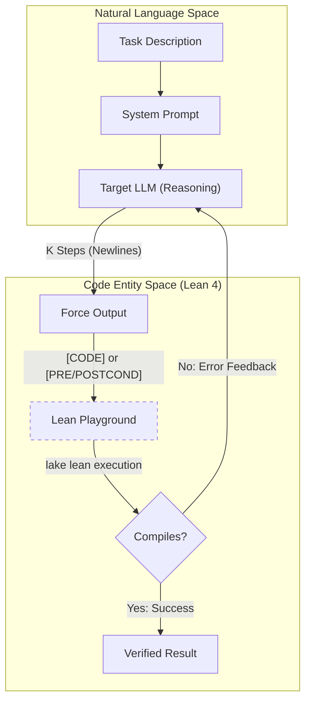
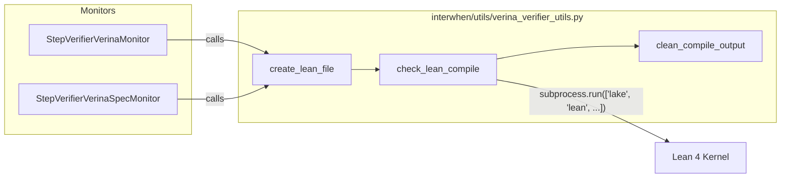

<!-- source: DeepWiki mcp.deepwiki.com · repo microsoft/interwhen · page 5 Verina: Formal Code and Specification Verification · fetched 2026-10-26 -->

# Verina: Formal Code and Specification Verification

Relevant source files

The following files were used as context for generating this wiki page:

- [interwhen/monitors/verina_code_verifier.py](interwhen/monitors/verina_code_verifier.py)
- [interwhen/monitors/verina_spec_verifier.py](interwhen/monitors/verina_spec_verifier.py)
- [interwhen/utils/verina_utils.py](interwhen/utils/verina_utils.py)
- [interwhen/utils/verina_verifier_utils.py](interwhen/utils/verina_verifier_utils.py)

Verina is a benchmark integration within the Interwhen framework focused on formal verification using the **Lean 4** theorem prover. It supports two primary task types: formal code generation and formal specification generation. The system utilizes a closed-loop verification strategy where LLM-generated Lean 4 snippets are compiled and checked in a sandboxed environment, with compiler errors fed back to the model for iterative refinement.

### Verina Verification Architecture

The Verina integration bridges the gap between natural language requirements and formally verified code entities by utilizing a local Lean 4 environment (`lake`) to validate the model's output against a defined task signature.

**System Workflow: Natural Language to Lean 4 Space**

Sources: [interwhen/monitors/verina_code_verifier.py:32-40](), [interwhen/utils/verina_verifier_utils.py:36-60]()

---

### Core Task Types

Verina divides formal verification into two distinct workflows, managed by specialized monitors.

#### 1. Code Generation
In this task, the model is provided with a function signature, preconditions, and postconditions. Its goal is to generate the implementation (function body) in Lean 4. The `StepVerifierVerinaMonitor` tracks the number of reasoning steps (newlines) and triggers a code extraction phase after `k_steps`.

*   **Key Class**: `StepVerifierVerinaMonitor` [interwhen/monitors/verina_code_verifier.py:31-40]()
*   **Mechanism**: Uses `check_lean_compile` to validate the generated code within a `lake` project [interwhen/utils/verina_verifier_utils.py:36-55]().
*   **Details**: For implementation details on progressive thinking budgets and code-forcing variants, see [Verina Code Generation Monitor](#5.1).

#### 2. Specification Generation
This task requires the model to generate formal preconditions and postconditions for a given code description. The `StepVerifierVerinaSpecMonitor` enforces the use of specific tags (`[PRECOND]` and `[POSTCOND]`) and validates that the resulting specification is syntactically correct and logically consistent within the Lean 4 environment.

*   **Key Class**: `StepVerifierVerinaSpecMonitor` [interwhen/monitors/verina_spec_verifier.py:25-34]()
*   **Mechanism**: Builds a complete Lean file using `build_spec_lean_content` and evaluates it for soundness [interwhen/monitors/verina_spec_verifier.py:93-120]().
*   **Details**: For details on soundness/completeness evaluation and tag enforcement, see [Verina Specification Generation Monitor](#5.2).

---

### Shared Infrastructure

Both Verina task types rely on a shared utility layer for environment management and Lean 4 interaction.

**Lean 4 Execution Environment**

| Component | Code Entity | Description |
| :--- | :--- | :--- |
| **Sandbox** | `LEAN_PLAYGROUND_DIR` | A directory used to store temporary `.lean` files for compilation. |
| **Compiler** | `lake lean` | The command-line tool used to check Lean 4 files. |
| **File Builder** | `build_lean_content` | Assembles imports, auxiliary definitions, and generated code into a valid file. |
| **Cleanup** | `clean_playground` | Removes temporary artifacts between verification attempts. |

Sources: [interwhen/utils/verina_verifier_utils.py:12-33](), [interwhen/utils/verina_verifier_utils.py:63-75]()

**Verification Data Flow**

Sources: [interwhen/utils/verina_verifier_utils.py:27-60](), [interwhen/monitors/verina_code_verifier.py:124-130](), [interwhen/monitors/verina_spec_verifier.py:118-125]()

### Child Pages
- **[Verina Code Generation Monitor](#5.1)**: Deep dive into `StepVerifierVerinaMonitor`, diversity feedback, and the code-forcing retry loop.
- **[Verina Specification Generation Monitor](#5.2)**: Deep dive into `StepVerifierVerinaSpecMonitor`, formal property extraction, and specification soundness checks.

---

