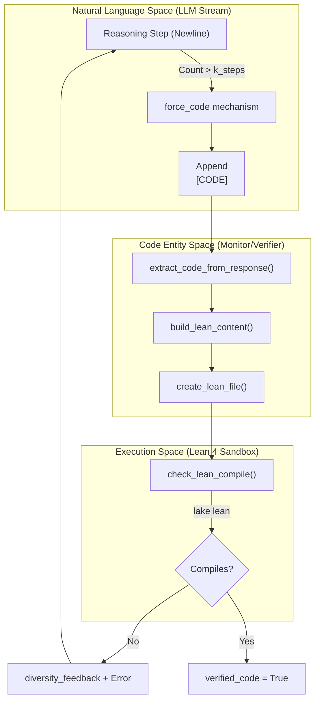
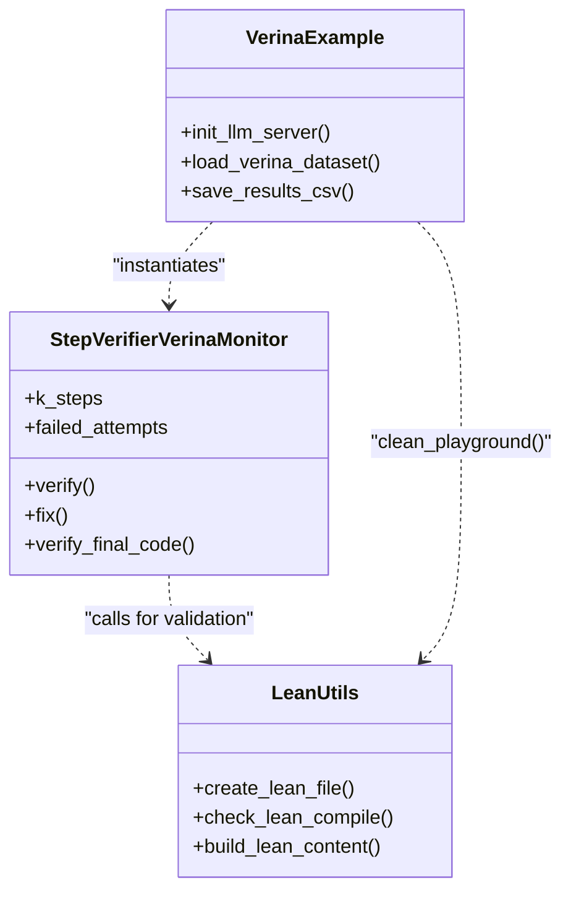

<!-- source: DeepWiki mcp.deepwiki.com · repo microsoft/interwhen · page 5.1 Verina Code Generation Monitor · fetched 2026-10-26 -->

# Verina Code Generation Monitor

Relevant source files

The following files were used as context for generating this wiki page:

- [examples/TTSwithVerification/interwhen/verina_code_example.py](examples/TTSwithVerification/interwhen/verina_code_example.py)
- [interwhen/monitors/verina_code_verifier.py](interwhen/monitors/verina_code_verifier.py)
- [interwhen/utils/verina_code_example_utils.py](interwhen/utils/verina_code_example_utils.py)
- [interwhen/utils/verina_verifier_utils.py](interwhen/utils/verina_verifier_utils.py)

The Verina Code Generation Monitor is a specialized verification component designed for the Verina benchmark, focusing on formal Lean 4 code generation. It implements a closed-loop verification strategy that monitors reasoning steps, forces code output after a defined thinking budget, and validates the generated code using a Lean 4 compilation sandbox.

## Overview and Purpose

The `StepVerifierVerinaMonitor` manages the lifecycle of a code generation task. Unlike simple text monitors, it interacts with a formal verification environment (Lean 4) to provide high-fidelity feedback to the LLM. It is designed to prevent infinite reasoning loops by enforcing a "thinking budget" and uses a diversity-aware feedback mechanism to guide the model away from repeated compilation errors.

### Key Responsibilities
*   **Step Monitoring**: Tracks the number of newlines in the `\n\n[CODE]` to the stream, effectively ending the reasoning phase and forcing the model into the code generation phase [interwhen/monitors/verina_code_verifier.py:226-235]().

To prevent the model from getting stuck, the monitor rotates through `_FORCE_CODE_VARIANTS`, providing different prompting cues if the model ignores the first force attempt [interwhen/monitors/verina_code_verifier.py:237-243]().

### Diversity Feedback
If a code block fails compilation, the monitor does not just provide the error. It appends the failed code and the error to `failed_attempts`. When generating the next feedback block, it explicitly tells the model: *"You have already tried the following approaches which failed..."* [interwhen/monitors/verina_code_verifier.py:318-325]().

**Sources:** [interwhen/monitors/verina_code_verifier.py:31-80](), [interwhen/monitors/verina_code_verifier.py:220-250]()

---

## Lean 4 Compilation Sandbox

The monitor relies on utility functions to interface with the Lean 4 toolchain. This process involves creating temporary files and executing the `lake` build system.

### Compilation Workflow
1.  **File Creation**: `create_lean_file` writes the generated content to the `lean-playground` directory [interwhen/utils/verina_verifier_utils.py:27-33]().
2.  **Execution**: `check_lean_compile` runs `lake lean <file>` within the `VERINA_ROOT` directory [interwhen/utils/verina_verifier_utils.py:41-47]().
3.  **Timeout Handling**: A default timeout (typically 120-240 seconds) is enforced to prevent runaway Lean processes [interwhen/utils/verina_verifier_utils.py:36]().

### Data Flow: From Step to Verification
The following diagram illustrates how natural language reasoning steps are transitioned into code entities and verified.

**Diagram: Verina Code Verification Loop**

**Sources:** [interwhen/utils/verina_verifier_utils.py:36-60](), [interwhen/monitors/verina_code_verifier.py:205-235]()

---

## Final Verification Retry Loop

Even after the main streaming loop concludes, the `StepVerifierVerinaMonitor` provides a high-level `verify_final_code` method. This serves as a secondary "Thinking Budget" specifically for fixing compilation errors.

### Implementation of `verify_final_code`
This function implements a synchronous retry loop (up to `max_retries`) that allows the model to re-examine its own failed code [interwhen/monitors/verina_code_verifier.py:99-116]().

1.  **Error Cleaning**: It uses `clean_compile_output` to strip verbose Lean error messages into a concise format for the LLM [interwhen/monitors/verina_code_verifier.py:138]().
2.  **Retry Prompting**: It constructs a new prompt including the `LEAN4_API_REFERENCE` and the specific error message [interwhen/monitors/verina_code_verifier.py:134-147]().
3.  **Thinking Budget**: It increases the `max_tokens` for the retry call to 2048, allowing the model significant room to reason about the fix [interwhen/monitors/verina_code_verifier.py:153]().

**Sources:** [interwhen/monitors/verina_code_verifier.py:99-179](), [interwhen/utils/verina_verifier_utils.py:10-15]()

---

## Integration with Example Scripts

The monitor is primarily used in `verina_code_example.py`. This script handles the loading of the `BenchmarkData` and the setup of the `stream_completion` loop.

### Component Association
The following diagram bridges the system components used in the example script to the code entities in the monitor.

**Diagram: System to Code Entity Mapping**

### Data Schema: BenchmarkData
The `BenchmarkData` class in `verina_code_example_utils.py` provides the structure for the tasks processed by the monitor:
*   `signature`: Defines the function name and parameters [interwhen/utils/verina_code_example_utils.py:22]().
*   `lean_data`: Contains the necessary imports and auxiliary definitions (preconditions/postconditions) required to build a valid Lean file [interwhen/utils/verina_code_example_utils.py:23]().
*   `tests`: A list of test cases used for final evaluation [interwhen/utils/verina_code_example_utils.py:25]().

**Sources:** [examples/TTSwithVerification/interwhen/verina_code_example.py:15-17](), [interwhen/utils/verina_code_example_utils.py:17-27](), [interwhen/utils/verina_verifier_utils.py:63-73]()

---

