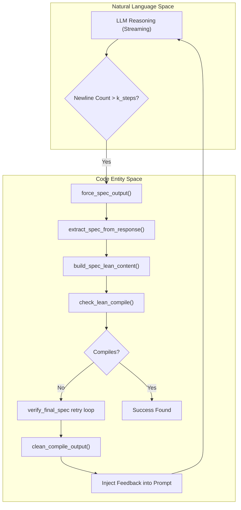
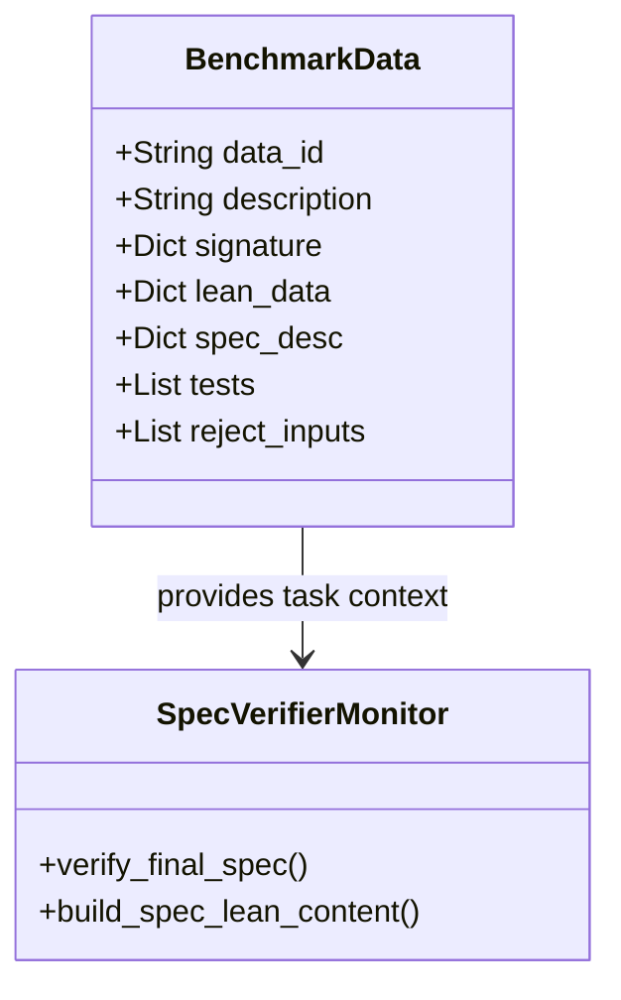

<!-- source: DeepWiki mcp.deepwiki.com · repo microsoft/interwhen · page 5.2 Verina Specification Generation Monitor · fetched 2026-10-26 -->

# Verina Specification Generation Monitor

Relevant source files

The following files were used as context for generating this wiki page:

- [examples/TTSwithVerification/interwhen/verina_spec_example.py](examples/TTSwithVerification/interwhen/verina_spec_example.py)
- [interwhen/monitors/verina_spec_verifier.py](interwhen/monitors/verina_spec_verifier.py)
- [interwhen/utils/verina_spec_example_utils.py](interwhen/utils/verina_spec_example_utils.py)
- [interwhen/utils/verina_verifier_utils.py](interwhen/utils/verina_verifier_utils.py)

The Verina Specification Generation Monitor is a specialized verification system designed to oversee the generation of formal specifications (preconditions and postconditions) in Lean 4. It ensures that the generated specifications are syntactically valid, compile within the Lean 4 environment, and satisfy logical constraints defined by the Verina benchmark.

## Overview

The `StepVerifierVerinaSpecMonitor` manages a closed-loop refinement process for specification generation. It monitors the reasoning process of an LLM, triggers specification output at strategic intervals, and performs real-time verification using the Lean 4 compiler. If the generated specification fails to compile, the monitor injects structured feedback into the LLM's context to facilitate self-correction.

### Key Responsibilities
*   **Tag Enforcement**: Ensures the model uses `[PRECOND]`, `[/PRECOND]`, `[POSTCOND]`, and `[/POSTCOND]` tags for clear extraction [interwhen/monitors/verina_spec_verifier.py:31-32]().
*   **Force-Spec Mechanism**: Interrupts extended reasoning (based on a newline threshold `k_steps`) to force the model into the output phase [interwhen/monitors/verina_spec_verifier.py:30-31]().
*   **Compilation Verification**: Utilizes a Lean 4 "playground" to validate the generated code [interwhen/monitors/verina_spec_verifier.py:32-33]().
*   **Retry Loop**: Implements a robust retry mechanism that allows the model to rethink and fix compilation errors [interwhen/monitors/verina_spec_verifier.py:93-114]().

---

## Implementation Details

### StepVerifierVerinaSpecMonitor Class

The `StepVerifierVerinaSpecMonitor` inherits from `VerifyMonitor` and maintains the state of the verification session, including failure history to encourage diversity in subsequent attempts.

| Attribute | Description |
| :--- | :--- |
| `task_data` | Dictionary containing function signatures, tests, and metadata [interwhen/monitors/verina_spec_verifier.py:39-48](). |
| `k_steps` | Threshold of newlines before the monitor forces the specification output [interwhen/monitors/verina_spec_verifier.py:42-51](). |
| `failed_attempts` | A list of previously failed specifications and their error summaries to prevent repetition [interwhen/monitors/verina_spec_verifier.py:69-69](). |
| `num_corrections` | Counter for the number of retry attempts made during a single generation [interwhen/monitors/verina_spec_verifier.py:56-56](). |

Sources: [interwhen/monitors/verina_spec_verifier.py:25-74]()

### Data Flow and Verification Loop

The monitor operates by intercepting the LLM stream. When the `k_steps` threshold is reached, it uses `httpx` to call the LLM server with a specialized prompt that appends `</think>` and the opening `[PRECOND]` tag, forcing the model to stop reasoning and start specifying [interwhen/monitors/verina_spec_verifier.py:31-31]().

**Verification Process Flow**

Sources: [interwhen/monitors/verina_spec_verifier.py:25-177](), [interwhen/utils/verina_verifier_utils.py:36-60]()

---

## Specification Verification Logic

### Soundness and Completeness
The Verina benchmark evaluates specifications based on two primary metrics:
1.  **Soundness**: Testing if the specification correctly rejects invalid inputs/outputs [examples/TTSwithVerification/interwhen/verina_spec_example.py:8-8]().
2.  **Completeness**: Testing if the specification correctly accepts valid inputs/outputs [examples/TTSwithVerification/interwhen/verina_spec_example.py:9-9]().

The monitor facilitates this by extracting the specification components into a dictionary containing `precond`, `postcond`, `precond_aux`, and `postcond_aux` [interwhen/monitors/verina_spec_verifier.py:104-104]().

### Lean 4 Integration
The function `build_spec_lean_content` constructs a complete Lean 4 file by merging the LLM's generated specification with the task's signature and auxiliary definitions.

**Lean File Construction Mapping**

| Component | Source Entity |
| :--- | :--- |
| Imports | `task_imports` + `solution_imports` [interwhen/utils/verina_verifier_utils.py:90-96]() |
| Precondition | `def {func_name}_precond ... := {precond}` [interwhen/utils/verina_verifier_utils.py:121-123]() |
| Postcondition | `def {func_name}_postcond ... := {postcond}` [interwhen/utils/verina_verifier_utils.py:134-136]() |
| Solution Body | Provided by `task_data["lean_data"]["code"]` [interwhen/utils/verina_verifier_utils.py:131-132]() |

Sources: [interwhen/utils/verina_verifier_utils.py:63-140](), [interwhen/utils/verina_spec_example_utils.py:34-102]()

---

## Benchmark Data Schema

The `BenchmarkData` class and the `parse_benchmark_lean_data` utility manage the ingestion of Verina tasks.

### Benchmark Structure
*   **Signature**: Defines the function name, parameters, and return types [interwhen/utils/verina_spec_example_utils.py:26-26]().
*   **Lean Data**: Contains partitioned sections of a `.lean` file marked with `-- !benchmark @start [section]` [interwhen/utils/verina_spec_example_utils.py:34-56]().
*   **Tests/Reject Inputs**: Used for evaluating the logical correctness of the spec after compilation succeeds [interwhen/utils/verina_spec_example_utils.py:136-148]().

Sources: [interwhen/utils/verina_spec_example_utils.py:21-31](), [interwhen/utils/verina_spec_example_utils.py:34-102]()

---

## Error Handling and Retries

The `verify_final_spec` function implements a retry loop (defaulting to 3 attempts) [interwhen/monitors/verina_spec_verifier.py:97-97]().

1.  **Error Cleaning**: The `clean_compile_output` utility (imported from `verina_verifier_utils.py`) strips verbose compiler messages to provide a concise error summary to the LLM [interwhen/monitors/verina_spec_verifier.py:136-136]().
2.  **Feedback Injection**: The monitor constructs a `retry_prompt` that includes the failed specification, the compiler error, and the `LEAN4_API_REFERENCE` to guide the model [interwhen/monitors/verina_spec_verifier.py:132-145]().
3.  **State Safety**: Uses `asyncio.Lock` to ensure that state updates during the verification of streaming chunks are thread-safe [interwhen/monitors/verina_spec_verifier.py:73-73]().

Sources: [interwhen/monitors/verina_spec_verifier.py:93-177](), [interwhen/utils/verina_verifier_utils.py:36-60]()

---

