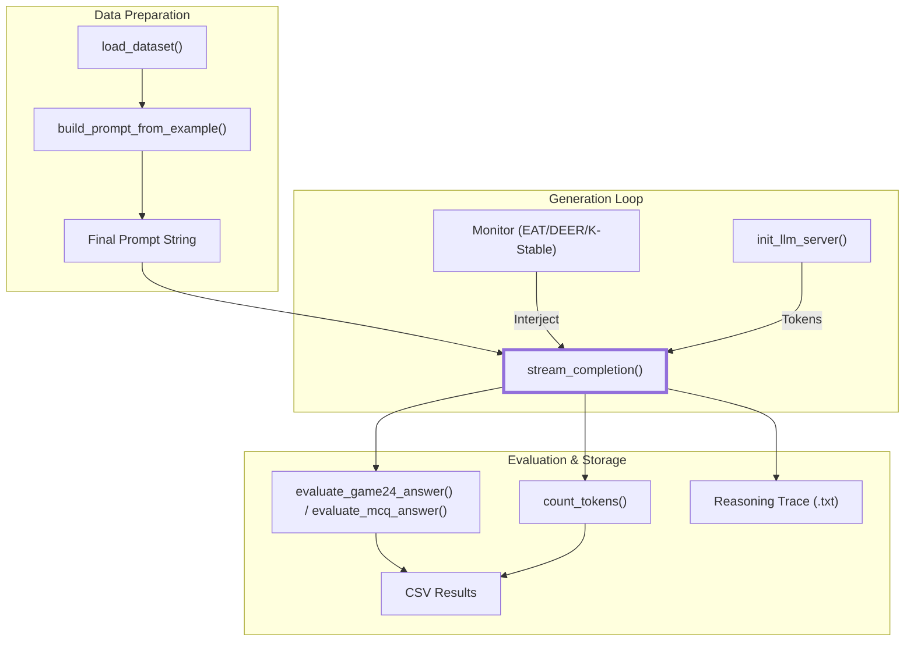
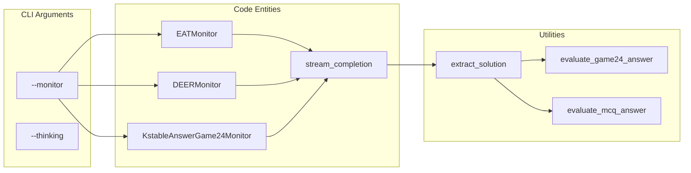

<!-- source: DeepWiki mcp.deepwiki.com · repo microsoft/interwhen · page 6.1 Early Stopping Examples · fetched 2026-10-26 -->

# Early Stopping Examples

Relevant source files

The following files were used as context for generating this wiki page:

- [examples/EarlyStopping/game24_example.py](examples/EarlyStopping/game24_example.py)
- [examples/EarlyStopping/maze_example.py](examples/EarlyStopping/maze_example.py)
- [examples/EarlyStopping/spatialmap_example.py](examples/EarlyStopping/spatialmap_example.py)

This page provides a technical walkthrough of the early stopping examples located in `examples/EarlyStopping/`. These scripts demonstrate how to integrate `interwhen` monitors to terminate LLM reasoning phases early based on confidence or stability metrics, significantly reducing token consumption while maintaining accuracy.

## Overview of Example Scripts

The repository contains three primary scripts for evaluating early stopping strategies across different reasoning domains:

| Script | Dataset | Task Type |
| :--- | :--- | :--- |
| `game24_example.py` | `nlile/24-game` | Mathematical expression generation |
| `maze_example.py` | `microsoft/VISION_LANGUAGE` (maze) | Multiple Choice (MCQ) navigation |
| `spatialmap_example.py` | `microsoft/VISION_LANGUAGE` (spatial) | Multiple Choice (MCQ) spatial reasoning |

### Core Components
All three scripts follow a standardized execution flow:
1.  **Dataset Loading**: Fetching domain-specific data from HuggingFace Hub [examples/EarlyStopping/game24_example.py:67-69](), [examples/EarlyStopping/maze_example.py:68-70](), [examples/EarlyStopping/spatialmap_example.py:68-70]().
2.  **LLM Configuration**: Initializing the server payload for the main reasoning model and the early-stopping assistant model [examples/EarlyStopping/game24_example.py:71-88]().
3.  **Monitor Selection**: Configuring `EATMonitor`, `DEERMonitor`, or `Kstable` variants via CLI flags.
4.  **Streaming Loop**: Invoking `stream_completion` to execute the interjection-capable generation [examples/EarlyStopping/game24_example.py:13]().
5.  **Evaluation**: Validating the final answer against ground truth and logging token statistics.

**Sources:**
- [examples/EarlyStopping/game24_example.py:1-100]()
- [examples/EarlyStopping/maze_example.py:1-100]()
- [examples/EarlyStopping/spatialmap_example.py:1-100]()

---

## Data Flow and Implementation

The following diagram illustrates the data flow from the dataset to the `stream_completion` loop and the subsequent evaluation.

### Example Execution Pipeline

**Sources:**
- [examples/EarlyStopping/game24_example.py:13-15]()
- [examples/EarlyStopping/game24_example.py:109-112]()
- [examples/EarlyStopping/maze_example.py:137-154]()

---

## Configuration and Setup

### LLM Server Initialization
The `init_llm_server` function configures the connection to a vLLM or compatible OpenAI-style endpoint. It defaults to a `top_k: 20` and `logprobs: 20` configuration, which is essential for entropy-based monitors like `EATMonitor` [examples/EarlyStopping/game24_example.py:71-88]().

### Monitor Selection
The examples support multiple monitors via the `interwhen.monitors` package:
- **EATMonitor**: Entropy-based stopping using a local model.
- **DEERMonitor**: Geometric mean confidence probing.
- **Kstable Monitors**: `KstableAnswerGame24Monitor` and `KstableAnswerMCQMonitor` which stop once the answer remains unchanged for $K$ consecutive steps [examples/EarlyStopping/game24_example.py:14]().

### Code-to-System Mapping
This diagram maps the CLI arguments and internal logic to the specific monitor classes and utility functions.

**Sources:**
- [examples/EarlyStopping/game24_example.py:156-170]()
- [examples/EarlyStopping/maze_example.py:15-16]()

---

## Answer Extraction and Evaluation

The accuracy of the early stopping benchmarks relies on robust answer extraction from the raw LLM stream.

### Game of 24 Extraction
The `extract_solution` function in `game24_example.py` is designed to:
1.  Search only after the `</think>` tag to avoid intermediate reasoning steps [examples/EarlyStopping/game24_example.py:121-122]().
2.  Handle nested LaTeX `\boxed{}` content [examples/EarlyStopping/game24_example.py:131-148]().
3.  Normalize LaTeX operators (e.g., `\times` to `*`) and handle implicit multiplication [examples/EarlyStopping/game24_example.py:155-184]().

### MCQ Extraction
The `evaluate_mcq_answer` function in `maze_example.py` and `spatialmap_example.py` supports multiple patterns including `\boxed{A}`, `**A**`, and standalone letters [examples/EarlyStopping/maze_example.py:104-123](). It validates the extracted choice against the `options` dictionary and the ground truth string [examples/EarlyStopping/maze_example.py:137-154]().

**Sources:**
- [examples/EarlyStopping/game24_example.py:115-185]()
- [examples/EarlyStopping/maze_example.py:104-123]()
- [examples/EarlyStopping/maze_example.py:137-154]()

---

## Output Directory Layout

The examples generate a structured output directory based on the `MAIN_MODEL` name to facilitate comparison across different model scales [examples/EarlyStopping/game24_example.py:28-43]().

| Path Component | Description |
| :--- | :--- |
| `Reasoning_output/` | Contains `.txt` files of the full prompt and answer trace (e.g., `reason_0.txt`) [examples/EarlyStopping/game24_example.py:59-63](). |
| `csv_saved/` | Stores the final token statistics and accuracy results. |
| `EAT_[N]examples.log` | Detailed execution logs including monitor interjection points [examples/EarlyStopping/game24_example.py:45-50](). |
| `EAT_[N]examples.csv` | Per-example token counts (thinking tokens vs. total tokens) [examples/EarlyStopping/game24_example.py:52-57](). |

**Sources:**
- [examples/EarlyStopping/game24_example.py:22-63]()
- [examples/EarlyStopping/maze_example.py:31-61]()

---

