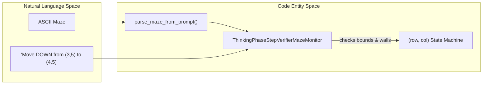

<!-- source: DeepWiki mcp.deepwiki.com · repo microsoft/interwhen · page 6.2 Test-Time Search with Verification Examples · fetched 2026-10-26 -->

# Test-Time Search with Verification Examples

<details>
<summary>Relevant source files</summary>

The following files were used as context for generating this wiki page:

- [examples/TTSwithVerification/interwhen/game24_example.py](examples/TTSwithVerification/interwhen/game24_example.py)
- [examples/TTSwithVerification/interwhen/maze_example.py](examples/TTSwithVerification/interwhen/maze_example.py)
- [examples/TTSwithVerification/interwhen/spatialmap_example.py](examples/TTSwithVerification/interwhen/spatialmap_example.py)
- [examples/TTSwithVerification/interwhen/zebralogic_example.py](examples/TTSwithVerification/interwhen/zebralogic_example.py)
- [examples/TTSwithVerification/metaPrompt/game24meta.py](examples/TTSwithVerification/metaPrompt/game24meta.py)
- [examples/TTSwithVerification/metaPrompt/mazemeta.py](examples/TTSwithVerification/metaPrompt/mazemeta.py)
- [examples/TTSwithVerification/metaPrompt/spatialmeta.py](examples/TTSwithVerification/metaPrompt/spatialmeta.py)

</details>


This page details the implementation and execution of Test-Time Search (TTS) benchmarks within the `interwhen` framework. It covers the example scripts that demonstrate how to use step-based verification and thinking-phase verification across four primary domains: Game of 24, Maze navigation, Spatial Mapping, and ZebraLogic.

## Overview of TTS Examples

The examples are organized into two primary categories based on how they interact with the LLM's reasoning process:

1.  **Thinking-Phase Verification**: These scripts monitor the `"]
        Feedback["[VERIFIER FEEDBACK: 4.8 * 5 = 24]"]
    end

    subgraph "Code Entity Space"
        Stream["stream_completion()"]
        Monitor["ThinkingPhaseStepVerifierGame24Monitor"]
        Extract["extract_solution()"]
        Verify["validate_numbers_used()"]
    end

    Prompt --> Stream
    Stream -- "intercepts <think>" --> Monitor
    Monitor -- "parses LaTeX" --> Extract
    Extract -- "checks math" --> Verify
    Verify -- "if error" --> Feedback
    Feedback -- "injected into" --> Stream
```

### Implementation Details
*   **Solution Extraction**: The `extract_solution` function handles complex LaTeX artifacts, including `\frac`, `\times`, and implicit multiplication (e.g., `(a+b)(c+d)`) [examples/TTSwithVerification/interwhen/game24_example.py:119-190]().
*   **Verification**: The `validate_numbers_used` function ensures the model uses exactly the four provided numbers [examples/TTSwithVerification/interwhen/game24_example.py:197-198]().
*   **Meta-Prompting**: The `game24meta.py` script provides a system prompt that defines a `>StepN` format for explicit verification [examples/TTSwithVerification/metaPrompt/game24meta.py:93-128]().

Sources: [examples/TTSwithVerification/interwhen/game24_example.py:119-190](), [examples/TTSwithVerification/metaPrompt/game24meta.py:93-128]()

---

## Maze Navigation Verification

The Maze examples verify path-finding steps in an ASCII grid. It supports three question types: counting right turns, counting total turns, and determining relative positions (e.g., "Is E top-left of S?").

### Structured Step Format
The `ThinkingPhaseStepVerifierMazeMonitor` looks for a specific format during the thinking phase or as part of a meta-prompted output:
1.  **LOCATE**: Identifying S (Start) and E (Exit) coordinates.
2.  **STEP**: Individual movements (UP, DOWN, LEFT, RIGHT).
3.  **TURN**: Calculation of turn types (RIGHT_TURN, LEFT_TURN, STRAIGHT).

### Verification Process
The monitor uses `parse_maze_from_prompt` to convert the ASCII text into a coordinate-indexed grid [examples/TTSwithVerification/interwhen/maze_example.py:24]().

**Maze Verification Data Flow**


Sources: [examples/TTSwithVerification/interwhen/maze_example.py:4-8](), [examples/TTSwithVerification/metaPrompt/mazemeta.py:72-125]()

---

## Spatial Map Verification (Z3-based)

Spatial Map examples involve reasoning about the relative positions of multiple entities (e.g., "A is Northwest of B"). This domain uses a formal Z3 solver to check for consistency and transitivity.

### Key Functions
*   **`get_question_type`**: Categorizes the task into "direction", "object", or "counting" based on the dataset index [examples/TTSwithVerification/interwhen/spatialmap_example.py:67-80]().
*   **`ThinkingPhaseStepVerifierSpatialMapMonitor`**: Intercepts claims like "X is Southeast of Y" and verifies them against the ground truth map constraints using a Z3 backend [examples/TTSwithVerification/interwhen/spatialmap_example.py:4-8]().
*   **Meta-Prompting**: The `spatialmeta.py` script enforces a `>>> STEP 1: PARSE RELATIONSHIPS` format to ensure the model explicitly lists its spatial deductions [examples/TTSwithVerification/metaPrompt/spatialmeta.py:135-155]().

Sources: [examples/TTSwithVerification/interwhen/spatialmap_example.py:67-80](), [examples/TTSwithVerification/metaPrompt/spatialmeta.py:135-155]()

---

## ZebraLogic Verification

The ZebraLogic example uses the `ZebraLogicMonitor` to verify logic puzzle solutions. Unlike the other examples, ZebraLogic verification is often performed at specific intervals rather than per-sentence.

### Monitor Configuration
The `run` function in `zebralogic_example.py` configures the monitor with a `step_token` (usually `\n\n`) and a `step_interval` (e.g., every 25 occurrences) to trigger verification [examples/TTSwithVerification/interwhen/zebralogic_example.py:85-94]().

### Verification Logic
1.  **State Extraction**: The monitor extracts the current "shadow state" of the logic grid (which house has which attribute).
2.  **Z3 Validation**: It uses `ZebraLogicProblem` (a Z3 wrapper) to check if the current assignments contradict the puzzle's rules [examples/TTSwithVerification/interwhen/zebralogic_example.py:107-112]().
3.  **Feedback**: If a contradiction is found, it injects a specific correction prompt [examples/TTSwithVerification/interwhen/zebralogic_example.py:142-143]().

Sources: [examples/TTSwithVerification/interwhen/zebralogic_example.py:85-112](), [examples/TTSwithVerification/interwhen/zebralogic_example.py:140-143]()

---

## Running the Benchmarks

All TTS examples share a common CLI interface for execution.

### Common Arguments
*   `--model`: The model name (defaulting to `Qwen/QwQ-32B`).
*   `--port`: The port where the vLLM/LLM server is running (default 8000).
*   `--max_corrections`: The maximum number of times the monitor can inject feedback before stopping.
*   `--indices` / `--start` / `--end`: Controls which subset of the dataset to run.

### Execution Command Example
To run the Game of 24 benchmark with 5 examples and a maximum of 5 corrections per example:
```bash
python examples/TTSwithVerification/interwhen/game24_example.py --num_examples 5 --max_corrections 5 --port 8000
```

### Output Structure
Results are saved in `Outputs_TTS/` relative to the repository root [examples/TTSwithVerification/interwhen/game24_example.py:33]().
*   `Reasoning_output/`: Contains `.txt` files of the full interaction traces, including injected feedback.
*   `csv_saved/`: Contains summary statistics (accuracy, token counts, number of corrections).

Sources: [examples/TTSwithVerification/interwhen/game24_example.py:162-175](), [examples/TTSwithVerification/interwhen/game24_example.py:41-57]()

---

