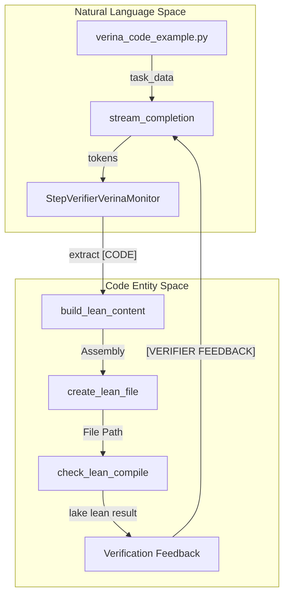
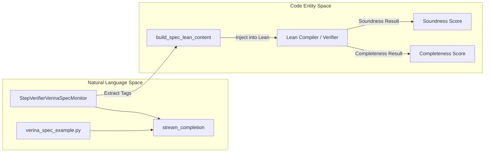

<!-- source: DeepWiki mcp.deepwiki.com · repo microsoft/interwhen · page 6.3 Verina Benchmark Examples · fetched 2026-10-26 -->

# Verina Benchmark Examples

Relevant source files

The following files were used as context for generating this wiki page:

- [examples/TTSwithVerification/interwhen/verina_code_example.py](examples/TTSwithVerification/interwhen/verina_code_example.py)
- [examples/TTSwithVerification/interwhen/verina_spec_example.py](examples/TTSwithVerification/interwhen/verina_spec_example.py)
- [interwhen/utils/verina_utils.py](interwhen/utils/verina_utils.py)

The Verina benchmark examples demonstrate how to apply real-time verification and early stopping to formal verification tasks in Lean 4. These examples cover two primary domains: **Code Generation** (implementing function bodies that satisfy specifications) and **Specification Generation** (defining preconditions and postconditions for existing code).

## 1. Verina Code Generation Example

The `verina_code_example.py` script evaluates the LLM's ability to generate Lean 4 code. It uses a closed-loop system where the `StepVerifierVerinaMonitor` monitors the generation process, extracts code snippets, and validates them against a Lean compiler.

### 1.1 CLI Arguments and Configuration
The script provides several command-line arguments to control the benchmark behavior:
*   `--tasks`: Number of tasks to run (default: 10) [examples/TTSwithVerification/interwhen/verina_code_example.py:204]().
*   `--k_steps`: Threshold for forcing code generation if the model is stuck in reasoning [examples/TTSwithVerification/interwhen/verina_code_example.py:205]().
*   `--max_corrections`: Maximum number of feedback loops allowed per task [examples/TTSwithVerification/interwhen/verina_code_example.py:206]().
*   `--monitor`: Choice of monitor strategy (e.g., `eat` for Entropy After Think, `step` for step-wise verification, or `both`) [examples/TTSwithVerification/interwhen/verina_code_example.py:207]().

### 1.2 Lean Playground Setup
To verify generated code, the system maintains a `lean-playground` directory within the `verina` root [interwhen/utils/verina_utils.py:14](). 
*   **`clean_playground()`**: Removes all files from the playground to ensure a fresh environment for each check [interwhen/utils/verina_utils.py:17-25]().
*   **`create_lean_file()`**: Writes the assembled Lean content to a `.lean` file [interwhen/utils/verina_utils.py:27-33]().
*   **`check_lean_compile()`**: Invokes `lake lean` via a subprocess to check for syntax or type errors [interwhen/utils/verina_utils.py:36-62]().

### 1.3 Data Flow: Code Verification Loop

The following diagram illustrates the interaction between the example script, the monitor, and the Lean environment.

**Code Verification Flow**

Sources: [examples/TTSwithVerification/interwhen/verina_code_example.py:15-17](), [interwhen/utils/verina_utils.py:65-142](), [interwhen/utils/verina_utils.py:36-50]()

## 2. Verina Specification Generation Example

The `verina_spec_example.py` script focuses on generating formal contracts (preconditions and postconditions). Unlike code generation, this task evaluates the **Soundness** and **Completeness** of the generated logic.

### 2.1 Soundness and Completeness Metrics
The benchmark calculates metrics to ensure the specification is neither too loose nor too strict:
*   **Soundness**: Ensures the specification correctly rejects invalid inputs/outputs [examples/TTSwithVerification/interwhen/verina_spec_example.py:8]().
*   **Completeness**: Ensures the specification correctly accepts valid inputs/outputs [examples/TTSwithVerification/interwhen/verina_spec_example.py:9]().

### 2.2 Specification Extraction
The `StepVerifierVerinaSpecMonitor` looks for specific tags in the LLM output:
*   `[PRECOND]`: Defines the logic for `func_name_precond` [examples/TTSwithVerification/interwhen/verina_spec_example.py:124]().
*   `[POSTCOND]`: Defines the logic for `func_name_postcond` [examples/TTSwithVerification/interwhen/verina_spec_example.py:137]().

**Specification Evaluation Flow**

Sources: [examples/TTSwithVerification/interwhen/verina_spec_example.py:118-158](), [interwhen/utils/verina_utils.py:107-110]()

## 3. Output Files and Interpretation

Both scripts generate standardized outputs in the `Outputs_TTS` directory to facilitate debugging and analysis.

### 3.1 File Structure
*   **`verina_results.csv`**: Contains per-task results including compilation status, token counts, and final generated code/spec [examples/TTSwithVerification/interwhen/verina_code_example.py:101-120]().
*   **`summary.json`**: Aggregated statistics across the entire run.
*   **Reasoning Traces**: Full text files (e.g., `reason_0_id.txt`) containing the complete interaction history, including verifier interjections [examples/TTSwithVerification/interwhen/verina_code_example.py:94-99]().
*   **Entropy Plots**: If `EATMonitor` is used, the script generates plots showing the entropy trajectory and the exit point chosen by the early-stopping mechanism [examples/TTSwithVerification/interwhen/verina_code_example.py:138-174]().

### 3.2 Metrics Table
| Metric | Description | Source |
| :--- | :--- | :--- |
| `compiles` | Boolean indicating if the final code passed Lean compilation. | [verina_code_example.py:105]() |
| `all_tests_pass` | Boolean indicating if the generated code passed all provided test cases. | [verina_code_example.py:105]() |
| `reasoning_tokens` | Total number of tokens spent in the reasoning/thinking phase. | [verina_code_example.py:105]() |
| `spec_sound` | (Spec only) Whether the generated spec correctly identifies invalid states. | [verina_spec_example.py:129]() |
| `spec_complete` | (Spec only) Whether the generated spec correctly identifies valid states. | [verina_spec_example.py:129]() |

Sources: [examples/TTSwithVerification/interwhen/verina_code_example.py:101-120](), [examples/TTSwithVerification/interwhen/verina_spec_example.py:118-158]()

---

