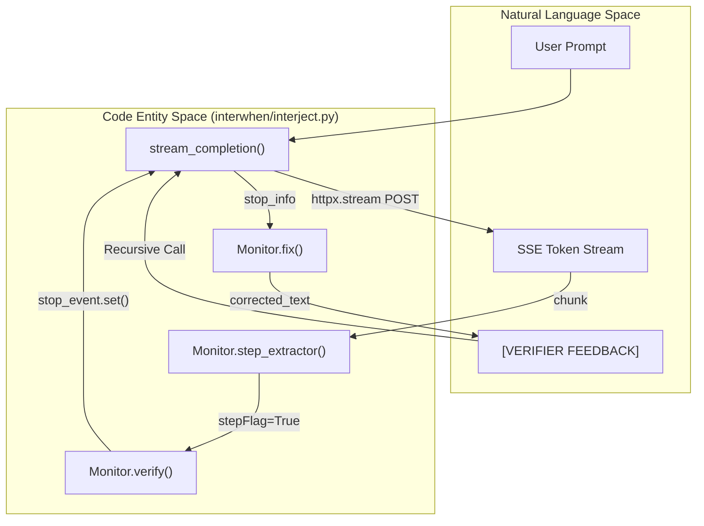
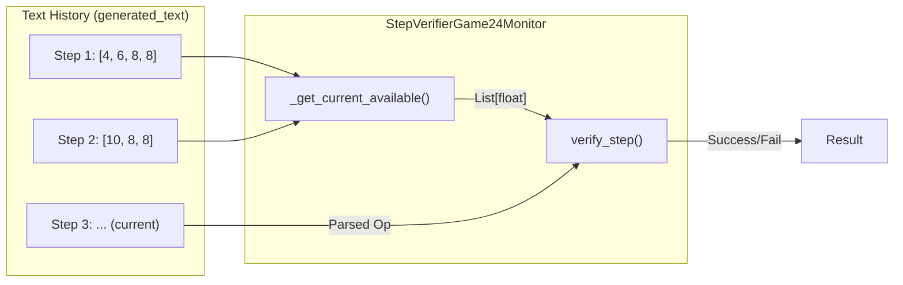

<!-- source: DeepWiki mcp.deepwiki.com · repo microsoft/interwhen · page 7 Glossary · fetched 2026-10-26 -->

# Glossary

Relevant source files

The following files were used as context for generating this wiki page:

- [README.md](README.md)
- [examples/README.md](examples/README.md)
- [interwhen/interject.py](interwhen/interject.py)
- [interwhen/monitors/__init__.py](interwhen/monitors/__init__.py)
- [interwhen/monitors/earlyStopping.py](interwhen/monitors/earlyStopping.py)
- [interwhen/monitors/stepVerifier.py](interwhen/monitors/stepVerifier.py)
- [interwhen/monitors/verina_code_verifier.py](interwhen/monitors/verina_code_verifier.py)
- [interwhen/monitors/verina_spec_verifier.py](interwhen/monitors/verina_spec_verifier.py)
- [interwhen/monitors/zebralogic_monitor.py](interwhen/monitors/zebralogic_monitor.py)
- [interwhen/utils/DEER_helper.py](interwhen/utils/DEER_helper.py)
- [interwhen/utils/EAT_helper.py](interwhen/utils/EAT_helper.py)
- [interwhen/utils/game24_verifier.py](interwhen/utils/game24_verifier.py)
- [interwhen/utils/spatialmap_verifier.py](interwhen/utils/spatialmap_verifier.py)
- [pyproject.toml](pyproject.toml)

This page provides definitions for codebase-specific terms, acronyms, and domain concepts used throughout the **interwhen** framework. It details the implementation of the verifier-guided reasoning loop and the specialized monitors that enforce correctness during LLM generation.

## Core System Concepts

### Verifier-guided Reasoning
A paradigm where an auxiliary **Monitor** agent observes the output of a target LLM in real-time. It intercepts the stream to validate intermediate reasoning steps, providing feedback or steering the model when violations are detected [README.md:23-28]().

### Interjection Loop
The recursive process managed by `stream_completion`. It handles the asynchronous execution of monitors and re-invokes the LLM with injected feedback if a monitor triggers a "stop" event [interwhen/interject.py:18-82]().

### Monitor
An abstract base class (`Monitor` or `VerifyMonitor`) that defines how to extract, verify, and fix LLM output.
- **Step Extractor**: A function that determines if a specific chunk of text (e.g., a completed reasoning step) should be verified [interwhen/monitors/base.py:1-10]().
- **Verify**: An async function that runs the domain-specific verification logic [interwhen/monitors/base.py:11-20]().
- **Fix**: A function called after a verification failure to modify the generated text or inject feedback [interwhen/interject.py:75]().

### Stop Event & Stop Info
An `asyncio.Event` used by monitors to signal the `stream_completion` loop to halt generation immediately. `stop_info` is a dictionary containing the `feedback` string and the `token_index` where the intervention occurred [interwhen/interject.py:20-21]().

## System Data Flow: Stream to Verification
The following diagram illustrates how the `stream_completion` function coordinates between the LLM Server and the Monitor entities.

**Diagram: Interjection Loop Data Flow**

**Sources:** [interwhen/interject.py:18-82](), [interwhen/monitors/base.py:1-25]()

---

## Domain-Specific Terms

### EAT (Entropy After Think)
An early-stopping strategy that monitors the entropy of the next-token distribution after a `\n\nWait` or `</think>` token. It uses a local model to compute if the LLM has reached a "stable" internal state [interwhen/monitors/earlyStopping.py:1-10](), [interwhen/utils/EAT_helper.py:146-175]().

### DEER (Dynamic Early Exit in Reasoning)
A strategy that uses a geometric mean of token confidence (probabilities) to decide when to stop reasoning. It relies on a remote `llm_server` to provide logprobs [interwhen/utils/DEER_helper.py:10-27]().

### K-Stability
A criterion for Multiple Choice Questions (MCQ) where the monitor ensures the predicted answer remains consistent over $K$ consecutive reasoning steps before allowing termination [interwhen/monitors/k_stable.py:1-15]().

### ZebraLogic IR
Intermediate Representation (IR) used for logic puzzles. The `ZebraLogicMonitor` extracts a JSON state of "house assignments" from the LLM and uses a Z3-solver to check for satisfiability against the puzzle's constraints [interwhen/monitors/zebralogic_monitor.py:89-107]().

### Verina
A benchmark for formal verification.
- **Verina Code**: Generating Lean 4 code that must compile [interwhen/monitors/verina_code_verifier.py:31-40]().
- **Verina Spec**: Generating formal preconditions and postconditions [interwhen/monitors/verina_spec_verifier.py:25-34]().

---

## Monitor Implementation Details

The table below maps domain concepts to their primary implementation classes and verification methods.

| Concept | Monitor Class | Primary Verification Logic |
| :--- | :--- | :--- |
| **Game of 24** | `StepVerifierGame24Monitor` | Reconstructs available numbers and checks arithmetic operations [interwhen/monitors/stepVerifier.py:25-38](). |
| **Maze Navigation** | `StepVerifierMazeMonitor` | Validates movement (Up/Down/Left/Right) against a grid [interwhen/monitors/stepVerifier.py:200-215](). |
| **Spatial Map** | `StepVerifierSpatialMapMonitor` | Uses `SpatialMapZ3Solver` to check directional consistency [interwhen/utils/spatialmap_verifier.py:19-35](). |
| **Lean 4 Code** | `StepVerifierVerinaMonitor` | Invokes `_verify_compilation` via Lean 4 subprocess [interwhen/monitors/verina_code_verifier.py:123-128](). |

### Verifier State Machine: Game of 24
The `StepVerifierGame24Monitor` is notable for being "stateless" relative to the class instance; it reconstructs the mathematical state (available numbers) by parsing the entire `generated_text` history on every verification call.

**Diagram: Stateless State Reconstruction**

**Sources:** [interwhen/monitors/stepVerifier.py:43-121](), [interwhen/utils/game24_verifier.py:1-20]()

---

## Acronyms & Constants Reference

- **SSE**: Server-Sent Events. The protocol used by `stream_completion` to receive tokens from the vLLM server [interwhen/interject.py:31-42]().
- **Z3**: A high-performance theorem prover from Microsoft Research used by SpatialMap and ZebraLogic monitors [pyproject.toml:42-44](), [interwhen/utils/spatialmap_verifier.py:16-19]().
- **EMA/EMV**: Exponential Moving Average/Variance. Used in `EATMonitor` to track entropy stability [interwhen/monitors/earlyStopping.py:15-25]().
- **`max_corrections`**: A guardrail in the interjection loop to prevent infinite recursion if the LLM cannot resolve a verifier error [interwhen/interject.py:71-73]().

**Sources:** [interwhen/interject.py:1-82](), [interwhen/monitors/earlyStopping.py:1-50](), [interwhen/utils/spatialmap_verifier.py:1-50]()