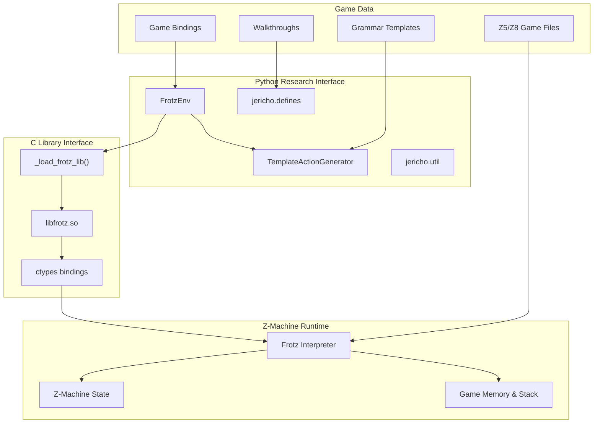
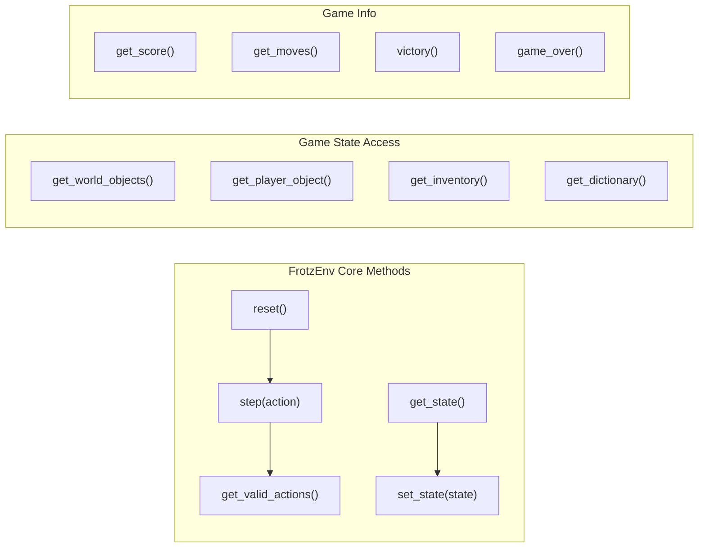
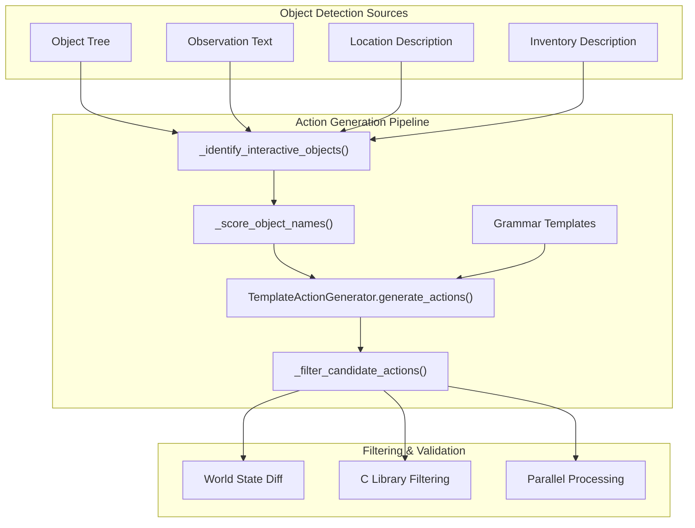
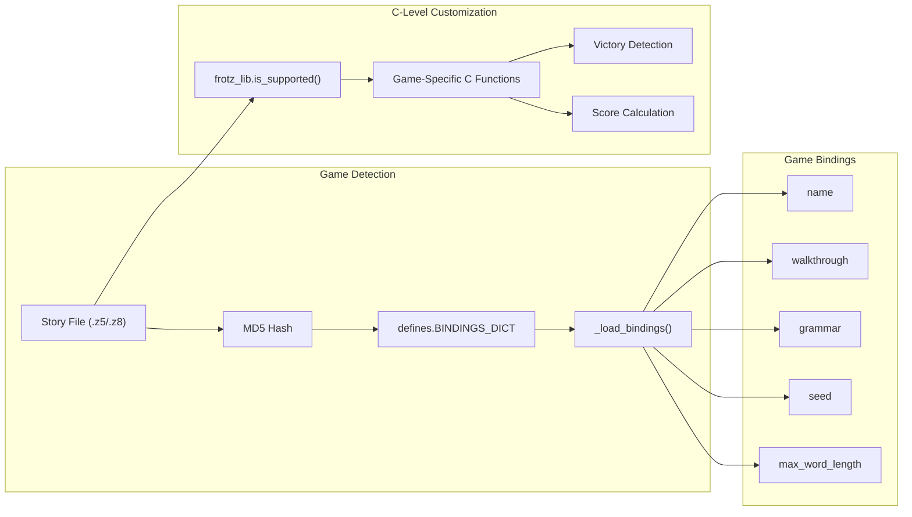
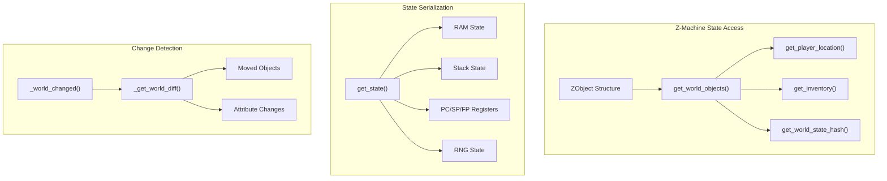

<!-- source: DeepWiki mcp.deepwiki.com · repo microsoft/jericho · page 1 Overview · fetched 2026-10-26 -->

# Overview

Relevant source files

The following files were used as context for generating this wiki page:

- [README.md](README.md)
- [docs/source/tutorial_quick.rst](docs/source/tutorial_quick.rst)
- [jericho/__init__.py](jericho/__init__.py)
- [jericho/jericho.py](jericho/jericho.py)
- [tests/test_valid_actions.py](tests/test_valid_actions.py)

## Purpose and Scope

Jericho is a Python interface connecting reinforcement learning agents with interactive fiction games. It provides a standardized environment wrapper around the Frotz Z-machine interpreter, enabling AI research on text-based adventure games through a clean, gym-like API.

This document introduces Jericho's core architecture, main components, and research-oriented features. For installation and basic usage, see [Getting Started](#2). For detailed API documentation, see [API Reference](#7). For information about supported games, see [Game Library](#6).

Sources: [README.md:19-21](), [jericho/jericho.py:371-383]()

## System Architecture

Jericho implements a layered architecture that separates the Python research interface from the underlying Z-machine interpreter implementation:

This architecture enables high-performance game execution through the C layer while providing rich research features through the Python layer.

Sources: [jericho/jericho.py:216-339](), [jericho/jericho.py:36-37](), [jericho/__init__.py:1-2]()

## Core Interface

The `FrotzEnv` class serves as the primary interface for interacting with interactive fiction games. It implements a reinforcement learning environment API similar to OpenAI Gym:

### Key Methods

| Method | Purpose | Returns |
|--------|---------|---------|
| `reset()` | Initialize/restart game | `(observation, info)` |
| `step(action)` | Execute action | `(observation, reward, done, info)` |
| `get_valid_actions()` | Generate valid actions | `list[str]` |
| `get_state()` | Serialize game state | `tuple` |
| `set_state(state)` | Restore game state | `None` |

The environment automatically handles game loading, state management, and provides rich introspection capabilities for research purposes.

Sources: [jericho/jericho.py:371-383](), [jericho/jericho.py:448-462](), [jericho/jericho.py:464-491](), [jericho/jericho.py:554-576]()

## Action Generation System

Jericho includes sophisticated action generation through the `TemplateActionGenerator` class, which automatically produces valid actions based on game grammar and current world state:

The system uses natural language processing to extract objects from game text, scores object names by relevance, generates actions from grammar templates, and filters them by testing actual game state changes.

Sources: [jericho/jericho.py:33](), [jericho/jericho.py:554-576](), [jericho/jericho.py:840-936](), [jericho/jericho.py:938-1013]()

## Game Support Framework

Jericho supports 40+ interactive fiction games through a game-specific binding system that maps game files to customized behavior:

Games are identified by MD5 hash and mapped to specific configurations including walkthroughs, action grammars, and custom scoring logic implemented in C.

Sources: [jericho/jericho.py:342-360](), [jericho/jericho.py:420-421](), [jericho/jericho.py:414-418]()

## Research Features

Jericho provides several advanced features specifically designed for AI research on interactive fiction:

### World State Introspection

### Key Research Capabilities

| Feature | Purpose | Implementation |
|---------|---------|----------------|
| State Serialization | Save/restore exact game state | `get_state()` / `set_state()` |
| Object Tree Access | Inspect game world structure | `ZObject` / `get_world_objects()` |
| Action Validation | Generate semantically valid actions | `get_valid_actions()` |
| Change Detection | Track world state modifications | `_world_changed()` / `_get_world_diff()` |
| Dictionary Access | Query parser vocabulary | `get_dictionary()` |
| Walkthrough Replay | Reproduce optimal solutions | `get_walkthrough()` |

These features enable sophisticated research including state space exploration, action space analysis, world model learning, and systematic evaluation of agent capabilities.

Sources: [jericho/jericho.py:59-129](), [jericho/jericho.py:578-632](), [jericho/jericho.py:664-692](), [jericho/jericho.py:710-738](), [jericho/jericho.py:764-819]()

---

