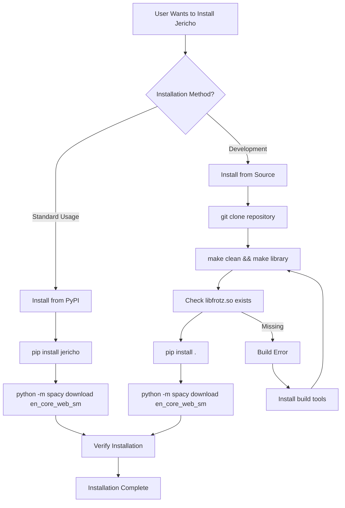
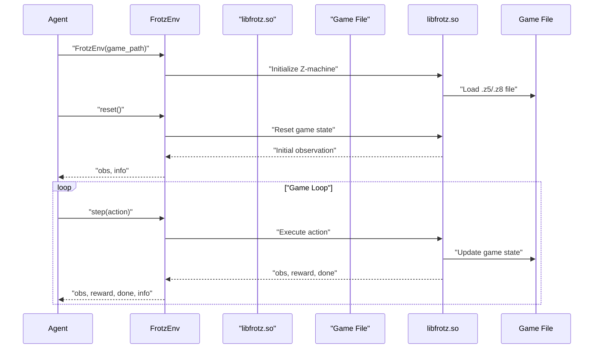

<!-- source: DeepWiki mcp.deepwiki.com · repo microsoft/jericho · page 2 Getting Started · fetched 2026-10-26 -->

# Getting Started

<details>
<summary>Relevant source files</summary>

The following files were used as context for generating this wiki page:

- [README.md](README.md)
- [docs/source/tutorial_quick.rst](docs/source/tutorial_quick.rst)
- [jericho/__init__.py](jericho/__init__.py)
- [jericho/util.py](jericho/util.py)
- [jericho/version.py](jericho/version.py)
- [requirements.txt](requirements.txt)
- [setup.py](setup.py)
- [tests/test_valid_actions.py](tests/test_valid_actions.py)

</details>


This page provides installation instructions, basic usage examples, and a quick start guide for new users beginning with Jericho. It covers the essential steps to get Jericho running and demonstrates the core interface for interacting with interactive fiction games.

For detailed information about the `FrotzEnv` interface and its methods, see [Core Components](#3.1). For information about adding support for new games, see [Adding New Games](#5.2).

## System Requirements

Jericho requires specific system dependencies and runtime environment setup before installation:

| Component | Requirement | Purpose |
|-----------|-------------|---------|
| Operating System | Linux | Required for C library compilation |
| Python | 3.9+ | Core runtime environment |
| Build Tools | gcc, make, curl | C library compilation |
| NLP Library | Spacy with en_core_web_sm model | Text processing and action generation |

## Installation Methods

Jericho supports two primary installation approaches: package manager installation for standard usage and source installation for development.

### Installation Flow



Sources: [setup.py:22-30](), [README.md:29-35](), [docs/source/tutorial_quick.rst:14-34]()

### PyPI Installation

The standard installation method uses the Python Package Index:

```bash
pip install jericho
python -m spacy download en_core_web_sm
```

This approach downloads the pre-compiled `libfrotz.so` library and handles dependency resolution automatically.

Sources: [README.md:33-34](), [docs/source/tutorial_quick.rst:16-17]()

### Source Installation

For development or customization, install from the GitHub repository:

```bash
git clone https://github.com/microsoft/jericho.git
cd jericho
pip install .
python -m spacy download en_core_web_sm
```

The source installation process compiles the Frotz C library during setup, as defined in [setup.py:24-25](). The build system ensures `libfrotz.so` exists before proceeding with Python package installation.

Sources: [setup.py:24-30](), [docs/source/tutorial_quick.rst:23-34]()

## Acquiring Game Files

Jericho requires Z-machine game files (`.z5`, `.z8` formats) to function. The supported game archive can be downloaded:

```bash
wget https://github.com/BYU-PCCL/z-machine-games/archive/master.zip
unzip master.zip
```

Jericho-supported games are located in the `jericho-game-suite` subdirectory of the extracted archive.

Sources: [docs/source/tutorial_quick.rst:42-47]()

## Core Interface Overview

The primary interaction with Jericho occurs through the `FrotzEnv` class, which implements a reinforcement learning interface for text-based games.

### Basic Usage Pattern



Sources: [docs/source/tutorial_quick.rst:55-68](), [jericho/__init__.py:1]()

## Essential Code Example

The following example demonstrates the core `FrotzEnv` interface pattern:

```python
from jericho import *

# Initialize environment with game file
env = FrotzEnv("z-machine-games-master/jericho-game-suite/zork1.z5")
initial_observation, info = env.reset()

done = False
while not done:
    # Execute action and receive feedback
    observation, reward, done, info = env.step('open mailbox')
    
    # Access game metadata
    print('Total Score', info['score'], 'Moves', info['moves'])

print('Scored', info['score'], 'out of', env.get_max_score())
```

This pattern follows the standard reinforcement learning interface where agents provide string actions and receive string observations, numerical rewards, and termination indicators.

Sources: [docs/source/tutorial_quick.rst:57-68]()

## Key Interface Methods

### State Management Methods

| Method | Purpose | Return Type |
|--------|---------|-------------|
| `reset()` | Initialize/restart game | `(observation, info)` |
| `step(action)` | Execute action | `(obs, reward, done, info)` |
| `get_state()` | Serialize current state | `bytes` |
| `set_state(state)` | Restore saved state | `None` |

### Information Access Methods

| Method | Purpose | Return Type |
|--------|---------|-------------|
| `get_dictionary()` | Game vocabulary | `list[str]` |
| `get_valid_actions()` | Available actions | `list[str]` |
| `get_world_objects()` | All game objects | `list[ZObject]` |
| `get_player_location()` | Current location object | `ZObject` |
| `get_inventory()` | Player inventory | `list[ZObject]` |

Sources: [docs/source/tutorial_quick.rst:74-138]()

### Action Generation and Validation

Jericho provides sophisticated action generation capabilities through `get_valid_actions()`:

```python
>>> env.reset()
'You are standing in an open field west of a white house, with a boarded front door. There is a small mailbox here.'
>>> valid_actions = env.get_valid_actions()
['south', 'open mailbox', 'west', 'north']
```

This method uses the `TemplateActionGenerator` system to automatically identify contextually appropriate actions based on current game state and available objects.

Sources: [docs/source/tutorial_quick.rst:117-124](), [tests/test_valid_actions.py:7-16]()

## Verification and Troubleshooting

### Installation Verification

Test the installation with a minimal example:

```python
import jericho
env = jericho.FrotzEnv("game.z5")  # Requires valid game file
obs, info = env.reset()
print("Installation successful:", len(obs) > 0)
```

### Common Dependencies

The build process requires specific dependencies defined in [requirements.txt:2-4]():

- `numpy`: Numerical computations
- `spacy>=2.1.0`: Natural language processing
- `termcolor`: Terminal output formatting

The setup process automatically handles Spacy model installation through [jericho/util.py:44-47](), which downloads `en_core_web_sm` if not present.

Sources: [requirements.txt:2-4](), [jericho/util.py:38-47](), [setup.py:35]()

---

