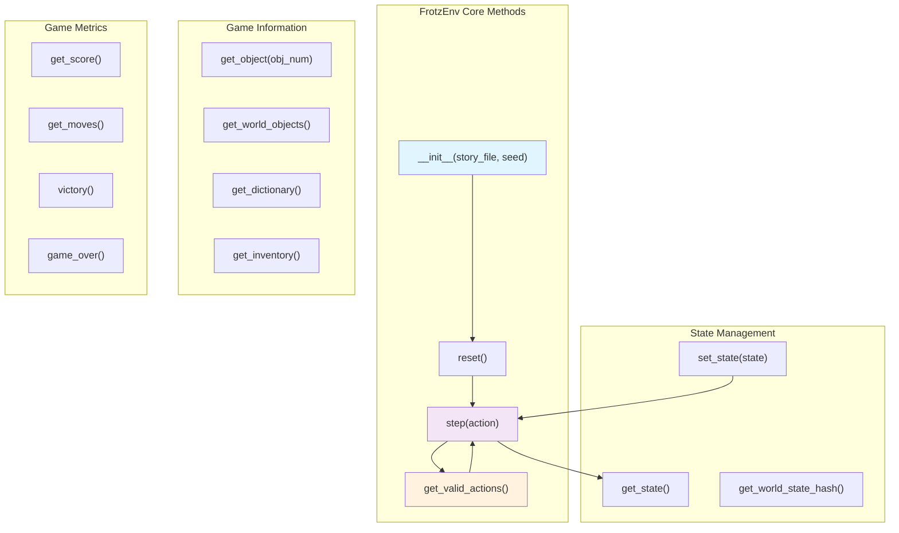
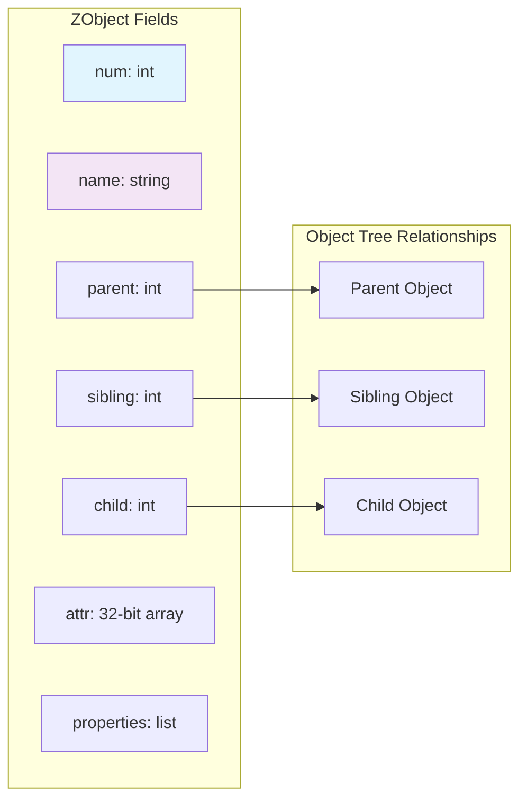
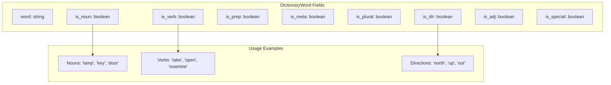
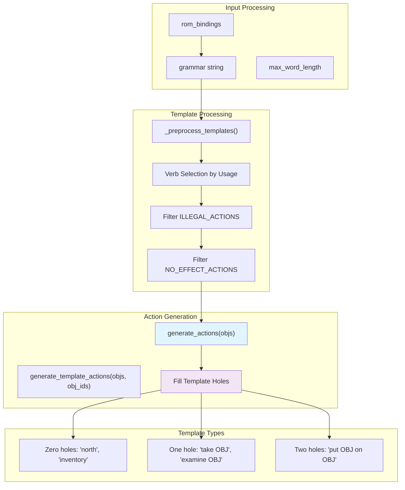
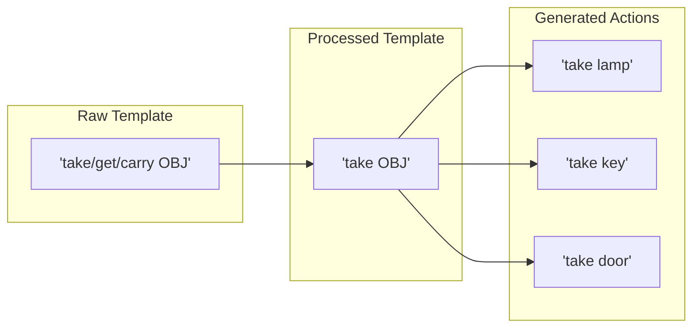
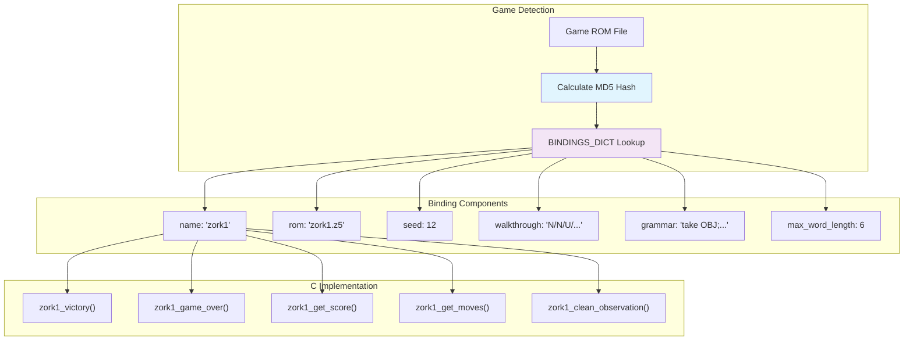
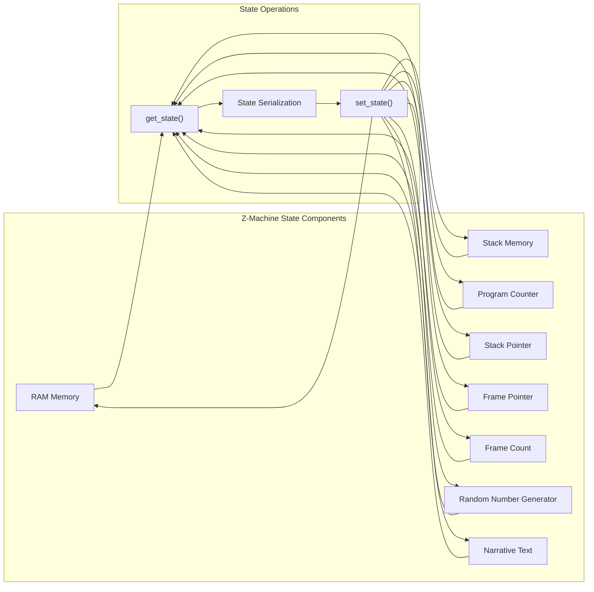

<!-- source: DeepWiki mcp.deepwiki.com · repo microsoft/jericho · page 3 Core Components · fetched 2026-10-26 -->

# Core Components

Relevant source files

The following files were used as context for generating this wiki page:

- [frotz/src/games/omniquest.c](frotz/src/games/omniquest.c)
- [frotz/src/games/plundered.c](frotz/src/games/plundered.c)
- [frotz/src/games/zork1.c](frotz/src/games/zork1.c)
- [jericho/defines.py](jericho/defines.py)
- [jericho/game_info.py](jericho/game_info.py)
- [jericho/jericho.py](jericho/jericho.py)
- [jericho/template_action_generator.py](jericho/template_action_generator.py)

This document provides a detailed overview of the main architectural components that make up the Jericho system. It covers the Python interface layer, action generation system, game support framework, and Z-machine integration. For information about building and installing Jericho, see [Building and Testing](#5.1). For details about adding support for new games, see [Adding New Games](#5.2).

## Python Interface Layer

The Python interface layer provides the primary API for interacting with interactive fiction games through the `FrotzEnv` class and supporting data structures.

### FrotzEnv Class

The `FrotzEnv` class serves as the main entry point for all game interactions. It wraps the underlying C library and provides a clean Python API compatible with reinforcement learning frameworks.

Sources: [jericho/jericho.py:371-492]()

### Z-Machine Data Structures

Jericho exposes key Z-machine data structures through Python classes that provide access to game internals.

#### ZObject Structure

The `ZObject` class represents objects in the Z-machine object tree, providing access to object relationships, attributes, and properties.

Sources: [jericho/jericho.py:59-129]()

#### DictionaryWord Structure

The `DictionaryWord` class represents vocabulary words recognized by the game parser, including part-of-speech information.

Sources: [jericho/jericho.py:131-214]()

## Action Generation System

The action generation system automatically creates valid actions from grammar templates and identified interactive objects, enabling systematic exploration of the action space.

### TemplateActionGenerator Architecture

Sources: [jericho/template_action_generator.py:22-99]()

### Template Processing Pipeline

The system processes raw grammar strings into usable templates through several steps:

1. **Verb Selection**: When templates contain multiple verbs separated by `/`, the system selects the most commonly used verb based on frequency counts
2. **Filtering**: Templates starting with illegal actions or no-effect actions are filtered out
3. **Hole Filling**: Templates with `OBJ` placeholders are filled with interactive objects

Sources: [jericho/template_action_generator.py:42-65]()

## Game Support Framework

Jericho supports over 40 different interactive fiction games through a sophisticated binding system that maps game MD5 hashes to game-specific implementations.

### Game Binding System

Sources: [jericho/defines.py:79-137](), [jericho/game_info.py:17-24]()

### Game-Specific Implementations

Each supported game has a corresponding C implementation that provides customized behavior for victory detection, scoring, observation cleaning, and state management.

| Function Pattern | Purpose | Example |
|------------------|---------|---------|
| `{game}_victory()` | Detect win condition | `zork1_victory()` checks for "Inside the Barrow" |
| `{game}_game_over()` | Detect death/loss | `zork1_game_over()` checks for "You have died" |
| `{game}_get_score()` | Read score from memory | `zork1_get_score()` reads from addresses 8819-8820 |
| `{game}_get_moves()` | Read move count | `zork1_get_moves()` reads from addresses 8821-8822 |
| `{game}_clean_observation()` | Process game text | Remove prompts, clean formatting |

Sources: [frotz/src/games/zork1.c:53-136](), [frotz/src/games/omniquest.c:50-82]()

## Z-Machine Integration

The Python layer communicates with the Z-machine interpreter through a C library interface (`libfrotz.so`) that provides low-level access to game state and execution.

### C Library Interface

```mermaid
graph TB
    subgraph "Python ctypes Interface"
        LOADLIB["_load_frotz_lib()"]
        ARGTYPES["Function Argument Types"]
        RESTYPES["Function Return Types"]
    end
    
    subgraph "Core Z-Machine Operations"
        SETUP["frotz_lib.setup()"]
        STEP["frotz_lib.step()"]
        SHUTDOWN["frotz_lib.shutdown()"]
    end
    
    subgraph "State Access Functions"
        GETRAM["frotz_lib.getRAM()"]
        SETRAM["frotz_lib.setRAM()"]
        GETSTACK["frotz_lib.getStack()"]
        SETSTACK["frotz_lib.setStack()"]
        GETPC["frotz_lib.getPC()"]
        SETPC["frotz_lib.setPC()"]
    end
    
    subgraph "Game Information Functions"
        GETOBJ["frotz_lib.get_object()"]
        GETWORLDOBJS["frotz_lib.get_world_objects()"]
        GETSCORE["frotz_lib.get_score()"]
        GETMOVES["frotz_lib.get_moves()"]
        VICTORY["frotz_lib.victory()"]
        GAMEOVER["frotz_lib.game_over()"]
    end
    
    LOADLIB --> ARGTYPES
    ARGTYPES --> RESTYPES
    
    RESTYPES --> SETUP
    RESTYPES --> STEP
    RESTYPES --> SHUTDOWN
    
    RESTYPES --> GETRAM
    RESTYPES --> SETRAM
    RESTYPES --> GETSTACK
    RESTYPES --> SETSTACK
    
    RESTYPES --> GETOBJ
    RESTYPES --> GETWORLDOBJS
    RESTYPES --> GETSCORE
    RESTYPES --> GETMOVES
    
    style LOADLIB fill:#e1f5fe
    style STEP fill:#f3e5f5
```

Sources: [jericho/jericho.py:216-339]()

### State Management System

The system provides complete access to Z-machine internal state, enabling save/restore functionality and state-based analysis.

Sources: [jericho/jericho.py:578-632]()

---

