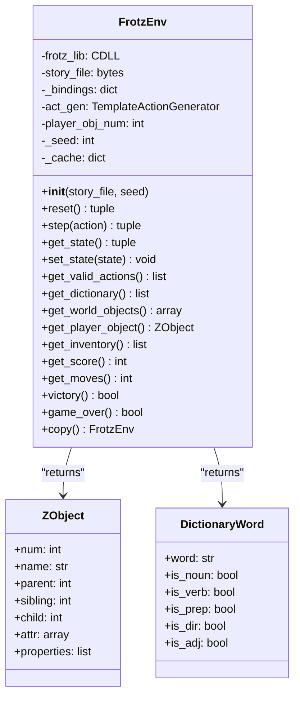
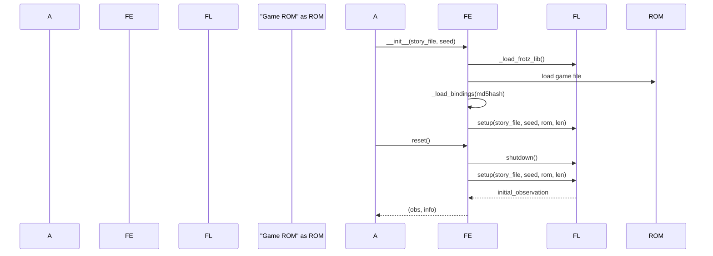
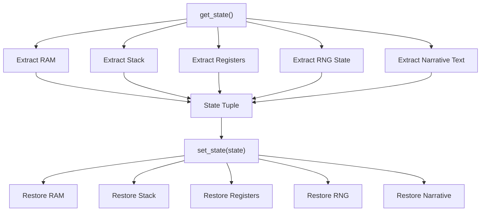
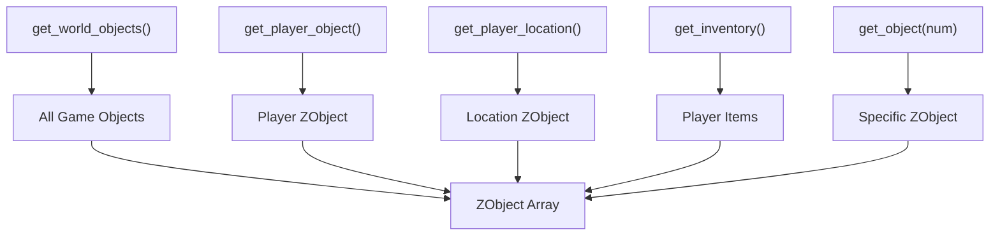
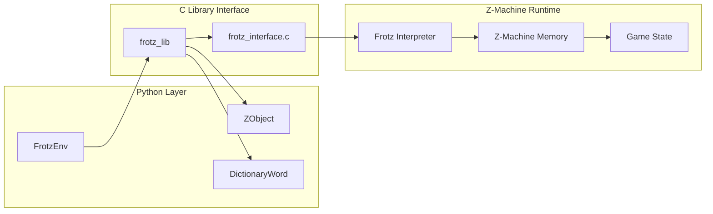
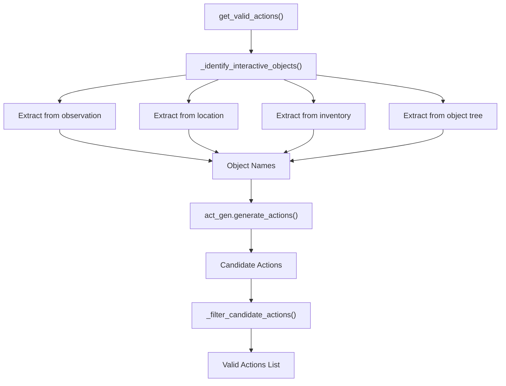

<!-- source: DeepWiki mcp.deepwiki.com · repo microsoft/jericho · page 3.1 FrotzEnv Interface · fetched 2026-10-26 -->

# FrotzEnv Interface

<details>
<summary>Relevant source files</summary>

The following files were used as context for generating this wiki page:

- [README.md](README.md)
- [docs/source/tutorial_quick.rst](docs/source/tutorial_quick.rst)
- [jericho/__init__.py](jericho/__init__.py)
- [jericho/jericho.py](jericho/jericho.py)
- [tests/test_jericho.py](tests/test_jericho.py)
- [tests/test_valid_actions.py](tests/test_valid_actions.py)

</details>


The `FrotzEnv` class is the primary interface for interacting with interactive fiction games in Jericho. It provides a Python wrapper around the Frotz Z-machine interpreter, offering a clean API for reinforcement learning agents and researchers to interact with text-based adventure games. This interface handles game loading, action execution, state management, and provides access to internal game structures like the object tree and dictionary.

For information about action generation from templates, see [Action Generation System](#3.2). For details about game-specific customizations and bindings, see [Game Support and Bindings](#3.3).

## Class Overview

The `FrotzEnv` class serves as the main entry point for game interaction, implementing a reinforcement learning-style interface with methods for resetting the environment, taking actions, and observing game state.



Sources: [jericho/jericho.py:371-497]()

## Core Interaction Methods

The fundamental game interaction follows a reset-step loop pattern typical of reinforcement learning environments.

### Initialization and Reset



The `reset()` method initializes a new game episode and returns the initial observation along with game metadata.

Sources: [jericho/jericho.py:448-462](), [jericho/jericho.py:383-431]()

### Action Execution

The `step(action)` method executes actions and returns the standard RL tuple of observation, reward, done, and info.

| Method | Parameters | Returns | Description |
|--------|------------|---------|-------------|
| `step(action)` | `action: str` | `(obs, reward, done, info)` | Execute action, return response |
| `reset()` | None | `(obs, info)` | Reset game to initial state |

The step method handles action encoding and truncation automatically:

Sources: [jericho/jericho.py:464-491]()

## State Management System

`FrotzEnv` provides comprehensive state serialization capabilities for implementing techniques like search and planning.



The state tuple contains:
- `ram`: Game memory as numpy array
- `stack`: Z-machine stack as numpy array
- `pc`: Program counter
- `sp`: Stack pointer
- `fp`: Frame pointer
- `frame_count`: Call frame count
- `opcode`: Current opcode
- `rng`: Random number generator state
- `narrative`: Current narrative text

Sources: [jericho/jericho.py:605-632](), [jericho/jericho.py:578-603]()

## Game Information Access

The interface provides multiple methods for accessing game internals and metadata.

### Object Tree Access



### Game Dictionary and Vocabulary

The `get_dictionary()` method returns all vocabulary words recognized by the game parser:

| Property | Type | Description |
|----------|------|-------------|
| `word` | str | The dictionary word |
| `is_noun` | bool | Word is a noun |
| `is_verb` | bool | Word is a verb |
| `is_prep` | bool | Word is a preposition |
| `is_dir` | bool | Word is a direction |
| `is_adj` | bool | Word is an adjective |

Sources: [jericho/jericho.py:532-539](), [jericho/jericho.py:131-214]()

## Integration with C Library

The interface communicates with the underlying Frotz interpreter through a dynamically loaded C library.



The C library provides functions for:
- Game setup and shutdown
- Action execution
- State serialization/deserialization
- Object tree access
- Dictionary access
- Game-specific logic hooks

Sources: [jericho/jericho.py:216-339](), [jericho/jericho.py:385-392]()

## Valid Actions Generation

The `get_valid_actions()` method integrates with the template action generator to produce contextually relevant actions.



This process:
1. Identifies interactive objects in the current context
2. Generates candidate actions using grammar templates
3. Filters actions by testing their effects on game state
4. Returns actions that cause meaningful state changes

Sources: [jericho/jericho.py:554-576](), [jericho/jericho.py:840-936]()

## Game Bindings Integration

Each game can have specific metadata and customizations accessed through the `bindings` property.

| Binding Key | Type | Description |
|-------------|------|-------------|
| `name` | str | Game identifier |
| `rom` | str | ROM filename |
| `walkthrough` | str | Solution sequence |
| `seed` | int | Deterministic seed |
| `grammar` | list | Action templates |
| `max_word_length` | int | Parser word limit |

The bindings are loaded based on the game's MD5 hash, ensuring each game gets its appropriate customizations.

Sources: [jericho/jericho.py:497-530](), [jericho/jericho.py:342-360]()

## Usage Patterns

### Basic Game Loop
```python
env = FrotzEnv('game.z5')
obs, info = env.reset()
while not done:
    action = select_action(obs)
    obs, reward, done, info = env.step(action)
```

### State Save/Restore
```python
state = env.get_state()
# Try risky action
obs, reward, done, info = env.step('dangerous action')
if done:
    env.set_state(state)  # Restore if failed
```

### Object Inspection
```python
player = env.get_player_object()
location = env.get_player_location()
inventory = env.get_inventory()
```

Sources: [tests/test_jericho.py:80-97](), [docs/source/tutorial_quick.rst:86-95]()

---

