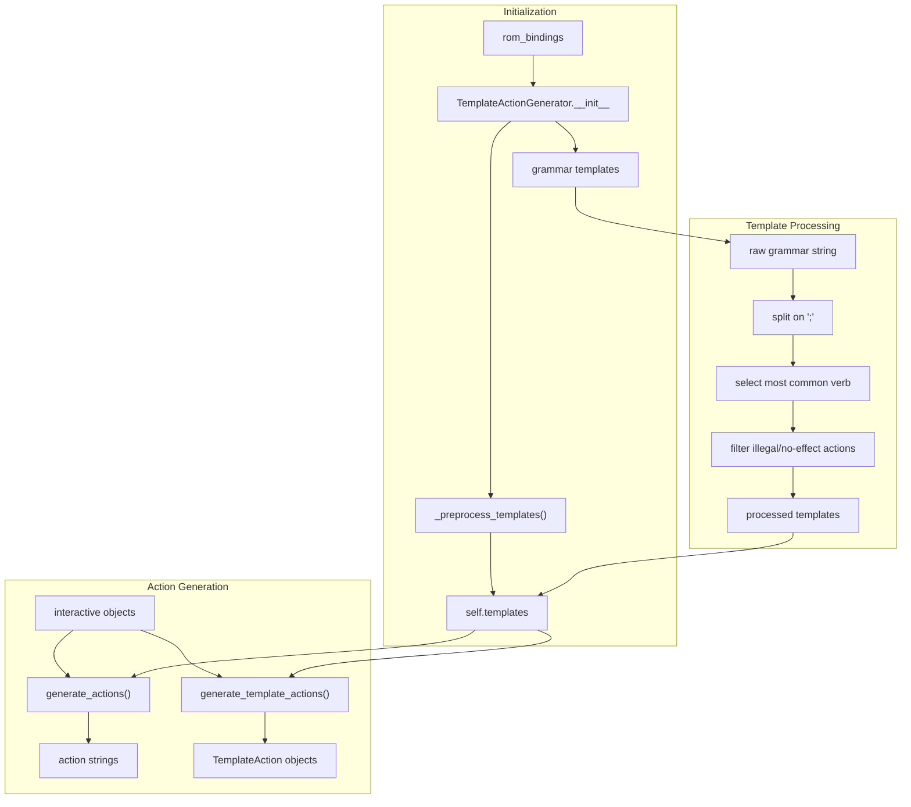
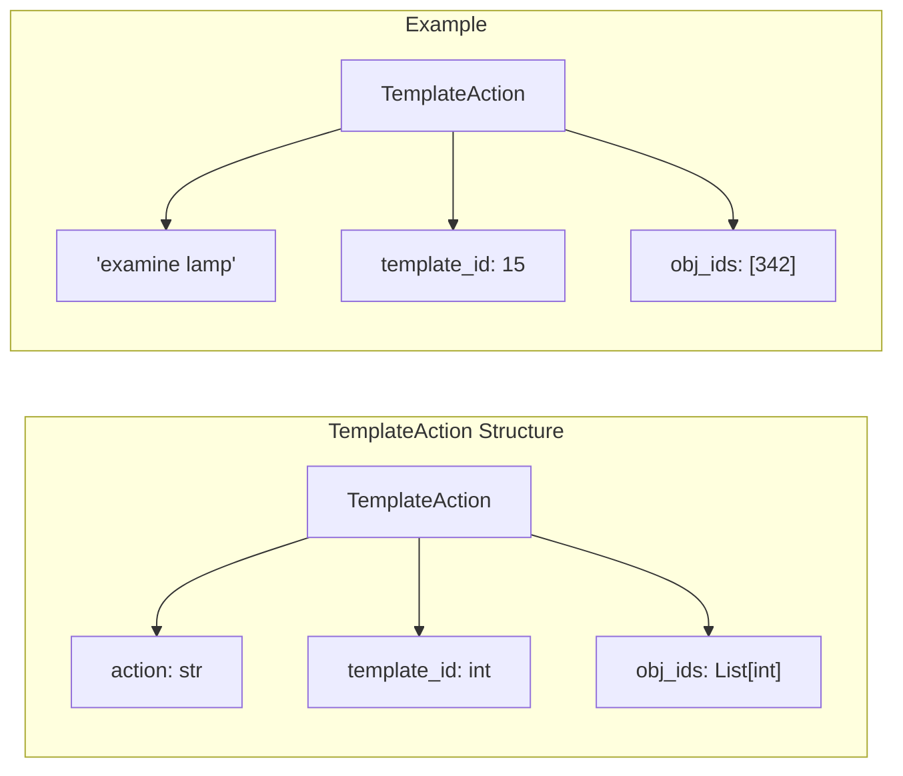
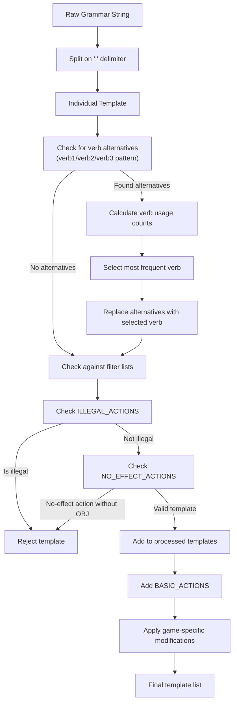
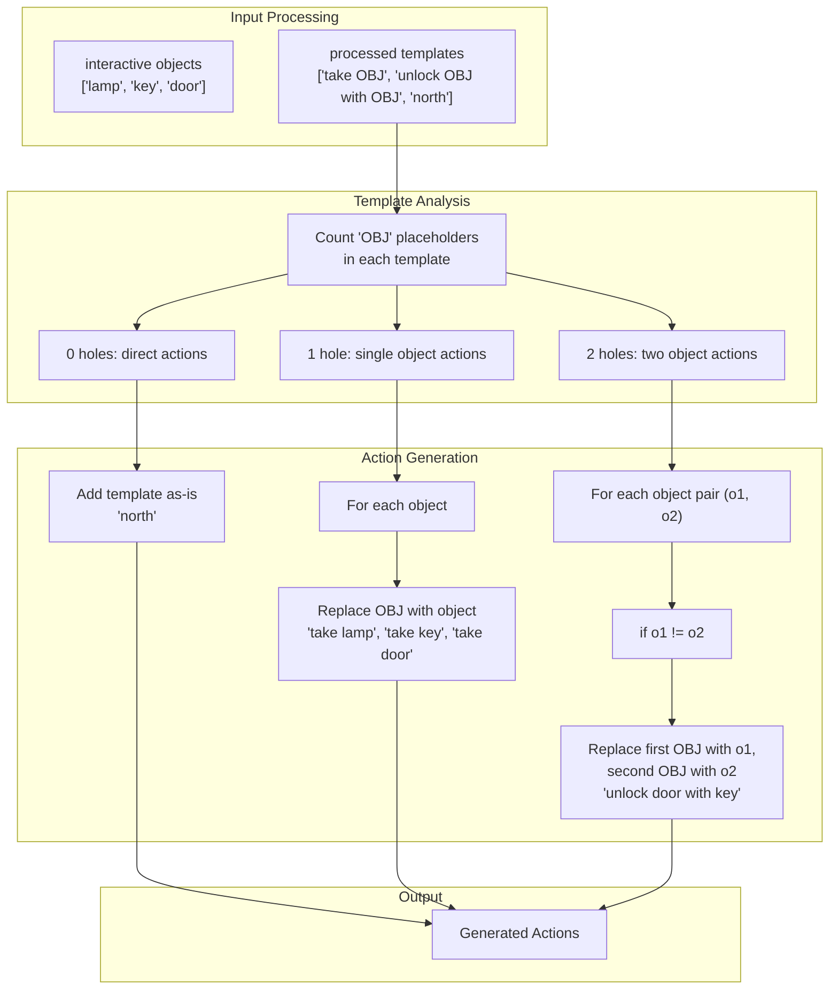
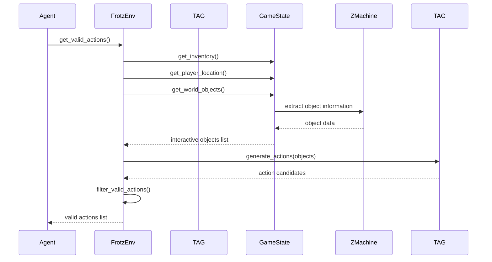
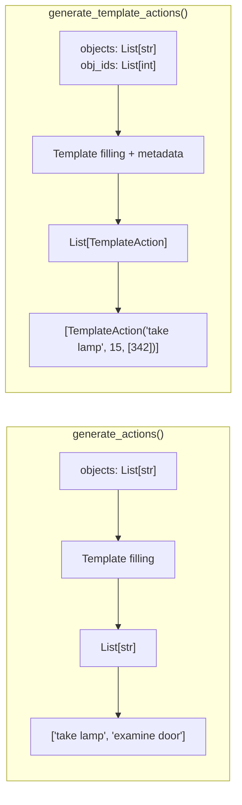

<!-- source: DeepWiki mcp.deepwiki.com · repo microsoft/jericho · page 3.2 Action Generation System · fetched 2026-10-26 -->

# Action Generation System

Relevant source files

The following files were used as context for generating this wiki page:

- [README.md](README.md)
- [docs/source/tutorial_quick.rst](docs/source/tutorial_quick.rst)
- [frotz/src/games/zork1.c](frotz/src/games/zork1.c)
- [jericho/__init__.py](jericho/__init__.py)
- [jericho/defines.py](jericho/defines.py)
- [jericho/template_action_generator.py](jericho/template_action_generator.py)
- [jericho/util.py](jericho/util.py)
- [requirements.txt](requirements.txt)
- [setup.py](setup.py)
- [tests/test_valid_actions.py](tests/test_valid_actions.py)

The Action Generation System is responsible for automatically generating valid actions that can be taken in interactive fiction games. This system bridges the gap between the vast space of possible natural language commands and the specific grammar patterns recognized by each game, enabling reinforcement learning agents to efficiently explore the action space.

The system centers around the `TemplateActionGenerator` class, which uses game-specific grammar templates and current game objects to produce contextually appropriate actions. For information about how these generated actions are validated and executed, see [FrotzEnv Interface](#3.1). For details about game-specific customizations that affect action generation, see [Game Support and Bindings](#3.3).

## Core Architecture

The Action Generation System operates as a template-based action synthesis engine that transforms abstract grammar patterns into concrete, executable commands.

### TemplateActionGenerator Overview

**Sources:** [jericho/template_action_generator.py:22-41](), [jericho/template_action_generator.py:42-66]()

### Template Action Data Structure

The system produces two types of outputs: simple action strings and structured `TemplateAction` objects that preserve metadata about their generation.

**Sources:** [jericho/defines.py:140-151]()

## Template Processing Pipeline

The system transforms raw grammar specifications into executable templates through a multi-stage preprocessing pipeline.

### Grammar Template Preprocessing

**Sources:** [jericho/template_action_generator.py:42-66](), [jericho/util.py:169-208](), [jericho/defines.py:22-28]()

### Verb Selection Algorithm

| Component | Purpose | Implementation |
|-----------|---------|----------------|
| `verb_usage_count()` | Determines frequency of verb usage across game transcripts | [jericho/util.py:169-208]() |
| `ILLEGAL_ACTIONS` | Filters out meta-game commands that manipulate state | [jericho/defines.py:22]() |
| `NO_EFFECT_ACTIONS` | Excludes actions that don't change world state when used alone | [jericho/defines.py:28]() |
| `BASIC_ACTIONS` | Adds fundamental navigation and interaction commands | [jericho/defines.py:25]() |

**Sources:** [jericho/template_action_generator.py:47-64](), [jericho/defines.py:22-28]()

## Action Generation Process

The core action generation process combines preprocessed templates with interactive objects from the current game state to produce concrete actions.

### Template Instantiation Logic

**Sources:** [jericho/template_action_generator.py:68-99](), [jericho/template_action_generator.py:102-149]()

### Object Combination Strategy

The system generates actions by systematically combining templates with available objects:

| Template Pattern | Object Requirements | Example Output |
|------------------|-------------------|----------------|
| `"take OBJ"` | 1 object | `"take lamp"`, `"take key"` |
| `"put OBJ on OBJ"` | 2 different objects | `"put key on table"`, `"put lamp on table"` |
| `"north"` | 0 objects | `"north"` |

**Sources:** [jericho/template_action_generator.py:87-98](), [jericho/template_action_generator.py:132-148]()

## Integration with Game Environment

The Action Generation System integrates tightly with the broader Jericho framework to provide context-aware action suggestions.

### FrotzEnv Integration Flow

**Sources:** [tests/test_valid_actions.py:7-16](), [jericho/template_action_generator.py:68-99]()

### Game-Specific Customizations

Some games require special handling for their action templates:

| Game | Customization | Reason |
|------|---------------|--------|
| `enchanter`, `spellbrkr`, `murdac` | Use abbreviated directions (`ne`, `nw`, `se`, `sw`) | Only recognize shortened direction commands |
| All games | Template verb disambiguation | Multiple verb forms need to be resolved to most common usage |

**Sources:** [jericho/template_action_generator.py:36-40]()

## Template vs Action String Generation

The system provides two generation methods to support different use cases in the Jericho ecosystem.

### Method Comparison

**Sources:** [jericho/template_action_generator.py:68-99](), [jericho/template_action_generator.py:102-149]()

### Use Case Differentiation

- **`generate_actions()`**: Used when only action text is needed, typically for immediate execution or simple action space exploration
- **`generate_template_actions()`**: Used when metadata preservation is important, such as for learning algorithms that need to track which templates and objects produced specific actions

**Sources:** [jericho/template_action_generator.py:77-85](), [jericho/template_action_generator.py:114-128]()

---

