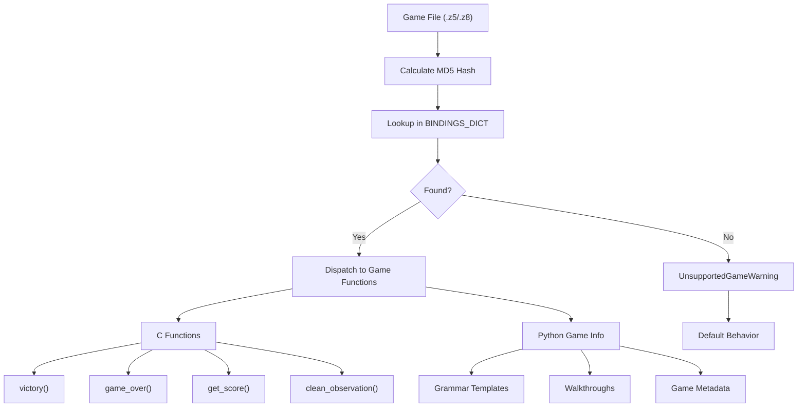
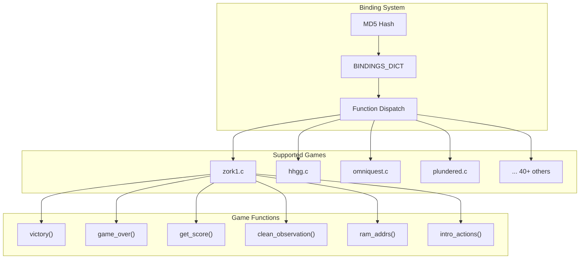
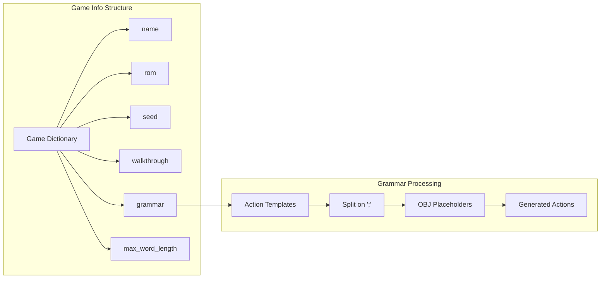
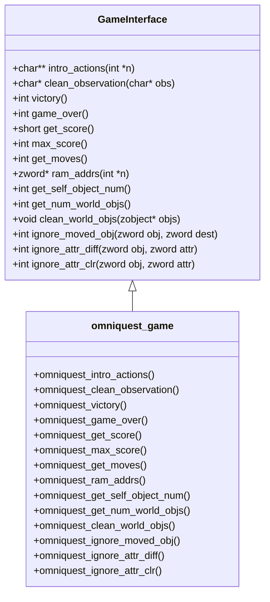
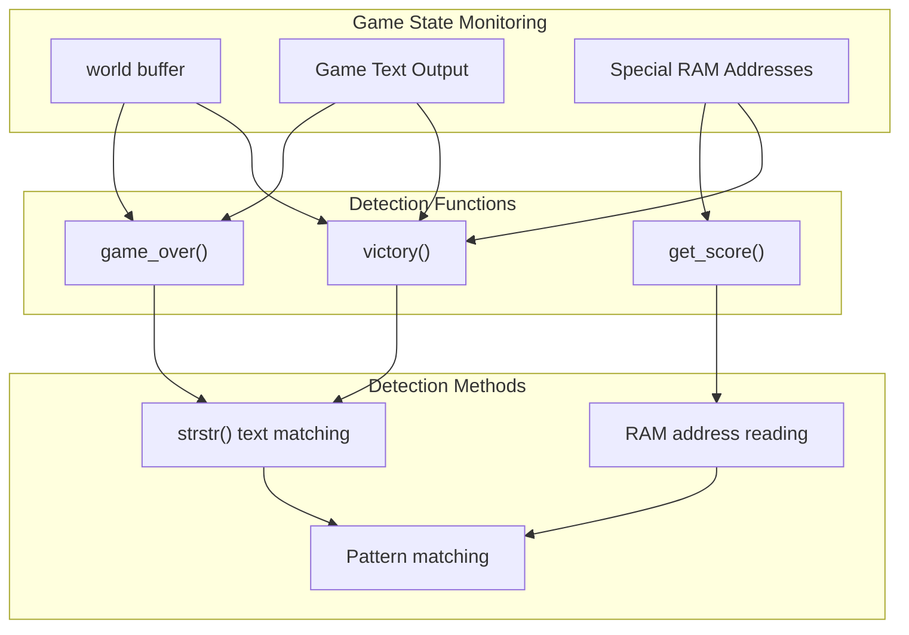
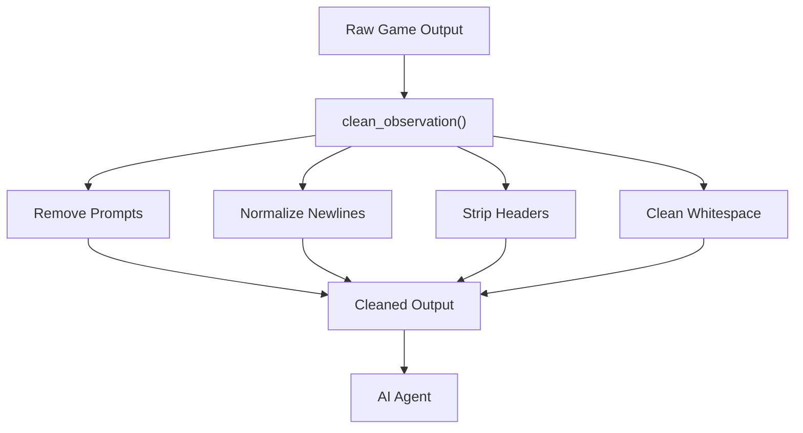
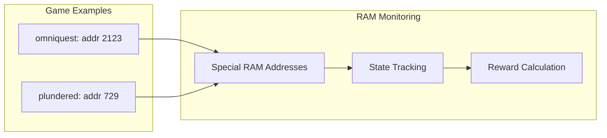

<!-- source: DeepWiki mcp.deepwiki.com · repo microsoft/jericho · page 3.3 Game Support and Bindings · fetched 2026-10-26 -->

# Game Support and Bindings

Relevant source files

The following files were used as context for generating this wiki page:

- [frotz/src/common/screen.c](frotz/src/common/screen.c)
- [frotz/src/games/omniquest.c](frotz/src/games/omniquest.c)
- [frotz/src/games/plundered.c](frotz/src/games/plundered.c)
- [jericho/game_info.py](jericho/game_info.py)
- [tests/test_textworld_games.py](tests/test_textworld_games.py)
- [tests/test_unsupported_game.py](tests/test_unsupported_game.py)

This page explains how Jericho supports 40+ different interactive fiction games through a sophisticated game detection and customization system. The system allows each game to have specialized behavior for victory detection, scoring, observation cleaning, and action generation while maintaining a consistent interface.

For information about the action generation system that uses game-specific grammar templates, see [Action Generation System](#3.2). For details about the core FrotzEnv interface, see [FrotzEnv Interface](#3.1).

## Game Detection and Binding System

Jericho automatically detects which game is being loaded by calculating the MD5 hash of the game file and looking it up in a centralized binding dictionary. This enables game-specific customizations to be applied automatically without user intervention.

### Game Detection Flow

Sources: [tests/test_unsupported_game.py:11-40](), [tests/test_textworld_games.py:11-39]()

### Hash-Based Game Identification

The system uses MD5 hashing for precise game identification, ensuring that different versions or releases of games can be handled appropriately. When a game is not found in the bindings dictionary, Jericho issues an `UnsupportedGameWarning` and falls back to generic behavior.

Sources: [frotz/src/games/omniquest.c:1-111](), [frotz/src/games/plundered.c:1-100]()

## Game Metadata Structure

Each supported game has comprehensive metadata stored in [jericho/game_info.py](). This includes essential information for both gameplay and AI training.

### Core Game Information Fields

| Field | Purpose | Example |
|-------|---------|---------|
| `name` | Game identifier | `"omniquest"` |
| `rom` | Game file name | `"omniquest.z5"` |
| `seed` | Random seed for reproducibility | `4` |
| `walkthrough` | Solution sequence | `"e/get axe/chop tree/..."` |
| `grammar` | Action templates | `"take OBJ;drop OBJ;..."` |
| `max_word_length` | Parser constraint | `9` |

### Grammar Template System

The grammar field contains semicolon-separated action templates that define valid action patterns for the game. These templates use `OBJ` placeholders that get filled with interactive objects discovered in the game world.

Sources: [jericho/game_info.py:17-24](), [jericho/game_info.py:26-34](), [jericho/game_info.py:36-45]()

## Game-Specific C Implementations

Each game has a dedicated C file in [frotz/src/games/]() that implements customized behavior. These implementations override default Z-machine behavior with game-specific logic.

### Required Function Interface

Every game-specific C file must implement a standard set of functions:

Sources: [frotz/src/games/omniquest.c:36-39](), [frotz/src/games/omniquest.c:50-56](), [frotz/src/games/omniquest.c:74-76]()

### Victory and Game Over Detection

Games implement custom logic to detect win/loss conditions by examining the game's text output or internal state:

Sources: [frotz/src/games/omniquest.c:50-64](), [frotz/src/games/plundered.c:50-64]()

## Observation Cleaning

Many games require custom observation cleaning to remove prompts, normalize formatting, or filter out irrelevant information for AI training.

### Common Cleaning Patterns

Different games use various cleaning strategies:

- **Prompt Removal**: Strip input prompts like `>` characters
- **Newline Normalization**: Handle different line ending conventions  
- **Header Stripping**: Remove game title screens or status information
- **Whitespace Cleanup**: Normalize spacing and indentation

Sources: [frotz/src/games/omniquest.c:41-48](), [frotz/src/games/plundered.c:41-48]()

## Special RAM Address Monitoring

Games can specify special RAM addresses to monitor for tracking internal state changes that aren't reflected in the text output. This enables more precise state tracking and reward calculation.

### RAM Address Configuration

Sources: [frotz/src/games/omniquest.c:27-34](), [frotz/src/games/plundered.c:27-34]()

## Unsupported Game Handling

When Jericho encounters a game not in its binding dictionary, it issues an `UnsupportedGameWarning` and falls back to generic behavior. This provides basic functionality while alerting users that game-specific features are unavailable.

### Fallback Behavior

- **Score Tracking**: Returns 0 for all score-related queries
- **Victory Detection**: Always returns false
- **Game Over Detection**: Always returns false  
- **Observation Cleaning**: Uses generic text processing
- **Action Generation**: Uses default grammar templates

Sources: [tests/test_unsupported_game.py:11-40]()

---

