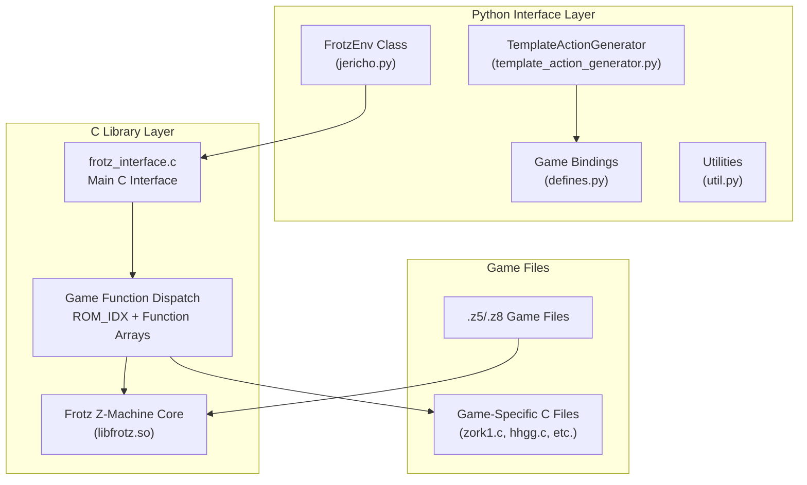
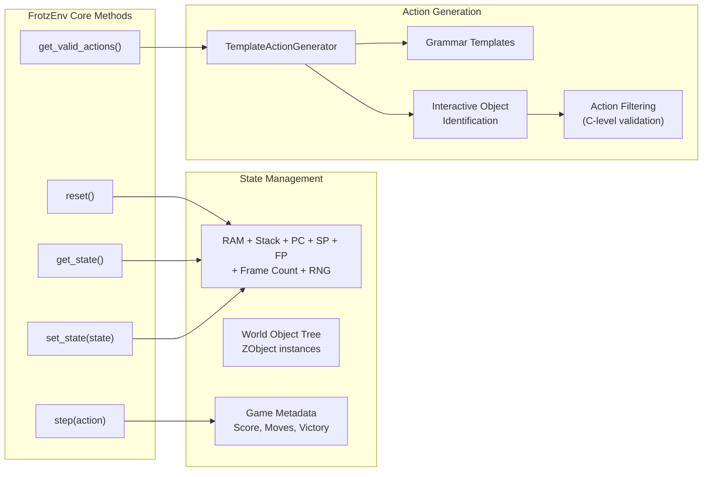
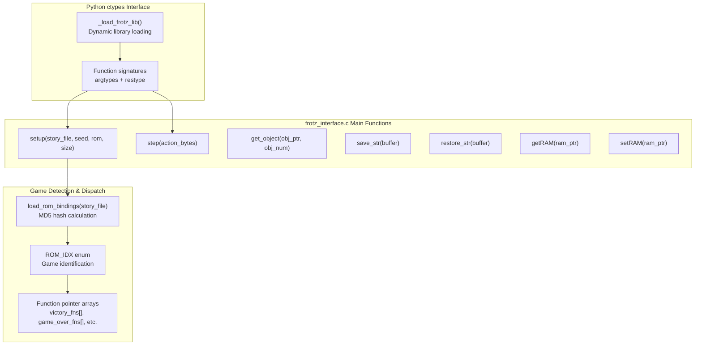
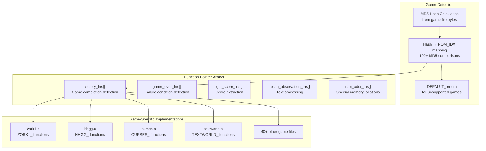
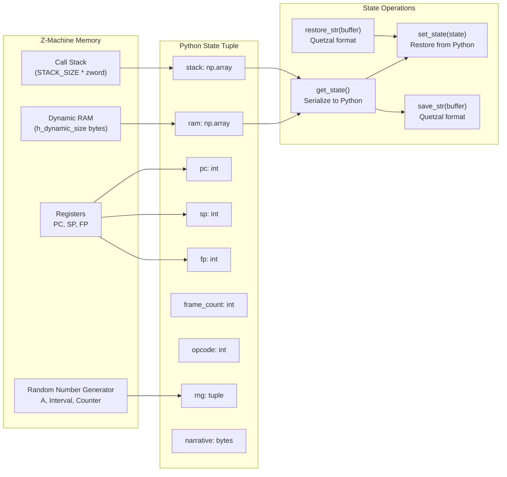
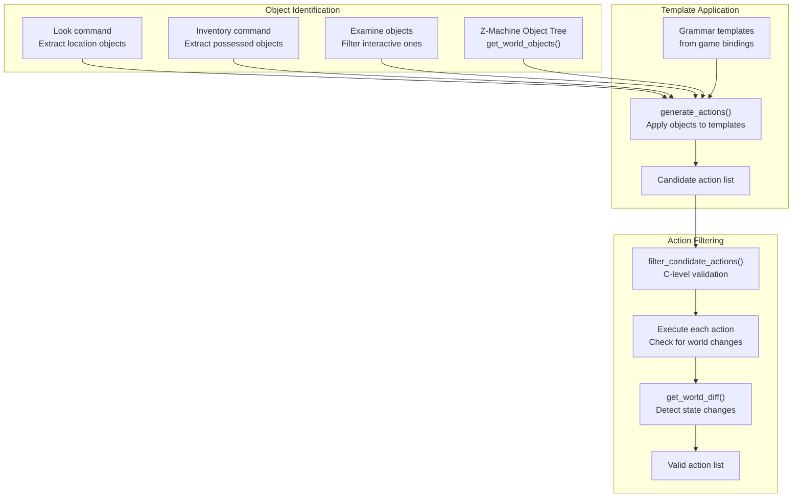

<!-- source: DeepWiki mcp.deepwiki.com · repo microsoft/jericho · page 4 Architecture · fetched 2026-10-26 -->

# Architecture

Relevant source files

The following files were used as context for generating this wiki page:

- [frotz/src/dumb/dumb_blorb.c](frotz/src/dumb/dumb_blorb.c)
- [frotz/src/dumb/dumb_frotz.h](frotz/src/dumb/dumb_frotz.h)
- [frotz/src/dumb/dumb_init.c](frotz/src/dumb/dumb_init.c)
- [frotz/src/dumb/dumb_input.c](frotz/src/dumb/dumb_input.c)
- [frotz/src/dumb/dumb_output.c](frotz/src/dumb/dumb_output.c)
- [frotz/src/dumb/dumb_pic.c](frotz/src/dumb/dumb_pic.c)
- [frotz/src/interface/frotz_interface.c](frotz/src/interface/frotz_interface.c)
- [jericho/jericho.py](jericho/jericho.py)

This document provides a technical deep dive into Jericho's internal architecture, explaining how the major components interact to provide a Python interface for interactive fiction games. It covers the layered design, game customization framework, and Z-machine integration patterns.

For information about using the FrotzEnv interface, see [Core Components](#3). For details on adding new games, see [Adding New Games](#5.2).

## Layered Architecture Overview

Jericho employs a clean layered architecture that separates the Python interface from the underlying Z-machine implementation:

The architecture provides clear separation of concerns: Python handles the high-level API and action generation, while C handles the performance-critical Z-machine interpretation and game-specific logic.

**Sources:** [jericho/jericho.py:371-388](), [frotz/src/interface/frotz_interface.c:174-311]()

## Python Interface Layer

The Python layer provides the main user-facing API through the `FrotzEnv` class and supporting components:

The `FrotzEnv` class in [jericho/jericho.py:371-388]() serves as the main interface, managing game state and coordinating between the action generation system and the underlying C library. Key methods include:

- `reset()` - Initializes game state and returns initial observation
- `step(action)` - Executes an action and returns observation, reward, done, info
- `get_valid_actions()` - Generates contextually valid actions using templates and object detection
- `get_state()`/`set_state()` - Serializes/deserializes complete game state for checkpointing

**Sources:** [jericho/jericho.py:448-491](), [jericho/jericho.py:554-576](), [jericho/jericho.py:578-632]()

## C Library Interface

The C layer provides the bridge between Python and the Frotz Z-machine interpreter:

The interface layer handles several critical responsibilities:

1. **Dynamic Library Loading**: [jericho/jericho.py:216-339]() loads `libfrotz.so` and defines ctypes signatures for all C functions
2. **Game Detection**: [frotz/src/interface/frotz_interface.c:174-311]() calculates MD5 hashes of game files to determine which game-specific implementations to use
3. **State Serialization**: Functions like `save_str()` and `restore_str()` enable complete game state checkpointing
4. **Memory Management**: Direct access to Z-machine RAM, stack, and registers through functions like `getRAM()`/`setRAM()`

**Sources:** [jericho/jericho.py:216-339](), [frotz/src/interface/frotz_interface.c:313-374](), [frotz/src/interface/frotz_interface.c:376-455]()

## Game Customization Framework

Jericho supports 40+ different interactive fiction games through a sophisticated dispatch system:

Each supported game has an entry in the ROM_IDX enum and corresponding implementations for critical functions:

| Function Category | Purpose | Example Implementation |
|------------------|---------|----------------------|
| Victory Detection | Determine game completion | `zork1_victory()` |
| Game Over Detection | Detect failure conditions | `hhgg_game_over()` |
| Score Calculation | Extract current score | `curses_get_score()` |
| Observation Cleaning | Process game text | `textworld_clean_observation()` |
| Special RAM Addresses | Game-specific memory locations | `zork1_ram_addrs()` |

The dispatch mechanism in [frotz/src/interface/frotz_interface.c:469-529]() uses function pointer arrays indexed by `ROM_IDX` to call the appropriate game-specific implementations.

**Sources:** [frotz/src/interface/frotz_interface.c:174-311](), [frotz/src/interface/frotz_interface.c:469-1148]()

## Z-Machine State Management

Jericho provides complete access to the Z-machine's internal state for research applications:

The state management system enables several key research capabilities:

1. **Perfect Checkpointing**: Complete game state can be saved and restored
2. **Deterministic Replay**: With saved state + actions, games can be replayed exactly
3. **State Analysis**: Access to object trees, memory, and internal variables
4. **Parallel Exploration**: Multiple environments can be forked from the same state

State serialization is handled by [jericho/jericho.py:605-632]() which extracts all Z-machine components into a Python tuple, while [jericho/jericho.py:578-604]() restores the state by calling the corresponding C functions.

**Sources:** [jericho/jericho.py:605-632](), [jericho/jericho.py:578-604](), [frotz/src/interface/frotz_interface.c:376-455]()

## Action Generation and Validation

The action generation system automatically produces valid actions based on game grammar and current context:

The action generation process in [jericho/jericho.py:554-576]() follows these steps:

1. **Object Identification**: Uses `_identify_interactive_objects()` to find objects in the current location and inventory
2. **Template Generation**: Applies grammar templates to identified objects using `TemplateActionGenerator`
3. **Action Filtering**: Tests each candidate action by executing it and checking for world state changes
4. **Parallelization**: Can use multiprocessing to speed up action filtering for large candidate sets

The filtering process is performance-critical and can optionally use C-level optimization (`use_ctypes=True`) and parallel processing (`use_parallel=True`).

**Sources:** [jericho/jericho.py:554-576](), [jericho/jericho.py:938-1036](), [jericho/jericho.py:840-936]()

---

