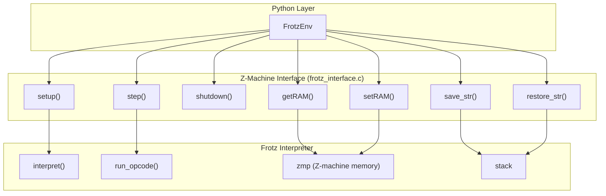
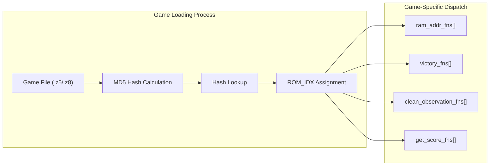
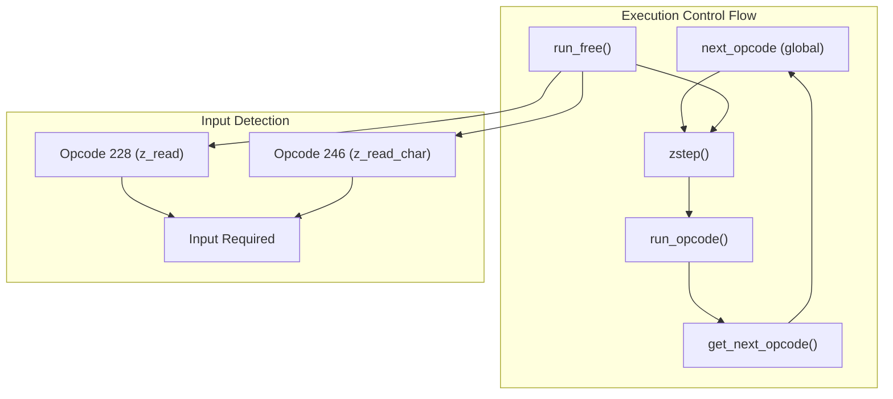
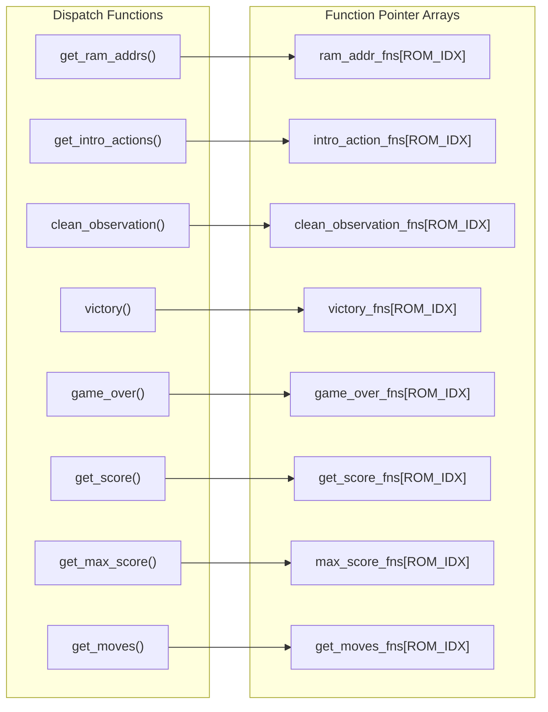
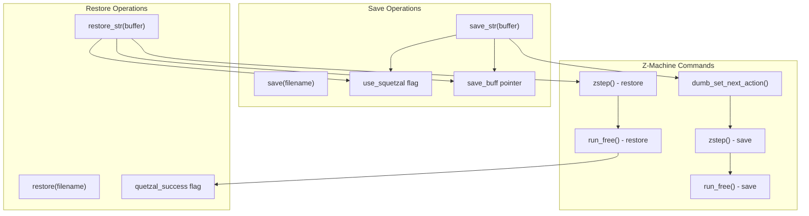
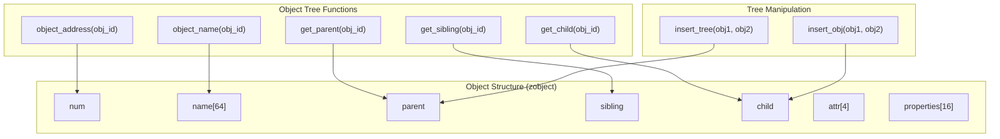
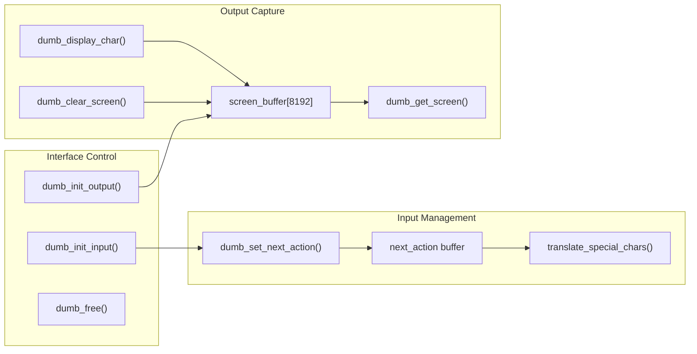

<!-- source: DeepWiki mcp.deepwiki.com · repo microsoft/jericho · page 4.1 Z-Machine Interface · fetched 2026-10-26 -->

# Z-Machine Interface

Relevant source files

The following files were used as context for generating this wiki page:

- [frotz/src/common/setup.h](frotz/src/common/setup.h)
- [frotz/src/dumb/dumb_blorb.c](frotz/src/dumb/dumb_blorb.c)
- [frotz/src/dumb/dumb_frotz.h](frotz/src/dumb/dumb_frotz.h)
- [frotz/src/dumb/dumb_init.c](frotz/src/dumb/dumb_init.c)
- [frotz/src/dumb/dumb_input.c](frotz/src/dumb/dumb_input.c)
- [frotz/src/dumb/dumb_output.c](frotz/src/dumb/dumb_output.c)
- [frotz/src/dumb/dumb_pic.c](frotz/src/dumb/dumb_pic.c)
- [frotz/src/interface/frotz_interface.c](frotz/src/interface/frotz_interface.c)
- [frotz/src/interface/frotz_interface.h](frotz/src/interface/frotz_interface.h)
- [tests/benchmarks.py](tests/benchmarks.py)

The Z-Machine Interface provides the low-level C bridge between Jericho's Python API and the Frotz Z-machine interpreter. This interface layer translates high-level Python operations into Z-machine opcodes and manages game state, execution control, and game-specific customizations.

For information about the higher-level Python interface, see [FrotzEnv Interface](#3.1). For details on game-specific customization implementations, see [Game Customization Framework](#4.2).

## Core Interface Functions

The Z-Machine Interface exposes a set of C functions that provide direct control over Z-machine execution and state management. These functions form the foundation upon which the Python `FrotzEnv` class is built.

**Sources:** [frotz/src/interface/frotz_interface.c:33-59](), [frotz/src/interface/frotz_interface.h:33-59]()

## Game Detection and Dispatch System

The interface uses MD5 hash-based game detection to dispatch to game-specific implementations. When a game is loaded, its MD5 hash is calculated and matched against a comprehensive database of supported games.

The `load_rom_bindings()` function performs this detection by computing MD5 hashes and setting the global `ROM_IDX` variable, which indexes into arrays of game-specific function pointers.

**Sources:** [frotz/src/interface/frotz_interface.c:174-311](), [frotz/src/interface/frotz_interface.c:469-529]()

## Z-Machine State Management

The interface provides comprehensive access to Z-machine internal state, enabling features like save/restore, undo, and state inspection for reinforcement learning agents.

| Function | Purpose | Returns |
|----------|---------|---------|
| `getRAMSize()` | Get size of dynamic memory | Size in bytes |
| `getRAM()` | Copy dynamic memory | Memory contents |
| `setRAM()` | Restore dynamic memory | - |
| `getPC()` | Get program counter | PC offset |
| `setPC()` | Set program counter | - |
| `getSP()` | Get stack pointer | SP offset |
| `setSP()` | Set stack pointer | - |
| `getStack()` | Copy call stack | Stack contents |
| `setStack()` | Restore call stack | - |

**Sources:** [frotz/src/interface/frotz_interface.c:376-463]()

## Execution Control

The Z-Machine Interface provides fine-grained control over game execution through opcode-level stepping and free-running modes.

The `run_free()` function executes Z-machine opcodes until the game requires user input (opcodes 228 or 246), while `zstep()` executes exactly one opcode.

**Sources:** [frotz/src/interface/frotz_interface.c:86-97]()

## Game-Specific Function Dispatch

The interface maintains arrays of function pointers indexed by `ROM_IDX` to provide game-specific behavior customization. This architecture supports over 40 different interactive fiction games with tailored implementations.

**Sources:** [frotz/src/interface/frotz_interface.c:1342-1395]()

## Save and Restore Operations

The interface supports both file-based and memory-based save/restore operations using the Quetzal save format. Memory-based operations enable rapid state snapshots for reinforcement learning.

**Sources:** [frotz/src/interface/frotz_interface.c:324-374]()

## Object System Interface

The Z-Machine Interface provides access to the Z-machine's object tree structure, which represents the game world's hierarchical organization of items, rooms, and characters.

**Sources:** [frotz/src/interface/frotz_interface.h:23-31](), [frotz/src/interface/frotz_interface.c:48-54]()

## Dumb Interface Integration

The Z-Machine Interface integrates with Frotz's "dumb" text-only interface to capture game output and manage input. This provides a headless interface suitable for automated agents.

**Sources:** [frotz/src/dumb/dumb_input.c:80-85](), [frotz/src/dumb/dumb_output.c:550-557](), [frotz/src/interface/frotz_interface.c:35-38]()

---

