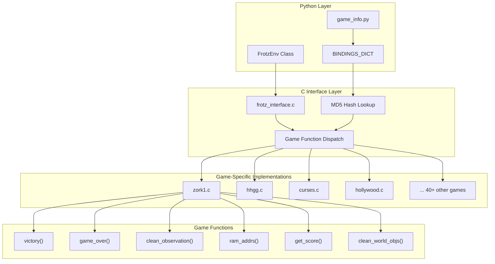
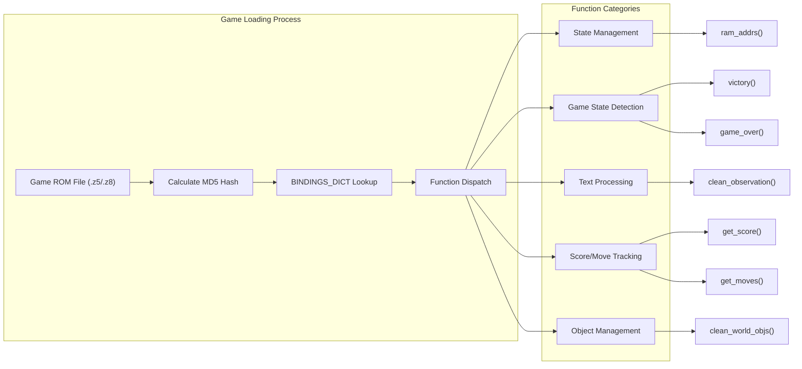
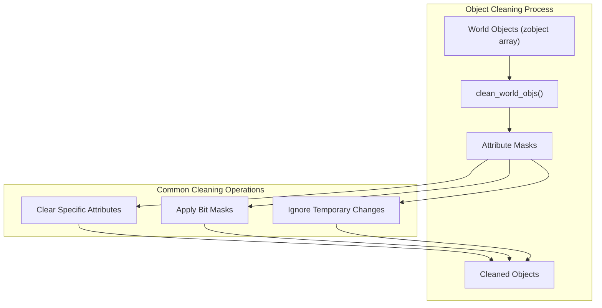

<!-- source: DeepWiki mcp.deepwiki.com · repo microsoft/jericho · page 4.2 Game Customization Framework · fetched 2026-10-26 -->

# Game Customization Framework

<details>
<summary>Relevant source files</summary>

The following files were used as context for generating this wiki page:

- [frotz/src/common/err.c](frotz/src/common/err.c)
- [frotz/src/games/curses.c](frotz/src/games/curses.c)
- [frotz/src/games/deephome.c](frotz/src/games/deephome.c)
- [frotz/src/games/detective.c](frotz/src/games/detective.c)
- [frotz/src/games/hhgg.c](frotz/src/games/hhgg.c)
- [frotz/src/games/hollywood.c](frotz/src/games/hollywood.c)
- [frotz/src/games/loose.c](frotz/src/games/loose.c)
- [frotz/src/games/omniquest.c](frotz/src/games/omniquest.c)
- [frotz/src/games/plundered.c](frotz/src/games/plundered.c)
- [frotz/src/games/snacktime.c](frotz/src/games/snacktime.c)
- [frotz/src/games/spellbrkr.c](frotz/src/games/spellbrkr.c)
- [frotz/src/games/trinity.c](frotz/src/games/trinity.c)
- [jericho/game_info.py](jericho/game_info.py)

</details>


The Game Customization Framework is the system by which Jericho supports over 40 different interactive fiction games through a unified interface. Each game requires specific customizations for victory detection, state monitoring, observation cleaning, and other game-specific behaviors. This framework provides both C-level function hooks and Python-level metadata to handle these customizations while maintaining a consistent API.

For information about the core FrotzEnv interface that uses this framework, see [FrotzEnv Interface](#3.1). For details on adding new games to the framework, see [Adding New Games](#5.2).

## Architecture Overview

The Game Customization Framework operates as a layer between the generic Frotz Z-machine interpreter and the specific requirements of individual games. It uses a hash-based dispatch system to route game-specific calls to the appropriate implementations.



Sources: [frotz/src/games/hollywood.c:1-119](), [frotz/src/games/hhgg.c:1-119](), [frotz/src/games/curses.c:1-121](), [jericho/game_info.py:1-50]()

## Game Detection and Dispatch System

Games are identified by calculating the MD5 hash of their ROM files and looking up the corresponding game bindings. This enables automatic detection and routing to game-specific implementations.



Sources: [jericho/game_info.py:17-24](), [frotz/src/games/hollywood.c:39-42]()

## Core Game-Specific Function Interface

Each game implements a standardized set of C functions that override default behavior. These functions handle the unique requirements of individual games while maintaining a consistent interface.

### Required Function Signatures

| Function | Purpose | Example Implementation |
|----------|---------|----------------------|
| `game_ram_addrs(int *n)` | Returns special RAM addresses to monitor | [frotz/src/games/hollywood.c:39-42]() |
| `game_victory()` | Detects victory condition | [frotz/src/games/hollywood.c:58-64]() |
| `game_game_over()` | Detects game over condition | [frotz/src/games/hollywood.c:66-72]() |
| `game_clean_observation(char* obs)` | Cleans raw game output | [frotz/src/games/hollywood.c:49-56]() |
| `game_get_score()` | Extracts current score | [frotz/src/games/hollywood.c:82-84]() |
| `game_get_moves()` | Extracts move count | [frotz/src/games/hollywood.c:78-80]() |
| `game_clean_world_objs(zobject* objs)` | Cleans object attributes | [frotz/src/games/hollywood.c:110-118]() |

### RAM Address Monitoring

Games can specify special RAM addresses that contain important state information. This enables tracking of game-specific mechanics beyond the standard Z-machine state.

```mermaid
graph TB
    subgraph "Hollywood Hijinx RAM Monitoring"
        Addr8207["Address 8207: Atomic Chihuahua"]
        Addr8241["Address 8241: Atomic Chihuahua"] 
        Addr8341["Address 8341: Atomic Chihuahua"]
        Addr8323["Address 8323: Breathing Fire"]
        Addr8381["Address 8381: Safe Dial"]
    end
    
    subgraph "HHGG RAM Monitoring"
        Addr8767["Address 8767: Bulldozer Lie Down"]
        Addr8189["Address 8189: Wait on Bulldozer"]
        Addr8169["Address 8169: Beer"]
        Addr8333["Address 8333: Improbability Drive"]
        AddrMore["... 12 more addresses"]
    end
    
    MonitorFunc["ram_addrs() Function"]
    MonitorFunc --> Addr8207
    MonitorFunc --> Addr8241
    MonitorFunc --> Addr8341
    MonitorFunc --> Addr8323
    MonitorFunc --> Addr8381
    
    MonitorFunc --> Addr8767
    MonitorFunc --> Addr8189
    MonitorFunc --> Addr8169
    MonitorFunc --> Addr8333
    MonitorFunc --> AddrMore
```



Sources: [frotz/src/games/hollywood.c:27-33](), [frotz/src/games/hhgg.c:27-44]()

### Victory and Game Over Detection

Each game implements custom logic to detect victory and game over conditions by searching for specific text patterns in the game output.

```c
// Example from Hollywood Hijinx
int hollywood_victory() {
  char *death_text = "Your score is 150 points out of 150";
  if (strstr(world, death_text)) {
    return 1;
  }
  return 0;
}
```

Sources: [frotz/src/games/hollywood.c:58-64](), [frotz/src/games/hhgg.c:65-71](), [frotz/src/games/curses.c:60-66]()

## Python Game Metadata

The Python layer provides rich metadata for each game, including grammar templates, walkthroughs, and configuration parameters. This data is stored in `game_info.py` as structured dictionaries.

### Game Information Structure

| Field | Purpose | Example |
|-------|---------|---------|
| `name` | Game identifier | `"hollywood"` |
| `rom` | ROM filename | `"hollywood.z5"` |
| `seed` | Random seed for reproducibility | `4` |
| `walkthrough` | Solution sequence | `"turn statue west/turn statue east/..."` |
| `grammar` | Valid action templates | `"attack/break/crack/destroy OBJ;..."` |
| `max_word_length` | Maximum word length for parsing | `9` |

```python
# Example game definition
hollywood = {
    "name": "hollywood",
    "rom": "hollywood.z5", 
    "seed": 4,
    "walkthrough": 'turn statue west/turn statue east/turn statue north',
    "grammar": "attack/break/crack/destroy/fight/hit/kill OBJ;take/get/hold OBJ;...",
    "max_word_length": 9
}
```

Sources: [jericho/game_info.py:17-24](), [jericho/game_info.py:26-34]()

## Object Tree Manipulation

Games can implement custom object cleaning logic to handle attributes that change frequently but don't represent meaningful state changes for learning agents.



Example from Hollywood Hijinx:
```c
void hollywood_clean_world_objs(zobject* objs) {
    int i;
    char mask = ~(1 << 3);  // Clear attribute 28
    for (i=1; i<=hollywood_get_num_world_objs(); ++i) {
        objs[i].attr[3] &= mask;
    }
}
```

Sources: [frotz/src/games/hollywood.c:110-118](), [frotz/src/games/curses.c:112-120](), [frotz/src/games/snacktime.c:105-116]()

## Implementation Patterns

### Observation Cleaning

Different games require different approaches to cleaning the raw text output from the Z-machine interpreter:

| Pattern | Implementation | Games Using |
|---------|----------------|-------------|
| Strip after newline | `strchr(obs, '\n')` | Hollywood, HHGG, Plundered Hearts |
| Strip before prompt | `strchr(obs, '>')` | Curses, Deephome, Loose |
| Strip specific patterns | `strstr(obs, ">  ")` | Snack Time, Detective |
| Offset-based | `obs+1` or `obs+2` | Various games |

### Score and Move Extraction

Games store score and move information at different memory locations, requiring custom extraction logic:

```c
// Hollywood Hijinx
short hollywood_get_score() {
  return zmp[8193];  // Single byte score
}

int hollywood_get_moves() {
  return (((short) zmp[8194]) << 8) | zmp[8195];  // 16-bit moves
}

// Hitchhiker's Guide  
short hhgg_get_score() {
  return (((short) zmp[7910]) << 8) | zmp[7911];  // 16-bit score
}
```

Sources: [frotz/src/games/hollywood.c:78-84](), [frotz/src/games/hhgg.c:85-91](), [frotz/src/games/curses.c:80-86]()

---

