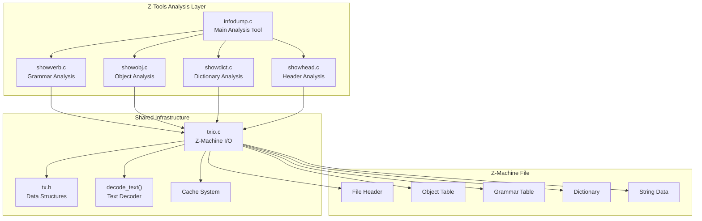
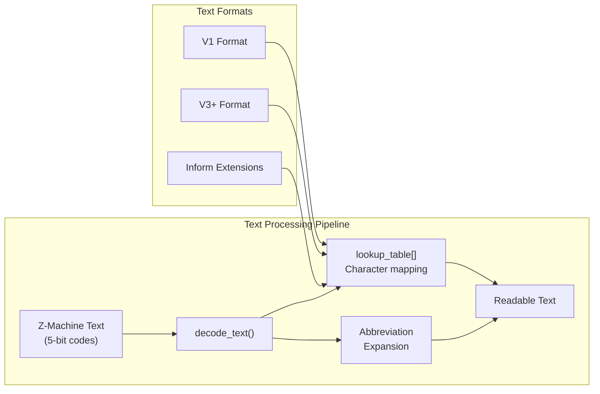
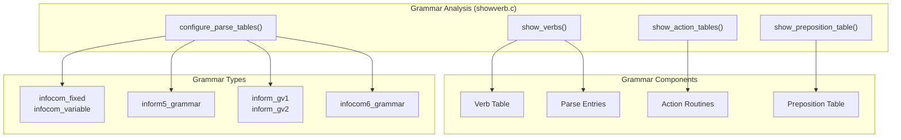
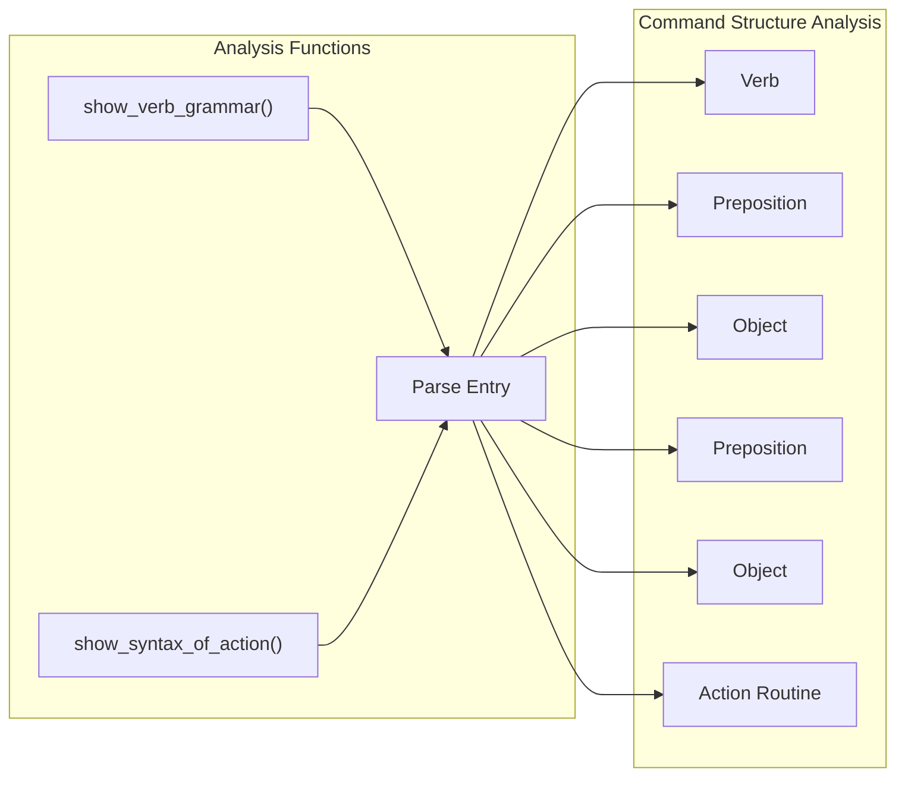
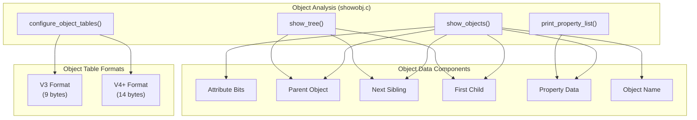
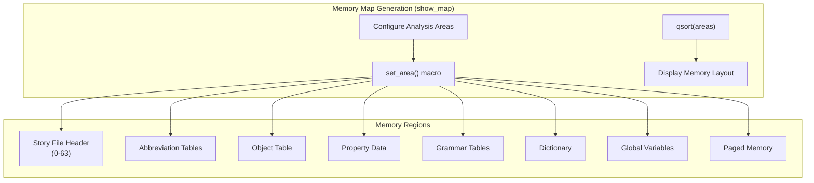
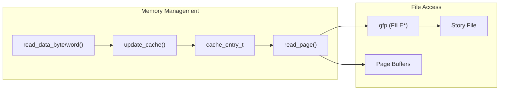

<!-- source: DeepWiki mcp.deepwiki.com · repo microsoft/jericho · page 4.3 Z-Tools and Debugging · fetched 2026-10-26 -->

# Z-Tools and Debugging

<details>
<summary>Relevant source files</summary>

The following files were used as context for generating this wiki page:

- [frotz/src/ztools/infodump.c](frotz/src/ztools/infodump.c)
- [frotz/src/ztools/showobj.c](frotz/src/ztools/showobj.c)
- [frotz/src/ztools/showverb.c](frotz/src/ztools/showverb.c)
- [frotz/src/ztools/tx.h](frotz/src/ztools/tx.h)
- [frotz/src/ztools/txio.c](frotz/src/ztools/txio.c)

</details>


This section covers the Z-machine analysis and debugging tools that provide deep introspection into interactive fiction game files. These tools enable developers to examine the internal structure, objects, grammar, and other game data for debugging, research, and game support development.

For information about the core Z-machine interface used during gameplay, see [Z-Machine Interface](#4.1). For details on how game-specific customization is implemented, see [Game Customization Framework](#4.2).

## Purpose and Scope

The Z-Tools are a collection of utilities built into Jericho that analyze and display the internal structure of Z-machine story files (.z5, .z8, etc.). These tools expose game internals including object hierarchies, verb grammar tables, dictionaries, and memory layouts that are normally hidden during gameplay.

The primary tool is `infodump`, which provides comprehensive analysis capabilities for understanding how interactive fiction games are structured internally. This is essential for adding support for new games and debugging game-specific behavior.

## Z-Tools Architecture

The Z-Tools are implemented as a separate subsystem within Jericho that shares the same core Z-machine reading infrastructure but provides analysis rather than gameplay functionality.



Sources: [frotz/src/ztools/infodump.c:1-52](), [frotz/src/ztools/tx.h:1-20](), [frotz/src/ztools/txio.c:1-30]()

## Core Analysis Functions

The Z-Tools provide several key analysis functions accessible through the `infodump` interface. Each function examines a specific aspect of the Z-machine file structure.

### Primary Analysis Operations

| Function | Flag | Purpose | Implementation |
|----------|------|---------|----------------|
| Header Info | `-i` | Display game metadata, version, serial | `show_header()` |
| Object Tree | `-t` | Show object hierarchy and containment | `show_tree()` |
| Objects | `-o` | List all objects with properties | `show_objects()` |
| Grammar | `-g` | Display verb syntax patterns | `show_verbs()` |
| Dictionary | `-d` | Show all recognized words | `show_dictionary()` |
| File Map | `-m` | Memory layout visualization | `show_map()` |
| Abbreviations | `-a` | Text compression table | `show_abbreviations()` |

### Text Analysis Functions

The Z-Tools include sophisticated text decoding capabilities that handle the Z-machine's compressed text format:



Sources: [frotz/src/ztools/txio.c:385-621](), [frotz/src/ztools/txio.c:31-61]()

## Grammar Analysis System

The Z-Tools provide detailed analysis of verb grammar tables, which define how player commands are parsed. This is crucial for understanding game-specific command structures.

### Grammar Table Types

The system handles multiple grammar formats used across different Z-machine versions and compilers:



Sources: [frotz/src/ztools/showverb.c:185-505](), [frotz/src/ztools/showverb.c:44-183]()

### Syntax Analysis

The grammar analysis reveals the sentence structures that games accept:



Sources: [frotz/src/ztools/showverb.c:1295-1572](), [frotz/src/ztools/showverb.c:772-896]()

## Object System Analysis

The Z-Tools provide comprehensive analysis of the object system, which represents all game entities and their relationships.

### Object Structure Inspection



Sources: [frotz/src/ztools/showobj.c:144-227](), [frotz/src/ztools/showobj.c:235-326](), [frotz/src/ztools/showobj.c:403-447]()

## Memory Layout Analysis

The Z-Tools can generate detailed memory maps showing how different data structures are laid out within the Z-machine file:



Sources: [frotz/src/ztools/infodump.c:401-531](), [frotz/src/ztools/infodump.c:375-386]()

## Integration with Jericho

The Z-Tools integrate with Jericho's main functionality through shared infrastructure and provide debugging support for game development:

### Shared Components

| Component | File | Purpose |
|-----------|------|---------|
| `zheader_t` | tx.h | Z-machine header structure |
| `configure()` | txio.c | Z-machine version detection |
| `load_cache()` | txio.c | Memory management |
| `decode_text()` | txio.c | Text decompression |
| `read_data_word/byte()` | txio.c | Data access functions |

### API Functions for External Use

Jericho exposes several Z-Tools functions for external debugging and analysis:

```c
// Dictionary analysis
void print_dictionary(const char *name);
void print_verbs(const char *name);
unsigned int get_dictionary_word_count(const char *name);

// Story processing
void process_story(const char *name, int *options, int columns, int symbolic);
```

Sources: [frotz/src/ztools/infodump.c:242-261](), [frotz/src/ztools/infodump.c:268-312]()

### Memory Management

The Z-Tools implement their own memory management system with caching for efficient analysis of large story files:



Sources: [frotz/src/ztools/txio.c:75-97](), [frotz/src/ztools/txio.c:866-896](), [frotz/src/ztools/txio.c:290-339]()

---

