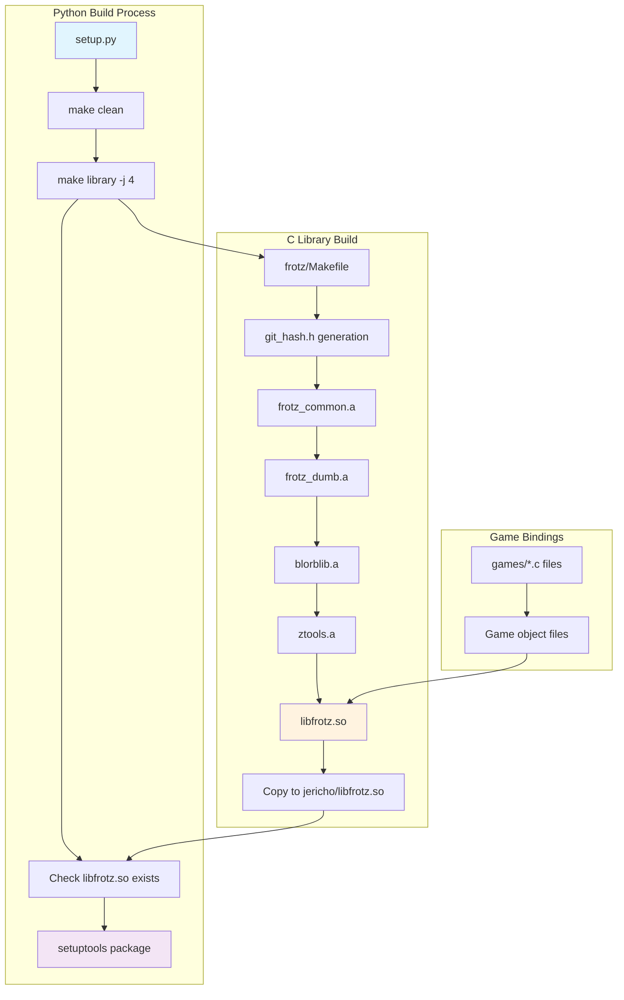
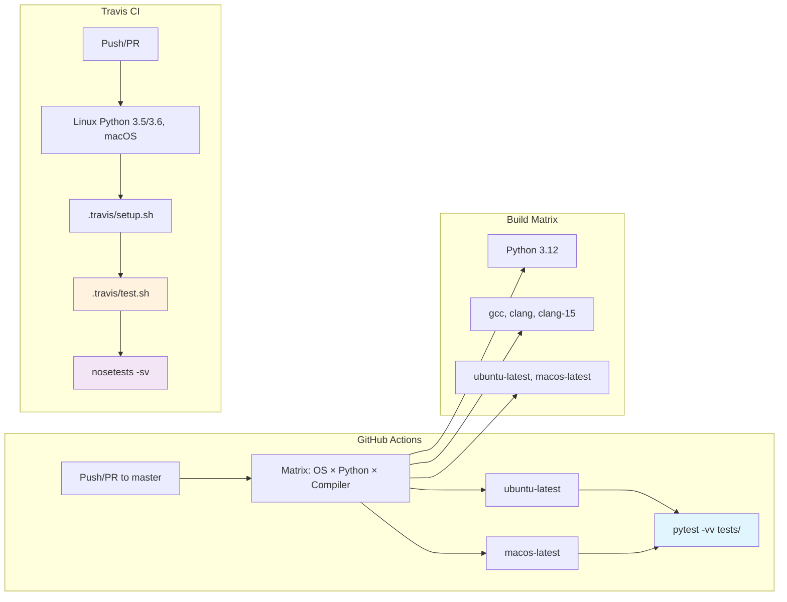
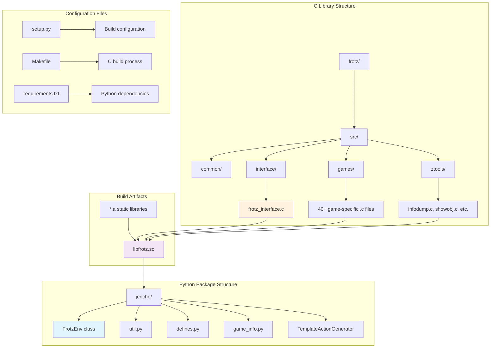

<!-- source: DeepWiki mcp.deepwiki.com · repo microsoft/jericho · page 5 Development Guide · fetched 2026-10-26 -->

# Development Guide

<details>
<summary>Relevant source files</summary>

The following files were used as context for generating this wiki page:

- [.github/workflows/main.yml](.github/workflows/main.yml)
- [.travis.yml](.travis.yml)
- [.travis/setup.sh](.travis/setup.sh)
- [.travis/test.sh](.travis/test.sh)
- [frotz/Makefile](frotz/Makefile)
- [frotz/src/ztools/makefile](frotz/src/ztools/makefile)
- [jericho/util.py](jericho/util.py)
- [requirements.txt](requirements.txt)
- [setup.py](setup.py)

</details>


This document provides technical information for developers who want to contribute to or extend Jericho. It covers the build system, testing infrastructure, CI/CD pipeline, and development workflow.

For information about using Jericho's API, see [Core Components](#3). For details on adding support for new games, see [Adding New Games](#5.2). For building and testing procedures, see [Building and Testing](#5.1).

## Development Environment Setup

Jericho requires a development environment capable of building both Python packages and C libraries. The system has been tested on Linux and macOS platforms with multiple Python versions and C compilers.

### Prerequisites

The build system requires several components:

| Component | Purpose | Configuration |
|-----------|---------|---------------|
| C Compiler | Compile Frotz library | `gcc`, `clang`, or `clang-15` |
| Python 3.9+ | Core runtime | Specified in [setup.py:39]() |
| Make | Build automation | Used for C library compilation |
| Git | Version control | Required for hash generation |

### Dependencies

Core Python dependencies are managed through [requirements.txt:1-4]():

- `numpy` - Numerical operations
- `spacy>=2.1.0` - Natural language processing with `en_core_web_sm` model
- `termcolor` - Terminal output formatting

The C library dependencies are handled through the Frotz build system in [frotz/Makefile]().

Sources: [setup.py:32-52](), [requirements.txt:1-4](), [frotz/Makefile:1-482]()

## Build System Architecture

Jericho uses a hybrid build system that combines Python setuptools with a custom Makefile-based C library build process.

### Build Process Flow



### C Library Components

The Frotz library build process creates several intermediate libraries:

| Library | Components | Purpose |
|---------|------------|---------|
| `frotz_common.a` | Core Z-machine interpreter | Basic Z-machine functionality |
| `frotz_dumb.a` | Simple I/O interface | Headless game interaction |
| `blorblib.a` | Blorb file handling | Multimedia resource management |
| `ztools.a` | Z-machine analysis tools | Game inspection and debugging |
| `libfrotz.so` | Final shared library | Python interface endpoint |

The build targets are defined in [frotz/Makefile:246]() and compiled with specific flags in [frotz/Makefile:14-25]().

Sources: [setup.py:22-30](), [frotz/Makefile:246-276](), [frotz/Makefile:390-396]()

## Testing and CI/CD Infrastructure

Jericho employs multiple CI/CD systems to ensure cross-platform compatibility and code quality.

### CI/CD Pipeline Architecture



### Test Execution Process

The testing process involves several stages:

1. **Environment Setup**: Install dependencies and build C library
2. **SpaCy Model Download**: Install `en_core_web_sm` language model
3. **Test Execution**: Run test suites with verbose output
4. **Multi-Compiler Testing**: Validate against different C compilers

The GitHub Actions workflow is configured in [.github/workflows/main.yml:1-51]() with a comprehensive test matrix excluding incompatible combinations.

Sources: [.github/workflows/main.yml:1-51](), [.travis.yml:1-19](), [.travis/setup.sh:1-14](), [.travis/test.sh:1-10]()

## Code Organization for Developers

Understanding Jericho's code organization is essential for effective development. The system follows a clear separation between Python interface code and C implementation.

### Development Component Map



### Key Development Files

| File | Purpose | Developer Focus |
|------|---------|----------------|
| `setup.py` | Build orchestration | Package configuration, C library integration |
| `frotz/Makefile` | C library build | Compiler flags, library targets, game bindings |
| `jericho/util.py` | Core utilities | Text processing, object tree manipulation |
| `frotz/src/interface/frotz_interface.c` | Python-C bridge | Function exports, game dispatch |
| `frotz/src/games/*.c` | Game-specific logic | Victory detection, scoring, customization |

The utility functions in [jericho/util.py]() provide essential development tools:

- `clean()` - Text preprocessing for game output
- `tokenize()` - SpaCy-based tokenization
- `extract_objs()` - Object extraction from text
- `get_subtree()` - Object tree traversal
- `verb_usage_count()` - Action frequency analysis

Sources: [jericho/util.py:23-228](), [frotz/Makefile:168-232](), [setup.py:17-52]()

## Development Workflow

### Local Development Setup

1. **Clone and Build**:
   ```bash
   git clone https://github.com/microsoft/jericho
   cd jericho
   pip install -e .
   ```

2. **C Library Development**:
   ```bash
   cd frotz
   make clean
   make library -j 4
   ```

3. **Testing**:
   ```bash
   pytest -vv tests/
   ```

### Compiler Configuration

The build system supports multiple compilers through environment variables:

| Compiler | Configuration | Platform |
|----------|---------------|----------|
| `gcc` | Default on Linux | `CC=gcc` |
| `clang` | Default on macOS | `CC=clang` |
| `clang-15` | Specific version | `CC=clang` with symlink |

The compiler selection affects both the C library build in [frotz/Makefile:11]() and the Python extension compilation.

### Git Integration

The build system automatically generates version information from Git:

- Git hash injection into [frotz/src/common/git_hash.h]()
- Version tracking for development builds
- Branch and tag information embedding

This is handled by the Git hash generation process in [frotz/Makefile:340-350]().

Sources: [.github/workflows/main.yml:34-47](), [frotz/Makefile:11-14](), [frotz/Makefile:340-350]()

## Build Customization

### Makefile Configuration

The Frotz Makefile provides extensive customization options:

| Variable | Purpose | Default |
|----------|---------|---------|
| `CC` | C compiler | `gcc` |
| `OPTS` | Optimization flags | `-O3 -fPIC` |
| `INCL` | Include paths | `/opt/local/include` |
| `LIB` | Library paths | `/opt/local/lib` |

Sound support can be configured through the `SOUND` variable in [frotz/Makefile:37-40](), with options for `none`, `ao`, `sun`, and `oss`.

### Game Integration

Adding new game support requires:

1. Creating a new C file in `frotz/src/games/`
2. Adding the object file to `INTERFACE_OBJECT` in [frotz/Makefile:171-231]()
3. Implementing game-specific functions following the pattern in existing games
4. Adding game metadata to Python game info structures

Sources: [frotz/Makefile:37-40](), [frotz/Makefile:171-231](), [frotz/Makefile:14-25]()

---

