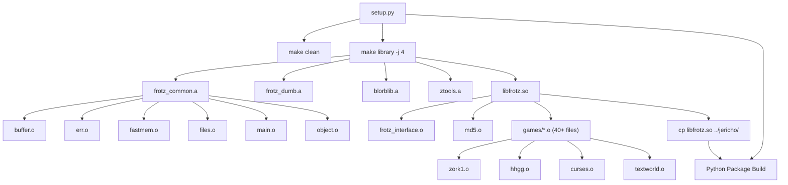
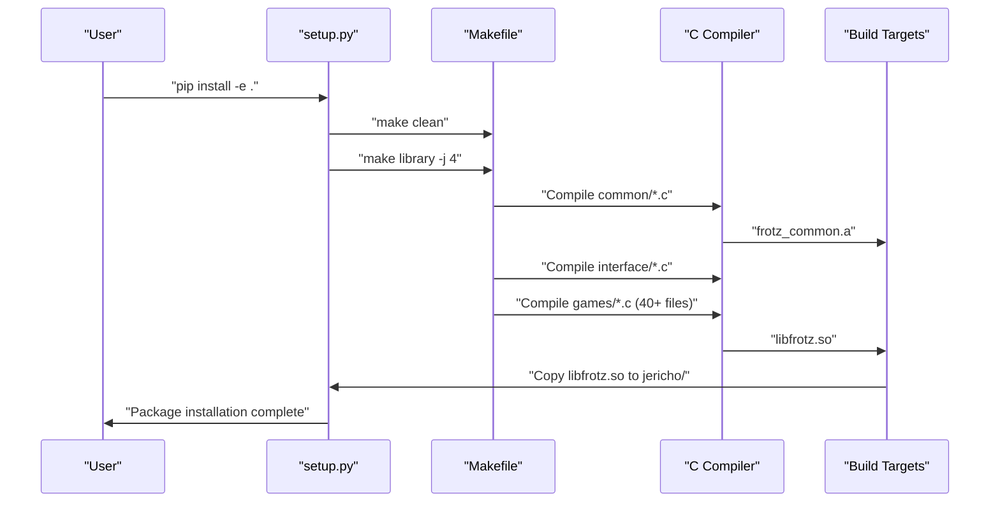
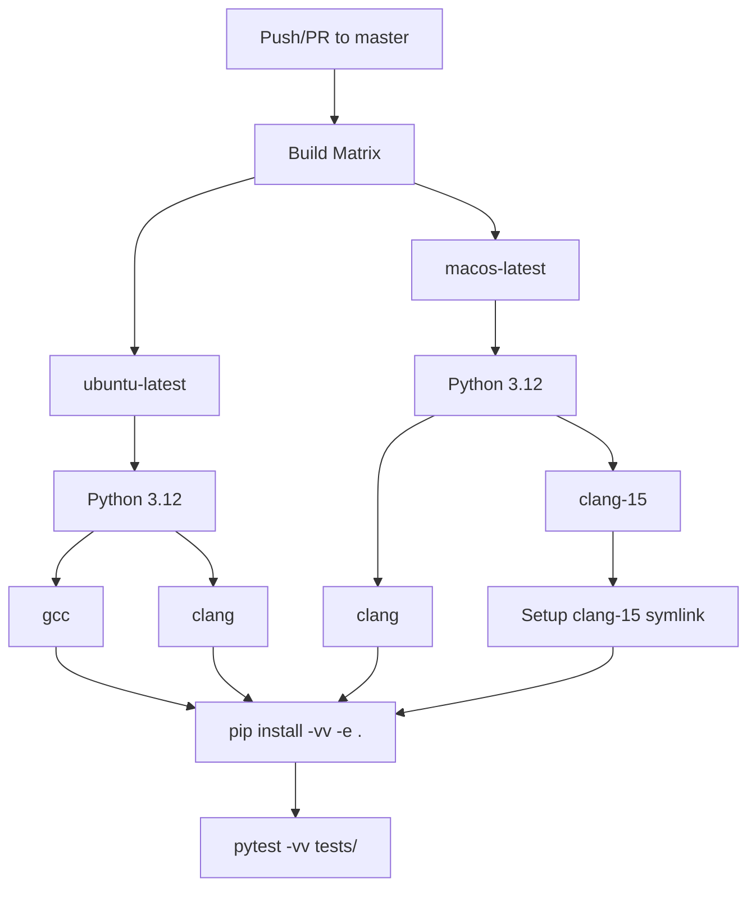
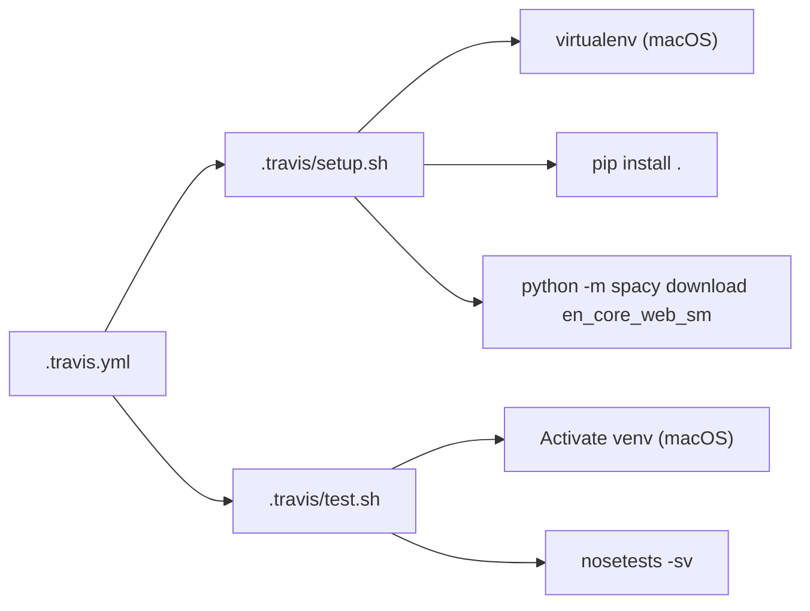

<!-- source: DeepWiki mcp.deepwiki.com · repo microsoft/jericho · page 5.1 Building and Testing · fetched 2026-10-26 -->

# Building and Testing

<details>
<summary>Relevant source files</summary>

The following files were used as context for generating this wiki page:

- [.github/workflows/main.yml](.github/workflows/main.yml)
- [.travis.yml](.travis.yml)
- [.travis/setup.sh](.travis/setup.sh)
- [.travis/test.sh](.travis/test.sh)
- [frotz/Makefile](frotz/Makefile)
- [frotz/src/ztools/makefile](frotz/src/ztools/makefile)
- [jericho/util.py](jericho/util.py)
- [requirements.txt](requirements.txt)
- [setup.py](setup.py)
- [tests/test_jericho.py](tests/test_jericho.py)

</details>


This document covers the build system, testing infrastructure, and continuous integration setup for Jericho. It explains how to build the project from source, run tests locally, and understand the automated testing pipeline used for development.

For information about adding support for new games, see [Adding New Games](#5.2). For details about the documentation build system, see [Documentation System](#5.3).

## Build System Overview

Jericho uses a hybrid build system combining Python's `setuptools` with C makefiles to build both the Python interface and the underlying Frotz Z-machine interpreter library.

### Build Architecture



Sources: [setup.py:22-31](), [frotz/Makefile:246-277](), [frotz/Makefile:389-396]()

### Build Targets and Dependencies

The build system creates several key components:

| Component | Purpose | Source Files |
|-----------|---------|--------------|
| `frotz_common.a` | Core Z-machine interpreter | [frotz/Makefile:122-141]() |
| `frotz_dumb.a` | Text-only interface | [frotz/Makefile:158-162]() |
| `blorblib.a` | Blorb file format support | [frotz/Makefile:166]() |
| `ztools.a` | Z-machine debugging tools | [frotz/Makefile:236-244]() |
| `libfrotz.so` | Main shared library | [frotz/Makefile:171-231]() |

Sources: [frotz/Makefile:120-246]()

## Building from Source

### Prerequisites

Jericho requires the following build dependencies:

```bash
# System dependencies
gcc or clang compiler
make
ar and ranlib utilities
ncurses development headers

# Python dependencies (installed automatically)
numpy
spacy>=2.1.0
termcolor
```

Sources: [requirements.txt:1-5](), [setup.py:39](), [frotz/Makefile:12-14]()

### Build Process

The build process is initiated through Python's setup script:

```bash
# Standard installation
pip install .

# Development installation  
pip install -e .

# Verbose build output
pip install -vv -e .
```

### Build Steps Detail



Sources: [setup.py:24-25](), [frotz/Makefile:276](), [frotz/Makefile:394]()

The build process performs these steps:

1. **Clean previous builds**: [setup.py:24]()
2. **Compile C libraries**: [setup.py:25]()
3. **Verify libfrotz.so exists**: [setup.py:28-30]()
4. **Package Python components**: [setup.py:33-52]()

## Running Tests

### Test Structure

Jericho uses `pytest` for its test suite with the main test file containing several key test scenarios:

| Test Function | Purpose | Game Files Used |
|---------------|---------|-----------------|
| `test_multiple_instances` | Verify parallel game instances | `905.z5`, `tw-game.z8` |
| `test_for_memory_leaks` | Check for memory leaks over 2000 cycles | `905.z5` |
| `test_copy` | Validate game state copying | `905.z5` |
| `test_saving_opcode_in_state` | Test save/restore edge cases | `yomomma.z8` |
| `test_very_long_action` | Handle long input strings | `905.z5` |

Sources: [tests/test_jericho.py:12-146]()

### Running Tests Locally

```bash
# Run all tests
pytest tests/

# Run with verbose output
pytest -vv tests/

# Run specific test
pytest tests/test_jericho.py::test_multiple_instances

# Run with coverage
pytest --cov=jericho tests/
```

### Memory Leak Testing

The test suite includes comprehensive memory leak detection:

```python
# From test_for_memory_leaks()
for _ in range(1000):
    env1 = jericho.FrotzEnv(gamefile1)
    env1.reset()
    del env1
# Verifies <1MB leak per 1000 cycles
```

Sources: [tests/test_jericho.py:36-77]()

## CI/CD Pipeline

### GitHub Actions Configuration



Sources: [.github/workflows/main.yml:16-51]()

The CI system tests multiple configurations:

- **Operating Systems**: Ubuntu Latest, macOS Latest
- **Python Versions**: 3.12 (previously 3.9-3.12)
- **Compilers**: gcc, clang, clang-15
- **Schedule**: Weekly runs on Fridays at 17:20 UTC

### Travis CI (Legacy)



Sources: [.travis.yml:1-19](), [.travis/setup.sh:1-14](), [.travis/test.sh:1-10]()

### Build Matrix Details

The GitHub Actions configuration defines a comprehensive test matrix:

```yaml
strategy:
  fail-fast: false
  matrix:
    os: [ubuntu-latest, macos-latest]
    python_version: ['3.12']
    compiler: ['clang', 'gcc', 'clang-15']
    exclude:
      - os: ubuntu-latest
        compiler: 'clang-15'
```

Sources: [.github/workflows/main.yml:16-25]()

## Build Dependencies and Requirements

### Python Requirements

The package requires Python 3.9+ and several dependencies:

- **numpy**: Numerical computing support
- **spacy>=2.1.0**: Natural language processing
  - Automatically downloads `en_core_web_sm` model
- **termcolor**: Colored terminal output

Sources: [setup.py:39](), [requirements.txt:2-4](), [jericho/util.py:44-47]()

### System Dependencies

The C build requires standard development tools:

```makefile
# Compiler selection
CC ?= gcc

# Required flags
CFLAGS += -Wall -Wextra -std=gnu99 -fPIC -Werror=implicit-function-declaration

# Optimization
OPTS = -O3 -fPIC

# Libraries
CURSES = -lncurses
```

Sources: [frotz/Makefile:11-21](), [frotz/Makefile:55]()

### Platform-Specific Considerations

#### macOS
- Uses Clang by default
- MacPorts paths: `-I/opt/local/include -L/opt/local/lib`
- Memory usage reported in bytes vs kilobytes

#### Linux
- Supports gcc and clang
- Standard library paths
- Memory usage in kilobytes

Sources: [frotz/Makefile:71-81](), [tests/test_jericho.py:44-47]()

## Troubleshooting Common Build Issues

### Missing libfrotz.so

If the build fails with "Unable to find required library", check:

1. C compiler is available and working
2. Make executed successfully in frotz directory
3. No compile errors in the C code

Sources: [setup.py:28-30]()

### Spacy Model Download

The build may fail if spacy models can't be downloaded:

```python
try:
    spacy_nlp = spacy.load("en_core_web_sm")
except OSError:
    spacy.cli.download("en_core_web_sm")
    spacy_nlp = spacy.load("en_core_web_sm")
```

Sources: [jericho/util.py:43-47]()

### Compiler Compatibility

The build system supports multiple compilers but requires C99 compliance:

- GCC 4.9+
- Clang 3.5+
- Apple Clang (Xcode Command Line Tools)

Sources: [frotz/Makefile:14](), [.github/workflows/main.yml:21]()

---

