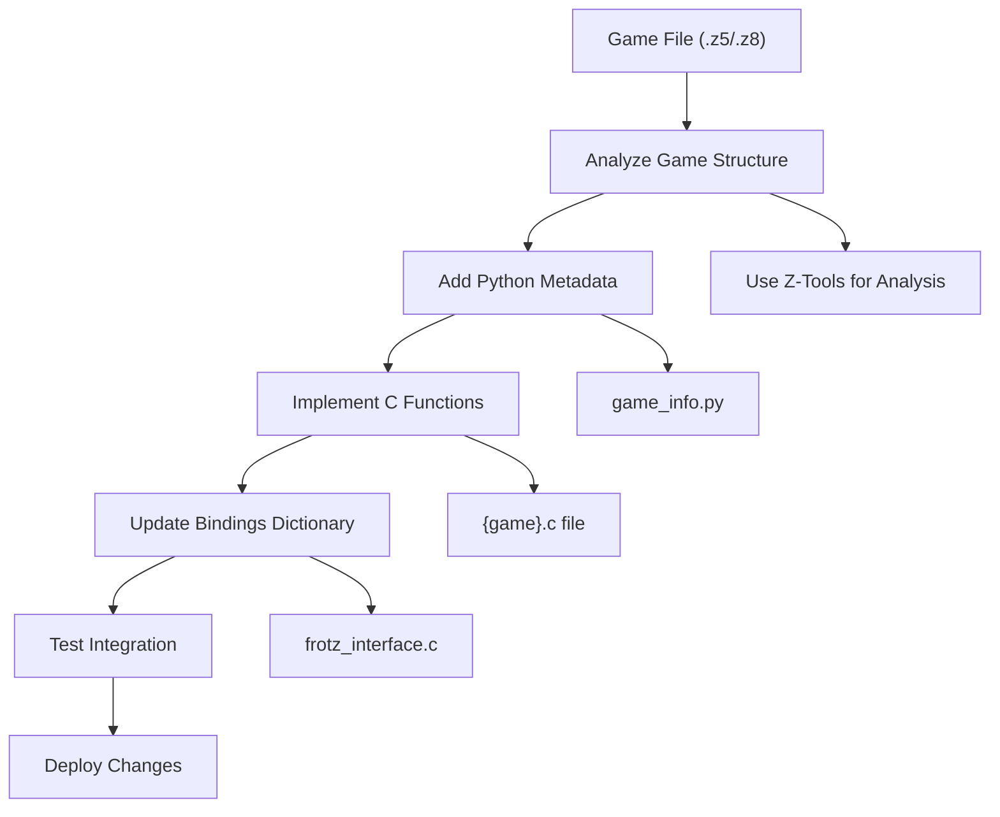
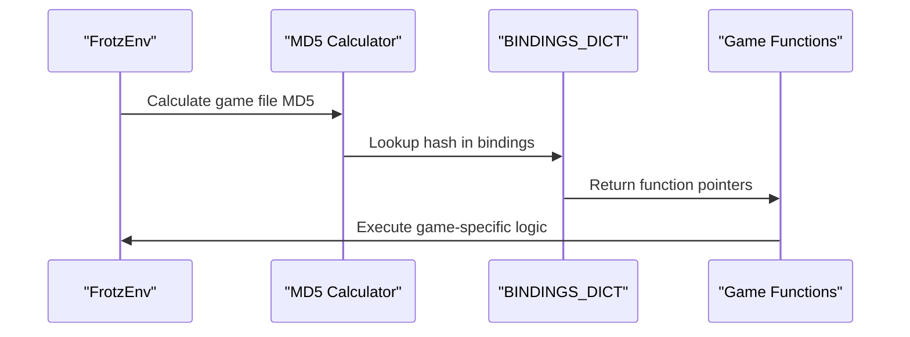

<!-- source: DeepWiki mcp.deepwiki.com · repo microsoft/jericho · page 5.2 Adding New Games · fetched 2026-10-26 -->

# Adding New Games

<details>
<summary>Relevant source files</summary>

The following files were used as context for generating this wiki page:

- [frotz/src/games/acorncourt.c](frotz/src/games/acorncourt.c)
- [frotz/src/games/advent.c](frotz/src/games/advent.c)
- [frotz/src/games/anchor.c](frotz/src/games/anchor.c)
- [frotz/src/games/karn.c](frotz/src/games/karn.c)
- [frotz/src/games/omniquest.c](frotz/src/games/omniquest.c)
- [frotz/src/games/pentari.c](frotz/src/games/pentari.c)
- [frotz/src/games/plundered.c](frotz/src/games/plundered.c)
- [frotz/src/games/spirit.c](frotz/src/games/spirit.c)
- [frotz/src/games/temple.c](frotz/src/games/temple.c)
- [jericho/game_info.py](jericho/game_info.py)

</details>


This guide covers the step-by-step process for adding support for new interactive fiction games to Jericho. The process involves implementing game-specific metadata in Python and custom logic functions in C to handle the unique characteristics of each Z-machine game.

For information about the overall game support architecture, see [Game Support and Bindings](#3.3). For details on building and testing changes, see [Building and Testing](#5.1).

## Prerequisites and Workflow

Adding a new game requires:
1. A Z-machine game file (.z5 or .z8 format)
2. Knowledge of the game's internal structure (score location, victory conditions, etc.)
3. C programming experience for implementing game-specific functions
4. Python knowledge for adding metadata and grammar templates

The integration workflow follows this pattern:



**Sources:** [jericho/game_info.py:1-100](), [frotz/src/games/anchor.c:1-50]()

## Game Metadata Definition

Each game requires a metadata entry in the `GAMES` dictionary within `game_info.py`. The metadata structure includes essential information for game identification and action generation.

### Required Metadata Fields

| Field | Type | Description | Example |
|-------|------|-------------|---------|
| `name` | string | Unique game identifier | `"anchor"` |
| `rom` | string | Game file name | `"anchor.z8"` |
| `seed` | integer | Random seed for reproducibility | `0` |
| `walkthrough` | string | Slash-separated solution commands | `"Se/Push can/Up"` |
| `grammar` | string | Action templates for generation | `"take OBJ;drop OBJ"` |
| `max_word_length` | integer | Maximum command word length | `9` |

### Example Game Definition

```python
anchorhead = {
    "name": "anchor",
    "rom": "anchor.z8", 
    "seed": 0,
    "walkthrough": 'Se/Push can against wall/Climb can/Up/West',
    "grammar": "take OBJ;drop OBJ;examine OBJ;go DIRECTION",
    "max_word_length": 9
}
```

**Sources:** [jericho/game_info.py:66-73](), [jericho/game_info.py:17-24]()

## C Implementation Functions

Each game requires a corresponding C implementation file in `frotz/src/games/` that provides game-specific functionality. The file must implement a standard set of functions that handle the game's unique characteristics.

### Function Implementation Pattern

```mermaid
graph TB
    CFILE["{game}.c"] --> RAMADDRS["{game}_ram_addrs()"]
    CFILE --> INTRO["{game}_intro_actions()"]
    CFILE --> CLEAN["{game}_clean_observation()"]
    CFILE --> VICTORY["{game}_victory()"]
    CFILE --> GAMEOVER["{game}_game_over()"]
    CFILE --> SELFOBJ["{game}_get_self_object_num()"]
    CFILE --> MOVES["{game}_get_moves()"]
    CFILE --> SCORE["{game}_get_score()"]
    CFILE --> MAXSCORE["{game}_max_score()"]
    CFILE --> NUMOBJS["{game}_get_num_world_objs()"]
    CFILE --> IGNOREOBJ["{game}_ignore_moved_obj()"]
    CFILE --> IGNOREATTR["{game}_ignore_attr_diff()"]
    CFILE --> IGNORECLR["{game}_ignore_attr_clr()"]
    CFILE --> CLEANOBJS["{game}_clean_world_objs()"]
    
    RAMADDRS --> ZMEM["Z-Machine Memory"]
    CLEAN --> OBSTEXT["Observation Text"]
    VICTORY --> GAMESTATE["Game State"]
    SCORE --> GAMESTATE
```



**Sources:** [frotz/src/games/anchor.c:36-110](), [frotz/src/games/advent.c:35-107]()

### Core Function Categories

#### Memory and State Functions

These functions provide access to game-specific memory locations and state information:

```c
// Returns array of special RAM addresses to monitor
zword* {game}_ram_addrs(int *n) {
    *n = 4;
    return {game}_special_ram_addrs;
}

// Returns current move count from game memory
int {game}_get_moves() {
    return (((short) zmp[addr1]) << 8) | zmp[addr2];
}

// Returns current score from game memory  
short {game}_get_score() {
    return zmp[score_addr];
}
```

#### Game Logic Functions

These functions implement game-specific logic for victory detection and observation processing:

```c
// Detects victory condition by searching game output
int {game}_victory() {
    char *victory_text = "*** You have won ***";
    if (strstr(world, victory_text)) {
        return 1;
    }
    return 0;
}

// Cleans up game output for consistent formatting
char* {game}_clean_observation(char* obs) {
    char* pch = strchr(obs, '>');
    if (pch != NULL) {
        *(pch-2) = '\0';
    }
    return obs+1;
}
```

**Sources:** [frotz/src/games/anchor.c:55-70](), [frotz/src/games/spirit.c:57-72]()

## Game Binding Integration

The binding system connects game files to their implementations through MD5 hash lookup. This enables automatic detection and dispatch to the correct game-specific functions.

### Binding Registration Process



The `BINDINGS_DICT` structure maps MD5 hashes to function pointer structs:

```c
// Binding structure for each game
struct game_binding {
    char* (*intro_actions)(int*);
    char* (*clean_observation)(char*);
    int (*victory)();
    int (*game_over)();
    // ... other function pointers
};

// Registration in frotz_interface.c
BINDINGS_DICT["{md5_hash}"] = {
    .intro_actions = {game}_intro_actions,
    .clean_observation = {game}_clean_observation, 
    .victory = {game}_victory,
    // ... other assignments
};
```

**Sources:** [frotz/src/games/anchor.c:41-53](), [frotz/src/games/advent.c:40-52]()

## Implementation Steps

### Step 1: Analyze Game Structure

Use Z-machine analysis tools to identify:
- Score and move counter memory locations
- Victory/defeat text patterns  
- Player object number
- Total number of world objects
- Special RAM addresses for game state

### Step 2: Create Game Metadata

Add a new dictionary entry to `game_info.py`:

```python
newgame = {
    "name": "newgame",
    "rom": "newgame.z5",
    "seed": 0, 
    "walkthrough": 'action1/action2/action3',
    "grammar": "take OBJ;drop OBJ;examine OBJ",
    "max_word_length": 9
}
```

### Step 3: Implement C Functions

Create `frotz/src/games/newgame.c` with all required functions:

```c
#include <string.h>
#include "frotz.h"
#include "games.h" 
#include "frotz_interface.h"

// Implement all 14 required functions
zword* newgame_ram_addrs(int *n) { /* ... */ }
char** newgame_intro_actions(int *n) { /* ... */ }
// ... etc
```

### Step 4: Register Bindings

Add the new game's MD5 hash and function pointers to the bindings dictionary in `frotz_interface.c`.

### Step 5: Test Integration

Build Jericho and test the new game integration:
- Verify game loads correctly
- Check that victory/defeat detection works
- Validate score and move tracking
- Test action generation with grammar templates

**Sources:** [frotz/src/games/omniquest.c:31-60](), [frotz/src/games/temple.c:33-66]()

## Game-Specific Customization Examples

Different games require different levels of customization. Here are common patterns:

### Minimal Implementation

Simple games may only need basic functions:

```c
// Pentari example - minimal RAM tracking
zword* pentari_ram_addrs(int *n) {
    *n = 0;
    return NULL;
}

// Standard victory detection
int pentari_victory() {
    char *death_text = "*** You have won ***";
    if (strstr(world, death_text)) {
        return 1;
    }
    return 0;
}
```

### Complex Implementation

Advanced games may need extensive customization:

```c
// Anchorhead example - multiple special RAM addresses
const zword anchor_special_ram_addrs[4] = {
    21922, // Combination lock
    40660, // Bathe
    38470, // Transitions between days  
    37992, // Sleep
};

// Complex object filtering
int anchor_ignore_attr_diff(zword obj_num, zword attr_idx) {
    if (attr_idx == 25)
        return 1;
    return 0;
}
```

**Sources:** [frotz/src/games/pentari.c:27-108](), [frotz/src/games/anchor.c:29-106]()

---

