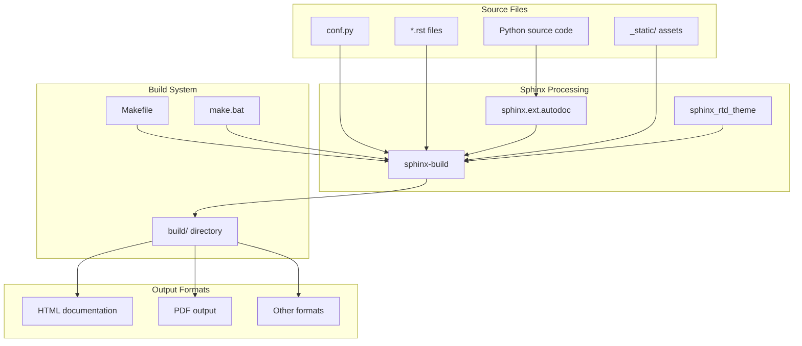
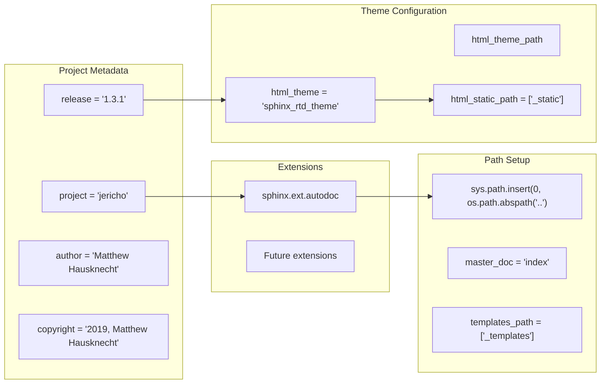
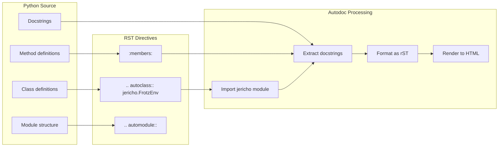
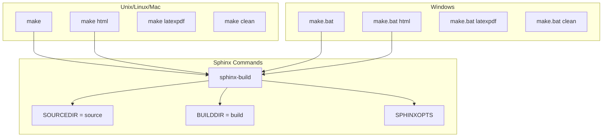

<!-- source: DeepWiki mcp.deepwiki.com · repo microsoft/jericho · page 5.3 Documentation System · fetched 2026-10-26 -->

# Documentation System

Relevant source files

The following files were used as context for generating this wiki page:

- [docs/Makefile](docs/Makefile)
- [docs/make.bat](docs/make.bat)
- [docs/source/conf.py](docs/source/conf.py)
- [docs/source/dictionary.rst](docs/source/dictionary.rst)
- [docs/source/frotz_env.rst](docs/source/frotz_env.rst)
- [docs/source/object_tree.rst](docs/source/object_tree.rst)

This document describes Jericho's documentation system, which uses Sphinx to automatically generate API documentation from Python docstrings and manual documentation from reStructuredText files. The system produces both HTML and other output formats for developer and user reference.

For information about building and testing the overall codebase, see [Building and Testing](#5.1). For details about adding new games, see [Adding New Games](#5.2).

## Architecture Overview

The documentation system is built on Sphinx, a Python documentation generator that combines automatic API documentation extraction with manually written guides. The system follows a standard Sphinx project structure with configuration, source files, and build outputs.

### Documentation Build Pipeline

Sources: [docs/source/conf.py:1-63](), [docs/Makefile:1-21](), [docs/make.bat:1-36]()

### Directory Structure

The documentation follows Sphinx conventions with separate source and build directories:

| Directory/File | Purpose |
|---|---|
| `docs/source/` | Documentation source files |
| `docs/source/conf.py` | Sphinx configuration |
| `docs/source/*.rst` | Manual documentation pages |
| `docs/source/_static/` | Static assets (CSS, images) |
| `docs/source/_templates/` | Custom templates |
| `docs/build/` | Generated documentation output |
| `docs/Makefile` | Unix build script |
| `docs/make.bat` | Windows build script |

Sources: [docs/source/conf.py:43](), [docs/source/conf.py:62]()

## Configuration System

The Sphinx configuration is centralized in `conf.py`, which defines project metadata, extensions, and output settings.

### Project Configuration

Sources: [docs/source/conf.py:22-27](), [docs/source/conf.py:40](), [docs/source/conf.py:56-57](), [docs/source/conf.py:29-33]()

The key configuration elements include:

- **Project Information**: Name, version, author, and copyright set in [docs/source/conf.py:22-27]()
- **Extensions**: Only `sphinx.ext.autodoc` is currently enabled at [docs/source/conf.py:40]()
- **Theme**: Uses Read the Docs theme configured at [docs/source/conf.py:56-57]()
- **Path Setup**: Adds parent directory to Python path for importing jericho module at [docs/source/conf.py:29-33]()

## Automatic API Documentation

The documentation system uses Sphinx's autodoc extension to automatically extract API documentation from Python docstrings in the jericho codebase.

### Autodoc Workflow

Sources: [docs/source/frotz_env.rst:6-7](), [docs/source/dictionary.rst:6-7](), [docs/source/object_tree.rst:20-21]()

### Documentation Source Files

Current RST files demonstrate different autodoc patterns:

| File | Purpose | Autodoc Directives |
|---|---|---|
| `frotz_env.rst` | FrotzEnv class documentation | `autoclass` with `:members:` |
| `dictionary.rst` | DictionaryWord class documentation | `autoclass` with `:members:` |
| `object_tree.rst` | ZObject class documentation | `autoclass` with `:members:` |

Each file follows the pattern of providing context and then using `.. autoclass:: jericho.ClassName` with `:members:` to automatically include all class methods and attributes.

Sources: [docs/source/frotz_env.rst:1-8](), [docs/source/dictionary.rst:1-8](), [docs/source/object_tree.rst:15-22]()

## Build System

The documentation uses standard Sphinx build tools with cross-platform support.

### Build Commands

Sources: [docs/Makefile:1-21](), [docs/make.bat:1-36]()

The build system provides:

- **Unix Makefile**: Standard `make` commands at [docs/Makefile:12-20]()
- **Windows Batch**: Equivalent `.bat` commands at [docs/make.bat:7-28]()
- **Flexible Targets**: Both route to `sphinx-build` with configurable options
- **Error Handling**: Windows batch includes Sphinx installation checks at [docs/make.bat:15-26]()

### Build Variables

Key build configuration variables:

| Variable | Unix Default | Windows Default | Purpose |
|---|---|---|---|
| `SPHINXBUILD` | `sphinx-build` | `sphinx-build` | Sphinx executable path |
| `SOURCEDIR` | `source` | `source` | Documentation source directory |
| `BUILDDIR` | `build` | `build` | Output directory |
| `SPHINXOPTS` | (empty) | (empty) | Additional Sphinx options |

Sources: [docs/Makefile:6-9](), [docs/make.bat:7-11]()

## Content Organization

The documentation follows a hierarchical structure that mirrors the conceptual organization of the Jericho system.

### Current Documentation Structure

Based on the existing RST files, the documentation covers:

- **FrotzEnv Interface**: Main API class for interacting with games
- **Object Tree**: Z-machine object representation and manipulation  
- **Dictionary**: Game parser dictionary access
- **Additional Sections**: Likely covered in other RST files not shown

Each section combines explanatory text with automatically generated API documentation, providing both conceptual understanding and detailed reference information.

Sources: [docs/source/frotz_env.rst:1-8](), [docs/source/object_tree.rst:1-22](), [docs/source/dictionary.rst:1-8]()

## Extending the Documentation

To add new documentation:

1. **Create RST Files**: Add new `.rst` files in `docs/source/` following existing patterns
2. **Use Autodoc**: Include `.. autoclass::` or `.. automodule::` directives for automatic API extraction
3. **Update Index**: Reference new files in the main index/toctree
4. **Build and Test**: Run `make html` or `make.bat html` to verify output

The system automatically imports the jericho module due to the path configuration in [docs/source/conf.py:29-33](), enabling autodoc to extract documentation from any Python classes or functions in the codebase.

Sources: [docs/source/conf.py:29-33](), [docs/Makefile:19-20](), [docs/make.bat:28]()

---

