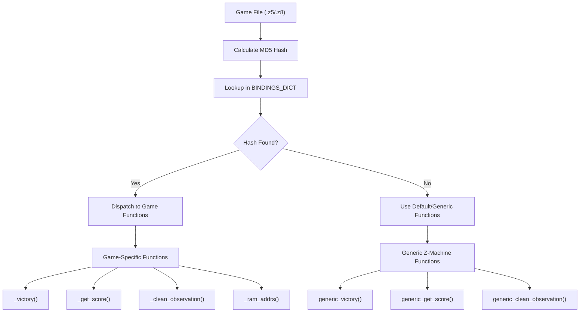
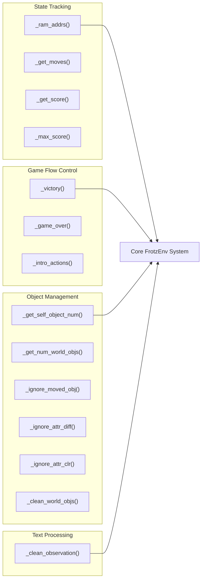
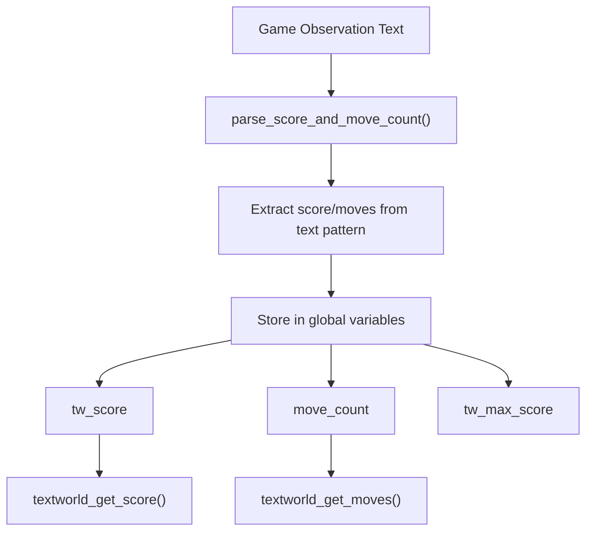
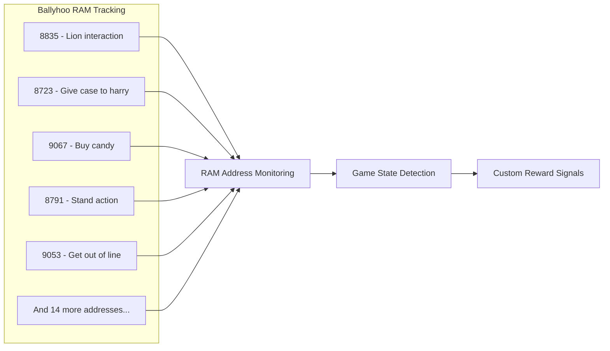
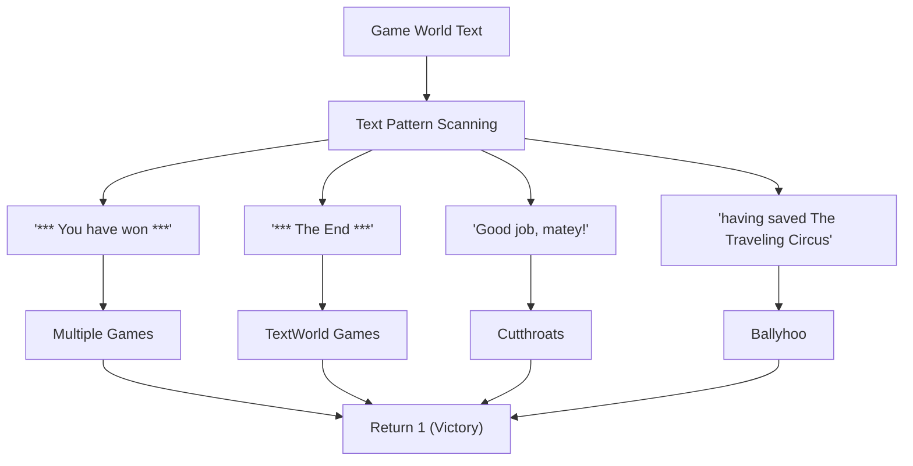
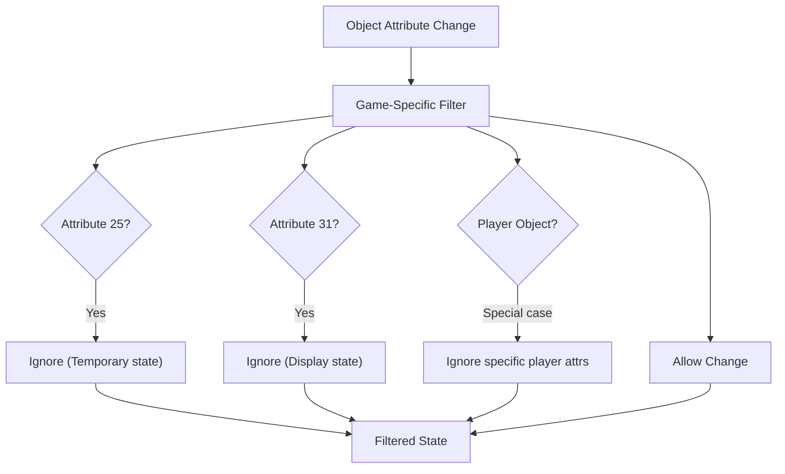
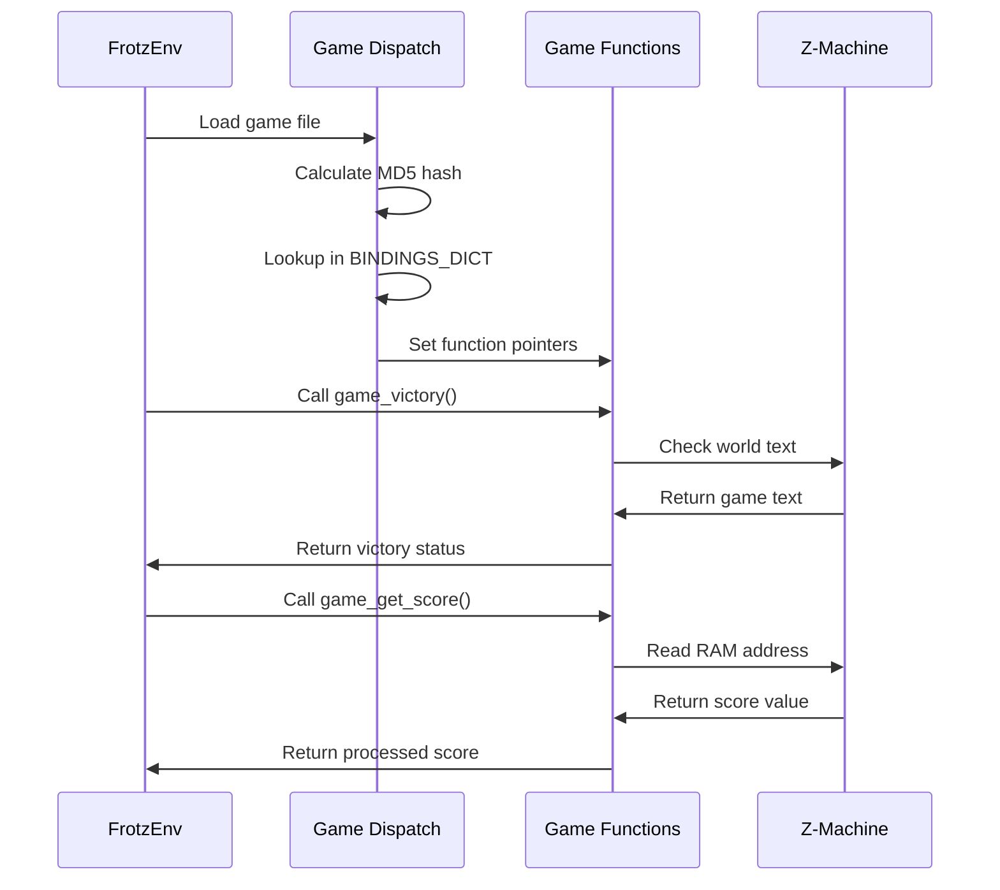

<!-- source: DeepWiki mcp.deepwiki.com · repo microsoft/jericho · page 6 Game Library · fetched 2026-10-26 -->

# Game Library

<details>
<summary>Relevant source files</summary>

The following files were used as context for generating this wiki page:

- [frotz/src/games/awaken.c](frotz/src/games/awaken.c)
- [frotz/src/games/balances.c](frotz/src/games/balances.c)
- [frotz/src/games/ballyhoo.c](frotz/src/games/ballyhoo.c)
- [frotz/src/games/cutthroat.c](frotz/src/games/cutthroat.c)
- [frotz/src/games/dragon.c](frotz/src/games/dragon.c)
- [frotz/src/games/enter.c](frotz/src/games/enter.c)
- [frotz/src/games/gold.c](frotz/src/games/gold.c)
- [frotz/src/games/jewel.c](frotz/src/games/jewel.c)
- [frotz/src/games/library.c](frotz/src/games/library.c)
- [frotz/src/games/lostpig.c](frotz/src/games/lostpig.c)
- [frotz/src/games/ludicorp.c](frotz/src/games/ludicorp.c)
- [frotz/src/games/night.c](frotz/src/games/night.c)
- [frotz/src/games/reverb.c](frotz/src/games/reverb.c)
- [frotz/src/games/textworld.c](frotz/src/games/textworld.c)

</details>


This page documents Jericho's comprehensive game library, which provides customized support for 40+ interactive fiction games. Each game requires specific adaptations to work properly with the reinforcement learning interface, including custom victory detection, observation cleaning, and state tracking. The game library implements a standardized plugin architecture that allows the core `FrotzEnv` to work consistently across diverse games while accommodating each game's unique characteristics.

For information about how games are integrated into the core system, see [Game Support and Bindings](#3.3). For details on adding new games to the library, see [Adding New Games](#5.2).

## Game Detection and Dispatch System

Jericho uses MD5 hash-based game detection to automatically select the appropriate game-specific implementation when a game file is loaded. This system allows the same `FrotzEnv` interface to work seamlessly across different games without requiring users to specify game types manually.

### Game Detection Flow



Sources: [frotz/src/games/textworld.c:1-139](), [frotz/src/games/reverb.c:1-104](), [frotz/src/games/dragon.c:1-115]()

## Standard Function Interface

Every game in the library implements a standardized set of functions that provide game-specific customizations while maintaining a consistent interface. This allows the core system to call the same function names regardless of which game is loaded.

### Core Function Categories



Sources: [frotz/src/games/ballyhoo.c:49-126](), [frotz/src/games/lostpig.c:37-112](), [frotz/src/games/balances.c:38-118]()

### Function Signatures and Purposes

| Function | Return Type | Purpose |
|----------|-------------|---------|
| `<game>_ram_addrs(int *n)` | `zword*` | Returns array of special RAM addresses to monitor |
| `<game>_intro_actions(int *n)` | `char**` | Returns initial actions to execute on game start |
| `<game>_clean_observation(char* obs)` | `char*` | Cleans and formats observation text |
| `<game>_victory()` | `int` | Detects victory condition from game text |
| `<game>_game_over()` | `int` | Detects game over condition from game text |
| `<game>_get_self_object_num()` | `int` | Returns player object number in Z-machine |
| `<game>_get_moves()` | `int` | Returns current move count |
| `<game>_get_score()` | `short` | Returns current score |
| `<game>_max_score()` | `int` | Returns maximum possible score |
| `<game>_get_num_world_objs()` | `int` | Returns total number of world objects |
| `<game>_ignore_moved_obj(zword obj, zword dest)` | `int` | Whether to ignore specific object movements |
| `<game>_ignore_attr_diff(zword obj, zword attr)` | `int` | Whether to ignore specific attribute changes |
| `<game>_ignore_attr_clr(zword obj, zword attr)` | `int` | Whether to ignore specific attribute clears |
| `<game>_clean_world_objs(zobject* objs)` | `void` | Clean/normalize world object state |

Sources: [frotz/src/games/gold.c:39-112](), [frotz/src/games/enter.c:36-105](), [frotz/src/games/ludicorp.c:33-113]()

## Game-Specific Implementations

The library contains implementations for diverse interactive fiction games, each with unique characteristics that require specialized handling. Here are examples of different implementation patterns:

### TextWorld Games

TextWorld games are generated programmatically and have standardized patterns for score and move tracking embedded in the observation text.



Sources: [frotz/src/games/textworld.c:26-139]()

### Classic Infocom Games

Games like Ballyhoo require extensive RAM address monitoring to track complex game states and special events.



Sources: [frotz/src/games/ballyhoo.c:27-47]()

### Modern Parser Games

Games like Lost Pig use sophisticated object filtering to focus on relevant state changes.

```c
int lostpig_ignore_moved_obj(zword obj_num, zword dest_num) {
  if (obj_num != 87 && dest_num != 87)
    return 1;  // Ignore unless involving player (obj 87)
  return 0;
}
```

Sources: [frotz/src/games/lostpig.c:92-96]()

## Victory and Game Over Detection

Each game implements custom text pattern matching to detect victory and game over conditions, since these vary significantly across games.

### Victory Detection Patterns



Sources: [frotz/src/games/jewel.c:48-54](), [frotz/src/games/textworld.c:83-89](), [frotz/src/games/cutthroat.c:46-52](), [frotz/src/games/ballyhoo.c:68-74]()

## Observation Cleaning

Games produce raw text output that needs cleaning to provide consistent, useful observations for learning agents. Different games require different cleaning strategies.

### Common Cleaning Patterns

| Pattern | Purpose | Example Games |
|---------|---------|---------------|
| Remove prompt (`> `) | Clean command prompt | Most games |
| Remove newlines | Standardize format | Ballyhoo, Cutthroats |
| Extract score/moves | Parse embedded data | TextWorld |
| Truncate at marker | Remove extraneous text | Dragon, Reverb |

```c
// Example from reverb.c
char* reverb_clean_observation(char* obs) {
  char* pch;
  pch = strchr(obs, '>');
  if (pch != NULL) {
    *(pch-2) = '\0';  // Truncate before prompt
  }
  return obs+1;  // Skip first character
}
```

Sources: [frotz/src/games/reverb.c:41-48](), [frotz/src/games/ballyhoo.c:59-66](), [frotz/src/games/textworld.c:73-81]()

## Object State Management

Games implement sophisticated object state filtering to prevent spurious state changes from affecting learning signals. This is crucial for maintaining stable training environments.

### Attribute Filtering



Sources: [frotz/src/games/gold.c:98-108](), [frotz/src/games/lostpig.c:98-108](), [frotz/src/games/balances.c:97-107]()

## Integration with Core System

The game library integrates seamlessly with the core Jericho system through the game binding dispatch mechanism. When a game is loaded, its MD5 hash determines which set of functions to use.

### Function Dispatch Flow



Sources: [frotz/src/games/dragon.c:72-78](), [frotz/src/games/jewel.c:68-74](), [frotz/src/games/library.c:68-74]()

## Game Categories and Characteristics

The library supports several categories of games, each with distinct implementation patterns:

### Game Categories

| Category | Examples | Key Characteristics |
|----------|----------|-------------------|
| **Classic Infocom** | Ballyhoo, Cutthroats | Complex RAM tracking, traditional scoring |
| **Modern Parser** | Lost Pig, Gold | Sophisticated object filtering, custom victory text |
| **Competition Games** | Reverb, Dragon | Standard patterns, moderate complexity |
| **TextWorld Generated** | TextWorld games | Programmatic patterns, embedded score tracking |
| **Educational/Simple** | Library, Night | Minimal customization, standard patterns |

Sources: [frotz/src/games/night.c:74-76](), [frotz/src/games/awaken.c:74-76](), [frotz/src/games/cutthroat.c:74-76]()

This comprehensive game library enables Jericho to provide consistent, reliable interfaces for reinforcement learning research across a diverse range of interactive fiction games, each with its own unique requirements and characteristics.

---

