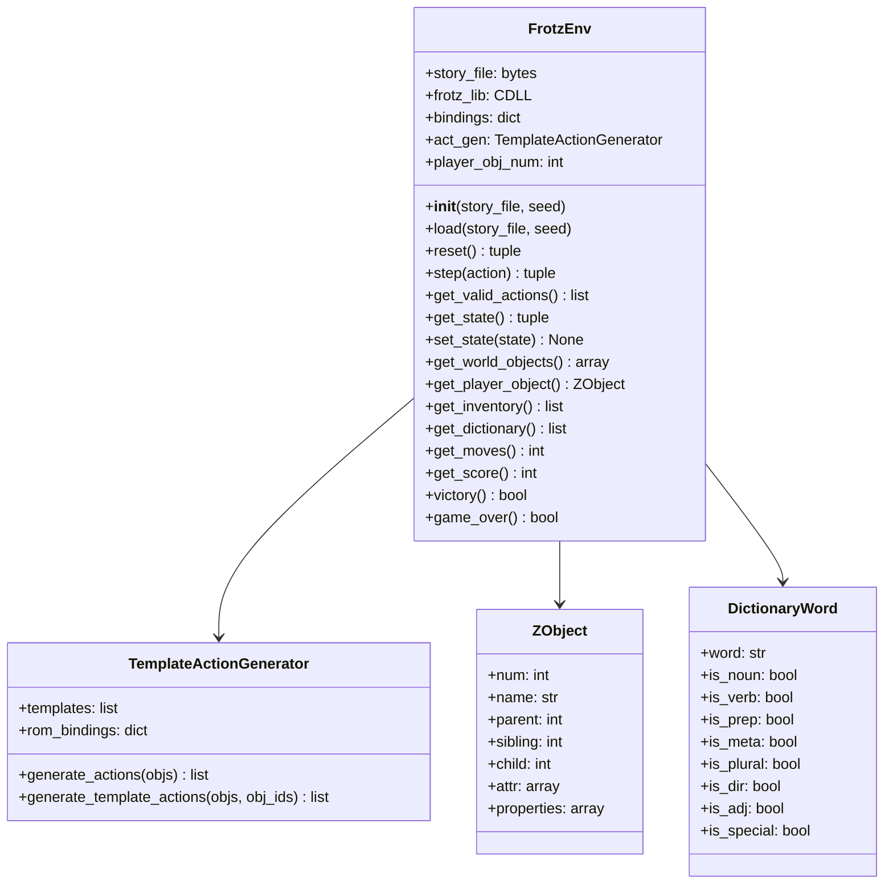
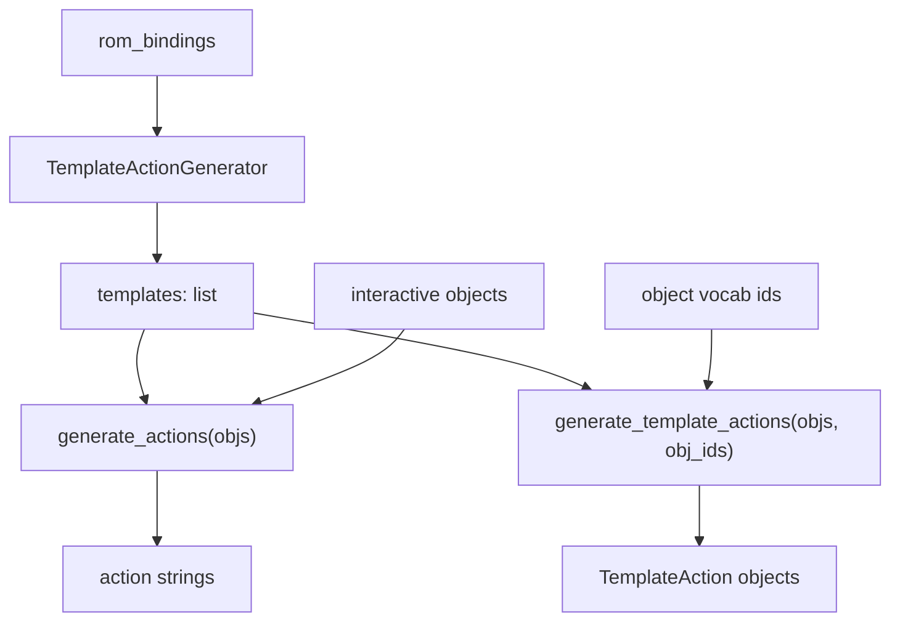
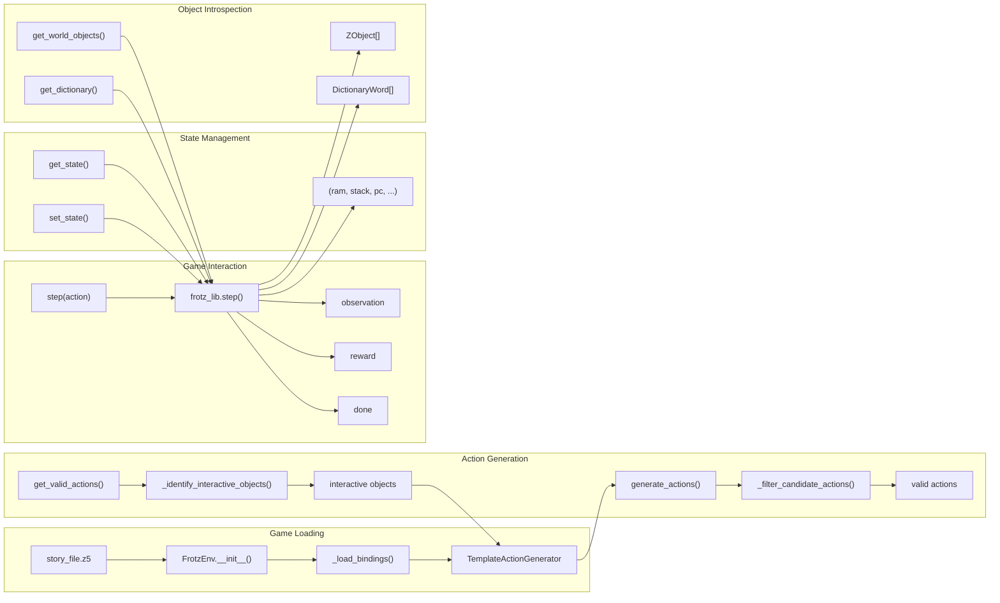

<!-- source: DeepWiki mcp.deepwiki.com · repo microsoft/jericho · page 7 API Reference · fetched 2026-10-26 -->

# API Reference

<details>
<summary>Relevant source files</summary>

The following files were used as context for generating this wiki page:

- [frotz/src/games/zork1.c](frotz/src/games/zork1.c)
- [jericho/defines.py](jericho/defines.py)
- [jericho/jericho.py](jericho/jericho.py)
- [jericho/template_action_generator.py](jericho/template_action_generator.py)
- [jericho/util.py](jericho/util.py)
- [jericho/version.py](jericho/version.py)
- [requirements.txt](requirements.txt)
- [setup.py](setup.py)

</details>


This document provides comprehensive API documentation for all public classes, methods, and functions in the Jericho library. This covers the Python interface for interacting with Z-machine games and generating valid actions.

For architectural details about how these components work internally, see [Architecture](#4). For information about adding support for new games, see [Adding New Games](#5.2).

## Core Classes

### FrotzEnv

The primary interface for interacting with Z-machine games. Provides a reinforcement learning environment with state management, action execution, and game introspection capabilities.



#### Constructor

**`__init__(story_file, seed=None)`**

Initializes a new FrotzEnv instance.

| Parameter | Type | Description |
|-----------|------|-------------|
| `story_file` | str | Path to Z-machine game file (.z3/.z5/.z6/.z8) |
| `seed` | int, optional | Random seed for game emulator. Defaults to walkthrough seed if available, otherwise -1 |

#### Core Methods

**`reset() -> tuple[str, dict]`**

Resets the game to its initial state.

Returns:
- `observation`: Initial game text
- `info`: Dictionary with 'moves' and 'score' keys

**`step(action) -> tuple[str, float, bool, dict]`**

Executes an action in the game.

| Parameter | Type | Description |
|-----------|------|-------------|
| `action` | str | Text command to send to interpreter |

Returns:
- `observation`: Game's textual response
- `reward`: Immediate reward (score change)
- `done`: Whether game is over
- `info`: Dictionary with 'moves' and 'score' keys

**`get_valid_actions(use_object_tree=True, use_ctypes=True, use_parallel=True) -> list[str]`**

Generates a list of valid actions from current game state.

| Parameter | Type | Description |
|-----------|------|-------------|
| `use_object_tree` | bool | Query object tree for surrounding objects |
| `use_ctypes` | bool | Use optimized C implementation |
| `use_parallel` | bool | Use parallel processing |

#### State Management

**`get_state() -> tuple`**

Returns complete internal game state for later restoration.

Returns tuple of: `(ram, stack, pc, sp, fp, frame_count, opcode, rng, narrative)`

**`set_state(state) -> None`**

Restores game to a previously captured state.

| Parameter | Type | Description |
|-----------|------|-------------|
| `state` | tuple | State tuple from `get_state()` |

#### Game Introspection

**`get_world_objects(clean=False) -> array[ZObject]`**

Returns all objects in the game world.

| Parameter | Type | Description |
|-----------|------|-------------|
| `clean` | bool | Remove noisy objects for state comparison |

**`get_player_object() -> ZObject`**

Returns the player object.

**`get_player_location() -> ZObject`**

Returns the object representing the player's current location.

**`get_inventory() -> list[ZObject]`**

Returns list of objects in player's possession.

**`get_dictionary() -> list[DictionaryWord]`**

Returns all words recognized by the game parser.

#### Game Status

**`get_score() -> int`**

Returns current game score.

**`get_max_score() -> int`**

Returns maximum possible score for the game.

**`get_moves() -> int`**

Returns number of moves taken in current episode.

**`victory() -> bool`**

Returns True if player has won the game.

**`game_over() -> bool`**

Returns True if player has lost the game.

Sources: [jericho/jericho.py:371-763]()

### ZObject

Represents a Z-machine object with hierarchical relationships and attributes.

#### Attributes

| Attribute | Type | Description |
|-----------|------|-------------|
| `num` | int | Object number |
| `name` | str | Short object name |
| `parent` | int | Object number of parent |
| `sibling` | int | Object number of sibling |
| `child` | int | Object number of child |
| `attr` | array | 32-bit array of object attributes |
| `properties` | array | Object properties |

#### Methods

**`__str__() -> str`**

Returns formatted string representation showing object relationships and attributes.

Sources: [jericho/jericho.py:59-130]()

### DictionaryWord

Represents a word recognized by the game parser with part-of-speech information.

#### Attributes

| Attribute | Type | Description |
|-----------|------|-------------|
| `word` | str | The dictionary word |
| `is_noun` | bool | Word is a noun |
| `is_verb` | bool | Word is a verb |
| `is_prep` | bool | Word is a preposition |
| `is_meta` | bool | Word is a meta command |
| `is_plural` | bool | Word is plural |
| `is_dir` | bool | Word is a direction |
| `is_adj` | bool | Word is an adjective |
| `is_special` | bool | Word is a special command |

#### Methods

**`pos() -> list[str]`**

Returns list of part-of-speech tags for the word.

Sources: [jericho/jericho.py:131-214]()

### TemplateActionGenerator

Generates valid actions by filling grammar templates with interactive objects.



#### Constructor

**`__init__(rom_bindings)`**

| Parameter | Type | Description |
|-----------|------|-------------|
| `rom_bindings` | dict | Game-specific bindings from `FrotzEnv.bindings` |

#### Methods

**`generate_actions(objs) -> list[str]`**

Generates action strings by filling templates with objects.

| Parameter | Type | Description |
|-----------|------|-------------|
| `objs` | list[str] | Interactive object names |

**`generate_template_actions(objs, obj_ids) -> list[TemplateAction]`**

Generates TemplateAction objects with metadata.

| Parameter | Type | Description |
|-----------|------|-------------|
| `objs` | list[str] | Interactive object names |
| `obj_ids` | list[int] | Corresponding vocabulary IDs |

Sources: [jericho/template_action_generator.py:22-150]()

### TemplateAction

Named tuple representing an action with generation metadata.

#### Fields

| Field | Type | Description |
|-------|------|-------------|
| `action` | str | The action text |
| `template_id` | int | Index of template used |
| `obj_ids` | list[int] | Vocabulary IDs of objects used |

Sources: [jericho/defines.py:140-151]()

## API Data Flow



Sources: [jericho/jericho.py:371-763](), [jericho/template_action_generator.py:22-150]()

## Utility Functions

### Text Processing

**`util.clean(s) -> str`**

Cleans strings by removing garbage characters like newlines and asterisks.

**`util.tokenize(str) -> list[str]`**

Tokenizes text using spaCy, returning lowercase tokens.

**`util.unabbreviate(action) -> str`**

Expands common action abbreviations (e.g., 'n' → 'north').

**`util.recognized(response) -> bool`**

Determines if game response indicates the action was understood.

**`util.extract_objs(text) -> set[tuple]`**

Extracts potential interactive objects from text using NLP.

### Object Tree Navigation

**`util.get_subtree(obj_nb, full_object_tree) -> list[ZObject]`**

Traverses object tree returning all descendants and siblings of given object.

### Action Analysis

**`util.verb_usage_count(verb, max_word_length=None) -> int`**

Returns usage frequency of verb from ClubFloyd transcript analysis.

**`util.chunk(items, n) -> list[list]`**

Splits list into n chunks for parallel processing.

Sources: [jericho/util.py:23-228]()

## Constants and Configuration

### Action Categories

| Constant | Description |
|----------|-------------|
| `ILLEGAL_ACTIONS` | Actions that manipulate game state illegally |
| `BASIC_ACTIONS` | Universal actions applicable to most games |
| `NO_EFFECT_ACTIONS` | Actions that typically don't change world state |

### Text Recognition

| Constant | Description |
|----------|-------------|
| `UNRECOGNIZED_REGEXPS` | Patterns matching unrecognized action responses |
| `ABBRV_DICT` | Common action abbreviations mapping |

### Game Bindings

| Constant | Description |
|----------|-------------|
| `BINDINGS_DICT` | Maps game MD5 hashes to game-specific configurations |

Sources: [jericho/defines.py:21-137]()

## Exception Classes

### UnsupportedGameWarning

Raised when attempting operations on games without full Jericho support.

### TruncatedInputActionWarning

Raised when action text exceeds maximum input buffer size and gets truncated.

Sources: [jericho/jericho.py:363-368]()

## Version Information

The current version is available via:

```python
from jericho.version import __version__
```

Sources: [jericho/version.py:1]()