# Page: Overview

# Overview

<details>
<summary>Relevant source files</summary>

The following files were used as context for generating this wiki page:

- [README.md](README.md)
- [docs/source/tutorial_quick.rst](docs/source/tutorial_quick.rst)
- [jericho/__init__.py](jericho/__init__.py)
- [jericho/jericho.py](jericho/jericho.py)
- [tests/test_valid_actions.py](tests/test_valid_actions.py)

</details>


## Purpose and Scope

Jericho is a Python interface connecting reinforcement learning agents with interactive fiction games. It provides a standardized environment wrapper around the Frotz Z-machine interpreter, enabling AI research on text-based adventure games through a clean, gym-like API.

This document introduces Jericho's core architecture, main components, and research-oriented features. For installation and basic usage, see [Getting Started](#2). For detailed API documentation, see [API Reference](#7). For information about supported games, see [Game Library](#6).

Sources: [README.md:19-21](), [jericho/jericho.py:371-383]()

## System Architecture

Jericho implements a layered architecture that separates the Python research interface from the underlying Z-machine interpreter implementation:

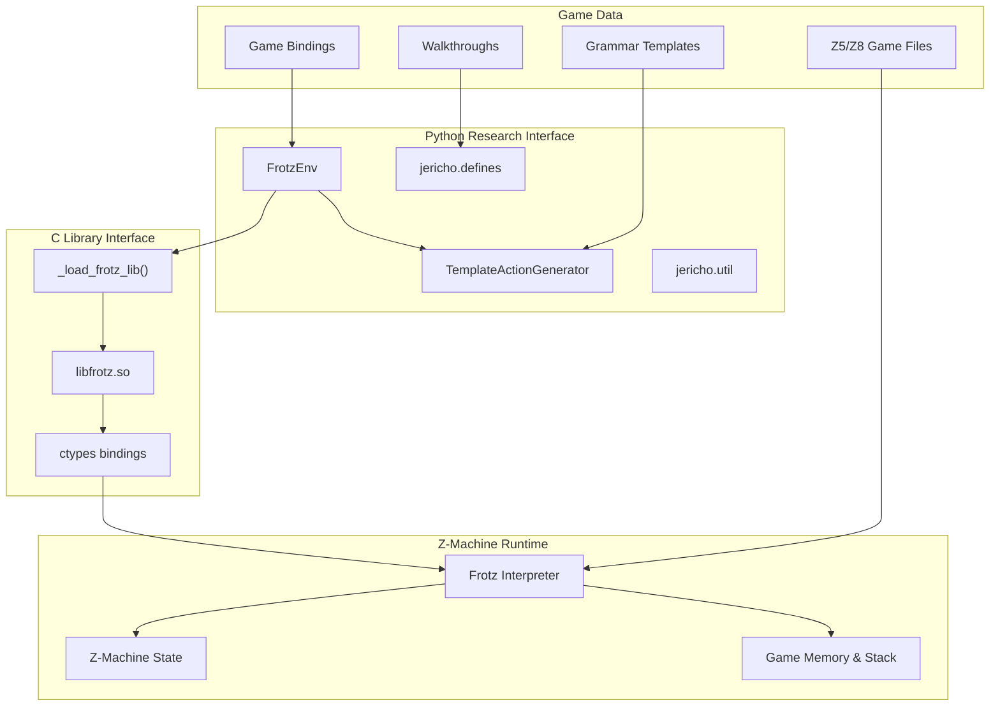

This architecture enables high-performance game execution through the C layer while providing rich research features through the Python layer.

Sources: [jericho/jericho.py:216-339](), [jericho/jericho.py:36-37](), [jericho/__init__.py:1-2]()

## Core Interface

The `FrotzEnv` class serves as the primary interface for interacting with interactive fiction games. It implements a reinforcement learning environment API similar to OpenAI Gym:

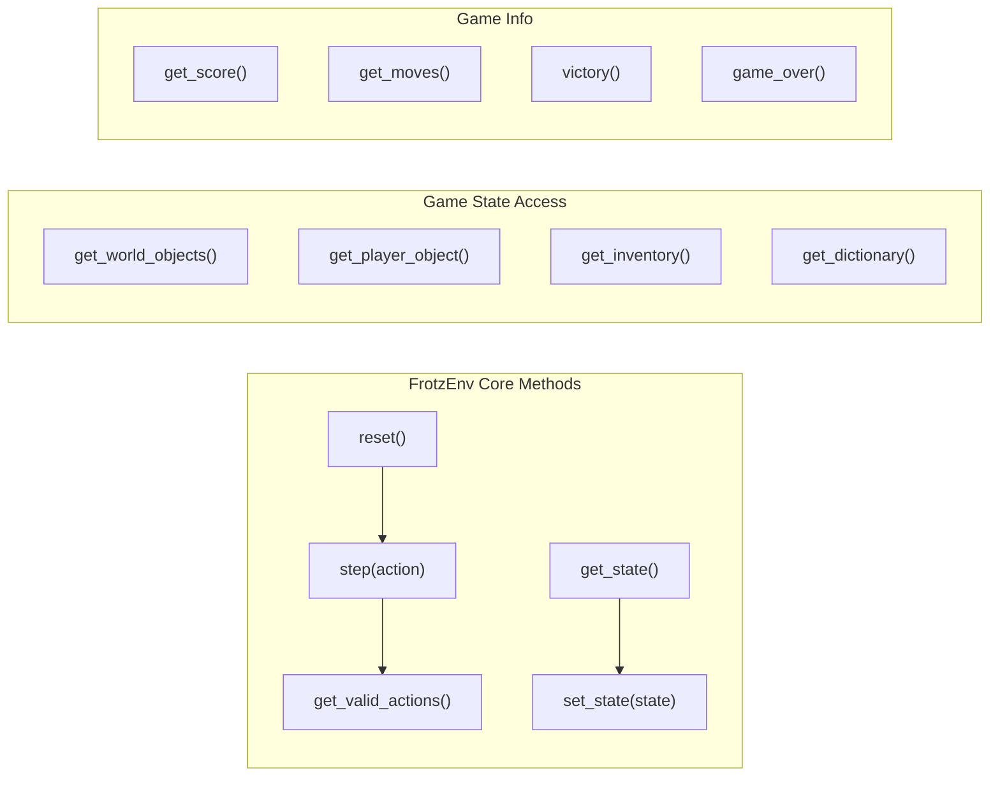

### Key Methods

| Method | Purpose | Returns |
|--------|---------|---------|
| `reset()` | Initialize/restart game | `(observation, info)` |
| `step(action)` | Execute action | `(observation, reward, done, info)` |
| `get_valid_actions()` | Generate valid actions | `list[str]` |
| `get_state()` | Serialize game state | `tuple` |
| `set_state(state)` | Restore game state | `None` |

The environment automatically handles game loading, state management, and provides rich introspection capabilities for research purposes.

Sources: [jericho/jericho.py:371-383](), [jericho/jericho.py:448-462](), [jericho/jericho.py:464-491](), [jericho/jericho.py:554-576]()

## Action Generation System

Jericho includes sophisticated action generation through the `TemplateActionGenerator` class, which automatically produces valid actions based on game grammar and current world state:

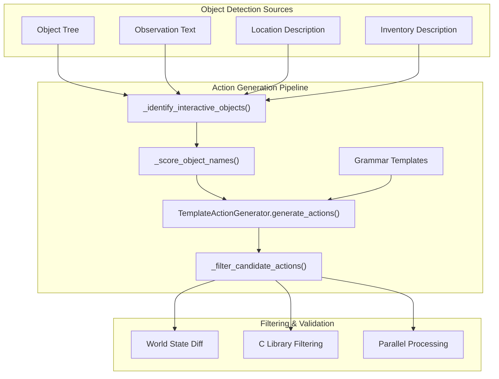

The system uses natural language processing to extract objects from game text, scores object names by relevance, generates actions from grammar templates, and filters them by testing actual game state changes.

Sources: [jericho/jericho.py:33](), [jericho/jericho.py:554-576](), [jericho/jericho.py:840-936](), [jericho/jericho.py:938-1013]()

## Game Support Framework

Jericho supports 40+ interactive fiction games through a game-specific binding system that maps game files to customized behavior:

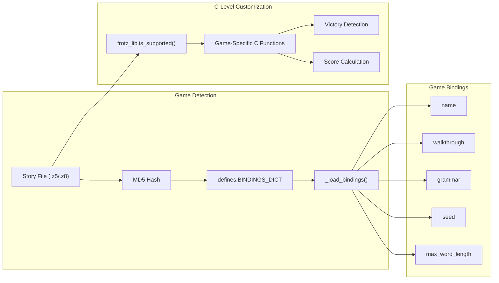

Games are identified by MD5 hash and mapped to specific configurations including walkthroughs, action grammars, and custom scoring logic implemented in C.

Sources: [jericho/jericho.py:342-360](), [jericho/jericho.py:420-421](), [jericho/jericho.py:414-418]()

## Research Features

Jericho provides several advanced features specifically designed for AI research on interactive fiction:

### World State Introspection

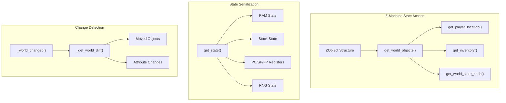

### Key Research Capabilities

| Feature | Purpose | Implementation |
|---------|---------|----------------|
| State Serialization | Save/restore exact game state | `get_state()` / `set_state()` |
| Object Tree Access | Inspect game world structure | `ZObject` / `get_world_objects()` |
| Action Validation | Generate semantically valid actions | `get_valid_actions()` |
| Change Detection | Track world state modifications | `_world_changed()` / `_get_world_diff()` |
| Dictionary Access | Query parser vocabulary | `get_dictionary()` |
| Walkthrough Replay | Reproduce optimal solutions | `get_walkthrough()` |

These features enable sophisticated research including state space exploration, action space analysis, world model learning, and systematic evaluation of agent capabilities.

Sources: [jericho/jericho.py:59-129](), [jericho/jericho.py:578-632](), [jericho/jericho.py:664-692](), [jericho/jericho.py:710-738](), [jericho/jericho.py:764-819]()

---

# Page: Getting Started

# Getting Started

<details>
<summary>Relevant source files</summary>

The following files were used as context for generating this wiki page:

- [README.md](README.md)
- [docs/source/tutorial_quick.rst](docs/source/tutorial_quick.rst)
- [jericho/__init__.py](jericho/__init__.py)
- [jericho/util.py](jericho/util.py)
- [jericho/version.py](jericho/version.py)
- [requirements.txt](requirements.txt)
- [setup.py](setup.py)
- [tests/test_valid_actions.py](tests/test_valid_actions.py)

</details>


This page provides installation instructions, basic usage examples, and a quick start guide for new users beginning with Jericho. It covers the essential steps to get Jericho running and demonstrates the core interface for interacting with interactive fiction games.

For detailed information about the `FrotzEnv` interface and its methods, see [Core Components](#3.1). For information about adding support for new games, see [Adding New Games](#5.2).

## System Requirements

Jericho requires specific system dependencies and runtime environment setup before installation:

| Component | Requirement | Purpose |
|-----------|-------------|---------|
| Operating System | Linux | Required for C library compilation |
| Python | 3.9+ | Core runtime environment |
| Build Tools | gcc, make, curl | C library compilation |
| NLP Library | Spacy with en_core_web_sm model | Text processing and action generation |

## Installation Methods

Jericho supports two primary installation approaches: package manager installation for standard usage and source installation for development.

### Installation Flow

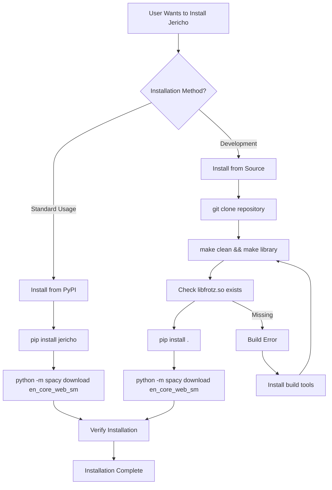

Sources: [setup.py:22-30](), [README.md:29-35](), [docs/source/tutorial_quick.rst:14-34]()

### PyPI Installation

The standard installation method uses the Python Package Index:

```bash
pip install jericho
python -m spacy download en_core_web_sm
```

This approach downloads the pre-compiled `libfrotz.so` library and handles dependency resolution automatically.

Sources: [README.md:33-34](), [docs/source/tutorial_quick.rst:16-17]()

### Source Installation

For development or customization, install from the GitHub repository:

```bash
git clone https://github.com/microsoft/jericho.git
cd jericho
pip install .
python -m spacy download en_core_web_sm
```

The source installation process compiles the Frotz C library during setup, as defined in [setup.py:24-25](). The build system ensures `libfrotz.so` exists before proceeding with Python package installation.

Sources: [setup.py:24-30](), [docs/source/tutorial_quick.rst:23-34]()

## Acquiring Game Files

Jericho requires Z-machine game files (`.z5`, `.z8` formats) to function. The supported game archive can be downloaded:

```bash
wget https://github.com/BYU-PCCL/z-machine-games/archive/master.zip
unzip master.zip
```

Jericho-supported games are located in the `jericho-game-suite` subdirectory of the extracted archive.

Sources: [docs/source/tutorial_quick.rst:42-47]()

## Core Interface Overview

The primary interaction with Jericho occurs through the `FrotzEnv` class, which implements a reinforcement learning interface for text-based games.

### Basic Usage Pattern

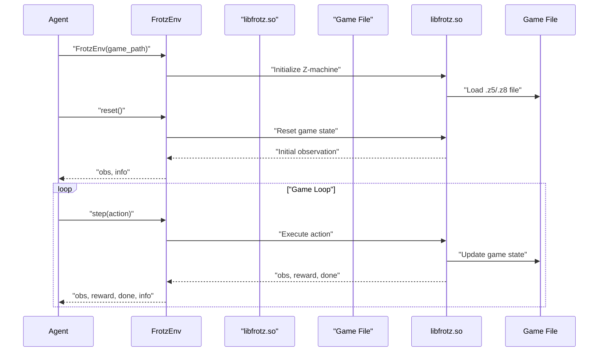

Sources: [docs/source/tutorial_quick.rst:55-68](), [jericho/__init__.py:1]()

## Essential Code Example

The following example demonstrates the core `FrotzEnv` interface pattern:

```python
from jericho import *

# Initialize environment with game file
env = FrotzEnv("z-machine-games-master/jericho-game-suite/zork1.z5")
initial_observation, info = env.reset()

done = False
while not done:
    # Execute action and receive feedback
    observation, reward, done, info = env.step('open mailbox')
    
    # Access game metadata
    print('Total Score', info['score'], 'Moves', info['moves'])

print('Scored', info['score'], 'out of', env.get_max_score())
```

This pattern follows the standard reinforcement learning interface where agents provide string actions and receive string observations, numerical rewards, and termination indicators.

Sources: [docs/source/tutorial_quick.rst:57-68]()

## Key Interface Methods

### State Management Methods

| Method | Purpose | Return Type |
|--------|---------|-------------|
| `reset()` | Initialize/restart game | `(observation, info)` |
| `step(action)` | Execute action | `(obs, reward, done, info)` |
| `get_state()` | Serialize current state | `bytes` |
| `set_state(state)` | Restore saved state | `None` |

### Information Access Methods

| Method | Purpose | Return Type |
|--------|---------|-------------|
| `get_dictionary()` | Game vocabulary | `list[str]` |
| `get_valid_actions()` | Available actions | `list[str]` |
| `get_world_objects()` | All game objects | `list[ZObject]` |
| `get_player_location()` | Current location object | `ZObject` |
| `get_inventory()` | Player inventory | `list[ZObject]` |

Sources: [docs/source/tutorial_quick.rst:74-138]()

### Action Generation and Validation

Jericho provides sophisticated action generation capabilities through `get_valid_actions()`:

```python
>>> env.reset()
'You are standing in an open field west of a white house, with a boarded front door. There is a small mailbox here.'
>>> valid_actions = env.get_valid_actions()
['south', 'open mailbox', 'west', 'north']
```

This method uses the `TemplateActionGenerator` system to automatically identify contextually appropriate actions based on current game state and available objects.

Sources: [docs/source/tutorial_quick.rst:117-124](), [tests/test_valid_actions.py:7-16]()

## Verification and Troubleshooting

### Installation Verification

Test the installation with a minimal example:

```python
import jericho
env = jericho.FrotzEnv("game.z5")  # Requires valid game file
obs, info = env.reset()
print("Installation successful:", len(obs) > 0)
```

### Common Dependencies

The build process requires specific dependencies defined in [requirements.txt:2-4]():

- `numpy`: Numerical computations
- `spacy>=2.1.0`: Natural language processing
- `termcolor`: Terminal output formatting

The setup process automatically handles Spacy model installation through [jericho/util.py:44-47](), which downloads `en_core_web_sm` if not present.

Sources: [requirements.txt:2-4](), [jericho/util.py:38-47](), [setup.py:35]()

---

# Page: Core Components

# Core Components

<details>
<summary>Relevant source files</summary>

The following files were used as context for generating this wiki page:

- [frotz/src/games/omniquest.c](frotz/src/games/omniquest.c)
- [frotz/src/games/plundered.c](frotz/src/games/plundered.c)
- [frotz/src/games/zork1.c](frotz/src/games/zork1.c)
- [jericho/defines.py](jericho/defines.py)
- [jericho/game_info.py](jericho/game_info.py)
- [jericho/jericho.py](jericho/jericho.py)
- [jericho/template_action_generator.py](jericho/template_action_generator.py)

</details>


This document provides a detailed overview of the main architectural components that make up the Jericho system. It covers the Python interface layer, action generation system, game support framework, and Z-machine integration. For information about building and installing Jericho, see [Building and Testing](#5.1). For details about adding support for new games, see [Adding New Games](#5.2).

## Python Interface Layer

The Python interface layer provides the primary API for interacting with interactive fiction games through the `FrotzEnv` class and supporting data structures.

### FrotzEnv Class

The `FrotzEnv` class serves as the main entry point for all game interactions. It wraps the underlying C library and provides a clean Python API compatible with reinforcement learning frameworks.

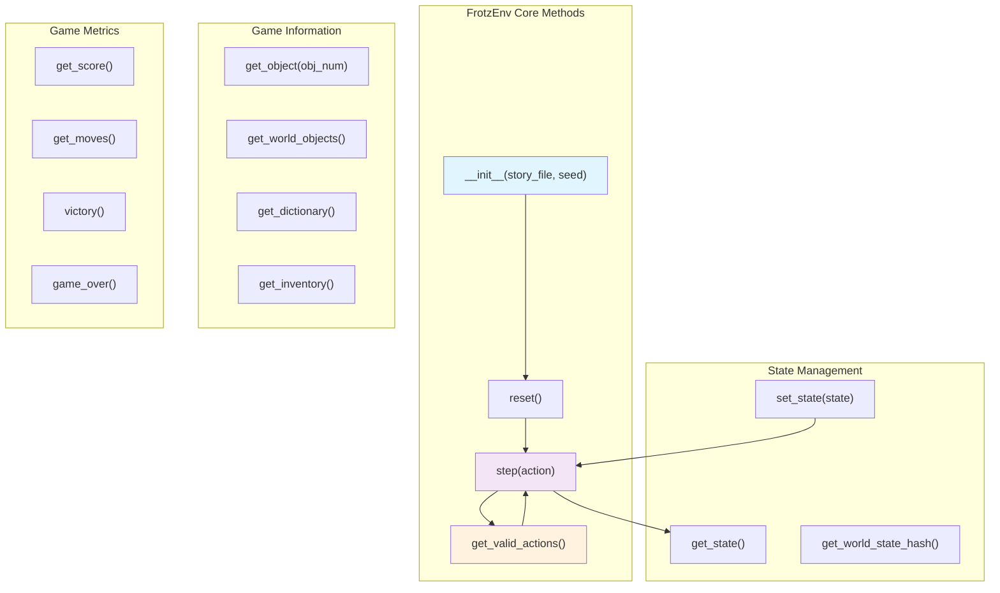

Sources: [jericho/jericho.py:371-492]()

### Z-Machine Data Structures

Jericho exposes key Z-machine data structures through Python classes that provide access to game internals.

#### ZObject Structure

The `ZObject` class represents objects in the Z-machine object tree, providing access to object relationships, attributes, and properties.

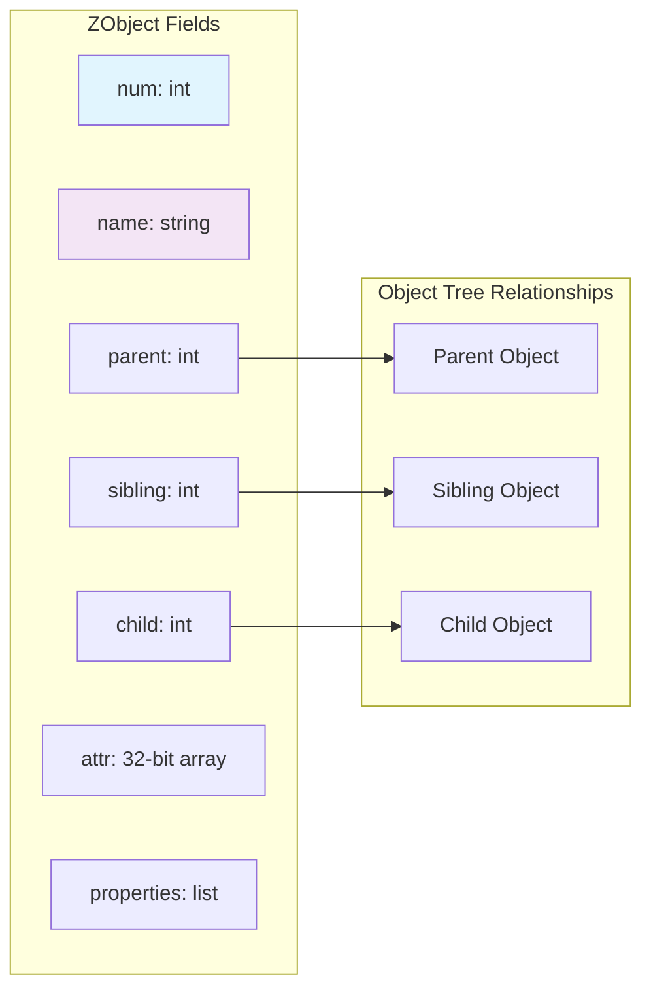

Sources: [jericho/jericho.py:59-129]()

#### DictionaryWord Structure

The `DictionaryWord` class represents vocabulary words recognized by the game parser, including part-of-speech information.

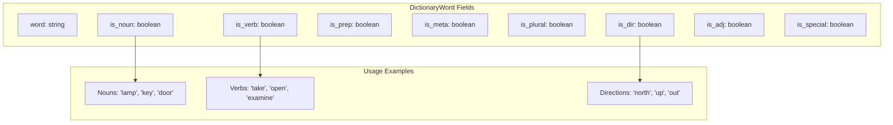

Sources: [jericho/jericho.py:131-214]()

## Action Generation System

The action generation system automatically creates valid actions from grammar templates and identified interactive objects, enabling systematic exploration of the action space.

### TemplateActionGenerator Architecture

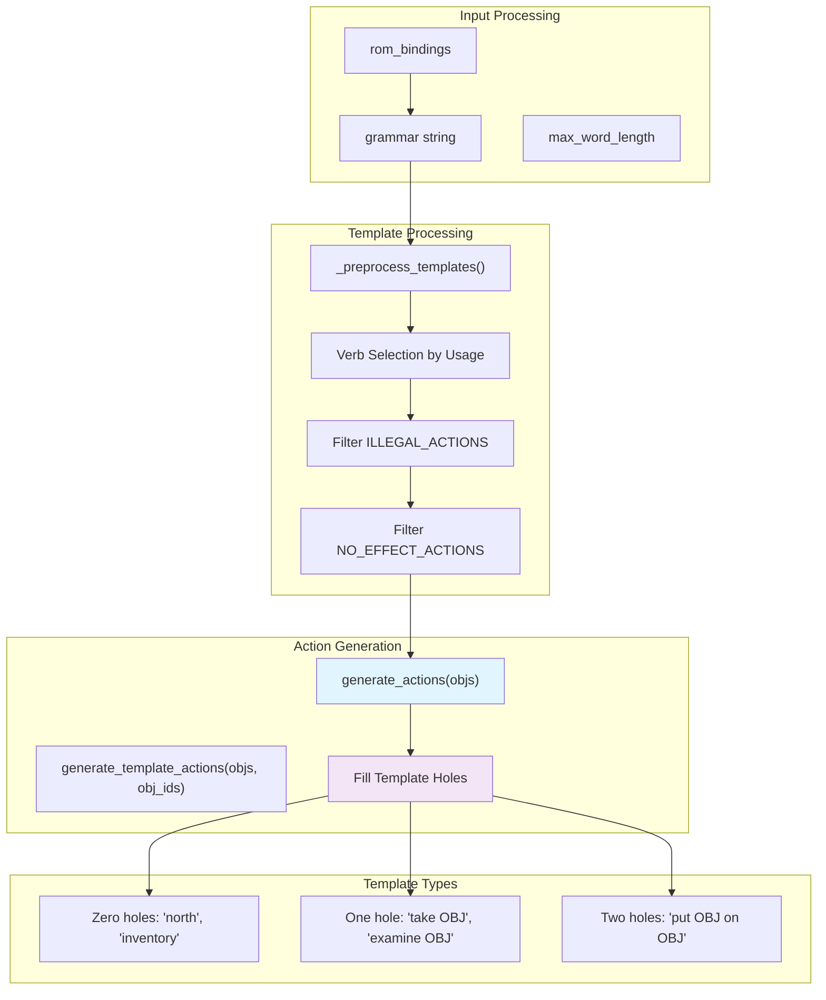

Sources: [jericho/template_action_generator.py:22-99]()

### Template Processing Pipeline

The system processes raw grammar strings into usable templates through several steps:

1. **Verb Selection**: When templates contain multiple verbs separated by `/`, the system selects the most commonly used verb based on frequency counts
2. **Filtering**: Templates starting with illegal actions or no-effect actions are filtered out
3. **Hole Filling**: Templates with `OBJ` placeholders are filled with interactive objects

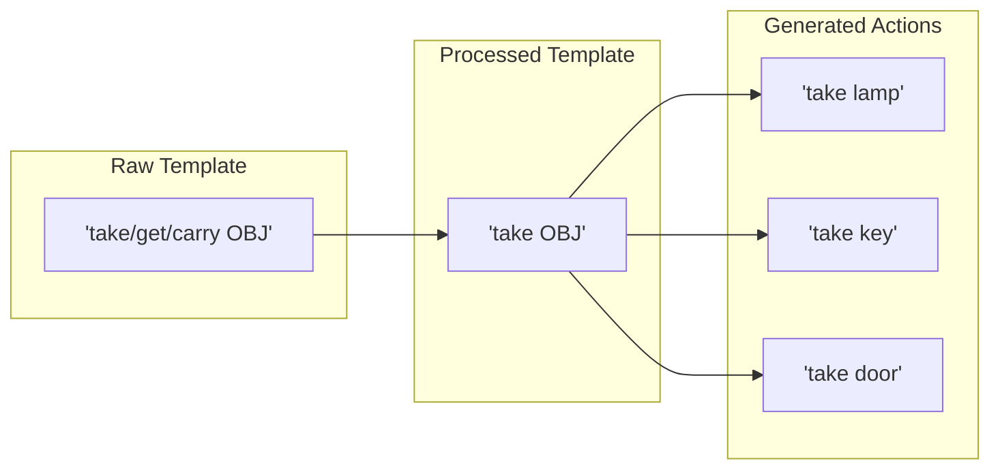

Sources: [jericho/template_action_generator.py:42-65]()

## Game Support Framework

Jericho supports over 40 different interactive fiction games through a sophisticated binding system that maps game MD5 hashes to game-specific implementations.

### Game Binding System

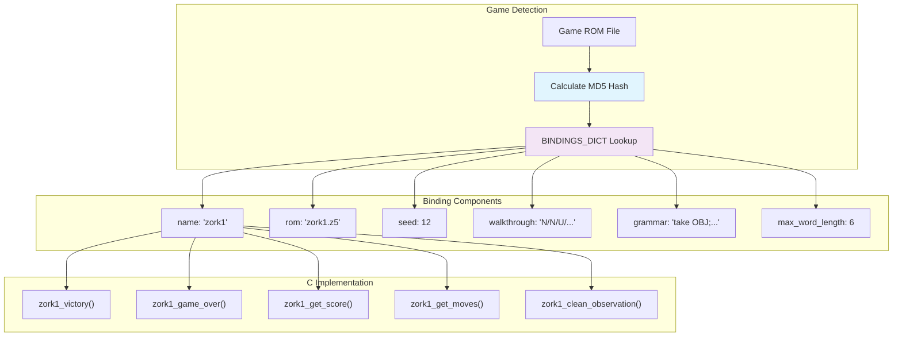

Sources: [jericho/defines.py:79-137](), [jericho/game_info.py:17-24]()

### Game-Specific Implementations

Each supported game has a corresponding C implementation that provides customized behavior for victory detection, scoring, observation cleaning, and state management.

| Function Pattern | Purpose | Example |
|------------------|---------|---------|
| `{game}_victory()` | Detect win condition | `zork1_victory()` checks for "Inside the Barrow" |
| `{game}_game_over()` | Detect death/loss | `zork1_game_over()` checks for "You have died" |
| `{game}_get_score()` | Read score from memory | `zork1_get_score()` reads from addresses 8819-8820 |
| `{game}_get_moves()` | Read move count | `zork1_get_moves()` reads from addresses 8821-8822 |
| `{game}_clean_observation()` | Process game text | Remove prompts, clean formatting |

Sources: [frotz/src/games/zork1.c:53-136](), [frotz/src/games/omniquest.c:50-82]()

## Z-Machine Integration

The Python layer communicates with the Z-machine interpreter through a C library interface (`libfrotz.so`) that provides low-level access to game state and execution.

### C Library Interface

```mermaid
graph TB
    subgraph "Python ctypes Interface"
        LOADLIB["_load_frotz_lib()"]
        ARGTYPES["Function Argument Types"]
        RESTYPES["Function Return Types"]
    end
    
    subgraph "Core Z-Machine Operations"
        SETUP["frotz_lib.setup()"]
        STEP["frotz_lib.step()"]
        SHUTDOWN["frotz_lib.shutdown()"]
    end
    
    subgraph "State Access Functions"
        GETRAM["frotz_lib.getRAM()"]
        SETRAM["frotz_lib.setRAM()"]
        GETSTACK["frotz_lib.getStack()"]
        SETSTACK["frotz_lib.setStack()"]
        GETPC["frotz_lib.getPC()"]
        SETPC["frotz_lib.setPC()"]
    end
    
    subgraph "Game Information Functions"
        GETOBJ["frotz_lib.get_object()"]
        GETWORLDOBJS["frotz_lib.get_world_objects()"]
        GETSCORE["frotz_lib.get_score()"]
        GETMOVES["frotz_lib.get_moves()"]
        VICTORY["frotz_lib.victory()"]
        GAMEOVER["frotz_lib.game_over()"]
    end
    
    LOADLIB --> ARGTYPES
    ARGTYPES --> RESTYPES
    
    RESTYPES --> SETUP
    RESTYPES --> STEP
    RESTYPES --> SHUTDOWN
    
    RESTYPES --> GETRAM
    RESTYPES --> SETRAM
    RESTYPES --> GETSTACK
    RESTYPES --> SETSTACK
    
    RESTYPES --> GETOBJ
    RESTYPES --> GETWORLDOBJS
    RESTYPES --> GETSCORE
    RESTYPES --> GETMOVES
    
    style LOADLIB fill:#e1f5fe
    style STEP fill:#f3e5f5
```

Sources: [jericho/jericho.py:216-339]()

### State Management System

The system provides complete access to Z-machine internal state, enabling save/restore functionality and state-based analysis.

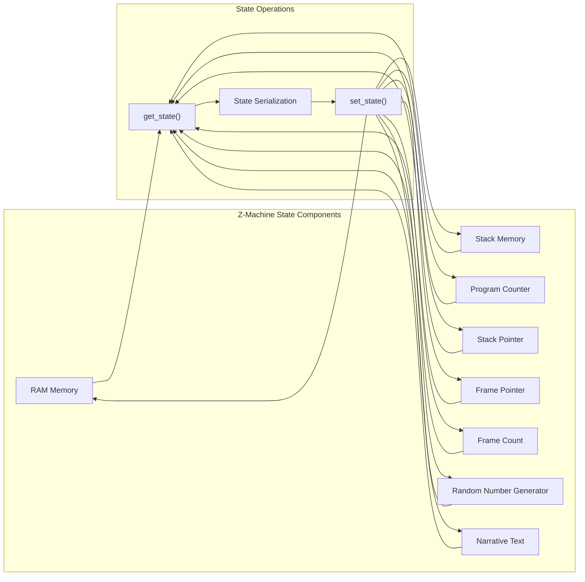

Sources: [jericho/jericho.py:578-632]()

---

# Page: FrotzEnv Interface

# FrotzEnv Interface

<details>
<summary>Relevant source files</summary>

The following files were used as context for generating this wiki page:

- [README.md](README.md)
- [docs/source/tutorial_quick.rst](docs/source/tutorial_quick.rst)
- [jericho/__init__.py](jericho/__init__.py)
- [jericho/jericho.py](jericho/jericho.py)
- [tests/test_jericho.py](tests/test_jericho.py)
- [tests/test_valid_actions.py](tests/test_valid_actions.py)

</details>


The `FrotzEnv` class is the primary interface for interacting with interactive fiction games in Jericho. It provides a Python wrapper around the Frotz Z-machine interpreter, offering a clean API for reinforcement learning agents and researchers to interact with text-based adventure games. This interface handles game loading, action execution, state management, and provides access to internal game structures like the object tree and dictionary.

For information about action generation from templates, see [Action Generation System](#3.2). For details about game-specific customizations and bindings, see [Game Support and Bindings](#3.3).

## Class Overview

The `FrotzEnv` class serves as the main entry point for game interaction, implementing a reinforcement learning-style interface with methods for resetting the environment, taking actions, and observing game state.

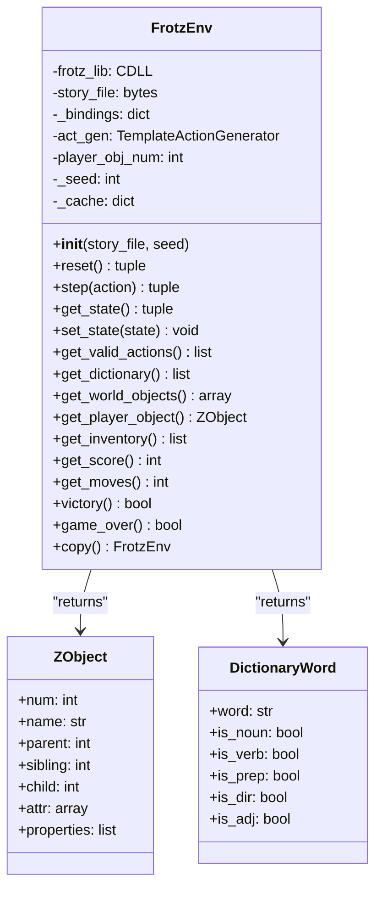

Sources: [jericho/jericho.py:371-497]()

## Core Interaction Methods

The fundamental game interaction follows a reset-step loop pattern typical of reinforcement learning environments.

### Initialization and Reset

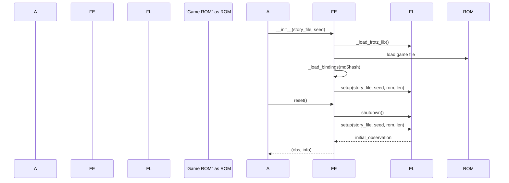

The `reset()` method initializes a new game episode and returns the initial observation along with game metadata.

Sources: [jericho/jericho.py:448-462](), [jericho/jericho.py:383-431]()

### Action Execution

The `step(action)` method executes actions and returns the standard RL tuple of observation, reward, done, and info.

| Method | Parameters | Returns | Description |
|--------|------------|---------|-------------|
| `step(action)` | `action: str` | `(obs, reward, done, info)` | Execute action, return response |
| `reset()` | None | `(obs, info)` | Reset game to initial state |

The step method handles action encoding and truncation automatically:

Sources: [jericho/jericho.py:464-491]()

## State Management System

`FrotzEnv` provides comprehensive state serialization capabilities for implementing techniques like search and planning.

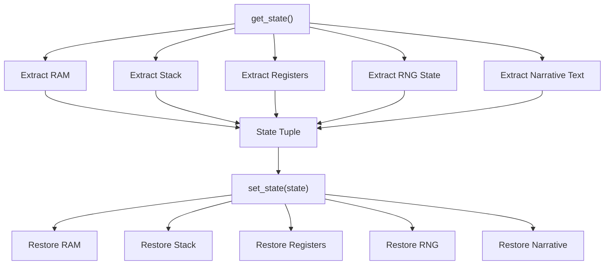

The state tuple contains:
- `ram`: Game memory as numpy array
- `stack`: Z-machine stack as numpy array
- `pc`: Program counter
- `sp`: Stack pointer
- `fp`: Frame pointer
- `frame_count`: Call frame count
- `opcode`: Current opcode
- `rng`: Random number generator state
- `narrative`: Current narrative text

Sources: [jericho/jericho.py:605-632](), [jericho/jericho.py:578-603]()

## Game Information Access

The interface provides multiple methods for accessing game internals and metadata.

### Object Tree Access

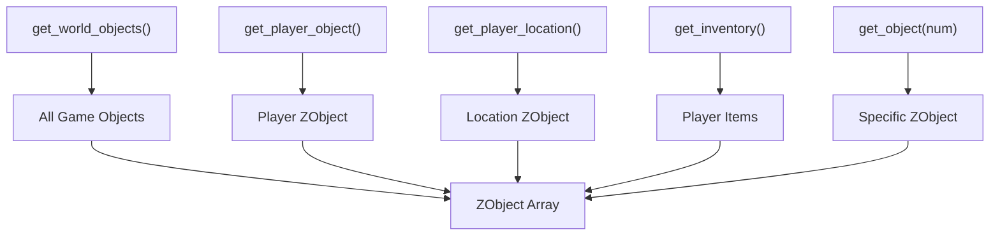

### Game Dictionary and Vocabulary

The `get_dictionary()` method returns all vocabulary words recognized by the game parser:

| Property | Type | Description |
|----------|------|-------------|
| `word` | str | The dictionary word |
| `is_noun` | bool | Word is a noun |
| `is_verb` | bool | Word is a verb |
| `is_prep` | bool | Word is a preposition |
| `is_dir` | bool | Word is a direction |
| `is_adj` | bool | Word is an adjective |

Sources: [jericho/jericho.py:532-539](), [jericho/jericho.py:131-214]()

## Integration with C Library

The interface communicates with the underlying Frotz interpreter through a dynamically loaded C library.

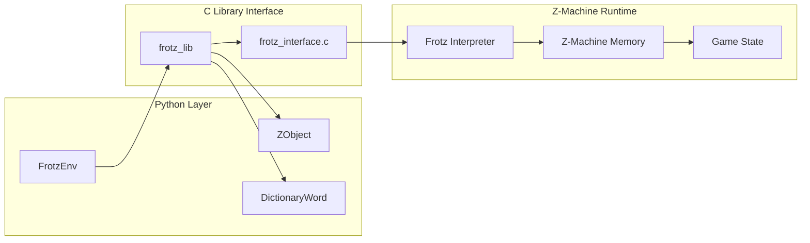

The C library provides functions for:
- Game setup and shutdown
- Action execution
- State serialization/deserialization
- Object tree access
- Dictionary access
- Game-specific logic hooks

Sources: [jericho/jericho.py:216-339](), [jericho/jericho.py:385-392]()

## Valid Actions Generation

The `get_valid_actions()` method integrates with the template action generator to produce contextually relevant actions.

```mermaid
flowchart TD
    A["get_valid_actions()"] --> B["_identify_interactive_objects()"]
    B --> C["Extract from observation"]
    B --> D["Extract from location"]
    B --> E["Extract from inventory"]
    B --> F["Extract from object tree"]
    
    C --> G["Object Names"]
    D --> G
    E --> G
    F --> G
    
    G --> H["act_gen.generate_actions()"]
    H --> I["Candidate Actions"]
    I --> J["_filter_candidate_actions()"]
    J --> K["Valid Actions List"]
```

This process:
1. Identifies interactive objects in the current context
2. Generates candidate actions using grammar templates
3. Filters actions by testing their effects on game state
4. Returns actions that cause meaningful state changes

Sources: [jericho/jericho.py:554-576](), [jericho/jericho.py:840-936]()

## Game Bindings Integration

Each game can have specific metadata and customizations accessed through the `bindings` property.

| Binding Key | Type | Description |
|-------------|------|-------------|
| `name` | str | Game identifier |
| `rom` | str | ROM filename |
| `walkthrough` | str | Solution sequence |
| `seed` | int | Deterministic seed |
| `grammar` | list | Action templates |
| `max_word_length` | int | Parser word limit |

The bindings are loaded based on the game's MD5 hash, ensuring each game gets its appropriate customizations.

Sources: [jericho/jericho.py:497-530](), [jericho/jericho.py:342-360]()

## Usage Patterns

### Basic Game Loop
```python
env = FrotzEnv('game.z5')
obs, info = env.reset()
while not done:
    action = select_action(obs)
    obs, reward, done, info = env.step(action)
```

### State Save/Restore
```python
state = env.get_state()
# Try risky action
obs, reward, done, info = env.step('dangerous action')
if done:
    env.set_state(state)  # Restore if failed
```

### Object Inspection
```python
player = env.get_player_object()
location = env.get_player_location()
inventory = env.get_inventory()
```

Sources: [tests/test_jericho.py:80-97](), [docs/source/tutorial_quick.rst:86-95]()

---

# Page: Action Generation System

# Action Generation System

<details>
<summary>Relevant source files</summary>

The following files were used as context for generating this wiki page:

- [README.md](README.md)
- [docs/source/tutorial_quick.rst](docs/source/tutorial_quick.rst)
- [frotz/src/games/zork1.c](frotz/src/games/zork1.c)
- [jericho/__init__.py](jericho/__init__.py)
- [jericho/defines.py](jericho/defines.py)
- [jericho/template_action_generator.py](jericho/template_action_generator.py)
- [jericho/util.py](jericho/util.py)
- [requirements.txt](requirements.txt)
- [setup.py](setup.py)
- [tests/test_valid_actions.py](tests/test_valid_actions.py)

</details>


The Action Generation System is responsible for automatically generating valid actions that can be taken in interactive fiction games. This system bridges the gap between the vast space of possible natural language commands and the specific grammar patterns recognized by each game, enabling reinforcement learning agents to efficiently explore the action space.

The system centers around the `TemplateActionGenerator` class, which uses game-specific grammar templates and current game objects to produce contextually appropriate actions. For information about how these generated actions are validated and executed, see [FrotzEnv Interface](#3.1). For details about game-specific customizations that affect action generation, see [Game Support and Bindings](#3.3).

## Core Architecture

The Action Generation System operates as a template-based action synthesis engine that transforms abstract grammar patterns into concrete, executable commands.

### TemplateActionGenerator Overview

```mermaid
graph TD
    subgraph "Initialization"
        BINDINGS["rom_bindings"] --> INIT["TemplateActionGenerator.__init__"]
        INIT --> GRAMMAR["grammar templates"]
        INIT --> PREPROCESS["_preprocess_templates()"]
        PREPROCESS --> TEMPLATES["self.templates"]
    end
    
    subgraph "Action Generation"
        OBJECTS["interactive objects"] --> GENERATE["generate_actions()"]
        TEMPLATES --> GENERATE
        GENERATE --> ACTIONS["action strings"]
        
        OBJECTS --> GENTEMPLATE["generate_template_actions()"]
        TEMPLATES --> GENTEMPLATE
        GENTEMPLATE --> TEMPLATE_ACTIONS["TemplateAction objects"]
    end
    
    subgraph "Template Processing"
        RAW_GRAMMAR["raw grammar string"] --> SPLIT["split on ';'"]
        SPLIT --> VERB_SELECT["select most common verb"]
        VERB_SELECT --> FILTER["filter illegal/no-effect actions"]
        FILTER --> FINAL_TEMPLATES["processed templates"]
    end
    
    GRAMMAR --> RAW_GRAMMAR
    FINAL_TEMPLATES --> TEMPLATES
```

**Sources:** [jericho/template_action_generator.py:22-41](), [jericho/template_action_generator.py:42-66]()

### Template Action Data Structure

The system produces two types of outputs: simple action strings and structured `TemplateAction` objects that preserve metadata about their generation.

```mermaid
graph LR
    subgraph "TemplateAction Structure"
        TA["TemplateAction"] --> ACTION["action: str"]
        TA --> TEMPLATE_ID["template_id: int"]
        TA --> OBJ_IDS["obj_ids: List[int]"]
    end
    
    subgraph "Example"
        EX["TemplateAction"] --> EX_ACTION["'examine lamp'"]
        EX --> EX_TEMPLATE["template_id: 15"]
        EX --> EX_OBJS["obj_ids: [342]"]
    end
```

**Sources:** [jericho/defines.py:140-151]()

## Template Processing Pipeline

The system transforms raw grammar specifications into executable templates through a multi-stage preprocessing pipeline.

### Grammar Template Preprocessing

```mermaid
flowchart TD
    START["Raw Grammar String"] --> SPLIT["Split on ';' delimiter"]
    SPLIT --> TEMPLATE["Individual Template"]
    
    TEMPLATE --> REGEX_CHECK["Check for verb alternatives\n(verb1/verb2/verb3 pattern)"]
    REGEX_CHECK -->|"Found alternatives"| VERB_USAGE["Calculate verb usage counts"]
    VERB_USAGE --> SELECT_VERB["Select most frequent verb"]
    SELECT_VERB --> REPLACE["Replace alternatives with selected verb"]
    
    REGEX_CHECK -->|"No alternatives"| FILTER_CHECK
    REPLACE --> FILTER_CHECK["Check against filter lists"]
    
    FILTER_CHECK --> ILLEGAL_CHECK["Check ILLEGAL_ACTIONS"]
    ILLEGAL_CHECK -->|"Is illegal"| REJECT["Reject template"]
    ILLEGAL_CHECK -->|"Not illegal"| NO_EFFECT_CHECK["Check NO_EFFECT_ACTIONS"]
    
    NO_EFFECT_CHECK -->|"No-effect action without OBJ"| REJECT
    NO_EFFECT_CHECK -->|"Valid template"| ACCEPT["Add to processed templates"]
    
    ACCEPT --> ADD_BASIC["Add BASIC_ACTIONS"]
    ADD_BASIC --> GAME_SPECIFIC["Apply game-specific modifications"]
    GAME_SPECIFIC --> FINAL["Final template list"]
```

**Sources:** [jericho/template_action_generator.py:42-66](), [jericho/util.py:169-208](), [jericho/defines.py:22-28]()

### Verb Selection Algorithm

| Component | Purpose | Implementation |
|-----------|---------|----------------|
| `verb_usage_count()` | Determines frequency of verb usage across game transcripts | [jericho/util.py:169-208]() |
| `ILLEGAL_ACTIONS` | Filters out meta-game commands that manipulate state | [jericho/defines.py:22]() |
| `NO_EFFECT_ACTIONS` | Excludes actions that don't change world state when used alone | [jericho/defines.py:28]() |
| `BASIC_ACTIONS` | Adds fundamental navigation and interaction commands | [jericho/defines.py:25]() |

**Sources:** [jericho/template_action_generator.py:47-64](), [jericho/defines.py:22-28]()

## Action Generation Process

The core action generation process combines preprocessed templates with interactive objects from the current game state to produce concrete actions.

### Template Instantiation Logic

```mermaid
graph TD
    subgraph "Input Processing"
        OBJS["interactive objects\n['lamp', 'key', 'door']"] 
        TEMPLATES["processed templates\n['take OBJ', 'unlock OBJ with OBJ', 'north']"]
    end
    
    subgraph "Template Analysis"
        TEMPLATES --> COUNT_HOLES["Count 'OBJ' placeholders\nin each template"]
        COUNT_HOLES --> ZERO_HOLES["0 holes: direct actions"]
        COUNT_HOLES --> ONE_HOLE["1 hole: single object actions"]
        COUNT_HOLES --> TWO_HOLES["2 holes: two object actions"]
    end
    
    subgraph "Action Generation"
        ZERO_HOLES --> DIRECT["Add template as-is\n'north'"]
        
        ONE_HOLE --> SINGLE_LOOP["For each object"]
        SINGLE_LOOP --> SINGLE_REPLACE["Replace OBJ with object\n'take lamp', 'take key', 'take door'"]
        
        TWO_HOLES --> DOUBLE_LOOP["For each object pair (o1, o2)"]
        DOUBLE_LOOP --> PAIR_CHECK["if o1 != o2"]
        PAIR_CHECK --> DOUBLE_REPLACE["Replace first OBJ with o1,\nsecond OBJ with o2\n'unlock door with key'"]
    end
    
    subgraph "Output"
        DIRECT --> RESULT["Generated Actions"]
        SINGLE_REPLACE --> RESULT
        DOUBLE_REPLACE --> RESULT
    end
```

**Sources:** [jericho/template_action_generator.py:68-99](), [jericho/template_action_generator.py:102-149]()

### Object Combination Strategy

The system generates actions by systematically combining templates with available objects:

| Template Pattern | Object Requirements | Example Output |
|------------------|-------------------|----------------|
| `"take OBJ"` | 1 object | `"take lamp"`, `"take key"` |
| `"put OBJ on OBJ"` | 2 different objects | `"put key on table"`, `"put lamp on table"` |
| `"north"` | 0 objects | `"north"` |

**Sources:** [jericho/template_action_generator.py:87-98](), [jericho/template_action_generator.py:132-148]()

## Integration with Game Environment

The Action Generation System integrates tightly with the broader Jericho framework to provide context-aware action suggestions.

### FrotzEnv Integration Flow

```mermaid
sequenceDiagram
    participant Agent
    participant FrotzEnv
    participant TemplateActionGenerator as TAG
    participant GameState
    participant ZMachine
    
    Agent->>FrotzEnv: get_valid_actions()
    FrotzEnv->>GameState: get_inventory()
    FrotzEnv->>GameState: get_player_location()
    FrotzEnv->>GameState: get_world_objects()
    GameState->>ZMachine: extract object information
    ZMachine-->>GameState: object data
    GameState-->>FrotzEnv: interactive objects list
    FrotzEnv->>TAG: generate_actions(objects)
    TAG-->>FrotzEnv: action candidates
    FrotzEnv->>FrotzEnv: filter_valid_actions()
    FrotzEnv-->>Agent: valid actions list
```

**Sources:** [tests/test_valid_actions.py:7-16](), [jericho/template_action_generator.py:68-99]()

### Game-Specific Customizations

Some games require special handling for their action templates:

| Game | Customization | Reason |
|------|---------------|--------|
| `enchanter`, `spellbrkr`, `murdac` | Use abbreviated directions (`ne`, `nw`, `se`, `sw`) | Only recognize shortened direction commands |
| All games | Template verb disambiguation | Multiple verb forms need to be resolved to most common usage |

**Sources:** [jericho/template_action_generator.py:36-40]()

## Template vs Action String Generation

The system provides two generation methods to support different use cases in the Jericho ecosystem.

### Method Comparison

```mermaid
graph LR
    subgraph "generate_actions()"
        GA_INPUT["objects: List[str]"] --> GA_PROCESS["Template filling"]
        GA_PROCESS --> GA_OUTPUT["List[str]"]
        GA_OUTPUT --> GA_EXAMPLE["['take lamp', 'examine door']"]
    end
    
    subgraph "generate_template_actions()"
        GTA_INPUT["objects: List[str]\nobj_ids: List[int]"] --> GTA_PROCESS["Template filling + metadata"]
        GTA_PROCESS --> GTA_OUTPUT["List[TemplateAction]"]
        GTA_OUTPUT --> GTA_EXAMPLE["[TemplateAction('take lamp', 15, [342])]"]
    end
```

**Sources:** [jericho/template_action_generator.py:68-99](), [jericho/template_action_generator.py:102-149]()

### Use Case Differentiation

- **`generate_actions()`**: Used when only action text is needed, typically for immediate execution or simple action space exploration
- **`generate_template_actions()`**: Used when metadata preservation is important, such as for learning algorithms that need to track which templates and objects produced specific actions

**Sources:** [jericho/template_action_generator.py:77-85](), [jericho/template_action_generator.py:114-128]()

---

# Page: Game Support and Bindings

# Game Support and Bindings

<details>
<summary>Relevant source files</summary>

The following files were used as context for generating this wiki page:

- [frotz/src/common/screen.c](frotz/src/common/screen.c)
- [frotz/src/games/omniquest.c](frotz/src/games/omniquest.c)
- [frotz/src/games/plundered.c](frotz/src/games/plundered.c)
- [jericho/game_info.py](jericho/game_info.py)
- [tests/test_textworld_games.py](tests/test_textworld_games.py)
- [tests/test_unsupported_game.py](tests/test_unsupported_game.py)

</details>


This page explains how Jericho supports 40+ different interactive fiction games through a sophisticated game detection and customization system. The system allows each game to have specialized behavior for victory detection, scoring, observation cleaning, and action generation while maintaining a consistent interface.

For information about the action generation system that uses game-specific grammar templates, see [Action Generation System](#3.2). For details about the core FrotzEnv interface, see [FrotzEnv Interface](#3.1).

## Game Detection and Binding System

Jericho automatically detects which game is being loaded by calculating the MD5 hash of the game file and looking it up in a centralized binding dictionary. This enables game-specific customizations to be applied automatically without user intervention.

### Game Detection Flow

```mermaid
flowchart TD
    GF["Game File (.z5/.z8)"] --> MD5["Calculate MD5 Hash"]
    MD5 --> LOOKUP["Lookup in BINDINGS_DICT"]
    LOOKUP --> FOUND{Found?}
    FOUND -->|Yes| DISPATCH["Dispatch to Game Functions"]
    FOUND -->|No| WARNING["UnsupportedGameWarning"]
    
    DISPATCH --> CFUNCS["C Functions"]
    DISPATCH --> PYINFO["Python Game Info"]
    
    CFUNCS --> VICTORY["victory()"]
    CFUNCS --> GAMEOVER["game_over()"]  
    CFUNCS --> SCORE["get_score()"]
    CFUNCS --> CLEAN["clean_observation()"]
    
    PYINFO --> GRAMMAR["Grammar Templates"]
    PYINFO --> WALKTHROUGH["Walkthroughs"]
    PYINFO --> METADATA["Game Metadata"]
    
    WARNING --> DEFAULT["Default Behavior"]
```

Sources: [tests/test_unsupported_game.py:11-40](), [tests/test_textworld_games.py:11-39]()

### Hash-Based Game Identification

The system uses MD5 hashing for precise game identification, ensuring that different versions or releases of games can be handled appropriately. When a game is not found in the bindings dictionary, Jericho issues an `UnsupportedGameWarning` and falls back to generic behavior.

```mermaid
graph TB
    subgraph "Supported Games"
        ZORK1["zork1.c"]
        HHGG["hhgg.c"] 
        OMNI["omniquest.c"]
        PLUND["plundered.c"]
        OTHER["... 40+ others"]
    end
    
    subgraph "Binding System"
        HASH["MD5 Hash"]
        DICT["BINDINGS_DICT"]
        DISPATCH["Function Dispatch"]
    end
    
    subgraph "Game Functions"
        VIC["victory()"]
        OVER["game_over()"]
        SCR["get_score()"]
        CLEAN["clean_observation()"]
        RAM["ram_addrs()"]
        INTRO["intro_actions()"]
    end
    
    HASH --> DICT
    DICT --> DISPATCH
    DISPATCH --> ZORK1
    DISPATCH --> HHGG
    DISPATCH --> OMNI
    DISPATCH --> PLUND
    DISPATCH --> OTHER
    
    ZORK1 --> VIC
    ZORK1 --> OVER
    ZORK1 --> SCR
    ZORK1 --> CLEAN
    ZORK1 --> RAM
    ZORK1 --> INTRO
```

Sources: [frotz/src/games/omniquest.c:1-111](), [frotz/src/games/plundered.c:1-100]()

## Game Metadata Structure

Each supported game has comprehensive metadata stored in [jericho/game_info.py](). This includes essential information for both gameplay and AI training.

### Core Game Information Fields

| Field | Purpose | Example |
|-------|---------|---------|
| `name` | Game identifier | `"omniquest"` |
| `rom` | Game file name | `"omniquest.z5"` |
| `seed` | Random seed for reproducibility | `4` |
| `walkthrough` | Solution sequence | `"e/get axe/chop tree/..."` |
| `grammar` | Action templates | `"take OBJ;drop OBJ;..."` |
| `max_word_length` | Parser constraint | `9` |

### Grammar Template System

The grammar field contains semicolon-separated action templates that define valid action patterns for the game. These templates use `OBJ` placeholders that get filled with interactive objects discovered in the game world.

```mermaid
graph LR
    subgraph "Game Info Structure"
        DICT["Game Dictionary"]
        NAME["name"]
        ROM["rom"] 
        SEED["seed"]
        WALK["walkthrough"]
        GRAM["grammar"]
        MAXWORD["max_word_length"]
    end
    
    subgraph "Grammar Processing"
        TEMPLATES["Action Templates"]
        SPLIT["Split on ';'"] 
        OBJ["OBJ Placeholders"]
        ACTIONS["Generated Actions"]
    end
    
    DICT --> NAME
    DICT --> ROM
    DICT --> SEED
    DICT --> WALK
    DICT --> GRAM
    DICT --> MAXWORD
    
    GRAM --> TEMPLATES
    TEMPLATES --> SPLIT
    SPLIT --> OBJ
    OBJ --> ACTIONS
```

Sources: [jericho/game_info.py:17-24](), [jericho/game_info.py:26-34](), [jericho/game_info.py:36-45]()

## Game-Specific C Implementations

Each game has a dedicated C file in [frotz/src/games/]() that implements customized behavior. These implementations override default Z-machine behavior with game-specific logic.

### Required Function Interface

Every game-specific C file must implement a standard set of functions:

```mermaid
classDiagram
    class GameInterface {
        +char** intro_actions(int *n)
        +char* clean_observation(char* obs)
        +int victory()
        +int game_over()
        +short get_score()
        +int max_score()
        +int get_moves()
        +zword* ram_addrs(int *n)
        +int get_self_object_num()
        +int get_num_world_objs()
        +void clean_world_objs(zobject* objs)
        +int ignore_moved_obj(zword obj, zword dest)
        +int ignore_attr_diff(zword obj, zword attr)
        +int ignore_attr_clr(zword obj, zword attr)
    }
    
    class omniquest_game {
        +omniquest_intro_actions()
        +omniquest_clean_observation()
        +omniquest_victory()
        +omniquest_game_over()
        +omniquest_get_score()
        +omniquest_max_score()
        +omniquest_get_moves()
        +omniquest_ram_addrs()
        +omniquest_get_self_object_num()
        +omniquest_get_num_world_objs()
        +omniquest_clean_world_objs()
        +omniquest_ignore_moved_obj()
        +omniquest_ignore_attr_diff()
        +omniquest_ignore_attr_clr()
    }
    
    GameInterface <|-- omniquest_game
```

Sources: [frotz/src/games/omniquest.c:36-39](), [frotz/src/games/omniquest.c:50-56](), [frotz/src/games/omniquest.c:74-76]()

### Victory and Game Over Detection

Games implement custom logic to detect win/loss conditions by examining the game's text output or internal state:

```mermaid
flowchart TB
    subgraph "Game State Monitoring"
        WORLD["world buffer"]
        TEXT["Game Text Output"]
        RAM["Special RAM Addresses"]
    end
    
    subgraph "Detection Functions"
        VIC["victory()"]
        OVER["game_over()"] 
        SCORE["get_score()"]
    end
    
    subgraph "Detection Methods"
        STRSTR["strstr() text matching"]
        RAMREAD["RAM address reading"] 
        PATTERN["Pattern matching"]
    end
    
    WORLD --> VIC
    TEXT --> VIC
    RAM --> VIC
    
    WORLD --> OVER
    TEXT --> OVER
    
    RAM --> SCORE
    
    VIC --> STRSTR
    OVER --> STRSTR
    SCORE --> RAMREAD
    
    STRSTR --> PATTERN
    RAMREAD --> PATTERN
```

Sources: [frotz/src/games/omniquest.c:50-64](), [frotz/src/games/plundered.c:50-64]()

## Observation Cleaning

Many games require custom observation cleaning to remove prompts, normalize formatting, or filter out irrelevant information for AI training.

### Common Cleaning Patterns

Different games use various cleaning strategies:

- **Prompt Removal**: Strip input prompts like `>` characters
- **Newline Normalization**: Handle different line ending conventions  
- **Header Stripping**: Remove game title screens or status information
- **Whitespace Cleanup**: Normalize spacing and indentation

```mermaid
graph TD
    RAW["Raw Game Output"] --> CLEAN["clean_observation()"]
    
    CLEAN --> PROMPT["Remove Prompts"]
    CLEAN --> NEWLINE["Normalize Newlines"]
    CLEAN --> HEADER["Strip Headers"]
    CLEAN --> SPACE["Clean Whitespace"]
    
    PROMPT --> PROCESSED["Cleaned Output"]
    NEWLINE --> PROCESSED
    HEADER --> PROCESSED  
    SPACE --> PROCESSED
    
    PROCESSED --> AI["AI Agent"]
```

Sources: [frotz/src/games/omniquest.c:41-48](), [frotz/src/games/plundered.c:41-48]()

## Special RAM Address Monitoring

Games can specify special RAM addresses to monitor for tracking internal state changes that aren't reflected in the text output. This enables more precise state tracking and reward calculation.

### RAM Address Configuration

```mermaid
graph LR
    subgraph "RAM Monitoring"
        ADDRS["Special RAM Addresses"]
        TRACK["State Tracking"]
        REWARD["Reward Calculation"]
    end
    
    subgraph "Game Examples"
        OMNI["omniquest: addr 2123"]
        PLUND["plundered: addr 729"]
    end
    
    ADDRS --> TRACK
    TRACK --> REWARD
    
    OMNI --> ADDRS
    PLUND --> ADDRS
```

Sources: [frotz/src/games/omniquest.c:27-34](), [frotz/src/games/plundered.c:27-34]()

## Unsupported Game Handling

When Jericho encounters a game not in its binding dictionary, it issues an `UnsupportedGameWarning` and falls back to generic behavior. This provides basic functionality while alerting users that game-specific features are unavailable.

### Fallback Behavior

- **Score Tracking**: Returns 0 for all score-related queries
- **Victory Detection**: Always returns false
- **Game Over Detection**: Always returns false  
- **Observation Cleaning**: Uses generic text processing
- **Action Generation**: Uses default grammar templates

Sources: [tests/test_unsupported_game.py:11-40]()

---

# Page: Architecture

# Architecture

<details>
<summary>Relevant source files</summary>

The following files were used as context for generating this wiki page:

- [frotz/src/dumb/dumb_blorb.c](frotz/src/dumb/dumb_blorb.c)
- [frotz/src/dumb/dumb_frotz.h](frotz/src/dumb/dumb_frotz.h)
- [frotz/src/dumb/dumb_init.c](frotz/src/dumb/dumb_init.c)
- [frotz/src/dumb/dumb_input.c](frotz/src/dumb/dumb_input.c)
- [frotz/src/dumb/dumb_output.c](frotz/src/dumb/dumb_output.c)
- [frotz/src/dumb/dumb_pic.c](frotz/src/dumb/dumb_pic.c)
- [frotz/src/interface/frotz_interface.c](frotz/src/interface/frotz_interface.c)
- [jericho/jericho.py](jericho/jericho.py)

</details>


This document provides a technical deep dive into Jericho's internal architecture, explaining how the major components interact to provide a Python interface for interactive fiction games. It covers the layered design, game customization framework, and Z-machine integration patterns.

For information about using the FrotzEnv interface, see [Core Components](#3). For details on adding new games, see [Adding New Games](#5.2).

## Layered Architecture Overview

Jericho employs a clean layered architecture that separates the Python interface from the underlying Z-machine implementation:

```mermaid
graph TB
    subgraph "Python Interface Layer"
        FrotzEnv["FrotzEnv Class<br/>(jericho.py)"]
        TAG["TemplateActionGenerator<br/>(template_action_generator.py)"]
        Bindings["Game Bindings<br/>(defines.py)"]
        Utils["Utilities<br/>(util.py)"]
    end
    
    subgraph "C Library Layer"
        Interface["frotz_interface.c<br/>Main C Interface"]
        GameDispatch["Game Function Dispatch<br/>ROM_IDX + Function Arrays"]
        FrotzCore["Frotz Z-Machine Core<br/>(libfrotz.so)"]
    end
    
    subgraph "Game Files"
        ZFiles[".z5/.z8 Game Files"]
        GameLogic["Game-Specific C Files<br/>(zork1.c, hhgg.c, etc.)"]
    end
    
    FrotzEnv --> Interface
    TAG --> Bindings
    Interface --> GameDispatch
    GameDispatch --> FrotzCore
    GameDispatch --> GameLogic
    ZFiles --> FrotzCore
```

The architecture provides clear separation of concerns: Python handles the high-level API and action generation, while C handles the performance-critical Z-machine interpretation and game-specific logic.

**Sources:** [jericho/jericho.py:371-388](), [frotz/src/interface/frotz_interface.c:174-311]()

## Python Interface Layer

The Python layer provides the main user-facing API through the `FrotzEnv` class and supporting components:

```mermaid
graph LR
    subgraph "FrotzEnv Core Methods"
        Reset["reset()"]
        Step["step(action)"]
        GetValidActions["get_valid_actions()"]
        GetState["get_state()"]
        SetState["set_state(state)"]
    end
    
    subgraph "State Management"
        StateData["RAM + Stack + PC + SP + FP<br/>+ Frame Count + RNG"]
        WorldObjects["World Object Tree<br/>ZObject instances"]
        GameInfo["Game Metadata<br/>Score, Moves, Victory"]
    end
    
    subgraph "Action Generation"
        TAG2["TemplateActionGenerator"]
        Templates["Grammar Templates"]
        ObjectIdentifier["Interactive Object<br/>Identification"]
        ActionFilter["Action Filtering<br/>(C-level validation)"]
    end
    
    Reset --> StateData
    Step --> GameInfo
    GetValidActions --> TAG2
    TAG2 --> Templates
    TAG2 --> ObjectIdentifier
    ObjectIdentifier --> ActionFilter
    GetState --> StateData
    SetState --> StateData
```

The `FrotzEnv` class in [jericho/jericho.py:371-388]() serves as the main interface, managing game state and coordinating between the action generation system and the underlying C library. Key methods include:

- `reset()` - Initializes game state and returns initial observation
- `step(action)` - Executes an action and returns observation, reward, done, info
- `get_valid_actions()` - Generates contextually valid actions using templates and object detection
- `get_state()`/`set_state()` - Serializes/deserializes complete game state for checkpointing

**Sources:** [jericho/jericho.py:448-491](), [jericho/jericho.py:554-576](), [jericho/jericho.py:578-632]()

## C Library Interface

The C layer provides the bridge between Python and the Frotz Z-machine interpreter:

```mermaid
graph TB
    subgraph "Python ctypes Interface"
        LoadLib["_load_frotz_lib()<br/>Dynamic library loading"]
        CtypeBindings["Function signatures<br/>argtypes + restype"]
    end
    
    subgraph "frotz_interface.c Main Functions"
        Setup["setup(story_file, seed, rom, size)"]
        Step2["step(action_bytes)"]
        GetObject["get_object(obj_ptr, obj_num)"]
        SaveState["save_str(buffer)"]
        RestoreState["restore_str(buffer)"]
        GetRAM["getRAM(ram_ptr)"]
        SetRAM["setRAM(ram_ptr)"]
    end
    
    subgraph "Game Detection & Dispatch"
        LoadBindings["load_rom_bindings(story_file)<br/>MD5 hash calculation"]
        ROMIndex["ROM_IDX enum<br/>Game identification"]
        FunctionArrays["Function pointer arrays<br/>victory_fns[], game_over_fns[], etc."]
    end
    
    LoadLib --> CtypeBindings
    CtypeBindings --> Setup
    CtypeBindings --> Step2
    Setup --> LoadBindings
    LoadBindings --> ROMIndex
    ROMIndex --> FunctionArrays
```

The interface layer handles several critical responsibilities:

1. **Dynamic Library Loading**: [jericho/jericho.py:216-339]() loads `libfrotz.so` and defines ctypes signatures for all C functions
2. **Game Detection**: [frotz/src/interface/frotz_interface.c:174-311]() calculates MD5 hashes of game files to determine which game-specific implementations to use
3. **State Serialization**: Functions like `save_str()` and `restore_str()` enable complete game state checkpointing
4. **Memory Management**: Direct access to Z-machine RAM, stack, and registers through functions like `getRAM()`/`setRAM()`

**Sources:** [jericho/jericho.py:216-339](), [frotz/src/interface/frotz_interface.c:313-374](), [frotz/src/interface/frotz_interface.c:376-455]()

## Game Customization Framework

Jericho supports 40+ different interactive fiction games through a sophisticated dispatch system:

```mermaid
graph TB
    subgraph "Game Detection"
        MD5["MD5 Hash Calculation<br/>from game file bytes"]
        HashLookup["Hash → ROM_IDX mapping<br/>192+ MD5 comparisons"]
        DefaultFallback["DEFAULT_ enum<br/>for unsupported games"]
    end
    
    subgraph "Function Pointer Arrays"
        VictoryFns["victory_fns[]<br/>Game completion detection"]
        GameOverFns["game_over_fns[]<br/>Failure condition detection"]
        ScoreFns["get_score_fns[]<br/>Score extraction"]
        CleanFns["clean_observation_fns[]<br/>Text processing"]
        RAMFns["ram_addr_fns[]<br/>Special memory locations"]
    end
    
    subgraph "Game-Specific Implementations"
        Zork1["zork1.c<br/>ZORK1_ functions"]
        HHGG["hhgg.c<br/>HHGG_ functions"]
        Curses["curses.c<br/>CURSES_ functions"]
        Textworld["textworld.c<br/>TEXTWORLD_ functions"]
        OtherGames["40+ other game files"]
    end
    
    MD5 --> HashLookup
    HashLookup --> DefaultFallback
    HashLookup --> VictoryFns
    VictoryFns --> Zork1
    VictoryFns --> HHGG
    VictoryFns --> Curses
    VictoryFns --> Textworld
    VictoryFns --> OtherGames
```

Each supported game has an entry in the ROM_IDX enum and corresponding implementations for critical functions:

| Function Category | Purpose | Example Implementation |
|------------------|---------|----------------------|
| Victory Detection | Determine game completion | `zork1_victory()` |
| Game Over Detection | Detect failure conditions | `hhgg_game_over()` |
| Score Calculation | Extract current score | `curses_get_score()` |
| Observation Cleaning | Process game text | `textworld_clean_observation()` |
| Special RAM Addresses | Game-specific memory locations | `zork1_ram_addrs()` |

The dispatch mechanism in [frotz/src/interface/frotz_interface.c:469-529]() uses function pointer arrays indexed by `ROM_IDX` to call the appropriate game-specific implementations.

**Sources:** [frotz/src/interface/frotz_interface.c:174-311](), [frotz/src/interface/frotz_interface.c:469-1148]()

## Z-Machine State Management

Jericho provides complete access to the Z-machine's internal state for research applications:

```mermaid
graph LR
    subgraph "Z-Machine Memory"
        RAM["Dynamic RAM<br/>(h_dynamic_size bytes)"]
        Stack["Call Stack<br/>(STACK_SIZE * zword)"]
        Registers["Registers<br/>PC, SP, FP"]
        RNG["Random Number Generator<br/>A, Interval, Counter"]
    end
    
    subgraph "Python State Tuple"
        StateRAM["ram: np.array"]
        StateStack["stack: np.array"]
        StatePC["pc: int"]
        StateSP["sp: int"]
        StateFP["fp: int"]
        StateFrameCount["frame_count: int"]
        StateOpcode["opcode: int"]
        StateRNG["rng: tuple"]
        StateNarrative["narrative: bytes"]
    end
    
    subgraph "State Operations"
        GetState2["get_state()<br/>Serialize to Python"]
        SetState2["set_state(state)<br/>Restore from Python"]
        SaveQuetzal["save_str(buffer)<br/>Quetzal format"]
        RestoreQuetzal["restore_str(buffer)<br/>Quetzal format"]
    end
    
    RAM --> StateRAM
    Stack --> StateStack
    Registers --> StatePC
    Registers --> StateSP
    Registers --> StateFP
    RNG --> StateRNG
    
    StateRAM --> GetState2
    StateStack --> GetState2
    GetState2 --> SetState2
    GetState2 --> SaveQuetzal
    RestoreQuetzal --> SetState2
```

The state management system enables several key research capabilities:

1. **Perfect Checkpointing**: Complete game state can be saved and restored
2. **Deterministic Replay**: With saved state + actions, games can be replayed exactly
3. **State Analysis**: Access to object trees, memory, and internal variables
4. **Parallel Exploration**: Multiple environments can be forked from the same state

State serialization is handled by [jericho/jericho.py:605-632]() which extracts all Z-machine components into a Python tuple, while [jericho/jericho.py:578-604]() restores the state by calling the corresponding C functions.

**Sources:** [jericho/jericho.py:605-632](), [jericho/jericho.py:578-604](), [frotz/src/interface/frotz_interface.c:376-455]()

## Action Generation and Validation

The action generation system automatically produces valid actions based on game grammar and current context:

```mermaid
graph TB
    subgraph "Object Identification"
        Look["Look command<br/>Extract location objects"]
        Inventory["Inventory command<br/>Extract possessed objects"]
        Examine["Examine objects<br/>Filter interactive ones"]
        ObjectTree["Z-Machine Object Tree<br/>get_world_objects()"]
    end
    
    subgraph "Template Application"
        Grammar["Grammar templates<br/>from game bindings"]
        TemplateGen["generate_actions()<br/>Apply objects to templates"]
        CandidateActions["Candidate action list"]
    end
    
    subgraph "Action Filtering"
        FilterC["filter_candidate_actions()<br/>C-level validation"]
        ExecuteTest["Execute each action<br/>Check for world changes"]
        WorldDiff["get_world_diff()<br/>Detect state changes"]
        ValidActions["Valid action list"]
    end
    
    Look --> TemplateGen
    Inventory --> TemplateGen
    Examine --> TemplateGen
    ObjectTree --> TemplateGen
    Grammar --> TemplateGen
    TemplateGen --> CandidateActions
    CandidateActions --> FilterC
    FilterC --> ExecuteTest
    ExecuteTest --> WorldDiff
    WorldDiff --> ValidActions
```

The action generation process in [jericho/jericho.py:554-576]() follows these steps:

1. **Object Identification**: Uses `_identify_interactive_objects()` to find objects in the current location and inventory
2. **Template Generation**: Applies grammar templates to identified objects using `TemplateActionGenerator`
3. **Action Filtering**: Tests each candidate action by executing it and checking for world state changes
4. **Parallelization**: Can use multiprocessing to speed up action filtering for large candidate sets

The filtering process is performance-critical and can optionally use C-level optimization (`use_ctypes=True`) and parallel processing (`use_parallel=True`).

**Sources:** [jericho/jericho.py:554-576](), [jericho/jericho.py:938-1036](), [jericho/jericho.py:840-936]()

---

# Page: Z-Machine Interface

# Z-Machine Interface

<details>
<summary>Relevant source files</summary>

The following files were used as context for generating this wiki page:

- [frotz/src/common/setup.h](frotz/src/common/setup.h)
- [frotz/src/dumb/dumb_blorb.c](frotz/src/dumb/dumb_blorb.c)
- [frotz/src/dumb/dumb_frotz.h](frotz/src/dumb/dumb_frotz.h)
- [frotz/src/dumb/dumb_init.c](frotz/src/dumb/dumb_init.c)
- [frotz/src/dumb/dumb_input.c](frotz/src/dumb/dumb_input.c)
- [frotz/src/dumb/dumb_output.c](frotz/src/dumb/dumb_output.c)
- [frotz/src/dumb/dumb_pic.c](frotz/src/dumb/dumb_pic.c)
- [frotz/src/interface/frotz_interface.c](frotz/src/interface/frotz_interface.c)
- [frotz/src/interface/frotz_interface.h](frotz/src/interface/frotz_interface.h)
- [tests/benchmarks.py](tests/benchmarks.py)

</details>


The Z-Machine Interface provides the low-level C bridge between Jericho's Python API and the Frotz Z-machine interpreter. This interface layer translates high-level Python operations into Z-machine opcodes and manages game state, execution control, and game-specific customizations.

For information about the higher-level Python interface, see [FrotzEnv Interface](#3.1). For details on game-specific customization implementations, see [Game Customization Framework](#4.2).

## Core Interface Functions

The Z-Machine Interface exposes a set of C functions that provide direct control over Z-machine execution and state management. These functions form the foundation upon which the Python `FrotzEnv` class is built.

```mermaid
graph TB
    subgraph "Python Layer"
        FrotzEnv["FrotzEnv"]
    end
    
    subgraph "Z-Machine Interface (frotz_interface.c)"
        setup["setup()"]
        step["step()"]
        shutdown["shutdown()"]
        save_str["save_str()"]
        restore_str["restore_str()"]
        getRAM["getRAM()"]
        setRAM["setRAM()"]
    end
    
    subgraph "Frotz Interpreter"
        interpret["interpret()"]
        run_opcode["run_opcode()"]
        zmp["zmp (Z-machine memory)"]
        stack["stack"]
    end
    
    FrotzEnv --> setup
    FrotzEnv --> step
    FrotzEnv --> shutdown
    FrotzEnv --> save_str
    FrotzEnv --> restore_str
    FrotzEnv --> getRAM
    FrotzEnv --> setRAM
    
    setup --> interpret
    step --> run_opcode
    getRAM --> zmp
    setRAM --> zmp
    save_str --> stack
    restore_str --> stack
```

**Sources:** [frotz/src/interface/frotz_interface.c:33-59](), [frotz/src/interface/frotz_interface.h:33-59]()

## Game Detection and Dispatch System

The interface uses MD5 hash-based game detection to dispatch to game-specific implementations. When a game is loaded, its MD5 hash is calculated and matched against a comprehensive database of supported games.

```mermaid
graph LR
    subgraph "Game Loading Process"
        game_file["Game File (.z5/.z8)"]
        md5_calc["MD5 Hash Calculation"]
        hash_lookup["Hash Lookup"]
        rom_idx["ROM_IDX Assignment"]
    end
    
    subgraph "Game-Specific Dispatch"
        ram_addr_fns["ram_addr_fns[]"]
        victory_fns["victory_fns[]"]
        clean_obs_fns["clean_observation_fns[]"]
        score_fns["get_score_fns[]"]
    end
    
    game_file --> md5_calc
    md5_calc --> hash_lookup
    hash_lookup --> rom_idx
    
    rom_idx --> ram_addr_fns
    rom_idx --> victory_fns
    rom_idx --> clean_obs_fns
    rom_idx --> score_fns
```

The `load_rom_bindings()` function performs this detection by computing MD5 hashes and setting the global `ROM_IDX` variable, which indexes into arrays of game-specific function pointers.

**Sources:** [frotz/src/interface/frotz_interface.c:174-311](), [frotz/src/interface/frotz_interface.c:469-529]()

## Z-Machine State Management

The interface provides comprehensive access to Z-machine internal state, enabling features like save/restore, undo, and state inspection for reinforcement learning agents.

| Function | Purpose | Returns |
|----------|---------|---------|
| `getRAMSize()` | Get size of dynamic memory | Size in bytes |
| `getRAM()` | Copy dynamic memory | Memory contents |
| `setRAM()` | Restore dynamic memory | - |
| `getPC()` | Get program counter | PC offset |
| `setPC()` | Set program counter | - |
| `getSP()` | Get stack pointer | SP offset |
| `setSP()` | Set stack pointer | - |
| `getStack()` | Copy call stack | Stack contents |
| `setStack()` | Restore call stack | - |

**Sources:** [frotz/src/interface/frotz_interface.c:376-463]()

## Execution Control

The Z-Machine Interface provides fine-grained control over game execution through opcode-level stepping and free-running modes.

```mermaid
graph TB
    subgraph "Execution Control Flow"
        next_opcode["next_opcode (global)"]
        zstep["zstep()"]
        run_free["run_free()"]
        get_next_opcode["get_next_opcode()"]
        run_opcode["run_opcode()"]
    end
    
    subgraph "Input Detection"
        opcode_228["Opcode 228 (z_read)"]
        opcode_246["Opcode 246 (z_read_char)"]
        input_needed["Input Required"]
    end
    
    next_opcode --> zstep
    zstep --> run_opcode
    run_opcode --> get_next_opcode
    get_next_opcode --> next_opcode
    
    run_free --> zstep
    run_free --> opcode_228
    run_free --> opcode_246
    opcode_228 --> input_needed
    opcode_246 --> input_needed
```

The `run_free()` function executes Z-machine opcodes until the game requires user input (opcodes 228 or 246), while `zstep()` executes exactly one opcode.

**Sources:** [frotz/src/interface/frotz_interface.c:86-97]()

## Game-Specific Function Dispatch

The interface maintains arrays of function pointers indexed by `ROM_IDX` to provide game-specific behavior customization. This architecture supports over 40 different interactive fiction games with tailored implementations.

```mermaid
graph LR
    subgraph "Function Pointer Arrays"
        ram_addrs["ram_addr_fns[ROM_IDX]"]
        intro_actions["intro_action_fns[ROM_IDX]"]
        clean_obs["clean_observation_fns[ROM_IDX]"]
        victory["victory_fns[ROM_IDX]"]
        game_over["game_over_fns[ROM_IDX]"]
        get_score["get_score_fns[ROM_IDX]"]
        max_score["max_score_fns[ROM_IDX]"]
        get_moves["get_moves_fns[ROM_IDX]"]
    end
    
    subgraph "Dispatch Functions"
        get_ram_addrs["get_ram_addrs()"]
        get_intro_actions["get_intro_actions()"]
        clean_observation["clean_observation()"]
        victory_check["victory()"]
        game_over_check["game_over()"]
        get_score_val["get_score()"]
        get_max_score_val["get_max_score()"]
        get_moves_val["get_moves()"]
    end
    
    get_ram_addrs --> ram_addrs
    get_intro_actions --> intro_actions
    clean_observation --> clean_obs
    victory_check --> victory
    game_over_check --> game_over
    get_score_val --> get_score
    get_max_score_val --> max_score
    get_moves_val --> get_moves
```

**Sources:** [frotz/src/interface/frotz_interface.c:1342-1395]()

## Save and Restore Operations

The interface supports both file-based and memory-based save/restore operations using the Quetzal save format. Memory-based operations enable rapid state snapshots for reinforcement learning.

```mermaid
graph TB
    subgraph "Save Operations"
        save_str["save_str(buffer)"]
        save_file["save(filename)"]
        use_squetzal["use_squetzal flag"]
        save_buff["save_buff pointer"]
    end
    
    subgraph "Restore Operations"
        restore_str["restore_str(buffer)"]
        restore_file["restore(filename)"]
        quetzal_success["quetzal_success flag"]
    end
    
    subgraph "Z-Machine Commands"
        dumb_set_action["dumb_set_next_action()"]
        zstep_save["zstep() - save"]
        zstep_restore["zstep() - restore"]
        run_free_save["run_free() - save"]
        run_free_restore["run_free() - restore"]
    end
    
    save_str --> use_squetzal
    save_str --> save_buff
    save_str --> dumb_set_action
    dumb_set_action --> zstep_save
    zstep_save --> run_free_save
    
    restore_str --> use_squetzal
    restore_str --> save_buff
    restore_str --> zstep_restore
    zstep_restore --> run_free_restore
    run_free_restore --> quetzal_success
```

**Sources:** [frotz/src/interface/frotz_interface.c:324-374]()

## Object System Interface

The Z-Machine Interface provides access to the Z-machine's object tree structure, which represents the game world's hierarchical organization of items, rooms, and characters.

```mermaid
graph TB
    subgraph "Object Tree Functions"
        object_name["object_name(obj_id)"]
        object_address["object_address(obj_id)"]
        get_parent["get_parent(obj_id)"]
        get_child["get_child(obj_id)"]
        get_sibling["get_sibling(obj_id)"]
    end
    
    subgraph "Object Structure (zobject)"
        obj_num["num"]
        obj_name["name[64]"]
        obj_parent["parent"]
        obj_sibling["sibling"]
        obj_child["child"]
        obj_attr["attr[4]"]
        obj_props["properties[16]"]
    end
    
    subgraph "Tree Manipulation"
        insert_tree["insert_tree(obj1, obj2)"]
        insert_obj["insert_obj(obj1, obj2)"]
    end
    
    object_name --> obj_name
    object_address --> obj_num
    get_parent --> obj_parent
    get_child --> obj_child
    get_sibling --> obj_sibling
    
    insert_tree --> obj_parent
    insert_obj --> obj_child
```

**Sources:** [frotz/src/interface/frotz_interface.h:23-31](), [frotz/src/interface/frotz_interface.c:48-54]()

## Dumb Interface Integration

The Z-Machine Interface integrates with Frotz's "dumb" text-only interface to capture game output and manage input. This provides a headless interface suitable for automated agents.

```mermaid
graph LR
    subgraph "Input Management"
        dumb_set_next_action["dumb_set_next_action()"]
        next_action["next_action buffer"]
        translate_chars["translate_special_chars()"]
    end
    
    subgraph "Output Capture"
        dumb_get_screen["dumb_get_screen()"]
        dumb_clear_screen["dumb_clear_screen()"]
        screen_buffer["screen_buffer[8192]"]
        dumb_display_char["dumb_display_char()"]
    end
    
    subgraph "Interface Control"
        dumb_init_input["dumb_init_input()"]
        dumb_init_output["dumb_init_output()"]
        dumb_free["dumb_free()"]
    end
    
    dumb_set_next_action --> next_action
    next_action --> translate_chars
    
    dumb_display_char --> screen_buffer
    screen_buffer --> dumb_get_screen
    dumb_clear_screen --> screen_buffer
    
    dumb_init_input --> dumb_set_next_action
    dumb_init_output --> screen_buffer
```

**Sources:** [frotz/src/dumb/dumb_input.c:80-85](), [frotz/src/dumb/dumb_output.c:550-557](), [frotz/src/interface/frotz_interface.c:35-38]()

---

# Page: Game Customization Framework

# Game Customization Framework

<details>
<summary>Relevant source files</summary>

The following files were used as context for generating this wiki page:

- [frotz/src/common/err.c](frotz/src/common/err.c)
- [frotz/src/games/curses.c](frotz/src/games/curses.c)
- [frotz/src/games/deephome.c](frotz/src/games/deephome.c)
- [frotz/src/games/detective.c](frotz/src/games/detective.c)
- [frotz/src/games/hhgg.c](frotz/src/games/hhgg.c)
- [frotz/src/games/hollywood.c](frotz/src/games/hollywood.c)
- [frotz/src/games/loose.c](frotz/src/games/loose.c)
- [frotz/src/games/omniquest.c](frotz/src/games/omniquest.c)
- [frotz/src/games/plundered.c](frotz/src/games/plundered.c)
- [frotz/src/games/snacktime.c](frotz/src/games/snacktime.c)
- [frotz/src/games/spellbrkr.c](frotz/src/games/spellbrkr.c)
- [frotz/src/games/trinity.c](frotz/src/games/trinity.c)
- [jericho/game_info.py](jericho/game_info.py)

</details>


The Game Customization Framework is the system by which Jericho supports over 40 different interactive fiction games through a unified interface. Each game requires specific customizations for victory detection, state monitoring, observation cleaning, and other game-specific behaviors. This framework provides both C-level function hooks and Python-level metadata to handle these customizations while maintaining a consistent API.

For information about the core FrotzEnv interface that uses this framework, see [FrotzEnv Interface](#3.1). For details on adding new games to the framework, see [Adding New Games](#5.2).

## Architecture Overview

The Game Customization Framework operates as a layer between the generic Frotz Z-machine interpreter and the specific requirements of individual games. It uses a hash-based dispatch system to route game-specific calls to the appropriate implementations.

```mermaid
graph TB
    subgraph "Python Layer"
        FrotzEnv["FrotzEnv Class"]
        GameInfo["game_info.py"]
        Bindings["BINDINGS_DICT"]
    end
    
    subgraph "C Interface Layer"
        FrotzInterface["frotz_interface.c"]
        Dispatcher["Game Function Dispatch"]
        HashLookup["MD5 Hash Lookup"]
    end
    
    subgraph "Game-Specific Implementations"
        ZorkC["zork1.c"]
        HhggC["hhgg.c"]
        CursesC["curses.c"]
        HollywoodC["hollywood.c"]
        OtherGames["... 40+ other games"]
    end
    
    subgraph "Game Functions"
        Victory["victory()"]
        GameOver["game_over()"]
        CleanObs["clean_observation()"]
        RamAddrs["ram_addrs()"]
        GetScore["get_score()"]
        CleanObjs["clean_world_objs()"]
    end
    
    FrotzEnv --> FrotzInterface
    GameInfo --> Bindings
    Bindings --> HashLookup
    FrotzInterface --> Dispatcher
    HashLookup --> Dispatcher
    
    Dispatcher --> ZorkC
    Dispatcher --> HhggC
    Dispatcher --> CursesC
    Dispatcher --> HollywoodC
    Dispatcher --> OtherGames
    
    ZorkC --> Victory
    ZorkC --> GameOver
    ZorkC --> CleanObs
    ZorkC --> RamAddrs
    ZorkC --> GetScore
    ZorkC --> CleanObjs
```

Sources: [frotz/src/games/hollywood.c:1-119](), [frotz/src/games/hhgg.c:1-119](), [frotz/src/games/curses.c:1-121](), [jericho/game_info.py:1-50]()

## Game Detection and Dispatch System

Games are identified by calculating the MD5 hash of their ROM files and looking up the corresponding game bindings. This enables automatic detection and routing to game-specific implementations.

```mermaid
graph LR
    subgraph "Game Loading Process"
        ROM["Game ROM File (.z5/.z8)"]
        MD5["Calculate MD5 Hash"]
        BINDINGS["BINDINGS_DICT Lookup"]
        DISPATCH["Function Dispatch"]
    end
    
    subgraph "Function Categories"
        STATE["State Management"]
        DETECTION["Game State Detection"] 
        CLEANING["Text Processing"]
        SCORING["Score/Move Tracking"]
        OBJECTS["Object Management"]
    end
    
    ROM --> MD5
    MD5 --> BINDINGS
    BINDINGS --> DISPATCH
    
    DISPATCH --> STATE
    DISPATCH --> DETECTION
    DISPATCH --> CLEANING
    DISPATCH --> SCORING
    DISPATCH --> OBJECTS
    
    STATE --> RAMFunc["ram_addrs()"]
    DETECTION --> VictoryFunc["victory()"]
    DETECTION --> GameOverFunc["game_over()"] 
    CLEANING --> CleanObsFunc["clean_observation()"]
    SCORING --> ScoreFunc["get_score()"]
    SCORING --> MovesFunc["get_moves()"]
    OBJECTS --> CleanObjsFunc["clean_world_objs()"]
```

Sources: [jericho/game_info.py:17-24](), [frotz/src/games/hollywood.c:39-42]()

## Core Game-Specific Function Interface

Each game implements a standardized set of C functions that override default behavior. These functions handle the unique requirements of individual games while maintaining a consistent interface.

### Required Function Signatures

| Function | Purpose | Example Implementation |
|----------|---------|----------------------|
| `game_ram_addrs(int *n)` | Returns special RAM addresses to monitor | [frotz/src/games/hollywood.c:39-42]() |
| `game_victory()` | Detects victory condition | [frotz/src/games/hollywood.c:58-64]() |
| `game_game_over()` | Detects game over condition | [frotz/src/games/hollywood.c:66-72]() |
| `game_clean_observation(char* obs)` | Cleans raw game output | [frotz/src/games/hollywood.c:49-56]() |
| `game_get_score()` | Extracts current score | [frotz/src/games/hollywood.c:82-84]() |
| `game_get_moves()` | Extracts move count | [frotz/src/games/hollywood.c:78-80]() |
| `game_clean_world_objs(zobject* objs)` | Cleans object attributes | [frotz/src/games/hollywood.c:110-118]() |

### RAM Address Monitoring

Games can specify special RAM addresses that contain important state information. This enables tracking of game-specific mechanics beyond the standard Z-machine state.

```mermaid
graph TB
    subgraph "Hollywood Hijinx RAM Monitoring"
        Addr8207["Address 8207: Atomic Chihuahua"]
        Addr8241["Address 8241: Atomic Chihuahua"] 
        Addr8341["Address 8341: Atomic Chihuahua"]
        Addr8323["Address 8323: Breathing Fire"]
        Addr8381["Address 8381: Safe Dial"]
    end
    
    subgraph "HHGG RAM Monitoring"
        Addr8767["Address 8767: Bulldozer Lie Down"]
        Addr8189["Address 8189: Wait on Bulldozer"]
        Addr8169["Address 8169: Beer"]
        Addr8333["Address 8333: Improbability Drive"]
        AddrMore["... 12 more addresses"]
    end
    
    MonitorFunc["ram_addrs() Function"]
    MonitorFunc --> Addr8207
    MonitorFunc --> Addr8241
    MonitorFunc --> Addr8341
    MonitorFunc --> Addr8323
    MonitorFunc --> Addr8381
    
    MonitorFunc --> Addr8767
    MonitorFunc --> Addr8189
    MonitorFunc --> Addr8169
    MonitorFunc --> Addr8333
    MonitorFunc --> AddrMore
```

Sources: [frotz/src/games/hollywood.c:27-33](), [frotz/src/games/hhgg.c:27-44]()

### Victory and Game Over Detection

Each game implements custom logic to detect victory and game over conditions by searching for specific text patterns in the game output.

```c
// Example from Hollywood Hijinx
int hollywood_victory() {
  char *death_text = "Your score is 150 points out of 150";
  if (strstr(world, death_text)) {
    return 1;
  }
  return 0;
}
```

Sources: [frotz/src/games/hollywood.c:58-64](), [frotz/src/games/hhgg.c:65-71](), [frotz/src/games/curses.c:60-66]()

## Python Game Metadata

The Python layer provides rich metadata for each game, including grammar templates, walkthroughs, and configuration parameters. This data is stored in `game_info.py` as structured dictionaries.

### Game Information Structure

| Field | Purpose | Example |
|-------|---------|---------|
| `name` | Game identifier | `"hollywood"` |
| `rom` | ROM filename | `"hollywood.z5"` |
| `seed` | Random seed for reproducibility | `4` |
| `walkthrough` | Solution sequence | `"turn statue west/turn statue east/..."` |
| `grammar` | Valid action templates | `"attack/break/crack/destroy OBJ;..."` |
| `max_word_length` | Maximum word length for parsing | `9` |

```python
# Example game definition
hollywood = {
    "name": "hollywood",
    "rom": "hollywood.z5", 
    "seed": 4,
    "walkthrough": 'turn statue west/turn statue east/turn statue north',
    "grammar": "attack/break/crack/destroy/fight/hit/kill OBJ;take/get/hold OBJ;...",
    "max_word_length": 9
}
```

Sources: [jericho/game_info.py:17-24](), [jericho/game_info.py:26-34]()

## Object Tree Manipulation

Games can implement custom object cleaning logic to handle attributes that change frequently but don't represent meaningful state changes for learning agents.

```mermaid
graph TB
    subgraph "Object Cleaning Process"
        WorldObjs["World Objects (zobject array)"]
        CleanFunc["clean_world_objs()"]
        AttrMask["Attribute Masks"]
        CleanedObjs["Cleaned Objects"]
    end
    
    subgraph "Common Cleaning Operations"
        ClearAttr["Clear Specific Attributes"]
        MaskBits["Apply Bit Masks"]
        IgnoreChanges["Ignore Temporary Changes"]
    end
    
    WorldObjs --> CleanFunc
    CleanFunc --> AttrMask
    AttrMask --> ClearAttr
    AttrMask --> MaskBits
    AttrMask --> IgnoreChanges
    
    ClearAttr --> CleanedObjs
    MaskBits --> CleanedObjs
    IgnoreChanges --> CleanedObjs
```

Example from Hollywood Hijinx:
```c
void hollywood_clean_world_objs(zobject* objs) {
    int i;
    char mask = ~(1 << 3);  // Clear attribute 28
    for (i=1; i<=hollywood_get_num_world_objs(); ++i) {
        objs[i].attr[3] &= mask;
    }
}
```

Sources: [frotz/src/games/hollywood.c:110-118](), [frotz/src/games/curses.c:112-120](), [frotz/src/games/snacktime.c:105-116]()

## Implementation Patterns

### Observation Cleaning

Different games require different approaches to cleaning the raw text output from the Z-machine interpreter:

| Pattern | Implementation | Games Using |
|---------|----------------|-------------|
| Strip after newline | `strchr(obs, '\n')` | Hollywood, HHGG, Plundered Hearts |
| Strip before prompt | `strchr(obs, '>')` | Curses, Deephome, Loose |
| Strip specific patterns | `strstr(obs, ">  ")` | Snack Time, Detective |
| Offset-based | `obs+1` or `obs+2` | Various games |

### Score and Move Extraction

Games store score and move information at different memory locations, requiring custom extraction logic:

```c
// Hollywood Hijinx
short hollywood_get_score() {
  return zmp[8193];  // Single byte score
}

int hollywood_get_moves() {
  return (((short) zmp[8194]) << 8) | zmp[8195];  // 16-bit moves
}

// Hitchhiker's Guide  
short hhgg_get_score() {
  return (((short) zmp[7910]) << 8) | zmp[7911];  // 16-bit score
}
```

Sources: [frotz/src/games/hollywood.c:78-84](), [frotz/src/games/hhgg.c:85-91](), [frotz/src/games/curses.c:80-86]()

---

# Page: Z-Tools and Debugging

# Z-Tools and Debugging

<details>
<summary>Relevant source files</summary>

The following files were used as context for generating this wiki page:

- [frotz/src/ztools/infodump.c](frotz/src/ztools/infodump.c)
- [frotz/src/ztools/showobj.c](frotz/src/ztools/showobj.c)
- [frotz/src/ztools/showverb.c](frotz/src/ztools/showverb.c)
- [frotz/src/ztools/tx.h](frotz/src/ztools/tx.h)
- [frotz/src/ztools/txio.c](frotz/src/ztools/txio.c)

</details>


This section covers the Z-machine analysis and debugging tools that provide deep introspection into interactive fiction game files. These tools enable developers to examine the internal structure, objects, grammar, and other game data for debugging, research, and game support development.

For information about the core Z-machine interface used during gameplay, see [Z-Machine Interface](#4.1). For details on how game-specific customization is implemented, see [Game Customization Framework](#4.2).

## Purpose and Scope

The Z-Tools are a collection of utilities built into Jericho that analyze and display the internal structure of Z-machine story files (.z5, .z8, etc.). These tools expose game internals including object hierarchies, verb grammar tables, dictionaries, and memory layouts that are normally hidden during gameplay.

The primary tool is `infodump`, which provides comprehensive analysis capabilities for understanding how interactive fiction games are structured internally. This is essential for adding support for new games and debugging game-specific behavior.

## Z-Tools Architecture

The Z-Tools are implemented as a separate subsystem within Jericho that shares the same core Z-machine reading infrastructure but provides analysis rather than gameplay functionality.

```mermaid
graph TB
    subgraph "Z-Tools Analysis Layer"
        INFODUMP["infodump.c<br/>Main Analysis Tool"]
        SHOWVERB["showverb.c<br/>Grammar Analysis"]
        SHOWOBJ["showobj.c<br/>Object Analysis"]
        SHOWDICT["showdict.c<br/>Dictionary Analysis"]
        SHOWHEAD["showhead.c<br/>Header Analysis"]
    end
    
    subgraph "Shared Infrastructure"
        TXIO["txio.c<br/>Z-Machine I/O"]
        TXHEADER["tx.h<br/>Data Structures"]
        DECODE["decode_text()<br/>Text Decoder"]
        CACHE["Cache System"]
    end
    
    subgraph "Z-Machine File"
        HEADER["File Header"]
        OBJECTS["Object Table"]
        GRAMMAR["Grammar Table"]
        DICT["Dictionary"]
        STRINGS["String Data"]
    end
    
    INFODUMP --> SHOWVERB
    INFODUMP --> SHOWOBJ
    INFODUMP --> SHOWDICT
    INFODUMP --> SHOWHEAD
    
    SHOWVERB --> TXIO
    SHOWOBJ --> TXIO
    SHOWDICT --> TXIO
    SHOWHEAD --> TXIO
    
    TXIO --> DECODE
    TXIO --> CACHE
    TXIO --> TXHEADER
    
    TXIO --> HEADER
    TXIO --> OBJECTS
    TXIO --> GRAMMAR
    TXIO --> DICT
    TXIO --> STRINGS
```

Sources: [frotz/src/ztools/infodump.c:1-52](), [frotz/src/ztools/tx.h:1-20](), [frotz/src/ztools/txio.c:1-30]()

## Core Analysis Functions

The Z-Tools provide several key analysis functions accessible through the `infodump` interface. Each function examines a specific aspect of the Z-machine file structure.

### Primary Analysis Operations

| Function | Flag | Purpose | Implementation |
|----------|------|---------|----------------|
| Header Info | `-i` | Display game metadata, version, serial | `show_header()` |
| Object Tree | `-t` | Show object hierarchy and containment | `show_tree()` |
| Objects | `-o` | List all objects with properties | `show_objects()` |
| Grammar | `-g` | Display verb syntax patterns | `show_verbs()` |
| Dictionary | `-d` | Show all recognized words | `show_dictionary()` |
| File Map | `-m` | Memory layout visualization | `show_map()` |
| Abbreviations | `-a` | Text compression table | `show_abbreviations()` |

### Text Analysis Functions

The Z-Tools include sophisticated text decoding capabilities that handle the Z-machine's compressed text format:

```mermaid
graph LR
    subgraph "Text Processing Pipeline"
        ZTEXT["Z-Machine Text<br/>(5-bit codes)"]
        DECODE["decode_text()"]
        LOOKUP["lookup_table[]<br/>Character mapping"]
        ABBREV["Abbreviation<br/>Expansion"]
        OUTPUT["Readable Text"]
    end
    
    subgraph "Text Formats"
        V1FORMAT["V1 Format"]
        V3FORMAT["V3+ Format"]
        INFORM["Inform Extensions"]
    end
    
    ZTEXT --> DECODE
    DECODE --> LOOKUP
    DECODE --> ABBREV
    LOOKUP --> OUTPUT
    ABBREV --> OUTPUT
    
    V1FORMAT --> LOOKUP
    V3FORMAT --> LOOKUP
    INFORM --> LOOKUP
```

Sources: [frotz/src/ztools/txio.c:385-621](), [frotz/src/ztools/txio.c:31-61]()

## Grammar Analysis System

The Z-Tools provide detailed analysis of verb grammar tables, which define how player commands are parsed. This is crucial for understanding game-specific command structures.

### Grammar Table Types

The system handles multiple grammar formats used across different Z-machine versions and compilers:

```mermaid
graph TB
    subgraph "Grammar Analysis (showverb.c)"
        CONFIGURE["configure_parse_tables()"]
        SHOWVERBS["show_verbs()"]
        SHOWACTION["show_action_tables()"]
        SHOWPREP["show_preposition_table()"]
    end
    
    subgraph "Grammar Types"
        INFOCOM["infocom_fixed<br/>infocom_variable"]
        INFORM5["inform5_grammar"]
        INFORM6["inform_gv1<br/>inform_gv2"]
        V6GRAMMAR["infocom6_grammar"]
    end
    
    subgraph "Grammar Components"
        VERBTABLE["Verb Table"]
        ACTIONTABLE["Action Routines"]
        PREPTABLE["Preposition Table"] 
        PARSETABLE["Parse Entries"]
    end
    
    CONFIGURE --> INFOCOM
    CONFIGURE --> INFORM5
    CONFIGURE --> INFORM6
    CONFIGURE --> V6GRAMMAR
    
    SHOWVERBS --> VERBTABLE
    SHOWACTION --> ACTIONTABLE
    SHOWPREP --> PREPTABLE
    SHOWVERBS --> PARSETABLE
```

Sources: [frotz/src/ztools/showverb.c:185-505](), [frotz/src/ztools/showverb.c:44-183]()

### Syntax Analysis

The grammar analysis reveals the sentence structures that games accept:

```mermaid
graph LR
    subgraph "Command Structure Analysis"
        VERB["Verb"]
        PREP1["Preposition"]
        OBJ1["Object"]
        PREP2["Preposition"]
        OBJ2["Object"]
        ACTION["Action Routine"]
    end
    
    subgraph "Analysis Functions"
        PARSEENTRY["Parse Entry"]
        GRAMMAR["show_verb_grammar()"]
        SYNTAX["show_syntax_of_action()"]
    end
    
    PARSEENTRY --> VERB
    PARSEENTRY --> PREP1
    PARSEENTRY --> OBJ1
    PARSEENTRY --> PREP2
    PARSEENTRY --> OBJ2
    PARSEENTRY --> ACTION
    
    GRAMMAR --> PARSEENTRY
    SYNTAX --> PARSEENTRY
```

Sources: [frotz/src/ztools/showverb.c:1295-1572](), [frotz/src/ztools/showverb.c:772-896]()

## Object System Analysis

The Z-Tools provide comprehensive analysis of the object system, which represents all game entities and their relationships.

### Object Structure Inspection

```mermaid
graph TB
    subgraph "Object Analysis (showobj.c)"
        CONFIGURE_OBJ["configure_object_tables()"]
        SHOW_OBJECTS["show_objects()"]
        SHOW_TREE["show_tree()"]
        PROP_LIST["print_property_list()"]
    end
    
    subgraph "Object Data Components"
        ATTRIBUTES["Attribute Bits"]
        PARENT["Parent Object"]
        SIBLING["Next Sibling"]
        CHILD["First Child"]
        PROPERTIES["Property Data"]
        DESCRIPTION["Object Name"]
    end
    
    subgraph "Object Table Formats"
        V3_FORMAT["V3 Format<br/>(9 bytes)"]
        V4_FORMAT["V4+ Format<br/>(14 bytes)"]
    end
    
    CONFIGURE_OBJ --> V3_FORMAT
    CONFIGURE_OBJ --> V4_FORMAT
    
    SHOW_OBJECTS --> ATTRIBUTES
    SHOW_OBJECTS --> PARENT
    SHOW_OBJECTS --> SIBLING
    SHOW_OBJECTS --> CHILD
    SHOW_OBJECTS --> PROPERTIES
    SHOW_OBJECTS --> DESCRIPTION
    
    SHOW_TREE --> PARENT
    SHOW_TREE --> SIBLING
    SHOW_TREE --> CHILD
    
    PROP_LIST --> PROPERTIES
```

Sources: [frotz/src/ztools/showobj.c:144-227](), [frotz/src/ztools/showobj.c:235-326](), [frotz/src/ztools/showobj.c:403-447]()

## Memory Layout Analysis

The Z-Tools can generate detailed memory maps showing how different data structures are laid out within the Z-machine file:

```mermaid
graph TB
    subgraph "Memory Map Generation (show_map)"
        SET_AREA["set_area() macro"]
        CONFIGURE_AREAS["Configure Analysis Areas"]
        SORT_AREAS["qsort(areas)"]
        DISPLAY_MAP["Display Memory Layout"]
    end
    
    subgraph "Memory Regions"
        HEADER_AREA["Story File Header<br/>(0-63)"]
        ABBREV_AREA["Abbreviation Tables"]
        OBJ_AREA["Object Table"]
        PROP_AREA["Property Data"]
        GRAMMAR_AREA["Grammar Tables"]
        DICT_AREA["Dictionary"]
        GLOBALS_AREA["Global Variables"]
        PAGED_AREA["Paged Memory"]
    end
    
    CONFIGURE_AREAS --> SET_AREA
    SET_AREA --> HEADER_AREA
    SET_AREA --> ABBREV_AREA
    SET_AREA --> OBJ_AREA
    SET_AREA --> PROP_AREA
    SET_AREA --> GRAMMAR_AREA
    SET_AREA --> DICT_AREA
    SET_AREA --> GLOBALS_AREA
    SET_AREA --> PAGED_AREA
    
    SORT_AREAS --> DISPLAY_MAP
```

Sources: [frotz/src/ztools/infodump.c:401-531](), [frotz/src/ztools/infodump.c:375-386]()

## Integration with Jericho

The Z-Tools integrate with Jericho's main functionality through shared infrastructure and provide debugging support for game development:

### Shared Components

| Component | File | Purpose |
|-----------|------|---------|
| `zheader_t` | tx.h | Z-machine header structure |
| `configure()` | txio.c | Z-machine version detection |
| `load_cache()` | txio.c | Memory management |
| `decode_text()` | txio.c | Text decompression |
| `read_data_word/byte()` | txio.c | Data access functions |

### API Functions for External Use

Jericho exposes several Z-Tools functions for external debugging and analysis:

```c
// Dictionary analysis
void print_dictionary(const char *name);
void print_verbs(const char *name);
unsigned int get_dictionary_word_count(const char *name);

// Story processing
void process_story(const char *name, int *options, int columns, int symbolic);
```

Sources: [frotz/src/ztools/infodump.c:242-261](), [frotz/src/ztools/infodump.c:268-312]()

### Memory Management

The Z-Tools implement their own memory management system with caching for efficient analysis of large story files:

```mermaid
graph LR
    subgraph "Memory Management"
        CACHE_ENTRY["cache_entry_t"]
        UPDATE_CACHE["update_cache()"]
        READ_PAGE["read_page()"]
        DATA_ACCESS["read_data_byte/word()"]
    end
    
    subgraph "File Access"
        STORY_FILE["Story File"]
        FILE_POINTER["gfp (FILE*)"]
        BUFFER["Page Buffers"]
    end
    
    DATA_ACCESS --> UPDATE_CACHE
    UPDATE_CACHE --> CACHE_ENTRY
    CACHE_ENTRY --> READ_PAGE
    READ_PAGE --> FILE_POINTER
    FILE_POINTER --> STORY_FILE
    READ_PAGE --> BUFFER
```

Sources: [frotz/src/ztools/txio.c:75-97](), [frotz/src/ztools/txio.c:866-896](), [frotz/src/ztools/txio.c:290-339]()

---

# Page: Development Guide

# Development Guide

<details>
<summary>Relevant source files</summary>

The following files were used as context for generating this wiki page:

- [.github/workflows/main.yml](.github/workflows/main.yml)
- [.travis.yml](.travis.yml)
- [.travis/setup.sh](.travis/setup.sh)
- [.travis/test.sh](.travis/test.sh)
- [frotz/Makefile](frotz/Makefile)
- [frotz/src/ztools/makefile](frotz/src/ztools/makefile)
- [jericho/util.py](jericho/util.py)
- [requirements.txt](requirements.txt)
- [setup.py](setup.py)

</details>


This document provides technical information for developers who want to contribute to or extend Jericho. It covers the build system, testing infrastructure, CI/CD pipeline, and development workflow.

For information about using Jericho's API, see [Core Components](#3). For details on adding support for new games, see [Adding New Games](#5.2). For building and testing procedures, see [Building and Testing](#5.1).

## Development Environment Setup

Jericho requires a development environment capable of building both Python packages and C libraries. The system has been tested on Linux and macOS platforms with multiple Python versions and C compilers.

### Prerequisites

The build system requires several components:

| Component | Purpose | Configuration |
|-----------|---------|---------------|
| C Compiler | Compile Frotz library | `gcc`, `clang`, or `clang-15` |
| Python 3.9+ | Core runtime | Specified in [setup.py:39]() |
| Make | Build automation | Used for C library compilation |
| Git | Version control | Required for hash generation |

### Dependencies

Core Python dependencies are managed through [requirements.txt:1-4]():

- `numpy` - Numerical operations
- `spacy>=2.1.0` - Natural language processing with `en_core_web_sm` model
- `termcolor` - Terminal output formatting

The C library dependencies are handled through the Frotz build system in [frotz/Makefile]().

Sources: [setup.py:32-52](), [requirements.txt:1-4](), [frotz/Makefile:1-482]()

## Build System Architecture

Jericho uses a hybrid build system that combines Python setuptools with a custom Makefile-based C library build process.

### Build Process Flow

```mermaid
graph TD
    subgraph "Python Build Process"
        SETUP["setup.py"] --> CLEAN["make clean"]
        CLEAN --> COMPILE["make library -j 4"]
        COMPILE --> CHECK["Check libfrotz.so exists"]
        CHECK --> PACKAGE["setuptools package"]
    end
    
    subgraph "C Library Build"
        MAKE["frotz/Makefile"] --> HASH["git_hash.h generation"]
        HASH --> COMMON["frotz_common.a"]
        COMMON --> DUMB["frotz_dumb.a"]
        DUMB --> BLORB["blorblib.a"]
        BLORB --> ZTOOLS["ztools.a"]
        ZTOOLS --> INTERFACE["libfrotz.so"]
        INTERFACE --> COPY["Copy to jericho/libfrotz.so"]
    end
    
    subgraph "Game Bindings"
        GAMES["games/*.c files"] --> GAMEOBJS["Game object files"]
        GAMEOBJS --> INTERFACE
    end
    
    COMPILE --> MAKE
    COPY --> CHECK
    
    style SETUP fill:#e1f5fe
    style INTERFACE fill:#fff3e0
    style PACKAGE fill:#f3e5f5
```

### C Library Components

The Frotz library build process creates several intermediate libraries:

| Library | Components | Purpose |
|---------|------------|---------|
| `frotz_common.a` | Core Z-machine interpreter | Basic Z-machine functionality |
| `frotz_dumb.a` | Simple I/O interface | Headless game interaction |
| `blorblib.a` | Blorb file handling | Multimedia resource management |
| `ztools.a` | Z-machine analysis tools | Game inspection and debugging |
| `libfrotz.so` | Final shared library | Python interface endpoint |

The build targets are defined in [frotz/Makefile:246]() and compiled with specific flags in [frotz/Makefile:14-25]().

Sources: [setup.py:22-30](), [frotz/Makefile:246-276](), [frotz/Makefile:390-396]()

## Testing and CI/CD Infrastructure

Jericho employs multiple CI/CD systems to ensure cross-platform compatibility and code quality.

### CI/CD Pipeline Architecture

```mermaid
graph LR
    subgraph "GitHub Actions"
        GHA_TRIGGER["Push/PR to master"] --> GHA_MATRIX["Matrix: OS × Python × Compiler"]
        GHA_MATRIX --> GHA_UBUNTU["ubuntu-latest"]
        GHA_MATRIX --> GHA_MACOS["macos-latest"]
        GHA_UBUNTU --> GHA_TEST["pytest -vv tests/"]
        GHA_MACOS --> GHA_TEST
    end
    
    subgraph "Travis CI"
        TRAVIS_TRIGGER["Push/PR"] --> TRAVIS_MATRIX["Linux Python 3.5/3.6, macOS"]
        TRAVIS_MATRIX --> TRAVIS_SETUP[".travis/setup.sh"]
        TRAVIS_SETUP --> TRAVIS_TEST[".travis/test.sh"]
        TRAVIS_TEST --> NOSETESTS["nosetests -sv"]
    end
    
    subgraph "Build Matrix"
        PYTHON_VERS["Python 3.12"]
        COMPILERS["gcc, clang, clang-15"]
        PLATFORMS["ubuntu-latest, macos-latest"]
    end
    
    GHA_MATRIX --> PYTHON_VERS
    GHA_MATRIX --> COMPILERS
    GHA_MATRIX --> PLATFORMS
    
    style GHA_TEST fill:#e1f5fe
    style TRAVIS_TEST fill:#fff3e0
    style NOSETESTS fill:#f3e5f5
```

### Test Execution Process

The testing process involves several stages:

1. **Environment Setup**: Install dependencies and build C library
2. **SpaCy Model Download**: Install `en_core_web_sm` language model
3. **Test Execution**: Run test suites with verbose output
4. **Multi-Compiler Testing**: Validate against different C compilers

The GitHub Actions workflow is configured in [.github/workflows/main.yml:1-51]() with a comprehensive test matrix excluding incompatible combinations.

Sources: [.github/workflows/main.yml:1-51](), [.travis.yml:1-19](), [.travis/setup.sh:1-14](), [.travis/test.sh:1-10]()

## Code Organization for Developers

Understanding Jericho's code organization is essential for effective development. The system follows a clear separation between Python interface code and C implementation.

### Development Component Map

```mermaid
graph TB
    subgraph "Python Package Structure"
        JERICHO["jericho/"] --> FROTZENV["FrotzEnv class"]
        JERICHO --> UTIL["util.py"]
        JERICHO --> DEFINES["defines.py"]
        JERICHO --> GAMEINFO["game_info.py"]
        JERICHO --> TEMPLATE["TemplateActionGenerator"]
    end
    
    subgraph "C Library Structure"
        FROTZ["frotz/"] --> SRCDIR["src/"]
        SRCDIR --> COMMON["common/"]
        SRCDIR --> INTERFACE_DIR["interface/"]
        SRCDIR --> GAMES_DIR["games/"]
        SRCDIR --> ZTOOLS_DIR["ztools/"]
        INTERFACE_DIR --> FROTZ_INTERFACE["frotz_interface.c"]
        GAMES_DIR --> GAME_FILES["40+ game-specific .c files"]
        ZTOOLS_DIR --> ZTOOLS_FILES["infodump.c, showobj.c, etc."]
    end
    
    subgraph "Build Artifacts"
        LIBFROTZ["libfrotz.so"] --> JERICHO
        STATIC_LIBS["*.a static libraries"] --> LIBFROTZ
    end
    
    subgraph "Configuration Files"
        SETUP["setup.py"] --> BUILD_CONFIG["Build configuration"]
        MAKEFILE["Makefile"] --> C_BUILD["C build process"]
        REQUIREMENTS["requirements.txt"] --> PYTHON_DEPS["Python dependencies"]
    end
    
    FROTZ_INTERFACE --> LIBFROTZ
    GAME_FILES --> LIBFROTZ
    ZTOOLS_FILES --> LIBFROTZ
    
    style FROTZENV fill:#e1f5fe
    style FROTZ_INTERFACE fill:#fff3e0
    style LIBFROTZ fill:#f3e5f5
```

### Key Development Files

| File | Purpose | Developer Focus |
|------|---------|----------------|
| `setup.py` | Build orchestration | Package configuration, C library integration |
| `frotz/Makefile` | C library build | Compiler flags, library targets, game bindings |
| `jericho/util.py` | Core utilities | Text processing, object tree manipulation |
| `frotz/src/interface/frotz_interface.c` | Python-C bridge | Function exports, game dispatch |
| `frotz/src/games/*.c` | Game-specific logic | Victory detection, scoring, customization |

The utility functions in [jericho/util.py]() provide essential development tools:

- `clean()` - Text preprocessing for game output
- `tokenize()` - SpaCy-based tokenization
- `extract_objs()` - Object extraction from text
- `get_subtree()` - Object tree traversal
- `verb_usage_count()` - Action frequency analysis

Sources: [jericho/util.py:23-228](), [frotz/Makefile:168-232](), [setup.py:17-52]()

## Development Workflow

### Local Development Setup

1. **Clone and Build**:
   ```bash
   git clone https://github.com/microsoft/jericho
   cd jericho
   pip install -e .
   ```

2. **C Library Development**:
   ```bash
   cd frotz
   make clean
   make library -j 4
   ```

3. **Testing**:
   ```bash
   pytest -vv tests/
   ```

### Compiler Configuration

The build system supports multiple compilers through environment variables:

| Compiler | Configuration | Platform |
|----------|---------------|----------|
| `gcc` | Default on Linux | `CC=gcc` |
| `clang` | Default on macOS | `CC=clang` |
| `clang-15` | Specific version | `CC=clang` with symlink |

The compiler selection affects both the C library build in [frotz/Makefile:11]() and the Python extension compilation.

### Git Integration

The build system automatically generates version information from Git:

- Git hash injection into [frotz/src/common/git_hash.h]()
- Version tracking for development builds
- Branch and tag information embedding

This is handled by the Git hash generation process in [frotz/Makefile:340-350]().

Sources: [.github/workflows/main.yml:34-47](), [frotz/Makefile:11-14](), [frotz/Makefile:340-350]()

## Build Customization

### Makefile Configuration

The Frotz Makefile provides extensive customization options:

| Variable | Purpose | Default |
|----------|---------|---------|
| `CC` | C compiler | `gcc` |
| `OPTS` | Optimization flags | `-O3 -fPIC` |
| `INCL` | Include paths | `/opt/local/include` |
| `LIB` | Library paths | `/opt/local/lib` |

Sound support can be configured through the `SOUND` variable in [frotz/Makefile:37-40](), with options for `none`, `ao`, `sun`, and `oss`.

### Game Integration

Adding new game support requires:

1. Creating a new C file in `frotz/src/games/`
2. Adding the object file to `INTERFACE_OBJECT` in [frotz/Makefile:171-231]()
3. Implementing game-specific functions following the pattern in existing games
4. Adding game metadata to Python game info structures

Sources: [frotz/Makefile:37-40](), [frotz/Makefile:171-231](), [frotz/Makefile:14-25]()

---

# Page: Building and Testing

# Building and Testing

<details>
<summary>Relevant source files</summary>

The following files were used as context for generating this wiki page:

- [.github/workflows/main.yml](.github/workflows/main.yml)
- [.travis.yml](.travis.yml)
- [.travis/setup.sh](.travis/setup.sh)
- [.travis/test.sh](.travis/test.sh)
- [frotz/Makefile](frotz/Makefile)
- [frotz/src/ztools/makefile](frotz/src/ztools/makefile)
- [jericho/util.py](jericho/util.py)
- [requirements.txt](requirements.txt)
- [setup.py](setup.py)
- [tests/test_jericho.py](tests/test_jericho.py)

</details>


This document covers the build system, testing infrastructure, and continuous integration setup for Jericho. It explains how to build the project from source, run tests locally, and understand the automated testing pipeline used for development.

For information about adding support for new games, see [Adding New Games](#5.2). For details about the documentation build system, see [Documentation System](#5.3).

## Build System Overview

Jericho uses a hybrid build system combining Python's `setuptools` with C makefiles to build both the Python interface and the underlying Frotz Z-machine interpreter library.

### Build Architecture

```mermaid
flowchart TD
    SETUP["setup.py"] --> MAKECLEAN["make clean"]
    SETUP --> MAKELIB["make library -j 4"]
    
    MAKELIB --> COMMON["frotz_common.a"]
    MAKELIB --> DUMB["frotz_dumb.a"] 
    MAKELIB --> BLORB["blorblib.a"]
    MAKELIB --> ZTOOLS["ztools.a"]
    MAKELIB --> INTERFACE["libfrotz.so"]
    
    COMMON --> BUFFER["buffer.o"]
    COMMON --> ERR["err.o"]
    COMMON --> FASTMEM["fastmem.o"]
    COMMON --> FILES["files.o"]
    COMMON --> MAIN["main.o"]
    COMMON --> OBJECT["object.o"]
    
    INTERFACE --> FROTZIF["frotz_interface.o"]
    INTERFACE --> MD5["md5.o"]
    INTERFACE --> GAMES["games/*.o (40+ files)"]
    
    GAMES --> ZORK1["zork1.o"]
    GAMES --> HHGG["hhgg.o"]
    GAMES --> CURSES["curses.o"]
    GAMES --> TEXTWORLD["textworld.o"]
    
    INTERFACE --> COPY["cp libfrotz.so ../jericho/"]
    
    SETUP --> PACKAGE["Python Package Build"]
    COPY --> PACKAGE
```

Sources: [setup.py:22-31](), [frotz/Makefile:246-277](), [frotz/Makefile:389-396]()

### Build Targets and Dependencies

The build system creates several key components:

| Component | Purpose | Source Files |
|-----------|---------|--------------|
| `frotz_common.a` | Core Z-machine interpreter | [frotz/Makefile:122-141]() |
| `frotz_dumb.a` | Text-only interface | [frotz/Makefile:158-162]() |
| `blorblib.a` | Blorb file format support | [frotz/Makefile:166]() |
| `ztools.a` | Z-machine debugging tools | [frotz/Makefile:236-244]() |
| `libfrotz.so` | Main shared library | [frotz/Makefile:171-231]() |

Sources: [frotz/Makefile:120-246]()

## Building from Source

### Prerequisites

Jericho requires the following build dependencies:

```bash
# System dependencies
gcc or clang compiler
make
ar and ranlib utilities
ncurses development headers

# Python dependencies (installed automatically)
numpy
spacy>=2.1.0
termcolor
```

Sources: [requirements.txt:1-5](), [setup.py:39](), [frotz/Makefile:12-14]()

### Build Process

The build process is initiated through Python's setup script:

```bash
# Standard installation
pip install .

# Development installation  
pip install -e .

# Verbose build output
pip install -vv -e .
```

### Build Steps Detail

```mermaid
sequenceDiagram
    participant USER as "User"
    participant SETUP as "setup.py"
    participant MAKE as "Makefile"
    participant CC as "C Compiler"
    participant TARGETS as "Build Targets"
    
    USER->>SETUP: "pip install -e ."
    SETUP->>MAKE: "make clean"
    SETUP->>MAKE: "make library -j 4"
    
    MAKE->>CC: "Compile common/*.c"
    CC->>TARGETS: "frotz_common.a"
    
    MAKE->>CC: "Compile interface/*.c"
    MAKE->>CC: "Compile games/*.c (40+ files)"
    CC->>TARGETS: "libfrotz.so"
    
    TARGETS->>SETUP: "Copy libfrotz.so to jericho/"
    SETUP->>USER: "Package installation complete"
```

Sources: [setup.py:24-25](), [frotz/Makefile:276](), [frotz/Makefile:394]()

The build process performs these steps:

1. **Clean previous builds**: [setup.py:24]()
2. **Compile C libraries**: [setup.py:25]()
3. **Verify libfrotz.so exists**: [setup.py:28-30]()
4. **Package Python components**: [setup.py:33-52]()

## Running Tests

### Test Structure

Jericho uses `pytest` for its test suite with the main test file containing several key test scenarios:

| Test Function | Purpose | Game Files Used |
|---------------|---------|-----------------|
| `test_multiple_instances` | Verify parallel game instances | `905.z5`, `tw-game.z8` |
| `test_for_memory_leaks` | Check for memory leaks over 2000 cycles | `905.z5` |
| `test_copy` | Validate game state copying | `905.z5` |
| `test_saving_opcode_in_state` | Test save/restore edge cases | `yomomma.z8` |
| `test_very_long_action` | Handle long input strings | `905.z5` |

Sources: [tests/test_jericho.py:12-146]()

### Running Tests Locally

```bash
# Run all tests
pytest tests/

# Run with verbose output
pytest -vv tests/

# Run specific test
pytest tests/test_jericho.py::test_multiple_instances

# Run with coverage
pytest --cov=jericho tests/
```

### Memory Leak Testing

The test suite includes comprehensive memory leak detection:

```python
# From test_for_memory_leaks()
for _ in range(1000):
    env1 = jericho.FrotzEnv(gamefile1)
    env1.reset()
    del env1
# Verifies <1MB leak per 1000 cycles
```

Sources: [tests/test_jericho.py:36-77]()

## CI/CD Pipeline

### GitHub Actions Configuration

```mermaid
graph TB
    TRIGGER["Push/PR to master"] --> MATRIX["Build Matrix"]
    
    MATRIX --> UBUNTU["ubuntu-latest"]
    MATRIX --> MACOS["macos-latest"]
    
    UBUNTU --> PYTHON312["Python 3.12"]
    MACOS --> PYTHON312B["Python 3.12"]
    
    PYTHON312 --> GCC["gcc"]
    PYTHON312 --> CLANG["clang"]
    PYTHON312B --> CLANGMAC["clang"]
    PYTHON312B --> CLANG15["clang-15"]
    
    GCC --> BUILD["pip install -vv -e ."]
    CLANG --> BUILD
    CLANGMAC --> BUILD
    CLANG15 --> SETUP15["Setup clang-15 symlink"]
    SETUP15 --> BUILD
    
    BUILD --> TEST["pytest -vv tests/"]
```

Sources: [.github/workflows/main.yml:16-51]()

The CI system tests multiple configurations:

- **Operating Systems**: Ubuntu Latest, macOS Latest
- **Python Versions**: 3.12 (previously 3.9-3.12)
- **Compilers**: gcc, clang, clang-15
- **Schedule**: Weekly runs on Fridays at 17:20 UTC

### Travis CI (Legacy)

```mermaid
graph LR
    TRAVIS[".travis.yml"] --> SETUP[".travis/setup.sh"]
    TRAVIS --> TEST[".travis/test.sh"]
    
    SETUP --> VENV["virtualenv (macOS)"]
    SETUP --> INSTALL["pip install ."]
    SETUP --> SPACY["python -m spacy download en_core_web_sm"]
    
    TEST --> ACTIVATE["Activate venv (macOS)"]
    TEST --> NOSE["nosetests -sv"]
```

Sources: [.travis.yml:1-19](), [.travis/setup.sh:1-14](), [.travis/test.sh:1-10]()

### Build Matrix Details

The GitHub Actions configuration defines a comprehensive test matrix:

```yaml
strategy:
  fail-fast: false
  matrix:
    os: [ubuntu-latest, macos-latest]
    python_version: ['3.12']
    compiler: ['clang', 'gcc', 'clang-15']
    exclude:
      - os: ubuntu-latest
        compiler: 'clang-15'
```

Sources: [.github/workflows/main.yml:16-25]()

## Build Dependencies and Requirements

### Python Requirements

The package requires Python 3.9+ and several dependencies:

- **numpy**: Numerical computing support
- **spacy>=2.1.0**: Natural language processing
  - Automatically downloads `en_core_web_sm` model
- **termcolor**: Colored terminal output

Sources: [setup.py:39](), [requirements.txt:2-4](), [jericho/util.py:44-47]()

### System Dependencies

The C build requires standard development tools:

```makefile
# Compiler selection
CC ?= gcc

# Required flags
CFLAGS += -Wall -Wextra -std=gnu99 -fPIC -Werror=implicit-function-declaration

# Optimization
OPTS = -O3 -fPIC

# Libraries
CURSES = -lncurses
```

Sources: [frotz/Makefile:11-21](), [frotz/Makefile:55]()

### Platform-Specific Considerations

#### macOS
- Uses Clang by default
- MacPorts paths: `-I/opt/local/include -L/opt/local/lib`
- Memory usage reported in bytes vs kilobytes

#### Linux
- Supports gcc and clang
- Standard library paths
- Memory usage in kilobytes

Sources: [frotz/Makefile:71-81](), [tests/test_jericho.py:44-47]()

## Troubleshooting Common Build Issues

### Missing libfrotz.so

If the build fails with "Unable to find required library", check:

1. C compiler is available and working
2. Make executed successfully in frotz directory
3. No compile errors in the C code

Sources: [setup.py:28-30]()

### Spacy Model Download

The build may fail if spacy models can't be downloaded:

```python
try:
    spacy_nlp = spacy.load("en_core_web_sm")
except OSError:
    spacy.cli.download("en_core_web_sm")
    spacy_nlp = spacy.load("en_core_web_sm")
```

Sources: [jericho/util.py:43-47]()

### Compiler Compatibility

The build system supports multiple compilers but requires C99 compliance:

- GCC 4.9+
- Clang 3.5+
- Apple Clang (Xcode Command Line Tools)

Sources: [frotz/Makefile:14](), [.github/workflows/main.yml:21]()

---

# Page: Adding New Games

# Adding New Games

<details>
<summary>Relevant source files</summary>

The following files were used as context for generating this wiki page:

- [frotz/src/games/acorncourt.c](frotz/src/games/acorncourt.c)
- [frotz/src/games/advent.c](frotz/src/games/advent.c)
- [frotz/src/games/anchor.c](frotz/src/games/anchor.c)
- [frotz/src/games/karn.c](frotz/src/games/karn.c)
- [frotz/src/games/omniquest.c](frotz/src/games/omniquest.c)
- [frotz/src/games/pentari.c](frotz/src/games/pentari.c)
- [frotz/src/games/plundered.c](frotz/src/games/plundered.c)
- [frotz/src/games/spirit.c](frotz/src/games/spirit.c)
- [frotz/src/games/temple.c](frotz/src/games/temple.c)
- [jericho/game_info.py](jericho/game_info.py)

</details>


This guide covers the step-by-step process for adding support for new interactive fiction games to Jericho. The process involves implementing game-specific metadata in Python and custom logic functions in C to handle the unique characteristics of each Z-machine game.

For information about the overall game support architecture, see [Game Support and Bindings](#3.3). For details on building and testing changes, see [Building and Testing](#5.1).

## Prerequisites and Workflow

Adding a new game requires:
1. A Z-machine game file (.z5 or .z8 format)
2. Knowledge of the game's internal structure (score location, victory conditions, etc.)
3. C programming experience for implementing game-specific functions
4. Python knowledge for adding metadata and grammar templates

The integration workflow follows this pattern:

```mermaid
flowchart TD
    GAMEFILE["Game File (.z5/.z8)"] --> ANALYZE["Analyze Game Structure"]
    ANALYZE --> PYTHON["Add Python Metadata"]
    PYTHON --> CFUNCS["Implement C Functions"]
    CFUNCS --> BINDINGS["Update Bindings Dictionary"]
    BINDINGS --> TEST["Test Integration"]
    TEST --> DEPLOY["Deploy Changes"]
    
    ANALYZE --> ZTOOLS["Use Z-Tools for Analysis"]
    PYTHON --> GAMEINFO["game_info.py"]
    CFUNCS --> GAMEC["{game}.c file"]
    BINDINGS --> INTERFACE["frotz_interface.c"]
```

**Sources:** [jericho/game_info.py:1-100](), [frotz/src/games/anchor.c:1-50]()

## Game Metadata Definition

Each game requires a metadata entry in the `GAMES` dictionary within `game_info.py`. The metadata structure includes essential information for game identification and action generation.

### Required Metadata Fields

| Field | Type | Description | Example |
|-------|------|-------------|---------|
| `name` | string | Unique game identifier | `"anchor"` |
| `rom` | string | Game file name | `"anchor.z8"` |
| `seed` | integer | Random seed for reproducibility | `0` |
| `walkthrough` | string | Slash-separated solution commands | `"Se/Push can/Up"` |
| `grammar` | string | Action templates for generation | `"take OBJ;drop OBJ"` |
| `max_word_length` | integer | Maximum command word length | `9` |

### Example Game Definition

```python
anchorhead = {
    "name": "anchor",
    "rom": "anchor.z8", 
    "seed": 0,
    "walkthrough": 'Se/Push can against wall/Climb can/Up/West',
    "grammar": "take OBJ;drop OBJ;examine OBJ;go DIRECTION",
    "max_word_length": 9
}
```

**Sources:** [jericho/game_info.py:66-73](), [jericho/game_info.py:17-24]()

## C Implementation Functions

Each game requires a corresponding C implementation file in `frotz/src/games/` that provides game-specific functionality. The file must implement a standard set of functions that handle the game's unique characteristics.

### Function Implementation Pattern

```mermaid
graph TB
    CFILE["{game}.c"] --> RAMADDRS["{game}_ram_addrs()"]
    CFILE --> INTRO["{game}_intro_actions()"]
    CFILE --> CLEAN["{game}_clean_observation()"]
    CFILE --> VICTORY["{game}_victory()"]
    CFILE --> GAMEOVER["{game}_game_over()"]
    CFILE --> SELFOBJ["{game}_get_self_object_num()"]
    CFILE --> MOVES["{game}_get_moves()"]
    CFILE --> SCORE["{game}_get_score()"]
    CFILE --> MAXSCORE["{game}_max_score()"]
    CFILE --> NUMOBJS["{game}_get_num_world_objs()"]
    CFILE --> IGNOREOBJ["{game}_ignore_moved_obj()"]
    CFILE --> IGNOREATTR["{game}_ignore_attr_diff()"]
    CFILE --> IGNORECLR["{game}_ignore_attr_clr()"]
    CFILE --> CLEANOBJS["{game}_clean_world_objs()"]
    
    RAMADDRS --> ZMEM["Z-Machine Memory"]
    CLEAN --> OBSTEXT["Observation Text"]
    VICTORY --> GAMESTATE["Game State"]
    SCORE --> GAMESTATE
```

**Sources:** [frotz/src/games/anchor.c:36-110](), [frotz/src/games/advent.c:35-107]()

### Core Function Categories

#### Memory and State Functions

These functions provide access to game-specific memory locations and state information:

```c
// Returns array of special RAM addresses to monitor
zword* {game}_ram_addrs(int *n) {
    *n = 4;
    return {game}_special_ram_addrs;
}

// Returns current move count from game memory
int {game}_get_moves() {
    return (((short) zmp[addr1]) << 8) | zmp[addr2];
}

// Returns current score from game memory  
short {game}_get_score() {
    return zmp[score_addr];
}
```

#### Game Logic Functions

These functions implement game-specific logic for victory detection and observation processing:

```c
// Detects victory condition by searching game output
int {game}_victory() {
    char *victory_text = "*** You have won ***";
    if (strstr(world, victory_text)) {
        return 1;
    }
    return 0;
}

// Cleans up game output for consistent formatting
char* {game}_clean_observation(char* obs) {
    char* pch = strchr(obs, '>');
    if (pch != NULL) {
        *(pch-2) = '\0';
    }
    return obs+1;
}
```

**Sources:** [frotz/src/games/anchor.c:55-70](), [frotz/src/games/spirit.c:57-72]()

## Game Binding Integration

The binding system connects game files to their implementations through MD5 hash lookup. This enables automatic detection and dispatch to the correct game-specific functions.

### Binding Registration Process

```mermaid
sequenceDiagram
    participant ENV as "FrotzEnv"
    participant HASH as "MD5 Calculator" 
    participant DICT as "BINDINGS_DICT"
    participant FUNCS as "Game Functions"
    
    ENV->>HASH: Calculate game file MD5
    HASH->>DICT: Lookup hash in bindings
    DICT->>FUNCS: Return function pointers
    FUNCS->>ENV: Execute game-specific logic
```

The `BINDINGS_DICT` structure maps MD5 hashes to function pointer structs:

```c
// Binding structure for each game
struct game_binding {
    char* (*intro_actions)(int*);
    char* (*clean_observation)(char*);
    int (*victory)();
    int (*game_over)();
    // ... other function pointers
};

// Registration in frotz_interface.c
BINDINGS_DICT["{md5_hash}"] = {
    .intro_actions = {game}_intro_actions,
    .clean_observation = {game}_clean_observation, 
    .victory = {game}_victory,
    // ... other assignments
};
```

**Sources:** [frotz/src/games/anchor.c:41-53](), [frotz/src/games/advent.c:40-52]()

## Implementation Steps

### Step 1: Analyze Game Structure

Use Z-machine analysis tools to identify:
- Score and move counter memory locations
- Victory/defeat text patterns  
- Player object number
- Total number of world objects
- Special RAM addresses for game state

### Step 2: Create Game Metadata

Add a new dictionary entry to `game_info.py`:

```python
newgame = {
    "name": "newgame",
    "rom": "newgame.z5",
    "seed": 0, 
    "walkthrough": 'action1/action2/action3',
    "grammar": "take OBJ;drop OBJ;examine OBJ",
    "max_word_length": 9
}
```

### Step 3: Implement C Functions

Create `frotz/src/games/newgame.c` with all required functions:

```c
#include <string.h>
#include "frotz.h"
#include "games.h" 
#include "frotz_interface.h"

// Implement all 14 required functions
zword* newgame_ram_addrs(int *n) { /* ... */ }
char** newgame_intro_actions(int *n) { /* ... */ }
// ... etc
```

### Step 4: Register Bindings

Add the new game's MD5 hash and function pointers to the bindings dictionary in `frotz_interface.c`.

### Step 5: Test Integration

Build Jericho and test the new game integration:
- Verify game loads correctly
- Check that victory/defeat detection works
- Validate score and move tracking
- Test action generation with grammar templates

**Sources:** [frotz/src/games/omniquest.c:31-60](), [frotz/src/games/temple.c:33-66]()

## Game-Specific Customization Examples

Different games require different levels of customization. Here are common patterns:

### Minimal Implementation

Simple games may only need basic functions:

```c
// Pentari example - minimal RAM tracking
zword* pentari_ram_addrs(int *n) {
    *n = 0;
    return NULL;
}

// Standard victory detection
int pentari_victory() {
    char *death_text = "*** You have won ***";
    if (strstr(world, death_text)) {
        return 1;
    }
    return 0;
}
```

### Complex Implementation

Advanced games may need extensive customization:

```c
// Anchorhead example - multiple special RAM addresses
const zword anchor_special_ram_addrs[4] = {
    21922, // Combination lock
    40660, // Bathe
    38470, // Transitions between days  
    37992, // Sleep
};

// Complex object filtering
int anchor_ignore_attr_diff(zword obj_num, zword attr_idx) {
    if (attr_idx == 25)
        return 1;
    return 0;
}
```

**Sources:** [frotz/src/games/pentari.c:27-108](), [frotz/src/games/anchor.c:29-106]()

---

# Page: Documentation System

# Documentation System

<details>
<summary>Relevant source files</summary>

The following files were used as context for generating this wiki page:

- [docs/Makefile](docs/Makefile)
- [docs/make.bat](docs/make.bat)
- [docs/source/conf.py](docs/source/conf.py)
- [docs/source/dictionary.rst](docs/source/dictionary.rst)
- [docs/source/frotz_env.rst](docs/source/frotz_env.rst)
- [docs/source/object_tree.rst](docs/source/object_tree.rst)

</details>


This document describes Jericho's documentation system, which uses Sphinx to automatically generate API documentation from Python docstrings and manual documentation from reStructuredText files. The system produces both HTML and other output formats for developer and user reference.

For information about building and testing the overall codebase, see [Building and Testing](#5.1). For details about adding new games, see [Adding New Games](#5.2).

## Architecture Overview

The documentation system is built on Sphinx, a Python documentation generator that combines automatic API documentation extraction with manually written guides. The system follows a standard Sphinx project structure with configuration, source files, and build outputs.

### Documentation Build Pipeline

```mermaid
flowchart TD
    subgraph "Source Files"
        CONF["conf.py"]
        RST["*.rst files"]
        PYTHON["Python source code"]
        STATIC["_static/ assets"]
    end
    
    subgraph "Sphinx Processing"
        SPHINX["sphinx-build"]
        AUTODOC["sphinx.ext.autodoc"]
        THEME["sphinx_rtd_theme"]
    end
    
    subgraph "Build System"
        MAKEFILE["Makefile"]
        MAKEBAT["make.bat"]
        BUILD["build/ directory"]
    end
    
    subgraph "Output Formats"
        HTML["HTML documentation"]
        PDF["PDF output"]
        OTHER["Other formats"]
    end
    
    CONF --> SPHINX
    RST --> SPHINX
    PYTHON --> AUTODOC
    AUTODOC --> SPHINX
    STATIC --> SPHINX
    THEME --> SPHINX
    
    MAKEFILE --> SPHINX
    MAKEBAT --> SPHINX
    
    SPHINX --> BUILD
    BUILD --> HTML
    BUILD --> PDF
    BUILD --> OTHER
```

Sources: [docs/source/conf.py:1-63](), [docs/Makefile:1-21](), [docs/make.bat:1-36]()

### Directory Structure

The documentation follows Sphinx conventions with separate source and build directories:

| Directory/File | Purpose |
|---|---|
| `docs/source/` | Documentation source files |
| `docs/source/conf.py` | Sphinx configuration |
| `docs/source/*.rst` | Manual documentation pages |
| `docs/source/_static/` | Static assets (CSS, images) |
| `docs/source/_templates/` | Custom templates |
| `docs/build/` | Generated documentation output |
| `docs/Makefile` | Unix build script |
| `docs/make.bat` | Windows build script |

Sources: [docs/source/conf.py:43](), [docs/source/conf.py:62]()

## Configuration System

The Sphinx configuration is centralized in `conf.py`, which defines project metadata, extensions, and output settings.

### Project Configuration

```mermaid
graph LR
    subgraph "Project Metadata"
        PROJECT["project = 'jericho'"]
        VERSION["release = '1.3.1'"]
        AUTHOR["author = 'Matthew Hausknecht'"]
        COPYRIGHT["copyright = '2019, Matthew Hausknecht'"]
    end
    
    subgraph "Extensions"
        AUTODOC["sphinx.ext.autodoc"]
        FUTURE["Future extensions"]
    end
    
    subgraph "Theme Configuration"
        THEME["html_theme = 'sphinx_rtd_theme'"]
        THEMEPATH["html_theme_path"]
        STATIC["html_static_path = ['_static']"]
    end
    
    subgraph "Path Setup"
        SYSPATH["sys.path.insert(0, os.path.abspath('..')"]
        MASTERDOC["master_doc = 'index'"]
        TEMPLATES["templates_path = ['_templates']"]
    end
    
    PROJECT --> AUTODOC
    VERSION --> THEME
    AUTODOC --> SYSPATH
    THEME --> STATIC
```

Sources: [docs/source/conf.py:22-27](), [docs/source/conf.py:40](), [docs/source/conf.py:56-57](), [docs/source/conf.py:29-33]()

The key configuration elements include:

- **Project Information**: Name, version, author, and copyright set in [docs/source/conf.py:22-27]()
- **Extensions**: Only `sphinx.ext.autodoc` is currently enabled at [docs/source/conf.py:40]()
- **Theme**: Uses Read the Docs theme configured at [docs/source/conf.py:56-57]()
- **Path Setup**: Adds parent directory to Python path for importing jericho module at [docs/source/conf.py:29-33]()

## Automatic API Documentation

The documentation system uses Sphinx's autodoc extension to automatically extract API documentation from Python docstrings in the jericho codebase.

### Autodoc Workflow

```mermaid
flowchart LR
    subgraph "Python Source"
        CLASSES["Class definitions"]
        METHODS["Method definitions"]
        DOCSTRINGS["Docstrings"]
        MODULES["Module structure"]
    end
    
    subgraph "RST Directives"
        AUTOCLASS[".. autoclass:: jericho.FrotzEnv"]
        MEMBERS[":members:"]
        AUTOMODULE[".. automodule::"]
    end
    
    subgraph "Autodoc Processing"
        IMPORT["Import jericho module"]
        EXTRACT["Extract docstrings"]
        FORMAT["Format as rST"]
        RENDER["Render to HTML"]
    end
    
    CLASSES --> AUTOCLASS
    METHODS --> MEMBERS
    DOCSTRINGS --> EXTRACT
    MODULES --> AUTOMODULE
    
    AUTOCLASS --> IMPORT
    MEMBERS --> EXTRACT
    IMPORT --> EXTRACT
    EXTRACT --> FORMAT
    FORMAT --> RENDER
```

Sources: [docs/source/frotz_env.rst:6-7](), [docs/source/dictionary.rst:6-7](), [docs/source/object_tree.rst:20-21]()

### Documentation Source Files

Current RST files demonstrate different autodoc patterns:

| File | Purpose | Autodoc Directives |
|---|---|---|
| `frotz_env.rst` | FrotzEnv class documentation | `autoclass` with `:members:` |
| `dictionary.rst` | DictionaryWord class documentation | `autoclass` with `:members:` |
| `object_tree.rst` | ZObject class documentation | `autoclass` with `:members:` |

Each file follows the pattern of providing context and then using `.. autoclass:: jericho.ClassName` with `:members:` to automatically include all class methods and attributes.

Sources: [docs/source/frotz_env.rst:1-8](), [docs/source/dictionary.rst:1-8](), [docs/source/object_tree.rst:15-22]()

## Build System

The documentation uses standard Sphinx build tools with cross-platform support.

### Build Commands

```mermaid
graph TD
    subgraph "Unix/Linux/Mac"
        MAKE["make"]
        MAKEHTML["make html"]
        MAKEPDF["make latexpdf"]
        MAKECLEAN["make clean"]
    end
    
    subgraph "Windows"
        MAKEBAT["make.bat"]
        BATHTML["make.bat html"]
        BATPDF["make.bat latexpdf"]
        BATCLEAN["make.bat clean"]
    end
    
    subgraph "Sphinx Commands"
        SPHINXBUILD["sphinx-build"]
        SOURCEDIR["SOURCEDIR = source"]
        BUILDDIR["BUILDDIR = build"]
        SPHINXOPTS["SPHINXOPTS"]
    end
    
    MAKE --> SPHINXBUILD
    MAKEHTML --> SPHINXBUILD
    MAKEBAT --> SPHINXBUILD
    BATHTML --> SPHINXBUILD
    
    SPHINXBUILD --> SOURCEDIR
    SPHINXBUILD --> BUILDDIR
    SPHINXBUILD --> SPHINXOPTS
```

Sources: [docs/Makefile:1-21](), [docs/make.bat:1-36]()

The build system provides:

- **Unix Makefile**: Standard `make` commands at [docs/Makefile:12-20]()
- **Windows Batch**: Equivalent `.bat` commands at [docs/make.bat:7-28]()
- **Flexible Targets**: Both route to `sphinx-build` with configurable options
- **Error Handling**: Windows batch includes Sphinx installation checks at [docs/make.bat:15-26]()

### Build Variables

Key build configuration variables:

| Variable | Unix Default | Windows Default | Purpose |
|---|---|---|---|
| `SPHINXBUILD` | `sphinx-build` | `sphinx-build` | Sphinx executable path |
| `SOURCEDIR` | `source` | `source` | Documentation source directory |
| `BUILDDIR` | `build` | `build` | Output directory |
| `SPHINXOPTS` | (empty) | (empty) | Additional Sphinx options |

Sources: [docs/Makefile:6-9](), [docs/make.bat:7-11]()

## Content Organization

The documentation follows a hierarchical structure that mirrors the conceptual organization of the Jericho system.

### Current Documentation Structure

Based on the existing RST files, the documentation covers:

- **FrotzEnv Interface**: Main API class for interacting with games
- **Object Tree**: Z-machine object representation and manipulation  
- **Dictionary**: Game parser dictionary access
- **Additional Sections**: Likely covered in other RST files not shown

Each section combines explanatory text with automatically generated API documentation, providing both conceptual understanding and detailed reference information.

Sources: [docs/source/frotz_env.rst:1-8](), [docs/source/object_tree.rst:1-22](), [docs/source/dictionary.rst:1-8]()

## Extending the Documentation

To add new documentation:

1. **Create RST Files**: Add new `.rst` files in `docs/source/` following existing patterns
2. **Use Autodoc**: Include `.. autoclass::` or `.. automodule::` directives for automatic API extraction
3. **Update Index**: Reference new files in the main index/toctree
4. **Build and Test**: Run `make html` or `make.bat html` to verify output

The system automatically imports the jericho module due to the path configuration in [docs/source/conf.py:29-33](), enabling autodoc to extract documentation from any Python classes or functions in the codebase.

Sources: [docs/source/conf.py:29-33](), [docs/Makefile:19-20](), [docs/make.bat:28]()

---

# Page: Game Library

# Game Library

<details>
<summary>Relevant source files</summary>

The following files were used as context for generating this wiki page:

- [frotz/src/games/awaken.c](frotz/src/games/awaken.c)
- [frotz/src/games/balances.c](frotz/src/games/balances.c)
- [frotz/src/games/ballyhoo.c](frotz/src/games/ballyhoo.c)
- [frotz/src/games/cutthroat.c](frotz/src/games/cutthroat.c)
- [frotz/src/games/dragon.c](frotz/src/games/dragon.c)
- [frotz/src/games/enter.c](frotz/src/games/enter.c)
- [frotz/src/games/gold.c](frotz/src/games/gold.c)
- [frotz/src/games/jewel.c](frotz/src/games/jewel.c)
- [frotz/src/games/library.c](frotz/src/games/library.c)
- [frotz/src/games/lostpig.c](frotz/src/games/lostpig.c)
- [frotz/src/games/ludicorp.c](frotz/src/games/ludicorp.c)
- [frotz/src/games/night.c](frotz/src/games/night.c)
- [frotz/src/games/reverb.c](frotz/src/games/reverb.c)
- [frotz/src/games/textworld.c](frotz/src/games/textworld.c)

</details>


This page documents Jericho's comprehensive game library, which provides customized support for 40+ interactive fiction games. Each game requires specific adaptations to work properly with the reinforcement learning interface, including custom victory detection, observation cleaning, and state tracking. The game library implements a standardized plugin architecture that allows the core `FrotzEnv` to work consistently across diverse games while accommodating each game's unique characteristics.

For information about how games are integrated into the core system, see [Game Support and Bindings](#3.3). For details on adding new games to the library, see [Adding New Games](#5.2).

## Game Detection and Dispatch System

Jericho uses MD5 hash-based game detection to automatically select the appropriate game-specific implementation when a game file is loaded. This system allows the same `FrotzEnv` interface to work seamlessly across different games without requiring users to specify game types manually.

### Game Detection Flow

```mermaid
flowchart TD
    GF["Game File (.z5/.z8)"] --> HASH["Calculate MD5 Hash"]
    HASH --> LOOKUP["Lookup in BINDINGS_DICT"]
    LOOKUP --> FOUND{Hash Found?}
    FOUND -->|Yes| DISPATCH["Dispatch to Game Functions"]
    FOUND -->|No| DEFAULT["Use Default/Generic Functions"]
    
    DISPATCH --> FUNCS["Game-Specific Functions"]
    DEFAULT --> GENERIC["Generic Z-Machine Functions"]
    
    FUNCS --> VICTORY["<game>_victory()"]
    FUNCS --> SCORE["<game>_get_score()"]
    FUNCS --> CLEAN["<game>_clean_observation()"]
    FUNCS --> RAMADDR["<game>_ram_addrs()"]
    
    GENERIC --> GVICTORY["generic_victory()"]
    GENERIC --> GSCORE["generic_get_score()"]
    GENERIC --> GCLEAN["generic_clean_observation()"]
```

Sources: [frotz/src/games/textworld.c:1-139](), [frotz/src/games/reverb.c:1-104](), [frotz/src/games/dragon.c:1-115]()

## Standard Function Interface

Every game in the library implements a standardized set of functions that provide game-specific customizations while maintaining a consistent interface. This allows the core system to call the same function names regardless of which game is loaded.

### Core Function Categories

```mermaid
graph LR
    subgraph "State Tracking"
        RAM["<game>_ram_addrs()"]
        MOVES["<game>_get_moves()"]
        SCORE["<game>_get_score()"]
        MAXSCORE["<game>_max_score()"]
    end
    
    subgraph "Game Flow Control"
        VICTORY["<game>_victory()"]
        GAMEOVER["<game>_game_over()"]
        INTRO["<game>_intro_actions()"]
    end
    
    subgraph "Object Management"
        SELFOBJ["<game>_get_self_object_num()"]
        NUMOBJS["<game>_get_num_world_objs()"]
        IGNOREMOVE["<game>_ignore_moved_obj()"]
        IGNOREATTR["<game>_ignore_attr_diff()"]
        IGNORECLR["<game>_ignore_attr_clr()"]
        CLEANOBJS["<game>_clean_world_objs()"]
    end
    
    subgraph "Text Processing"
        CLEANOBS["<game>_clean_observation()"]
    end
    
    RAM --> CORE["Core FrotzEnv System"]
    VICTORY --> CORE
    SELFOBJ --> CORE
    CLEANOBS --> CORE
```

Sources: [frotz/src/games/ballyhoo.c:49-126](), [frotz/src/games/lostpig.c:37-112](), [frotz/src/games/balances.c:38-118]()

### Function Signatures and Purposes

| Function | Return Type | Purpose |
|----------|-------------|---------|
| `<game>_ram_addrs(int *n)` | `zword*` | Returns array of special RAM addresses to monitor |
| `<game>_intro_actions(int *n)` | `char**` | Returns initial actions to execute on game start |
| `<game>_clean_observation(char* obs)` | `char*` | Cleans and formats observation text |
| `<game>_victory()` | `int` | Detects victory condition from game text |
| `<game>_game_over()` | `int` | Detects game over condition from game text |
| `<game>_get_self_object_num()` | `int` | Returns player object number in Z-machine |
| `<game>_get_moves()` | `int` | Returns current move count |
| `<game>_get_score()` | `short` | Returns current score |
| `<game>_max_score()` | `int` | Returns maximum possible score |
| `<game>_get_num_world_objs()` | `int` | Returns total number of world objects |
| `<game>_ignore_moved_obj(zword obj, zword dest)` | `int` | Whether to ignore specific object movements |
| `<game>_ignore_attr_diff(zword obj, zword attr)` | `int` | Whether to ignore specific attribute changes |
| `<game>_ignore_attr_clr(zword obj, zword attr)` | `int` | Whether to ignore specific attribute clears |
| `<game>_clean_world_objs(zobject* objs)` | `void` | Clean/normalize world object state |

Sources: [frotz/src/games/gold.c:39-112](), [frotz/src/games/enter.c:36-105](), [frotz/src/games/ludicorp.c:33-113]()

## Game-Specific Implementations

The library contains implementations for diverse interactive fiction games, each with unique characteristics that require specialized handling. Here are examples of different implementation patterns:

### TextWorld Games

TextWorld games are generated programmatically and have standardized patterns for score and move tracking embedded in the observation text.

```mermaid
graph TD
    OBS["Game Observation Text"] --> PARSE["parse_score_and_move_count()"]
    PARSE --> EXTRACT["Extract score/moves from text pattern"]
    EXTRACT --> STORE["Store in global variables"]
    
    STORE --> TWSCORE["tw_score"]
    STORE --> MOVECOUNT["move_count"]
    STORE --> TWMAXSCORE["tw_max_score"]
    
    TWSCORE --> GETSCORE["textworld_get_score()"]
    MOVECOUNT --> GETMOVES["textworld_get_moves()"]
```

Sources: [frotz/src/games/textworld.c:26-139]()

### Classic Infocom Games

Games like Ballyhoo require extensive RAM address monitoring to track complex game states and special events.

```mermaid
graph LR
    subgraph "Ballyhoo RAM Tracking"
        RAM1["8835 - Lion interaction"]
        RAM2["8723 - Give case to harry"]
        RAM3["9067 - Buy candy"]
        RAM4["8791 - Stand action"]
        RAM5["9053 - Get out of line"]
        RAM6["And 14 more addresses..."]
    end
    
    RAM1 --> MONITOR["RAM Address Monitoring"]
    RAM2 --> MONITOR
    RAM3 --> MONITOR
    RAM4 --> MONITOR
    RAM5 --> MONITOR
    RAM6 --> MONITOR
    
    MONITOR --> STATE["Game State Detection"]
    STATE --> REWARDS["Custom Reward Signals"]
```

Sources: [frotz/src/games/ballyhoo.c:27-47]()

### Modern Parser Games

Games like Lost Pig use sophisticated object filtering to focus on relevant state changes.

```c
int lostpig_ignore_moved_obj(zword obj_num, zword dest_num) {
  if (obj_num != 87 && dest_num != 87)
    return 1;  // Ignore unless involving player (obj 87)
  return 0;
}
```

Sources: [frotz/src/games/lostpig.c:92-96]()

## Victory and Game Over Detection

Each game implements custom text pattern matching to detect victory and game over conditions, since these vary significantly across games.

### Victory Detection Patterns

```mermaid
graph TD
    WORLD["Game World Text"] --> SCAN["Text Pattern Scanning"]
    SCAN --> VICTORY1["'*** You have won ***'"]
    SCAN --> VICTORY2["'*** The End ***'"]
    SCAN --> VICTORY3["'Good job, matey!'"]
    SCAN --> VICTORY4["'having saved The Traveling Circus'"]
    
    VICTORY1 --> MULTIPLE["Multiple Games"]
    VICTORY2 --> TEXTWORLD["TextWorld Games"]
    VICTORY3 --> CUTTHROAT["Cutthroats"]
    VICTORY4 --> BALLYHOO["Ballyhoo"]
    
    MULTIPLE --> RETURN["Return 1 (Victory)"]
    TEXTWORLD --> RETURN
    CUTTHROAT --> RETURN
    BALLYHOO --> RETURN
```

Sources: [frotz/src/games/jewel.c:48-54](), [frotz/src/games/textworld.c:83-89](), [frotz/src/games/cutthroat.c:46-52](), [frotz/src/games/ballyhoo.c:68-74]()

## Observation Cleaning

Games produce raw text output that needs cleaning to provide consistent, useful observations for learning agents. Different games require different cleaning strategies.

### Common Cleaning Patterns

| Pattern | Purpose | Example Games |
|---------|---------|---------------|
| Remove prompt (`> `) | Clean command prompt | Most games |
| Remove newlines | Standardize format | Ballyhoo, Cutthroats |
| Extract score/moves | Parse embedded data | TextWorld |
| Truncate at marker | Remove extraneous text | Dragon, Reverb |

```c
// Example from reverb.c
char* reverb_clean_observation(char* obs) {
  char* pch;
  pch = strchr(obs, '>');
  if (pch != NULL) {
    *(pch-2) = '\0';  // Truncate before prompt
  }
  return obs+1;  // Skip first character
}
```

Sources: [frotz/src/games/reverb.c:41-48](), [frotz/src/games/ballyhoo.c:59-66](), [frotz/src/games/textworld.c:73-81]()

## Object State Management

Games implement sophisticated object state filtering to prevent spurious state changes from affecting learning signals. This is crucial for maintaining stable training environments.

### Attribute Filtering

```mermaid
graph TD
    OBJCHANGE["Object Attribute Change"] --> CHECK["Game-Specific Filter"]
    CHECK --> ATTR25{Attribute 25?}
    CHECK --> ATTR31{Attribute 31?}
    CHECK --> PLAYEROBJ{Player Object?}
    
    ATTR25 -->|Yes| IGNORE1["Ignore (Temporary state)"]
    ATTR31 -->|Yes| IGNORE2["Ignore (Display state)"]
    PLAYEROBJ -->|Special case| IGNORE3["Ignore specific player attrs"]
    
    CHECK --> ALLOW["Allow Change"]
    IGNORE1 --> FILTERED["Filtered State"]
    IGNORE2 --> FILTERED
    IGNORE3 --> FILTERED
    ALLOW --> FILTERED
```

Sources: [frotz/src/games/gold.c:98-108](), [frotz/src/games/lostpig.c:98-108](), [frotz/src/games/balances.c:97-107]()

## Integration with Core System

The game library integrates seamlessly with the core Jericho system through the game binding dispatch mechanism. When a game is loaded, its MD5 hash determines which set of functions to use.

### Function Dispatch Flow

```mermaid
sequenceDiagram
    participant FE as FrotzEnv
    participant GD as Game Dispatch
    participant GF as Game Functions
    participant ZM as Z-Machine
    
    FE->>GD: Load game file
    GD->>GD: Calculate MD5 hash
    GD->>GD: Lookup in BINDINGS_DICT
    GD->>GF: Set function pointers
    
    FE->>GF: Call game_victory()
    GF->>ZM: Check world text
    ZM->>GF: Return game text
    GF->>FE: Return victory status
    
    FE->>GF: Call game_get_score()
    GF->>ZM: Read RAM address
    ZM->>GF: Return score value
    GF->>FE: Return processed score
```

Sources: [frotz/src/games/dragon.c:72-78](), [frotz/src/games/jewel.c:68-74](), [frotz/src/games/library.c:68-74]()

## Game Categories and Characteristics

The library supports several categories of games, each with distinct implementation patterns:

### Game Categories

| Category | Examples | Key Characteristics |
|----------|----------|-------------------|
| **Classic Infocom** | Ballyhoo, Cutthroats | Complex RAM tracking, traditional scoring |
| **Modern Parser** | Lost Pig, Gold | Sophisticated object filtering, custom victory text |
| **Competition Games** | Reverb, Dragon | Standard patterns, moderate complexity |
| **TextWorld Generated** | TextWorld games | Programmatic patterns, embedded score tracking |
| **Educational/Simple** | Library, Night | Minimal customization, standard patterns |

Sources: [frotz/src/games/night.c:74-76](), [frotz/src/games/awaken.c:74-76](), [frotz/src/games/cutthroat.c:74-76]()

This comprehensive game library enables Jericho to provide consistent, reliable interfaces for reinforcement learning research across a diverse range of interactive fiction games, each with its own unique requirements and characteristics.

---

# Page: API Reference

# API Reference

<details>
<summary>Relevant source files</summary>

The following files were used as context for generating this wiki page:

- [frotz/src/games/zork1.c](frotz/src/games/zork1.c)
- [jericho/defines.py](jericho/defines.py)
- [jericho/jericho.py](jericho/jericho.py)
- [jericho/template_action_generator.py](jericho/template_action_generator.py)
- [jericho/util.py](jericho/util.py)
- [jericho/version.py](jericho/version.py)
- [requirements.txt](requirements.txt)
- [setup.py](setup.py)

</details>


This document provides comprehensive API documentation for all public classes, methods, and functions in the Jericho library. This covers the Python interface for interacting with Z-machine games and generating valid actions.

For architectural details about how these components work internally, see [Architecture](#4). For information about adding support for new games, see [Adding New Games](#5.2).

## Core Classes

### FrotzEnv

The primary interface for interacting with Z-machine games. Provides a reinforcement learning environment with state management, action execution, and game introspection capabilities.

```mermaid
classDiagram
    class FrotzEnv {
        +story_file: bytes
        +frotz_lib: CDLL
        +bindings: dict
        +act_gen: TemplateActionGenerator
        +player_obj_num: int
        +__init__(story_file, seed)
        +load(story_file, seed)
        +reset() tuple
        +step(action) tuple
        +get_valid_actions() list
        +get_state() tuple
        +set_state(state) None
        +get_world_objects() array
        +get_player_object() ZObject
        +get_inventory() list
        +get_dictionary() list
        +get_moves() int
        +get_score() int
        +victory() bool
        +game_over() bool
    }
    
    class TemplateActionGenerator {
        +templates: list
        +rom_bindings: dict
        +generate_actions(objs) list
        +generate_template_actions(objs, obj_ids) list
    }
    
    class ZObject {
        +num: int
        +name: str
        +parent: int
        +sibling: int
        +child: int
        +attr: array
        +properties: array
    }
    
    class DictionaryWord {
        +word: str
        +is_noun: bool
        +is_verb: bool
        +is_prep: bool
        +is_meta: bool
        +is_plural: bool
        +is_dir: bool
        +is_adj: bool
        +is_special: bool
    }
    
    FrotzEnv --> TemplateActionGenerator
    FrotzEnv --> ZObject
    FrotzEnv --> DictionaryWord
```

#### Constructor

**`__init__(story_file, seed=None)`**

Initializes a new FrotzEnv instance.

| Parameter | Type | Description |
|-----------|------|-------------|
| `story_file` | str | Path to Z-machine game file (.z3/.z5/.z6/.z8) |
| `seed` | int, optional | Random seed for game emulator. Defaults to walkthrough seed if available, otherwise -1 |

#### Core Methods

**`reset() -> tuple[str, dict]`**

Resets the game to its initial state.

Returns:
- `observation`: Initial game text
- `info`: Dictionary with 'moves' and 'score' keys

**`step(action) -> tuple[str, float, bool, dict]`**

Executes an action in the game.

| Parameter | Type | Description |
|-----------|------|-------------|
| `action` | str | Text command to send to interpreter |

Returns:
- `observation`: Game's textual response
- `reward`: Immediate reward (score change)
- `done`: Whether game is over
- `info`: Dictionary with 'moves' and 'score' keys

**`get_valid_actions(use_object_tree=True, use_ctypes=True, use_parallel=True) -> list[str]`**

Generates a list of valid actions from current game state.

| Parameter | Type | Description |
|-----------|------|-------------|
| `use_object_tree` | bool | Query object tree for surrounding objects |
| `use_ctypes` | bool | Use optimized C implementation |
| `use_parallel` | bool | Use parallel processing |

#### State Management

**`get_state() -> tuple`**

Returns complete internal game state for later restoration.

Returns tuple of: `(ram, stack, pc, sp, fp, frame_count, opcode, rng, narrative)`

**`set_state(state) -> None`**

Restores game to a previously captured state.

| Parameter | Type | Description |
|-----------|------|-------------|
| `state` | tuple | State tuple from `get_state()` |

#### Game Introspection

**`get_world_objects(clean=False) -> array[ZObject]`**

Returns all objects in the game world.

| Parameter | Type | Description |
|-----------|------|-------------|
| `clean` | bool | Remove noisy objects for state comparison |

**`get_player_object() -> ZObject`**

Returns the player object.

**`get_player_location() -> ZObject`**

Returns the object representing the player's current location.

**`get_inventory() -> list[ZObject]`**

Returns list of objects in player's possession.

**`get_dictionary() -> list[DictionaryWord]`**

Returns all words recognized by the game parser.

#### Game Status

**`get_score() -> int`**

Returns current game score.

**`get_max_score() -> int`**

Returns maximum possible score for the game.

**`get_moves() -> int`**

Returns number of moves taken in current episode.

**`victory() -> bool`**

Returns True if player has won the game.

**`game_over() -> bool`**

Returns True if player has lost the game.

Sources: [jericho/jericho.py:371-763]()

### ZObject

Represents a Z-machine object with hierarchical relationships and attributes.

#### Attributes

| Attribute | Type | Description |
|-----------|------|-------------|
| `num` | int | Object number |
| `name` | str | Short object name |
| `parent` | int | Object number of parent |
| `sibling` | int | Object number of sibling |
| `child` | int | Object number of child |
| `attr` | array | 32-bit array of object attributes |
| `properties` | array | Object properties |

#### Methods

**`__str__() -> str`**

Returns formatted string representation showing object relationships and attributes.

Sources: [jericho/jericho.py:59-130]()

### DictionaryWord

Represents a word recognized by the game parser with part-of-speech information.

#### Attributes

| Attribute | Type | Description |
|-----------|------|-------------|
| `word` | str | The dictionary word |
| `is_noun` | bool | Word is a noun |
| `is_verb` | bool | Word is a verb |
| `is_prep` | bool | Word is a preposition |
| `is_meta` | bool | Word is a meta command |
| `is_plural` | bool | Word is plural |
| `is_dir` | bool | Word is a direction |
| `is_adj` | bool | Word is an adjective |
| `is_special` | bool | Word is a special command |

#### Methods

**`pos() -> list[str]`**

Returns list of part-of-speech tags for the word.

Sources: [jericho/jericho.py:131-214]()

### TemplateActionGenerator

Generates valid actions by filling grammar templates with interactive objects.

```mermaid
flowchart TD
    bindings["rom_bindings"] --> TAG["TemplateActionGenerator"]
    TAG --> templates["templates: list"]
    templates --> generate["generate_actions(objs)"]
    objs["interactive objects"] --> generate
    generate --> actions["action strings"]
    
    templates --> generate_template["generate_template_actions(objs, obj_ids)"]
    obj_ids["object vocab ids"] --> generate_template
    generate_template --> template_actions["TemplateAction objects"]
```

#### Constructor

**`__init__(rom_bindings)`**

| Parameter | Type | Description |
|-----------|------|-------------|
| `rom_bindings` | dict | Game-specific bindings from `FrotzEnv.bindings` |

#### Methods

**`generate_actions(objs) -> list[str]`**

Generates action strings by filling templates with objects.

| Parameter | Type | Description |
|-----------|------|-------------|
| `objs` | list[str] | Interactive object names |

**`generate_template_actions(objs, obj_ids) -> list[TemplateAction]`**

Generates TemplateAction objects with metadata.

| Parameter | Type | Description |
|-----------|------|-------------|
| `objs` | list[str] | Interactive object names |
| `obj_ids` | list[int] | Corresponding vocabulary IDs |

Sources: [jericho/template_action_generator.py:22-150]()

### TemplateAction

Named tuple representing an action with generation metadata.

#### Fields

| Field | Type | Description |
|-------|------|-------------|
| `action` | str | The action text |
| `template_id` | int | Index of template used |
| `obj_ids` | list[int] | Vocabulary IDs of objects used |

Sources: [jericho/defines.py:140-151]()

## API Data Flow

```mermaid
flowchart LR
    subgraph "Game Loading"
        story_file["story_file.z5"] --> FE["FrotzEnv.__init__()"]
        FE --> load_bindings["_load_bindings()"]
        load_bindings --> TAG["TemplateActionGenerator"]
    end
    
    subgraph "Action Generation"
        get_valid["get_valid_actions()"] --> identify["_identify_interactive_objects()"]
        identify --> objs["interactive objects"]
        objs --> TAG
        TAG --> generate["generate_actions()"]
        generate --> filter["_filter_candidate_actions()"]
        filter --> valid_actions["valid actions"]
    end
    
    subgraph "Game Interaction"
        step["step(action)"] --> frotz_lib["frotz_lib.step()"]
        frotz_lib --> obs["observation"]
        frotz_lib --> reward["reward"]
        frotz_lib --> done["done"]
    end
    
    subgraph "State Management"
        get_state["get_state()"] --> frotz_lib
        frotz_lib --> state_tuple["(ram, stack, pc, ...)"]
        set_state["set_state()"] --> frotz_lib
    end
    
    subgraph "Object Introspection"
        get_world_objects["get_world_objects()"] --> frotz_lib
        frotz_lib --> zobjects["ZObject[]"]
        get_dictionary["get_dictionary()"] --> frotz_lib
        frotz_lib --> dict_words["DictionaryWord[]"]
    end
```

Sources: [jericho/jericho.py:371-763](), [jericho/template_action_generator.py:22-150]()

## Utility Functions

### Text Processing

**`util.clean(s) -> str`**

Cleans strings by removing garbage characters like newlines and asterisks.

**`util.tokenize(str) -> list[str]`**

Tokenizes text using spaCy, returning lowercase tokens.

**`util.unabbreviate(action) -> str`**

Expands common action abbreviations (e.g., 'n' → 'north').

**`util.recognized(response) -> bool`**

Determines if game response indicates the action was understood.

**`util.extract_objs(text) -> set[tuple]`**

Extracts potential interactive objects from text using NLP.

### Object Tree Navigation

**`util.get_subtree(obj_nb, full_object_tree) -> list[ZObject]`**

Traverses object tree returning all descendants and siblings of given object.

### Action Analysis

**`util.verb_usage_count(verb, max_word_length=None) -> int`**

Returns usage frequency of verb from ClubFloyd transcript analysis.

**`util.chunk(items, n) -> list[list]`**

Splits list into n chunks for parallel processing.

Sources: [jericho/util.py:23-228]()

## Constants and Configuration

### Action Categories

| Constant | Description |
|----------|-------------|
| `ILLEGAL_ACTIONS` | Actions that manipulate game state illegally |
| `BASIC_ACTIONS` | Universal actions applicable to most games |
| `NO_EFFECT_ACTIONS` | Actions that typically don't change world state |

### Text Recognition

| Constant | Description |
|----------|-------------|
| `UNRECOGNIZED_REGEXPS` | Patterns matching unrecognized action responses |
| `ABBRV_DICT` | Common action abbreviations mapping |

### Game Bindings

| Constant | Description |
|----------|-------------|
| `BINDINGS_DICT` | Maps game MD5 hashes to game-specific configurations |

Sources: [jericho/defines.py:21-137]()

## Exception Classes

### UnsupportedGameWarning

Raised when attempting operations on games without full Jericho support.

### TruncatedInputActionWarning

Raised when action text exceeds maximum input buffer size and gets truncated.

Sources: [jericho/jericho.py:363-368]()

## Version Information

The current version is available via:

```python
from jericho.version import __version__
```

Sources: [jericho/version.py:1]()