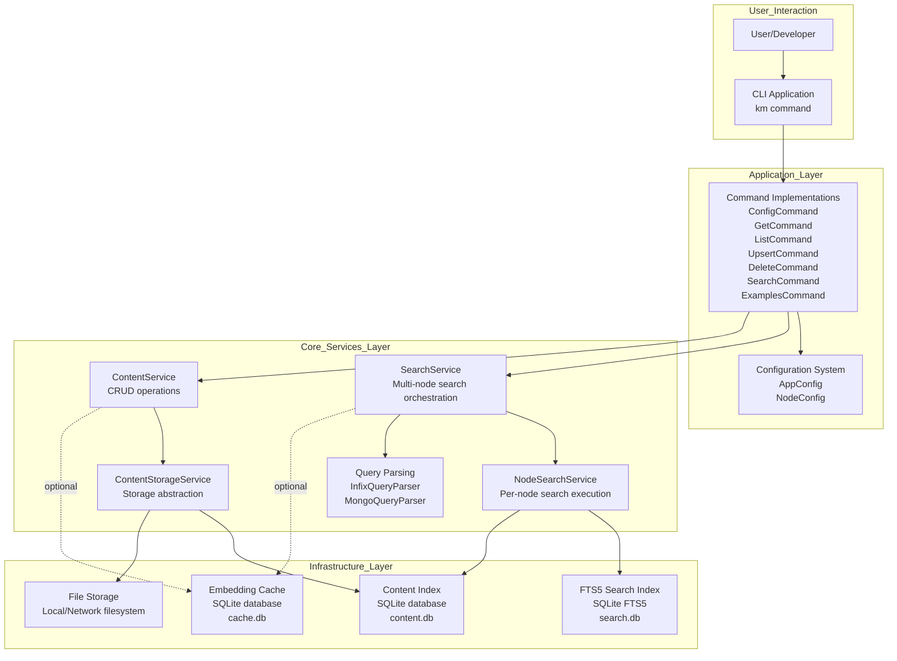
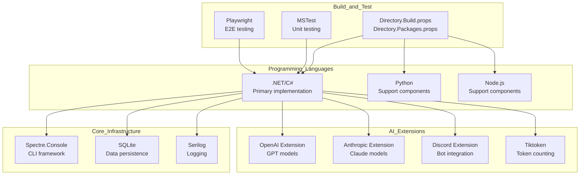
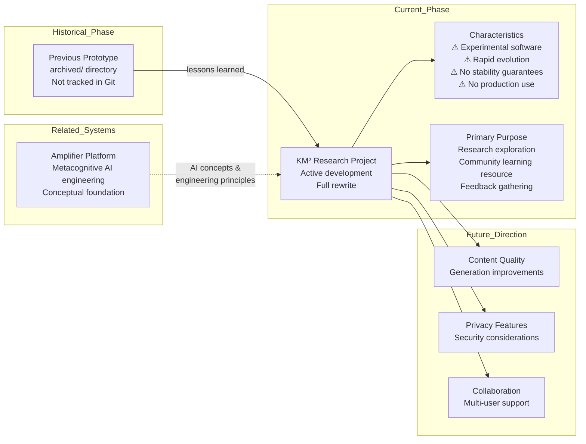
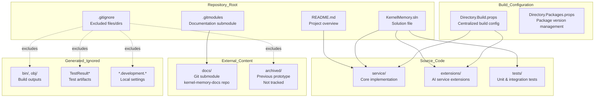
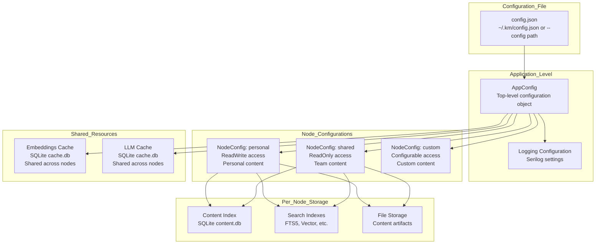

<!-- source: DeepWiki mcp.deepwiki.com · repo microsoft/kernel-memory · page 1 Overview · fetched 2026-10-26 -->

# Overview

Relevant source files

The following files were used as context for generating this wiki page:

- [.gitignore](.gitignore)
- [.gitmodules](.gitmodules)
- [README.md](README.md)

## Purpose and Scope

This document provides a high-level introduction to **Kernel Memory (KM²)**, explaining its purpose as an active research project, its experimental nature, architectural approach, and relationship to related systems. It establishes context for the entire system and sets expectations for developers and researchers exploring the codebase.

For installation and first-run instructions, see [Getting Started](#2). For detailed architectural documentation, see [Architecture](#3). For explicit warnings about the experimental nature of this software, see [Project Status and Warnings](#1.1).

---

## What is Kernel Memory (KM²)?

**Kernel Memory (KM²)** is a research project exploring AI memory concepts through a full-text search system with multi-node architecture and AI service integrations. The project represents a complete rewrite of an earlier research prototype, incorporating lessons learned from the first iteration and adjacent work in this space.

The system provides:
- A command-line interface for content management and search operations
- Full-text search capabilities using SQLite FTS5 with BM25 ranking
- Multi-node architecture for logical content partitioning
- AI service extensions for OpenAI, Anthropic (Claude), and other providers
- Flexible configuration supporting both read-only and read-write operations

**Key Characteristics:**
- **Status**: Active research project, experimental software
- **Evolution**: Rapid changes with no stability or compatibility guarantees
- **Purpose**: Learning resource and research exploration, not production software
- **Contributions**: Not accepted at this stage
- **Support**: No support provided

Sources: [README.md:1-34]()

---

## System Architecture Overview

KM² is structured in three primary layers, each with distinct responsibilities:

**Application Layer**: The CLI application (`km` command) provides the user-facing interface with commands for configuration management, content operations (get, list, upsert, delete), and search functionality. Commands are implemented as separate classes following a command pattern.

**Core Services Layer**: Contains the business logic for search orchestration (`SearchService`, `NodeSearchService`), content management (`ContentService`, `ContentStorageService`), and query parsing (`InfixQueryParser`, `MongoQueryParser`). These services coordinate operations across multiple nodes and handle the complexity of distributed search.

**Infrastructure Layer**: Manages data persistence through SQLite databases for content indexing, full-text search (FTS5), and optional embedding caching. File storage handles content artifacts on local or network filesystems.

For detailed architectural documentation including the multi-node design, see [Architecture](#3). For search system specifics, see [Search System](#5).

Sources: [README.md:1-34](), High-level system diagrams

---

## Technology Stack

KM² is built using a multi-language technology stack with .NET/C# as the primary language:

| Component | Technology | Purpose |
|-----------|-----------|---------|
| **Primary Language** | .NET/C# | Core services, CLI application, search implementation |
| **Supporting Languages** | Python, Node.js/JavaScript | Supporting components and extensions |
| **CLI Framework** | Spectre.Console | Command-line interface with rich formatting |
| **Database** | SQLite | Content index, FTS5 search, embedding cache |
| **Search Engine** | SQLite FTS5 | Full-text search with BM25 ranking and stemming |
| **Logging** | Serilog | Structured logging infrastructure |
| **AI/ML Extensions** | OpenAI SDK, Anthropic SDK | LLM integrations for content generation |
| **Testing** | MSTest, Playwright | Unit testing and end-to-end testing |
| **Build System** | .NET SDK, Directory.Build.props | Centralized package and build management |

The project uses centralized package management through `Directory.Build.props` and `Directory.Packages.props` to maintain consistency across all projects in the solution. The main solution file is `KernelMemory.sln`.

For build system details, see [Build System](#9.2). For AI service integrations, see [AI Service Integrations](#8).

Sources: [README.md:1-34](), High-level system diagrams

---

## Project Evolution and Status

KM² represents a significant evolution in the research project's lifecycle:

**Previous Prototype**: The initial research prototype explored early concepts but has been superseded. Its codebase remains in the repository under the `archived/` directory for reference purposes only. This directory is not tracked in version control as indicated in [.gitignore:1]().

**Current Status (KM²)**: This is a complete rewrite incorporating lessons from the first iteration. The project is explicitly experimental software with the following characteristics:
- **Rapid Evolution**: Changes occur frequently without notice
- **No Guarantees**: No stability or compatibility guarantees between versions
- **Research Purpose**: Intended for exploration and learning, not production deployment
- **Community Engagement**: Feedback is welcomed, but contributions are not accepted at this stage
- **No Support**: The project provides no support (see SUPPORT.md)

**Development Approach**: The team is using [Amplifier](https://github.com/microsoft/amplifier), a platform for metacognitive AI engineering, to build KM². Amplifier concepts and AI-assisted development techniques inform the design and implementation of this memory system. For more details on this relationship, see [Relationship to Amplifier](#1.2).

**Future Focus**: Development will concentrate on three key areas as documented in [README.md:19-22]():
1. **Quality of content generated** - Improving the output quality of AI-generated content
2. **Privacy** - Addressing privacy considerations in memory systems
3. **Collaboration** - Enabling multi-user collaboration features

For detailed documentation of planned features, see [Future Vision](#1.3). For current warnings and limitations, see [Project Status and Warnings](#1.1).

Sources: [README.md:6-33](), [.gitignore:1]()

---

## Repository Structure

The codebase is organized into several key directories and files:

**Key Files and Directories:**

| Path | Purpose | Version Control |
|------|---------|----------------|
| `README.md` | Project overview, warnings, and contributor list | Tracked |
| `KernelMemory.sln` | Main solution file for .NET projects | Tracked |
| `service/` | Core service implementations | Tracked |
| `extensions/` | AI service extensions (OpenAI, Anthropic, etc.) | Tracked |
| `tests/` | Unit and integration test projects | Tracked |
| `docs/` | Documentation (Git submodule to kernel-memory-docs) | Submodule |
| `archived/` | Previous prototype codebase (reference only) | Not tracked |
| `bin/`, `obj/` | Build output directories | Ignored |
| `*.development.*` | Local development configuration files | Ignored |

The `.gitignore` file excludes build artifacts, test results, IDE-specific files, sensitive configuration, and the archived directory from version control. Development configuration files (matching patterns like `*.development.json`, `config.development.yaml`, `.env`) are also ignored to prevent accidental credential commits.

For detailed repository structure, see [Repository Structure](#9.1). For build system configuration, see [Build System](#9.2).

Sources: [README.md:1-80](), [.gitignore:1-73](), [.gitmodules:1-4]()

---

## Configuration System

KM² uses a JSON-based configuration system centered around `config.json` (typically located at `~/.km/config.json`):

**Multi-Node Architecture**: The configuration system supports multiple "nodes," where each node represents a logical partition of content with its own:
- Content index (SQLite database for metadata)
- Search indexes (FTS5 full-text search, optional vector indexes)
- File storage location (local or network filesystem)
- Access mode (ReadWrite or ReadOnly)

**Shared Resources**: Embedding and LLM caches are configured at the application level and shared across all nodes to optimize resource usage and avoid redundant API calls.

**Default Behavior**: When users don't specify a node via the `--node` flag, the system uses the first node defined in the configuration (typically named "personal"). The CLI creates a default configuration on first run if none exists.

For detailed configuration documentation, see [Configuration System](#6). For multi-node architecture details, see [Multi-Node Architecture](#3.3). For configuration command usage, see [Configuration Command](#4.3).

Sources: [README.md:1-34](), High-level system diagrams

---

## Command-Line Interface

KM² provides a CLI application (`km`) with commands for content management and search:

| Command | Purpose | Example |
|---------|---------|---------|
| `config` | View or create configuration files | `km config` |
| `get` | Retrieve a specific content item by ID | `km get <id>` |
| `list` | List all content items | `km list` |
| `upsert` | Create or update content | `km upsert <file>` |
| `delete` | Remove content by ID | `km delete <id>` |
| `search` | Full-text search across content | `km search "query"` |
| `examples` | Show usage examples | `km examples` |

**Global Options:**
- `--node <name>`: Specify which node to operate on (default: first configured node)
- `--config <path>`: Path to configuration file (default: `~/.km/config.json`)
- `--format <format>`: Output format (human, json, yaml)
- `--verbose`: Enable verbose logging

**Database Initialization**: Write operations (upsert, delete) automatically initialize databases and storage on first use. Read operations (get, list, search) require existing databases or will return empty results.

For comprehensive CLI documentation, see [CLI Application](#4). For getting started with the CLI, see [First Steps with the CLI](#2.3).

Sources: [README.md:1-34](), High-level system diagrams

---

## Getting Started

To begin using KM²:

1. **Build the project**: Clone the repository and build using the .NET SDK
2. **Initialize configuration**: Run `km config` to create a default configuration file
3. **Add content**: Use `km upsert` to add content to the system
4. **Search content**: Use `km search` to perform full-text searches

**Important Reminders:**
- This is experimental software with no stability guarantees
- Pin specific commits if you need consistency
- Do not use in production environments
- No support is provided

For detailed installation and setup instructions, see [Getting Started](#2). For build requirements, see [Installation and Setup](#2.1). For configuration details, see [Configuration Basics](#2.2).

Sources: [README.md:1-34]()

---

## Related Documentation

- **[Project Status and Warnings](#1.1)**: Explicit documentation of experimental status and limitations
- **[Relationship to Amplifier](#1.2)**: How Amplifier concepts influence KM² development
- **[Future Vision](#1.3)**: Planned focus areas for quality, privacy, and collaboration
- **[Getting Started](#2)**: Installation and first-run instructions
- **[Architecture](#3)**: Comprehensive architectural documentation
- **[Search System](#5)**: Detailed search system documentation including query syntax and ranking
- **[Configuration System](#6)**: Complete configuration reference

---

## Contributors

The project benefits from contributions by multiple community members. For the current contributor list, see [README.md:35-79]().

Sources: [README.md:35-79]()

---

