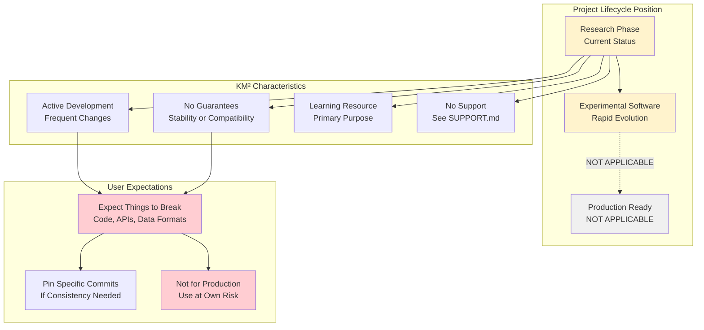
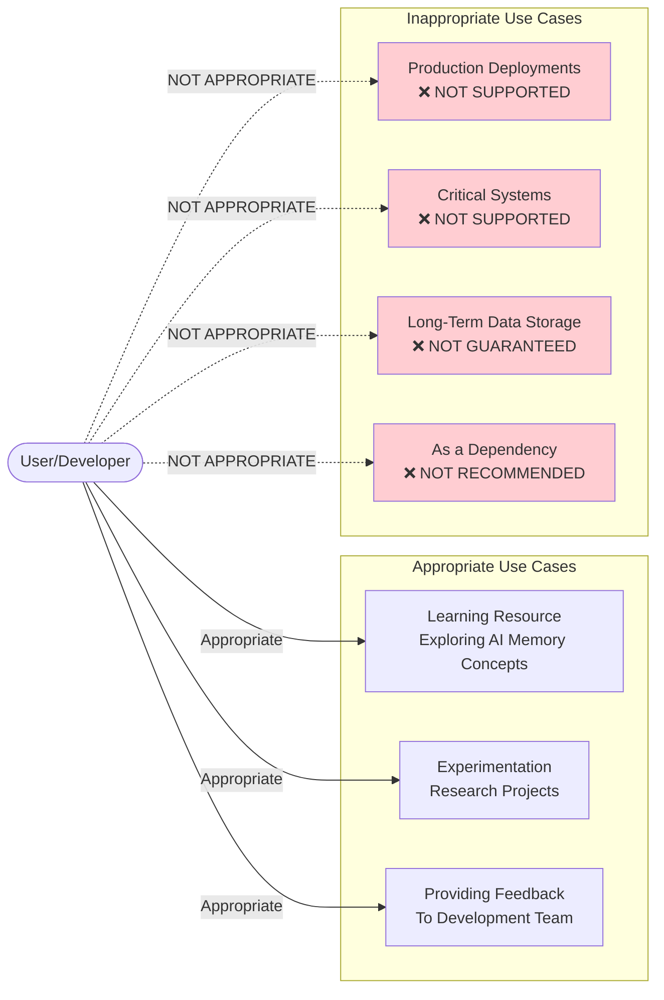
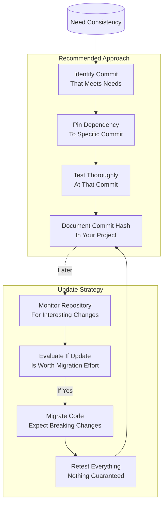
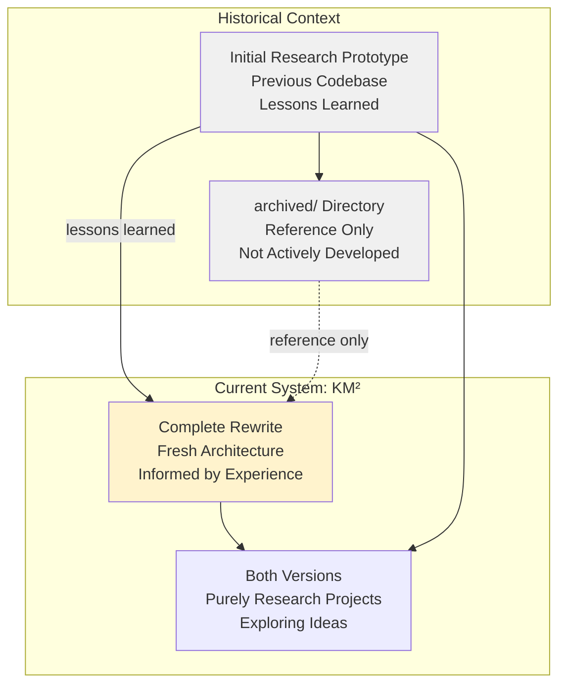

<!-- source: DeepWiki mcp.deepwiki.com · repo microsoft/kernel-memory · page 1.1 Project Status and Warnings · fetched 2026-10-26 -->

# Project Status and Warnings

Relevant source files

The following files were used as context for generating this wiki page:

- [.gitignore](.gitignore)
- [.gitmodules](.gitmodules)
- [README.md](README.md)

**Purpose**: This page documents the current status of the Kernel Memory (KM²) project, including critical warnings, stability guarantees (or lack thereof), and guidance on appropriate usage. This information is essential reading before attempting to use, deploy, or depend on KM² in any capacity.

For information about the project's relationship to Amplifier and metacognitive AI engineering, see [Relationship to Amplifier](#1.2). For the project's future development plans, see [Future Vision](#1.3).

---

## Current Status: Active Research Project

KM² is explicitly an **active research project** and **experimental software**. This designation has concrete implications for how the project should be used and what users can expect.

**Status Declaration**: KM² is explicitly positioned in the research and experimental phase, with no path currently defined toward production readiness.

Sources: [README.md:6-7](), [README.md:24-33]()

---

## Critical Warnings and Disclaimers

The project README contains several critical warnings that users must understand before proceeding. These are not pro forma disclaimers but accurate descriptions of the current state.

### Stability and Compatibility

| Aspect | Status | Details |
|--------|--------|---------|
| **API Stability** | ❌ No Guarantees | APIs may change without notice or deprecation cycle |
| **Data Format Compatibility** | ❌ No Guarantees | Database schemas and file formats may change incompatibly |
| **Behavioral Consistency** | ❌ No Guarantees | System behavior may change between commits |
| **Backward Compatibility** | ❌ Not Maintained | No commitment to maintaining compatibility with previous versions |
| **Forward Compatibility** | ❌ Not Planned | Older data may not work with newer versions |

**Implication**: Code written against KM² today may not work tomorrow without modifications. Data created today may not be readable by tomorrow's version.

Sources: [README.md:30-31]()

### Production Use

**Explicit Statement**: KM² is **not production-ready software** and is **not intended for production use**. It is designed as a learning resource for exploring AI memory concepts.

Sources: [README.md:32]()

### Support Policy

The project has an explicit no-support policy:

- **No support provided** for any issues encountered
- **No guarantee of bug fixes** for reported problems
- **No commitment to feature requests**
- **Contributions not accepted at this stage** of development

Users experiencing issues should refer to [SUPPORT.md]() for the official support policy statement.

Sources: [README.md:29](), [README.md:33]()

---

## What This Means in Practice

### For Developers Exploring the Codebase

If you are using KM² as a **learning resource**:

- ✅ Study the code architecture and design patterns
- ✅ Experiment with the CLI and APIs locally
- ✅ Provide feedback on the approach and concepts
- ✅ Reference specific commits in your learning notes
- ⚠️ Expect to encounter bugs, incomplete features, and inconsistencies
- ⚠️ Do not build dependent projects assuming current behavior will persist

### For Researchers and Experimenters

If you are using KM² for **research or experimentation**:

- ✅ Use it to explore AI memory concepts
- ✅ Test different configurations and approaches
- ✅ Pin to specific commits for reproducible research
- ⚠️ Document the exact commit hash used in research papers
- ⚠️ Be prepared to adapt to breaking changes if updating
- ❌ Do not use as the foundation for research infrastructure

### Version Pinning Strategy

**Key Recommendation**: If you need any consistency, pin your dependency to a specific commit hash rather than using branch names or version tags.

Sources: [README.md:31]()

---

## Context: Complete Rewrite from Initial Prototype

KM² represents a **complete rewrite** of an earlier research prototype. Understanding this history provides context for the current state.

### Relationship to Previous Codebase

**Key Point**: Both the original prototype and KM² exist purely as research projects for exploring new ideas and gathering community feedback. Neither is intended as production software.

Sources: [README.md:9-13]()

### Archived Content

The `archived/` directory in the repository contains the previous codebase:

- Remains in the repository for **reference only**
- Not actively developed or maintained
- Provides historical context for design decisions
- **Not tracked in version control** (see `.gitignore`)

The `.gitignore` configuration explicitly excludes the `archived/` directory from version control tracking.

Sources: [README.md:11](), [.gitignore:1]()

---

## Repository Metadata and Community

### Contributors and Attribution

The project maintains a list of contributors in the README, acknowledging community members who have provided feedback and contributions. This section uses GitHub API integration to display contributor avatars and profiles.

However, as noted in the disclaimer:

> **Contributions are not accepted at this stage**

This means that while the project acknowledges past contributors, it is not currently accepting pull requests or external contributions.

Sources: [README.md:35-79](), [README.md:29]()

### Documentation Structure

The project uses a Git submodule for its documentation:

- Documentation repository: `kernel-memory-docs`
- Submodule path: `docs/`
- Allows documentation to evolve independently

This separation enables documentation updates without affecting the main codebase and vice versa.

Sources: [.gitmodules:1-3]()

---

## Summary of Key Warnings

| Warning | Severity | Impact |
|---------|----------|--------|
| **This is experimental software** | ⚠️ Critical | Core functionality may not work as expected |
| **Expect things to break** | ⚠️ Critical | APIs, data formats, and behavior will change |
| **No stability guarantees** | ⚠️ Critical | Breaking changes without notice or deprecation |
| **No compatibility guarantees** | ⚠️ Critical | Updates may require complete data migration |
| **Not production-ready** | ⚠️ Critical | Do not use in production systems |
| **No support provided** | ℹ️ Important | Issues and bugs may not be addressed |
| **No contributions accepted** | ℹ️ Important | Pull requests will not be reviewed at this stage |
| **Pin specific commits** | 💡 Recommended | Only way to ensure consistency |

**Final Statement**: Users proceed at their own risk with full awareness that this is an active research project undergoing rapid evolution.

Sources: [README.md:6-7](), [README.md:24-33]()

---

