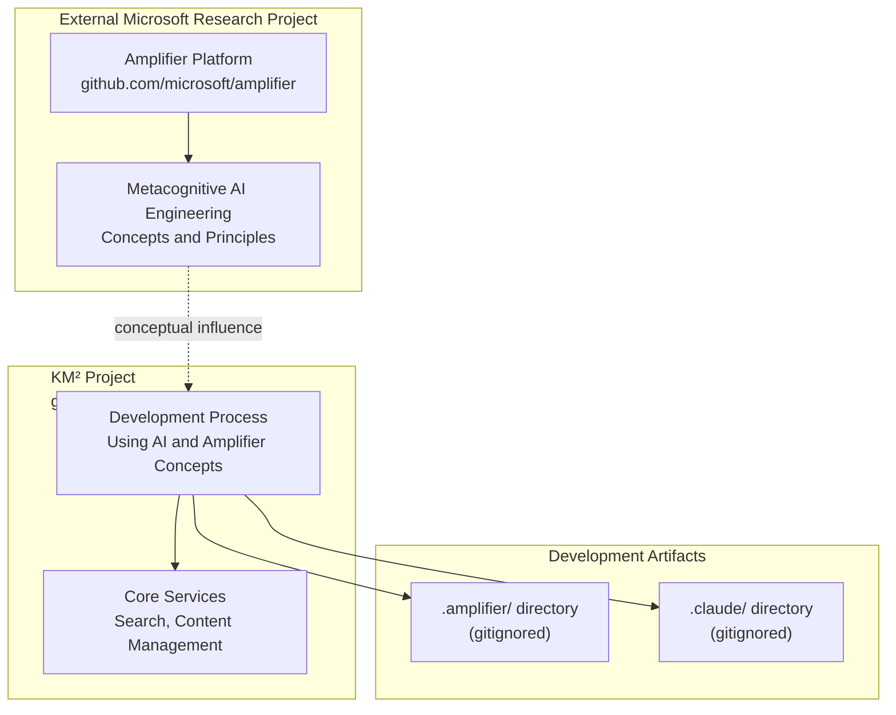
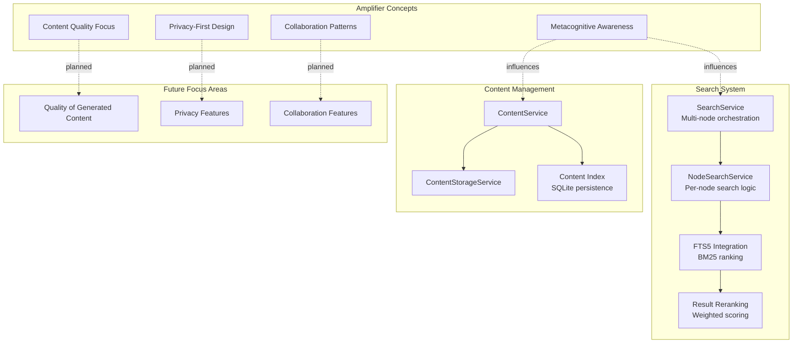
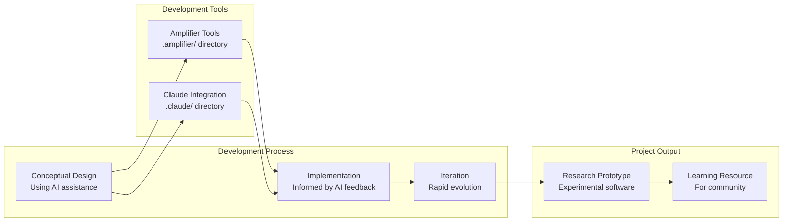
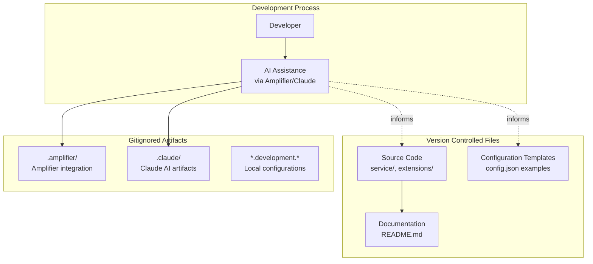
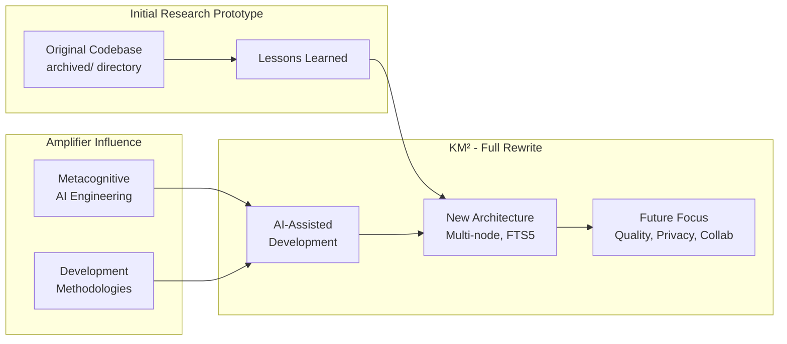

<!-- source: DeepWiki mcp.deepwiki.com · repo microsoft/kernel-memory · page 1.2 Relationship to Amplifier · fetched 2026-10-26 -->

# Relationship to Amplifier

Relevant source files

The following files were used as context for generating this wiki page:

- [.gitignore](.gitignore)
- [.gitmodules](.gitmodules)
- [README.md](README.md)

## Purpose and Scope

This document explains the relationship between KM² (Kernel Memory squared) and Amplifier, Microsoft's platform for metacognitive AI engineering. It covers the conceptual foundation that Amplifier provides, how Amplifier concepts are applied in building KM², and the practical development artifacts that result from this relationship.

For information about the broader project vision and future directions, see [Future Vision](#1.3). For details about the overall architecture, see [Architecture](#3).

---

## What is Amplifier

Amplifier is a parallel Microsoft research project that serves as a platform for metacognitive AI engineering. According to the project documentation, Amplifier is unique in that the team uses Amplifier to build Amplifier itself—a self-referential development approach that embodies metacognitive principles.

The relationship is conceptual rather than technical: KM² does not depend on Amplifier as a runtime dependency or library. Instead, KM² applies the same metacognitive AI engineering concepts and methodologies that Amplifier employs.

**Conceptual Relationship Between Amplifier and KM²**

**Sources:** [README.md:16-17](), [.gitignore:2-3]()

---

## Metacognitive AI Engineering Philosophy

Metacognitive AI engineering refers to the practice of using AI systems to reason about and improve their own development processes. In the context of KM² and Amplifier, this means:

| Principle | Description | Application in KM² |
|-----------|-------------|-------------------|
| **Self-Referential Development** | Using the system being built to help build itself | KM² explores memory concepts while being built with AI assistance |
| **AI-Assisted Design** | Leveraging AI systems for architectural decisions and implementation | Development process incorporates AI feedback loops |
| **Conceptual Alignment** | Ensuring system design reflects metacognitive principles | Search and content systems designed with AI memory concepts |
| **Iterative Refinement** | Continuous improvement through AI-augmented feedback | Rapid evolution based on AI-informed insights |

The philosophy emphasizes quality of generated content, privacy considerations, and collaboration features—all areas that benefit from metacognitive approaches where AI systems can reason about their own outputs and capabilities.

**Sources:** [README.md:16-22]()

---

## How KM² Uses Amplifier Concepts

The application of Amplifier concepts in KM² manifests in several ways:

### Conceptual Influence on Architecture

KM²'s architecture reflects metacognitive principles through its multi-node design, search system, and content management approach. The system is designed to be self-aware of its capabilities and limitations.

**Application of Amplifier Concepts in KM² Architecture**

### AI-Assisted Development Process

The development process itself uses AI and Amplifier concepts, as indicated by the presence of development artifacts:

**AI-Assisted Development Workflow**

**Sources:** [README.md:9-22](), [.gitignore:2-3]()

---

## Development Artifacts and Tools

The codebase contains evidence of Amplifier-related development tooling through gitignored directories:

### Ignored Development Directories

| Directory | Purpose | Why Gitignored |
|-----------|---------|----------------|
| `.amplifier/` | Amplifier platform integration files | Local development environment, may contain user-specific configurations |
| `.claude/` | Claude AI assistant integration | AI-assisted development artifacts, potentially containing prompts or session data |

These directories are explicitly excluded from version control, suggesting they are part of the local development environment where AI and Amplifier concepts are actively applied.

**Development Artifacts in Version Control**

**Sources:** [.gitignore:2-3](), [.gitignore:19-25]()

---

## Implications for the Codebase

The Amplifier relationship has several implications for understanding and working with the KM² codebase:

### Active Research Nature

The use of Amplifier concepts reinforces KM²'s status as an active research project. The system evolves rapidly as new insights from metacognitive AI engineering are incorporated:

- **No Stability Guarantees**: The experimental nature means breaking changes are expected
- **Conceptual Evolution**: System design may shift as Amplifier concepts mature
- **Learning Focus**: The project prioritizes exploration over production readiness

### Future Development Direction

The three focus areas—quality of generated content, privacy, and collaboration—align with metacognitive principles where systems reason about their outputs and interactions:

| Focus Area | Metacognitive Aspect | Planned Impact |
|------------|---------------------|----------------|
| **Content Quality** | Self-evaluation of generated outputs | Systems that understand and improve content quality |
| **Privacy** | Awareness of data sensitivity | Context-aware privacy controls |
| **Collaboration** | Multi-agent coordination | Systems that coordinate and share knowledge |

### No Direct Code Dependencies

Importantly, there are no direct code imports or runtime dependencies on Amplifier in the KM² codebase. The relationship is purely conceptual and methodological. The project structure contains:

- No NuGet packages referencing Amplifier
- No submodules linking to Amplifier repositories (only `kernel-memory-docs`)
- No service integrations requiring Amplifier runtime

The `.amplifier/` and `.claude/` directories are local development tools, not part of the distributed system.

**Sources:** [README.md:6-33](), [.gitmodules:1-4](), [.gitignore:1-3]()

---

## Comparison: Previous Prototype vs. KM²

The current KM² represents a complete rewrite informed by Amplifier concepts, distinguishing it from the initial prototype:

**Evolution from Prototype to KM² with Amplifier Concepts**

The archived prototype remains in the repository for reference but is not maintained. The rewrite incorporates both lessons from that prototype and new insights from Amplifier's metacognitive approach.

**Sources:** [README.md:9-11](), [.gitignore:1]()

---

## Summary

KM²'s relationship to Amplifier is primarily conceptual and methodological rather than technical. The project applies metacognitive AI engineering principles—using AI to reason about and improve the development process—while building a system for AI memory management. This self-referential approach manifests in:

- The use of AI-assisted development tools (evidenced by `.amplifier/` and `.claude/` directories)
- A focus on content quality, privacy, and collaboration aligned with metacognitive principles
- An experimental, rapidly-evolving codebase that prioritizes learning and exploration
- No runtime dependencies on Amplifier, maintaining KM² as an independent research project

Developers working with KM² should understand this relationship to properly contextualize the project's experimental nature, rapid evolution, and future direction. The system is not just a memory solution but a research platform exploring how AI concepts can inform AI system development.

**Sources:** [README.md:1-33](), [.gitignore:1-3]()

---

