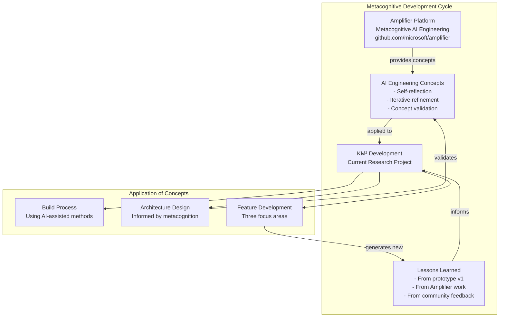
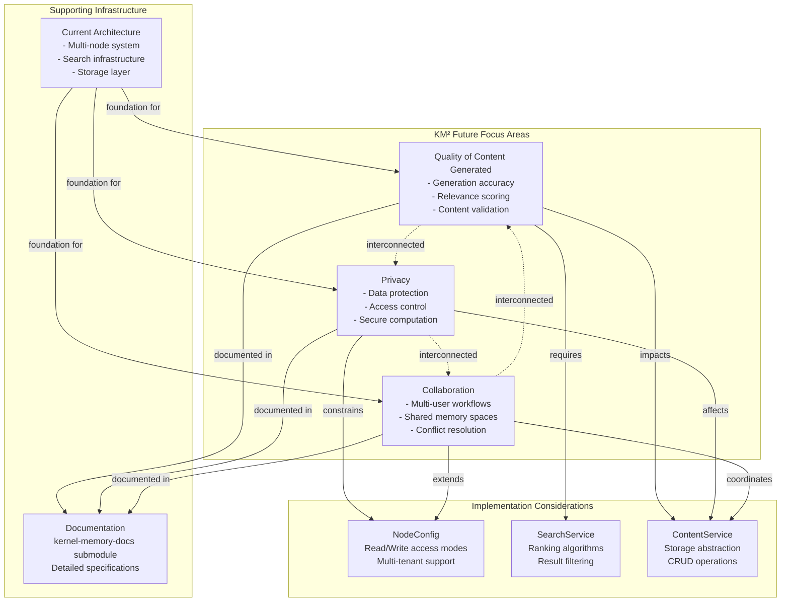
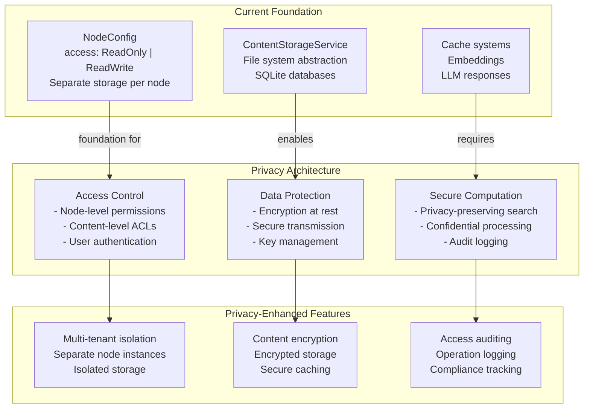
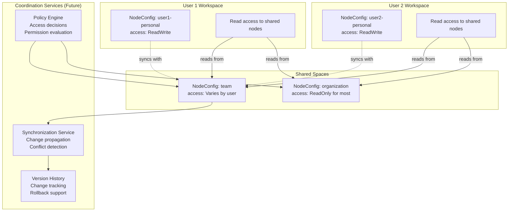
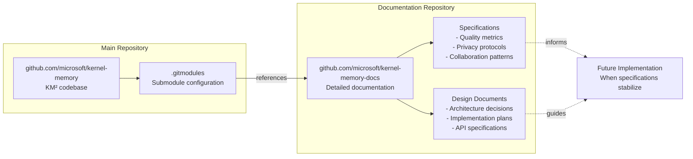
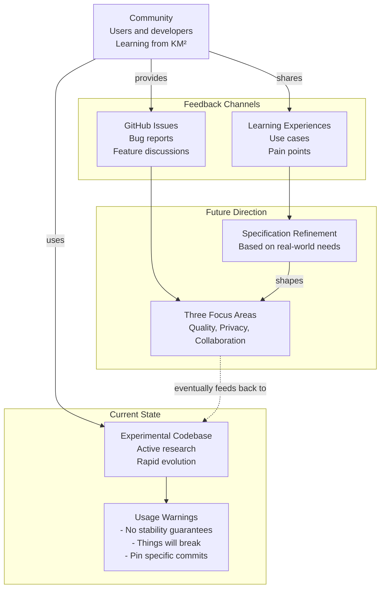
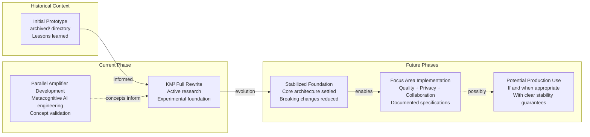

<!-- source: DeepWiki mcp.deepwiki.com · repo microsoft/kernel-memory · page 1.3 Future Vision · fetched 2026-10-26 -->

# Future Vision

Relevant source files

The following files were used as context for generating this wiki page:

- [.gitignore](.gitignore)
- [.gitmodules](.gitmodules)
- [README.md](README.md)

This page documents the planned development focus areas for KM² (Kernel Memory squared), including the philosophy behind its development approach and the three primary areas of future work: quality of content generated, privacy, and collaboration. These areas represent the next phase of research after the current experimental foundation is stabilized.

For information about the current experimental status of KM², see [Project Status and Warnings](#1.1). For background on the metacognitive AI engineering philosophy informing this vision, see [Relationship to Amplifier](#1.2).

---

## Development Philosophy

KM² is being built using a metacognitive approach informed by the [Amplifier platform](https://github.com/microsoft/amplifier). The development philosophy centers on using AI and Amplifier concepts to build the next generation of Kernel Memory itself—a recursive, self-improving approach where the tools and concepts being developed are applied to the development process.

**Diagram: Development Approach**

**Sources:** [README.md:15-22]()

This approach differs from traditional software development by treating the development process itself as a subject of AI-assisted metacognitive analysis, allowing the system to evolve more organically based on learned patterns and validated concepts.

---

## Three Primary Focus Areas

The future development of KM² centers on three interconnected areas that will shape the system's evolution once the current experimental foundation is stable.

**Diagram: Focus Areas and Their Relationships**

**Sources:** [README.md:19-22](), [.gitmodules:1-3]()

### Quality of Content Generated

This focus area addresses the accuracy, relevance, and validation of content produced by KM². While the current system provides search and retrieval capabilities, future work will enhance:

| Aspect | Current State | Future Direction |
|--------|--------------|------------------|
| **Search Ranking** | BM25 scoring with configurable weights | Enhanced ranking incorporating quality signals |
| **Content Validation** | Basic CRUD operations | Validation pipelines for generated content |
| **Relevance Scoring** | FTS5-based relevance | Multi-factor relevance including semantic understanding |
| **Result Quality** | Post-filtering via LINQ | Advanced filtering with quality thresholds |

The existing `SearchService` and `NodeSearchService` components provide the foundation for these enhancements, with their configurable weighting system allowing future quality metrics to be incorporated into ranking algorithms.

**Sources:** [README.md:19-20]()

### Privacy

Privacy considerations will govern how content is stored, accessed, and shared across the multi-node architecture. The existing node-based design with `ReadOnly` and `ReadWrite` access modes provides a starting point for more sophisticated privacy controls.

**Planned Privacy Dimensions:**

**Sources:** [README.md:19-21]()

The current `.gitignore` configuration already demonstrates privacy awareness by excluding sensitive files like `.env`, certificates, and development configurations, establishing patterns that will extend to runtime privacy features.

**Sources:** [.gitignore:19-72]()

### Collaboration

Collaboration features will enable multiple users to work with shared memory spaces while maintaining consistency and resolving conflicts. The multi-node architecture provides a natural foundation for collaborative scenarios.

**Collaboration Scenarios:**

| Scenario | Node Architecture | Key Challenges |
|----------|------------------|----------------|
| **Personal + Shared Nodes** | Individual writable node + shared read-only nodes | Synchronization, version control |
| **Team Workspaces** | Multiple users with different access levels | Concurrent modifications, conflict resolution |
| **Distributed Teams** | Geographically distributed nodes | Consistency, replication, latency |
| **Hierarchical Access** | Nested node permissions | Inheritance, escalation, auditing |

**Diagram: Collaborative Node Architecture (Future)**

**Sources:** [README.md:19-22]()

The existing `NodeConfig` structure with its `id` and `access` properties provides the foundation for collaborative access patterns, though coordination services and conflict resolution mechanisms are future work.

---

## Documentation Status and Timeline

These focus areas are explicitly marked as future work that will be "documented in more detail when ready." The team uses a separate documentation repository managed as a Git submodule to maintain detailed specifications independently from the codebase evolution.

**Documentation Repository Structure:**

**Sources:** [README.md:19-22](), [.gitmodules:1-3]()

**Implementation Timeline Expectations:**

| Phase | Focus | Status |
|-------|-------|--------|
| **Current** | Experimental foundation, core infrastructure | Active development |
| **Short-term** | Stabilization, community feedback integration | Ongoing |
| **Medium-term** | Detailed specifications for focus areas | Documentation in progress |
| **Long-term** | Implementation of quality, privacy, and collaboration features | Future work |

The separation of documentation into a dedicated repository allows specifications to evolve independently while the main codebase remains in active research mode with rapid changes.

**Sources:** [.gitmodules:1-3]()

---

## Community Engagement

While the project does not currently accept contributions due to its experimental nature, community feedback plays a crucial role in shaping the future vision. The project serves as a learning resource, and user experiences inform the direction of future development.

**Diagram: Community Feedback Loop**

**Sources:** [README.md:24-33]()

**Current Community Stance:**

- **Contributions**: Not accepted at this stage
- **Support**: No formal support provided (see `SUPPORT.md`)
- **Feedback**: Welcome through appropriate channels
- **Use Cases**: Shared experiences inform future direction
- **Stability**: Users must pin specific commits for consistency

The project's disclaimer clearly states this is "experimental software" and a "learning resource, not production-ready software," setting appropriate expectations while the future vision crystallizes into detailed specifications.

**Sources:** [README.md:24-33]()

---

## Research Project Context

KM² represents a complete rewrite informed by lessons from an earlier prototype. The archived previous codebase remains in the repository for reference but is not tracked in version control, demonstrating the team's commitment to radical evolution rather than incremental improvements.

**Evolution Pathway:**

**Sources:** [README.md:6-13](), [.gitignore:1]()

The `.gitignore` file explicitly excludes the `archived/` directory, reinforcing that historical code is for reference only and not part of the active development stream. This clean break allows the team to explore new architectures without being constrained by backward compatibility with the prototype.

**Sources:** [.gitignore:1]()

---

## Summary

The future vision for KM² centers on three interconnected areas—quality of content generated, privacy, and collaboration—which will be developed using metacognitive AI engineering principles derived from the Amplifier platform. These focus areas represent planned work that will be documented in detail when specifications stabilize.

The current phase focuses on establishing an experimental foundation with a multi-node architecture that provides natural extension points for future privacy and collaboration features. The search and content management infrastructure provides the basis for quality enhancements. Community feedback during this experimental phase will inform how these focus areas are refined and implemented.

As an active research project, KM² maintains explicit warnings about instability and breaking changes while serving as a learning resource for the community. The separation of detailed documentation into a dedicated repository allows specifications to evolve independently from the rapidly changing codebase, with the expectation that implementation will follow once designs are validated and stabilized.

---

