<!-- source: DeepWiki mcp.deepwiki.com · repo microsoft/kernel-memory · page 10 Advanced Topics · fetched 2026-10-26 -->

# Advanced Topics

<details>
<summary>Relevant source files</summary>

The following files were used as context for generating this wiki page:

- [KNOWN-ISSUES.md](KNOWN-ISSUES.md)
- [src/Core/Search/NodeSearchService.cs](src/Core/Search/NodeSearchService.cs)
- [src/Core/Search/Query/Parsers/InfixQueryParser.cs](src/Core/Search/Query/Parsers/InfixQueryParser.cs)
- [src/Core/Search/SearchService.cs](src/Core/Search/SearchService.cs)
- [src/Core/Search/SqliteFtsIndex.cs](src/Core/Search/SqliteFtsIndex.cs)
- [src/Main/CLI/CliApplicationBuilder.cs](src/Main/CLI/CliApplicationBuilder.cs)
- [src/Main/CLI/Commands/BaseCommand.cs](src/Main/CLI/Commands/BaseCommand.cs)
- [src/Main/CLI/Commands/ConfigCommand.cs](src/Main/CLI/Commands/ConfigCommand.cs)
- [src/Main/CLI/Commands/DeleteCommand.cs](src/Main/CLI/Commands/DeleteCommand.cs)
- [src/Main/CLI/Commands/ExamplesCommand.cs](src/Main/CLI/Commands/ExamplesCommand.cs)
- [src/Main/CLI/Commands/GetCommand.cs](src/Main/CLI/Commands/GetCommand.cs)
- [src/Main/CLI/Commands/ListCommand.cs](src/Main/CLI/Commands/ListCommand.cs)
- [src/Main/CLI/Commands/SearchCommand.cs](src/Main/CLI/Commands/SearchCommand.cs)
- [src/Main/CLI/Commands/UpsertCommand.cs](src/Main/CLI/Commands/UpsertCommand.cs)
- [tests/Core.Tests/Search/FtsQueryExtractionTest.cs](tests/Core.Tests/Search/FtsQueryExtractionTest.cs)
- [tests/Core.Tests/Search/NodeSearchServiceIndexIdTests.cs](tests/Core.Tests/Search/NodeSearchServiceIndexIdTests.cs)
- [tests/Core.Tests/Search/Query/InfixQueryParserTests.cs](tests/Core.Tests/Search/Query/InfixQueryParserTests.cs)
- [tests/Core.Tests/Search/SearchEndToEndTests.cs](tests/Core.Tests/Search/SearchEndToEndTests.cs)
- [tests/Core.Tests/Search/SearchServiceIndexWeightsTests.cs](tests/Core.Tests/Search/SearchServiceIndexWeightsTests.cs)
- [tests/Main.Tests/Integration/CliIntegrationTests.cs](tests/Main.Tests/Integration/CliIntegrationTests.cs)
- [tests/Main.Tests/Integration/CommandExecutionTests.cs](tests/Main.Tests/Integration/CommandExecutionTests.cs)
- [tests/Main.Tests/Integration/ConfigCommandTests.cs](tests/Main.Tests/Integration/ConfigCommandTests.cs)
- [tests/Main.Tests/Integration/ExamplesCommandE2ETests.cs](tests/Main.Tests/Integration/ExamplesCommandE2ETests.cs)
- [tests/Main.Tests/Integration/ReadonlyCommandTests.cs](tests/Main.Tests/Integration/ReadonlyCommandTests.cs)

</details>


This page covers advanced operational considerations for KM² including database initialization modes, error handling patterns, and multi-node search optimization strategies. For basic CLI usage, see [CLI Application](#4). For search query syntax, see [Query Syntax and Parsing](#5.2).

---

## Read-Only vs Write Operations

KM² distinguishes between read-only operations (queries that should not modify the system) and write operations (commands that create or modify data). This distinction is critical for first-run experience and preventing unintended file creation.

### Operation Classification

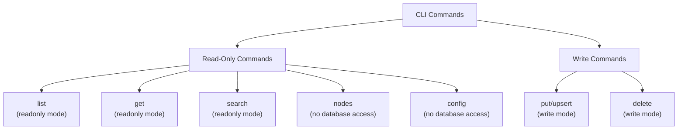

**Sources:** [src/Main/CLI/Commands/BaseCommand.cs:86-116](), [src/Main/CLI/Commands/GetCommand.cs:67](), [src/Main/CLI/Commands/ListCommand.cs:75](), [src/Main/CLI/Commands/SearchCommand.cs:463]()

### Database Initialization Behavior

The `BaseCommand.CreateContentService` method implements the readonly/write mode distinction:

| Mode | Database Exists | Behavior |
|------|----------------|----------|
| **readonly** | Yes | Opens existing database |
| **readonly** | No | Throws `DatabaseNotFoundException` |
| **write** | Yes | Opens existing database |
| **write** | No | Creates directory + database via `EnsureCreated()` |

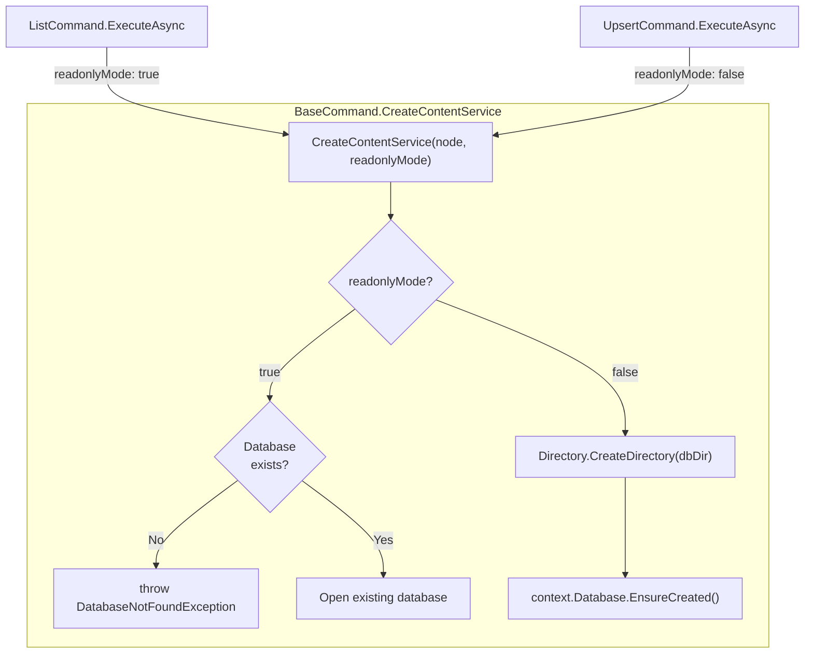

**Sources:** [src/Main/CLI/Commands/BaseCommand.cs:90-131](), [tests/Main.Tests/Integration/ReadonlyCommandTests.cs:64-98]()

### First-Run Experience

When no database exists yet, read-only commands handle this gracefully rather than failing with errors:

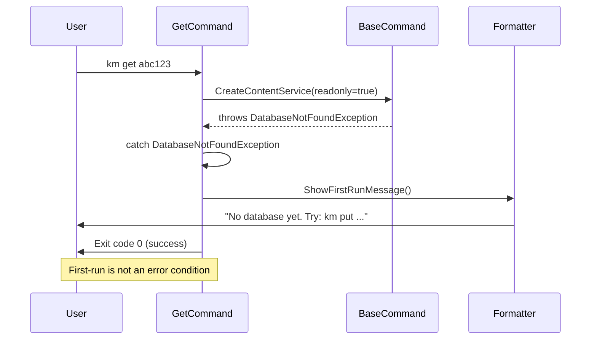

The first-run handler provides context-specific guidance:

```mermaid
graph LR
    Exception["DatabaseNotFoundException"]
    
    GetMsg["Get: 'No content found.<br/>Create content first:<br/>km put \"...\" --id abc123'"]
    
    ListMsg["List: 'Welcome! No content yet.<br/>To get started:<br/>km put \"Your content\"'"]
    
    SearchMsg["Search: 'No content indexed yet.<br/>Add content first:<br/>km put \"...\"'"]
    
    Exception --> GetMsg
    Exception --> ListMsg
    Exception --> SearchMsg
```

**Sources:** [src/Main/CLI/Commands/GetCommand.cs:84-124](), [src/Main/CLI/Commands/ListCommand.cs:92-136](), [src/Main/CLI/Commands/SearchCommand.cs:186-190,536-581]()

---

## Error Handling and Exit Codes

KM² uses standardized exit codes to distinguish between user errors, system errors, and successful operations.

### Exit Code Constants

| Exit Code | Constant | Meaning | Example Scenarios |
|-----------|----------|---------|-------------------|
| `0` | `Constants.App.ExitCodeSuccess` | Success | Operation completed, or first-run (not an error) |
| `1` | `Constants.App.ExitCodeUserError` | User error | Invalid arguments, content not found in existing DB |
| `2` | `Constants.App.ExitCodeSystemError` | System error | Database corruption, network failure |

**Sources:** [src/Core/Constants.cs:6-10]()

### Exception Handling Pattern

The `BaseCommand.HandleError` method maps exception types to exit codes:

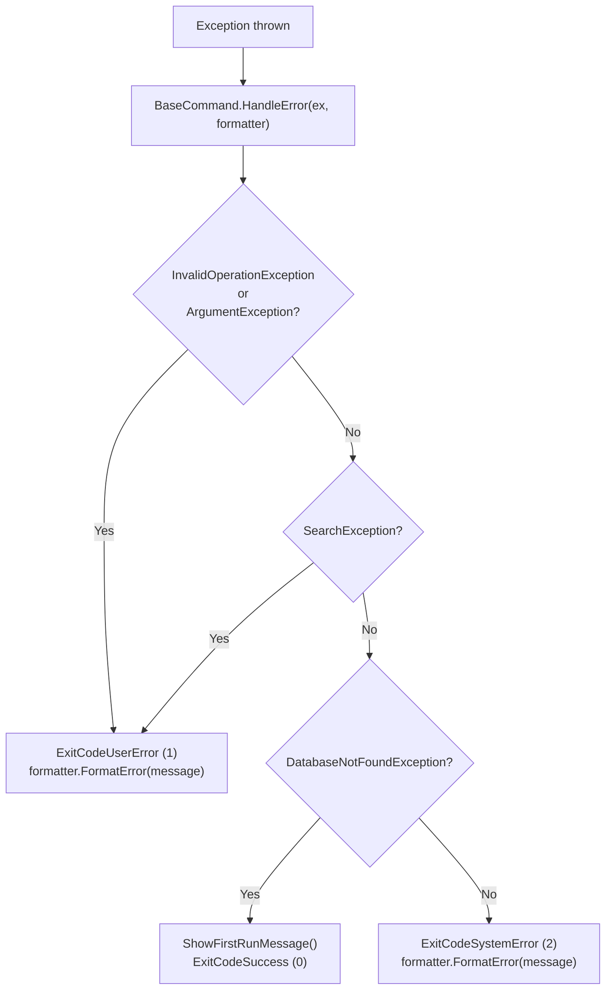

**Sources:** [src/Main/CLI/Commands/BaseCommand.cs:172-191]()

### Specialized Exception Types

KM² defines domain-specific exceptions with additional context:

#### DatabaseNotFoundException

Used when a database file is expected but missing. Caught by commands to trigger first-run messaging instead of failing.

```
DatabaseNotFoundException
├── DatabasePath: string (path to missing database)
└── Handled by: GetCommand, ListCommand, SearchCommand
```

**Sources:** [src/Main/CLI/Exceptions/DatabaseNotFoundException.cs]()

#### SearchException

Thrown during search operations with categorized error types:

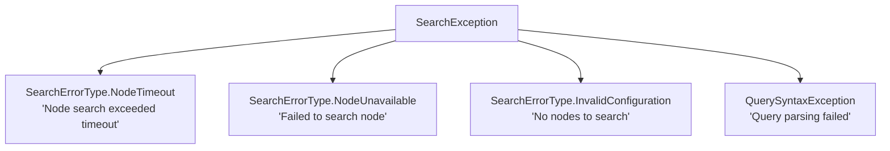

**Sources:** [src/Core/Search/Exceptions/SearchException.cs](), [src/Core/Search/NodeSearchService.cs:127-142]()

### Command Error Handling Examples

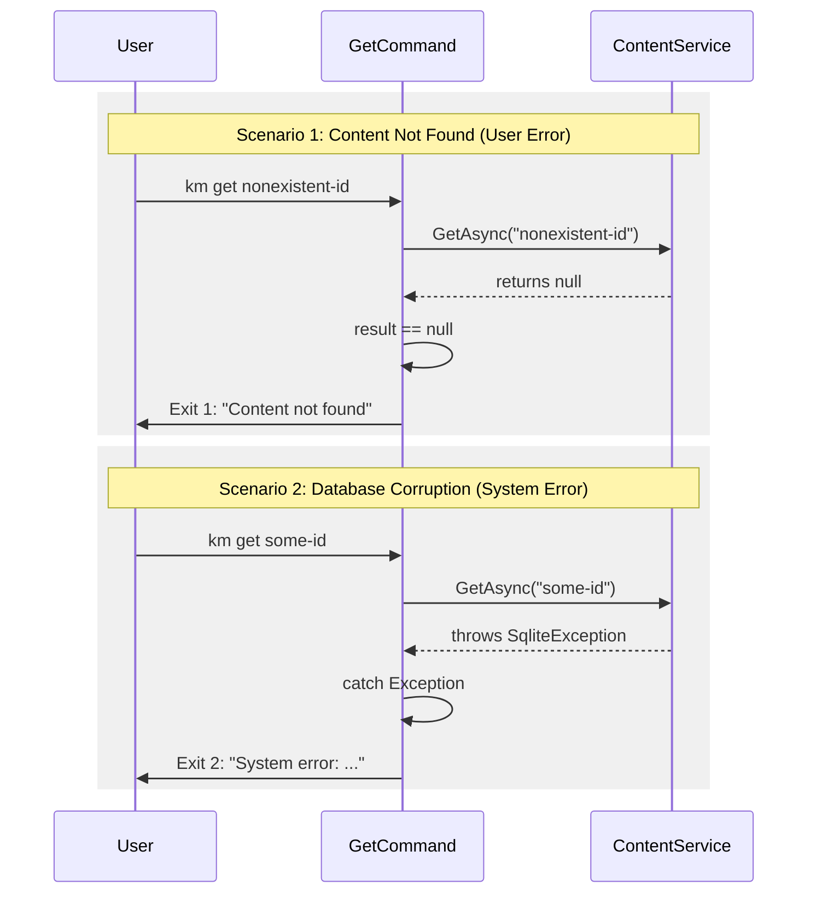

**Sources:** [src/Main/CLI/Commands/GetCommand.cs:59-95](), [tests/Main.Tests/Integration/CommandExecutionTests.cs:76-102]()

---

## Multi-Node Search Strategies

Advanced search configurations use node weights and index weights to control result ranking across multiple nodes and indexes.

### Weight Configuration Hierarchy

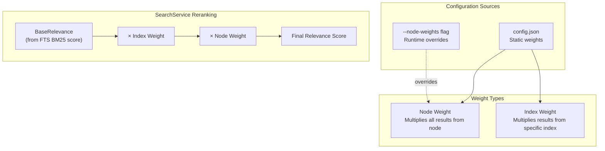

**Sources:** [src/Core/Search/SearchService.cs:23-38,72-76](), [src/Main/CLI/Commands/SearchCommand.cs:316-358]()

### Node Weight Configuration

Node weights allow prioritizing or de-prioritizing entire nodes in search results:

| Use Case | Configuration | Effect |
|----------|--------------|--------|
| **Prioritize work node** | `work:1.5, personal:1.0, archive:0.5` | Work results boosted 1.5×, archive reduced 50% |
| **Exclude experimental** | `main:1.0, experimental:0.0` | Experimental results filtered out |
| **Balanced multi-tenant** | `tenant-a:1.0, tenant-b:1.0` | Equal weight (default) |

Configuration in `config.json`:

```json
{
  "nodes": {
    "work": {
      "id": "work",
      "weight": 1.5
    },
    "personal": {
      "id": "personal", 
      "weight": 1.0
    }
  }
}
```

Runtime override via CLI:

```bash
km search "kubernetes" --node-weights work:2.0,personal:0.8
```

**Sources:** [src/Main/CLI/Commands/SearchCommand.cs:83-85,316-358](), [src/Core/Search/SearchService.cs:165-213]()

### Index Weight Configuration

Index weights control relative importance of different search indexes within a node:

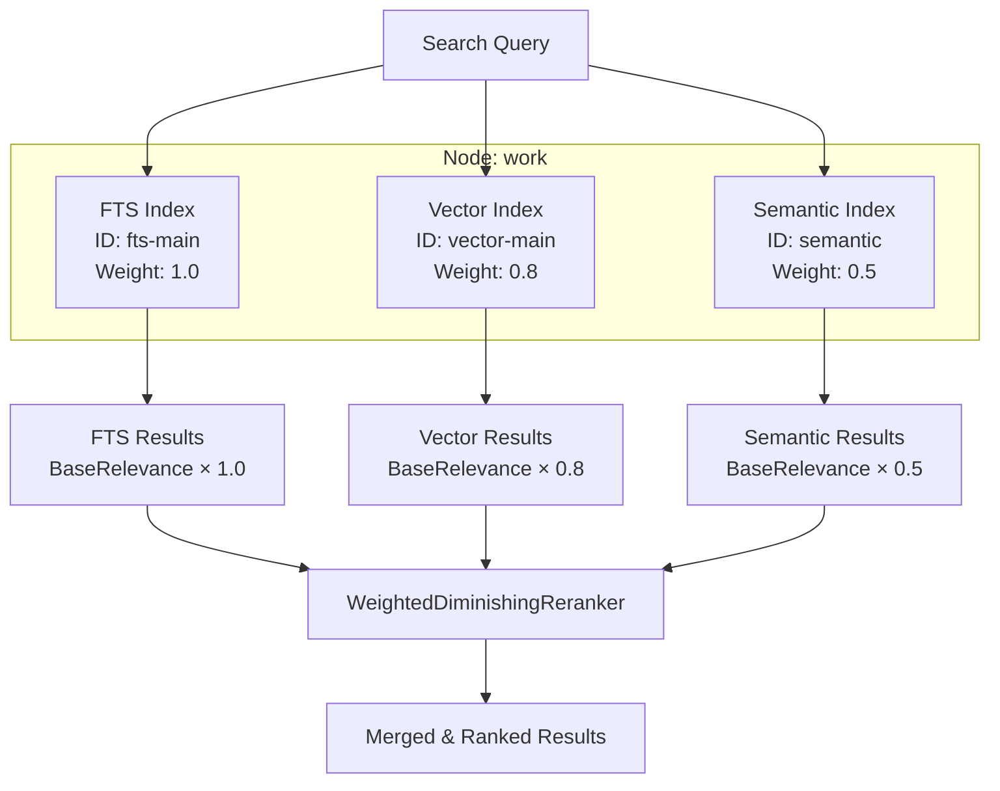

Configuration structure:

```csharp
// Dictionary<NodeId, Dictionary<IndexId, Weight>>
var indexWeights = new Dictionary<string, Dictionary<string, float>>
{
    ["work"] = new Dictionary<string, float>
    {
        ["fts-main"] = 1.0f,      // Full-text search: highest weight
        ["vector-main"] = 0.8f,   // Vector similarity: high weight
        ["semantic"] = 0.5f       // Semantic search: lower weight
    }
};

var searchService = new SearchService(nodeServices, indexWeights);
```

**Sources:** [src/Core/Search/SearchService.cs:17,24-38](), [tests/Core.Tests/Search/SearchServiceIndexWeightsTests.cs:67-109]()

### Reranking Algorithm

The `WeightedDiminishingReranker` combines results from multiple sources:

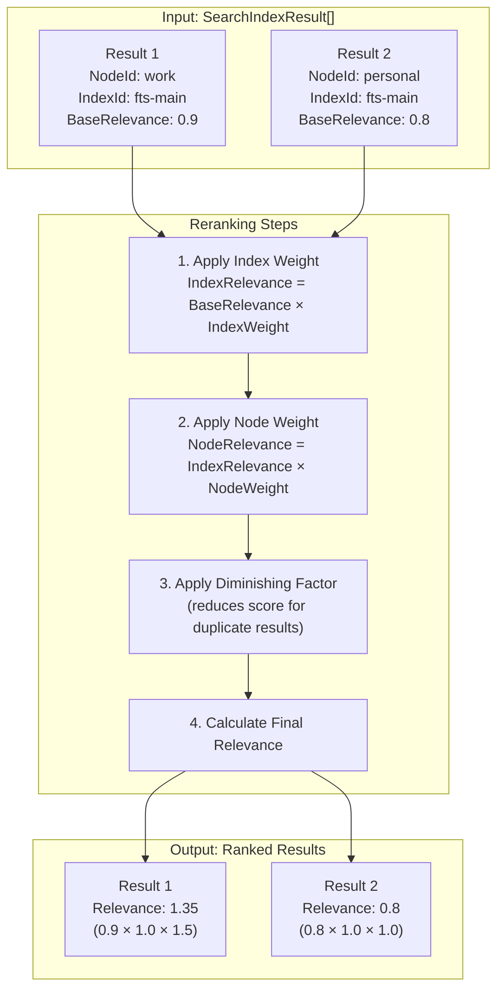

Reranking configuration object:

```csharp
public sealed record RerankingConfig
{
    public Dictionary<string, float> NodeWeights { get; init; }
    public Dictionary<string, Dictionary<string, float>>? IndexWeights { get; init; }
}
```

**Sources:** [src/Core/Search/Reranking/WeightedDiminishingReranker.cs](), [src/Core/Search/SearchService.cs:72-90]()

### Advanced Search Orchestration Flow

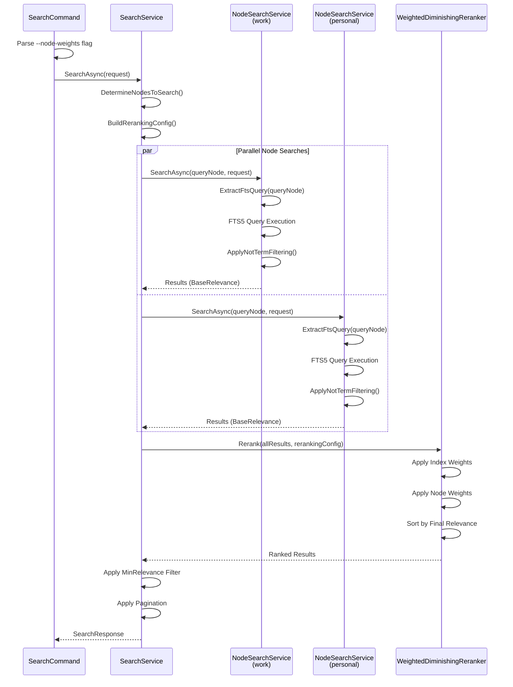

**Sources:** [src/Core/Search/SearchService.cs:43-106](), [src/Core/Search/NodeSearchService.cs:59-143](), [src/Main/CLI/Commands/SearchCommand.cs:157-203]()

### Known Limitations

#### NOT Term Filtering

SQLite FTS5's `NOT` operator requires a left operand, making standalone `NOT` queries problematic. KM² works around this by:

1. Extracting NOT terms separately during query processing
2. Executing FTS query with only positive terms (or `*` for match-all)
3. Post-filtering results via LINQ to exclude NOT terms

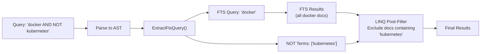

**Sources:** [src/Core/Search/NodeSearchService.cs:11-26,117-211](), [KNOWN-ISSUES.md:28-34]()

#### Field Queries with Quoted Values

Queries like `content:"user:password"` fail due to SQLite FTS5 syntax limitations. Special characters in quoted values after field prefixes generate invalid FTS queries.

**Workaround:** Search without field prefix or without quotes.

**Sources:** [KNOWN-ISSUES.md:1-24]()

---

## Performance Considerations

### Search Timeouts

Configure per-node timeouts to prevent slow nodes from blocking results:

```bash
km search "query" --timeout 10  # 10 seconds per node
```

Default: 30 seconds per node. Timed-out nodes return partial results with warnings.

**Sources:** [src/Core/Search/NodeSearchService.cs:75-78](), [src/Core/Search/SearchService.cs:43-106]()

### Memory Safety

The `--max-results-per-node` flag prevents memory exhaustion when searching large indexes:

```bash
km search "query" --max-results-per-node 500
```

Default: 1000 results per node. Prevents loading excessive results into memory before reranking.

**Sources:** [src/Main/CLI/Commands/SearchCommand.cs:61-63](), [src/Core/Search/NodeSearchService.cs:81-82]()

### Database Connection Management

SQLite connections are managed per-command execution. For CLI usage:

- Connections open on-demand via `BaseCommand.CreateContentService`
- `PRAGMA synchronous=FULL` ensures writes persist before disposal
- Explicit WAL checkpoint on FTS index disposal

For long-running services, consider connection pooling (not implemented in current CLI).

**Sources:** [src/Core/Search/SqliteFtsIndex.cs:47-53,285-318]()

---

