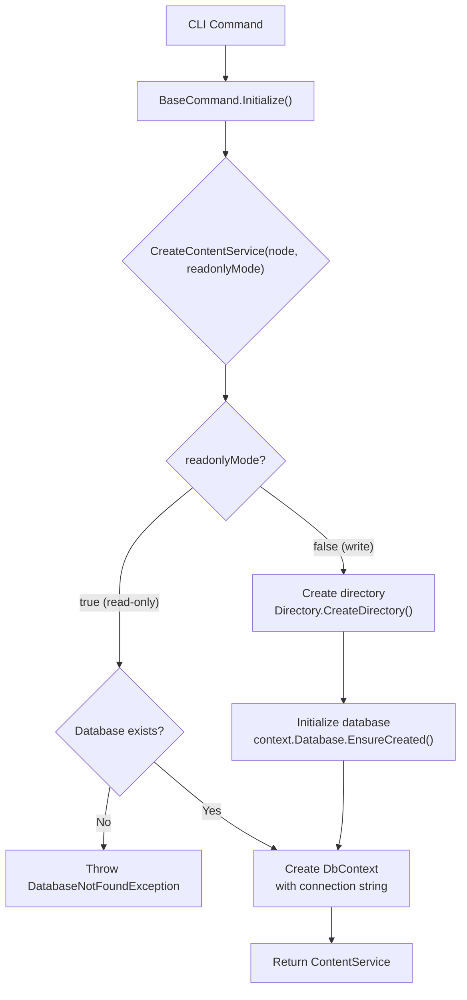
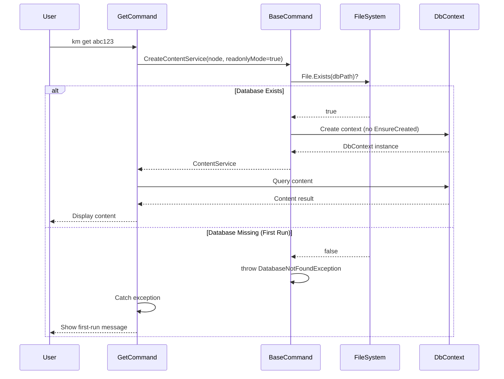
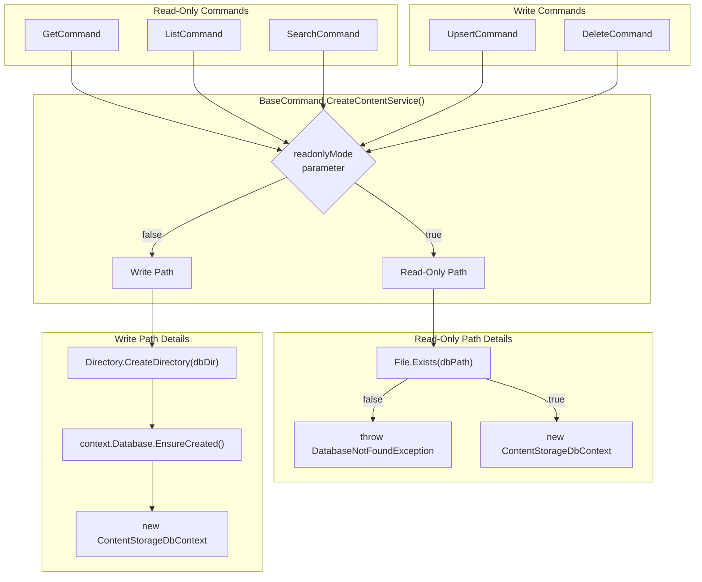

<!-- source: DeepWiki mcp.deepwiki.com · repo microsoft/kernel-memory · page 10.1 Read-Only vs Write Operations · fetched 2026-10-26 -->

# Read-Only vs Write Operations

<details>
<summary>Relevant source files</summary>

The following files were used as context for generating this wiki page:

- [src/Main/CLI/CliApplicationBuilder.cs](src/Main/CLI/CliApplicationBuilder.cs)
- [src/Main/CLI/Commands/BaseCommand.cs](src/Main/CLI/Commands/BaseCommand.cs)
- [src/Main/CLI/Commands/ConfigCommand.cs](src/Main/CLI/Commands/ConfigCommand.cs)
- [src/Main/CLI/Commands/DeleteCommand.cs](src/Main/CLI/Commands/DeleteCommand.cs)
- [src/Main/CLI/Commands/GetCommand.cs](src/Main/CLI/Commands/GetCommand.cs)
- [src/Main/CLI/Commands/ListCommand.cs](src/Main/CLI/Commands/ListCommand.cs)
- [src/Main/CLI/Commands/UpsertCommand.cs](src/Main/CLI/Commands/UpsertCommand.cs)
- [tests/Main.Tests/Integration/CliIntegrationTests.cs](tests/Main.Tests/Integration/CliIntegrationTests.cs)
- [tests/Main.Tests/Integration/CommandExecutionTests.cs](tests/Main.Tests/Integration/CommandExecutionTests.cs)
- [tests/Main.Tests/Integration/ConfigCommandTests.cs](tests/Main.Tests/Integration/ConfigCommandTests.cs)
- [tests/Main.Tests/Integration/ReadonlyCommandTests.cs](tests/Main.Tests/Integration/ReadonlyCommandTests.cs)

</details>


## Purpose and Scope

This document explains the distinction between read-only and write operations in KM² CLI commands, focusing on when and how the SQLite database and associated directories are created. Understanding this distinction is critical for:

- Preventing unintended filesystem modifications during query operations
- Providing appropriate first-run user experiences
- Ensuring data integrity and avoiding race conditions in shared storage scenarios

For information about command-line interface usage, see [CLI Application](#4). For configuration management, see [Configuration System](#6).

---

## Command Classification

KM² commands are classified into three categories based on their filesystem behavior:

| Command | Category | Creates Database | Creates Directories | Typical Use Case |
|---------|----------|------------------|---------------------|------------------|
| `get` | Read-Only | No | No | Retrieve existing content |
| `list` | Read-Only | No | No | Browse available content |
| `search` | Read-Only | No | No | Query content across nodes |
| `put` (upsert) | Write | Yes | Yes | Create or update content |
| `delete` | Write | Yes | Yes | Remove content |
| `config` | Configuration-Only | No | No | View/manage configuration |
| `nodes` | Configuration-Only | No | No | List configured nodes |
| `examples` | Configuration-Only | No | No | Show command examples |
| `doctor` | Configuration-Only | No | No | Validate system health |

**Sources:** [src/Main/CLI/Commands/GetCommand.cs:67](), [src/Main/CLI/Commands/ListCommand.cs:75](), [src/Main/CLI/Commands/UpsertCommand.cs:83](), [src/Main/CLI/Commands/DeleteCommand.cs:61](), [src/Main/CLI/Commands/ConfigCommand.cs:73-74]()

---

## Read-Only Mode Architecture



**Read-Only Mode Implementation**

The `BaseCommand<TSettings>.CreateContentService()` method implements the core read-only vs write distinction through its `readonlyMode` parameter:

```
readonlyMode: true  → Verifies database exists, throws exception if missing
readonlyMode: false → Creates directory and initializes database if needed
```

**Sources:** [src/Main/CLI/Commands/BaseCommand.cs:90-131]()

---

## Database Initialization Behavior

### Write Mode Operations

When `readonlyMode: false` (write operations):

1. **Directory Creation**: The database directory is created if it doesn't exist using `Directory.CreateDirectory()` [src/Main/CLI/Commands/BaseCommand.cs:111-115]()
2. **Database Initialization**: `context.Database.EnsureCreated()` is called to create tables [src/Main/CLI/Commands/BaseCommand.cs:130]()
3. **Idempotent**: Safe to call multiple times; only creates if missing

### Read-Only Mode Operations

When `readonlyMode: true` (read operations):

1. **Existence Check**: Verifies the database file exists using `File.Exists(dbPath)` [src/Main/CLI/Commands/BaseCommand.cs:103]()
2. **Exception on Missing**: Throws `DatabaseNotFoundException` if database doesn't exist [src/Main/CLI/Commands/BaseCommand.cs:105]()
3. **No Filesystem Modifications**: Never creates directories, files, or database tables



**Sources:** [src/Main/CLI/Commands/BaseCommand.cs:100-131](), [tests/Main.Tests/Integration/ReadonlyCommandTests.cs:64-98]()

---

## First-Run Experience

When users run read-only commands on a fresh installation (no database exists yet), KM² provides a friendly first-run experience instead of showing errors.

### Exception Handling Pattern

Read-only commands catch `DatabaseNotFoundException` and provide context-appropriate responses:

**GetCommand First-Run Handling:**
- JSON/YAML format: Returns `null` (valid, parseable output) [src/Main/CLI/Commands/GetCommand.cs:108]()
- Human format: Shows friendly message with usage examples [src/Main/CLI/Commands/GetCommand.cs:113-123]()
- Exit code: `0` (success, not an error) [src/Main/CLI/Commands/GetCommand.cs:88]()

**ListCommand First-Run Handling:**
- JSON/YAML format: Returns empty list with count=0 [src/Main/CLI/Commands/ListCommand.cs:116]()
- Human format: Shows welcome message with getting started guide [src/Main/CLI/Commands/ListCommand.cs:120-136]()
- Exit code: `0` (success, not an error) [src/Main/CLI/Commands/ListCommand.cs:96]()

### First-Run Message Examples

**GetCommand** displays:
```
Content with ID 'abc123' not found.

No content database exists yet. This is your first run.

Create content first:
  km put "Your content here" --id abc123

Or list available content:
  km list
```

**ListCommand** displays:
```
Welcome to Kernel Memory! 🚀

No content found in node 'personal' yet.

To get started:
  km put "Your content here"

Example:
  km put "Hello, world!" --id greeting
```

**Sources:** [src/Main/CLI/Commands/GetCommand.cs:98-124](), [src/Main/CLI/Commands/ListCommand.cs:104-136](), [tests/Main.Tests/Integration/ReadonlyCommandTests.cs:1-215]()

---

## Configuration-Only Commands

Some commands operate entirely on the in-memory configuration and never access the database, even in write mode.

### Commands That Never Access Database

1. **ConfigCommand**: Displays or creates configuration files [src/Main/CLI/Commands/ConfigCommand.cs:73-74]()
   - Reads `AppConfig` injected via DI
   - Optional: writes config file with `--create` flag
   - Never calls `CreateContentService()`

2. **NodesCommand**: Lists configured nodes from `AppConfig.Nodes`
   - Reads node metadata from configuration
   - No database queries required

3. **ExamplesCommand**: Shows command usage examples
   - Static help content
   - No persistence layer interaction

### ConfigCommand Special Case

`ConfigCommand` explicitly skips node initialization because it operates on the entire configuration, not a specific node:

```csharp
// ConfigCommand doesn't need node selection - it queries the entire configuration
// So we skip Initialize() and just use the injected config directly
var formatter = OutputFormatterFactory.Create(settings);
var configPath = this._configPathService.Path;
```

**Sources:** [src/Main/CLI/Commands/ConfigCommand.cs:73-76](), [tests/Main.Tests/Integration/ReadonlyCommandTests.cs:137-169]()

---

## Read-Only Mode Code Flow



**Key Code References:**

**Read-Only Command Invocations:**
- `GetCommand`: [src/Main/CLI/Commands/GetCommand.cs:67]()
- `ListCommand`: [src/Main/CLI/Commands/ListCommand.cs:75]()

**Write Command Invocations:**
- `UpsertCommand`: [src/Main/CLI/Commands/UpsertCommand.cs:83]()
- `DeleteCommand`: [src/Main/CLI/Commands/DeleteCommand.cs:61]()

**BaseCommand Implementation:**
- Parameter check: [src/Main/CLI/Commands/BaseCommand.cs:90]()
- Read-only path: [src/Main/CLI/Commands/BaseCommand.cs:101-106]()
- Write path: [src/Main/CLI/Commands/BaseCommand.cs:108-131]()

**Sources:** [src/Main/CLI/Commands/BaseCommand.cs:90-131](), [src/Main/CLI/Commands/GetCommand.cs:67](), [src/Main/CLI/Commands/UpsertCommand.cs:83]()

---

## Testing Read-Only Guarantees

The test suite includes dedicated tests to verify that read-only commands never create filesystem artifacts.

### Test Coverage

**ReadonlyCommandTests** specifically validates Bug A: "Readonly operations should NEVER create files/directories" [tests/Main.Tests/Integration/ReadonlyCommandTests.cs:13]()

Test cases verify:
1. `ListCommand` does not create database directory [tests/Main.Tests/Integration/ReadonlyCommandTests.cs:64-98]()
2. `GetCommand` does not create database directory [tests/Main.Tests/Integration/ReadonlyCommandTests.cs:100-134]()
3. `NodesCommand` does not create database directory [tests/Main.Tests/Integration/ReadonlyCommandTests.cs:136-169]()
4. `ConfigCommand` does not create database directory [tests/Main.Tests/Integration/ReadonlyCommandTests.cs:171-205]()

### Test Pattern

```csharp
// Verify database directory does not exist yet
Assert.False(Directory.Exists(dbDir), "Database directory should not exist before test");

// Execute read-only command
var exitCode = await command.ExecuteAsync(context, settings, CancellationToken.None);

// Assert: Command succeeds with first-run UX
Assert.Equal(Constants.App.ExitCodeSuccess, exitCode);

// Assert: No filesystem modifications occurred
Assert.False(Directory.Exists(dbDir), "BUG: Command should NOT create directory");
Assert.False(File.Exists(dbPath), "BUG: Command should NOT create database");
```

**Sources:** [tests/Main.Tests/Integration/ReadonlyCommandTests.cs:1-215]()

---

## Node Access Modes

While the `readonlyMode` parameter controls database initialization behavior, it is distinct from the `NodeConfig.Access` enum, which controls logical read/write permissions at the node level.

| Concept | Scope | Purpose |
|---------|-------|---------|
| `readonlyMode` parameter | Per-operation | Controls filesystem modifications during service creation |
| `NodeConfig.Access` enum | Per-node configuration | Controls logical read/write permissions for a node |

**Example Scenario:**
- A node configured with `Access = ReadOnly` prevents write operations logically
- The `readonlyMode` parameter prevents database creation during initialization
- These are complementary but independent mechanisms

For more information on node access configuration, see [Node Configuration](#6.2).

**Sources:** [src/Main/CLI/Commands/BaseCommand.cs:90](), [src/Main/CLI/Commands/ConfigCommand.cs:99-107]()

---

## Error Codes and First-Run Handling

### Exit Code Behavior

| Scenario | Exit Code | Rationale |
|----------|-----------|-----------|
| Read-only command, DB exists, content found | `0` (success) | Normal operation |
| Read-only command, DB exists, content not found | `1` (user error) | User requested non-existent ID |
| Read-only command, DB missing (first-run) | `0` (success) | Not an error, show helpful message |
| Write command, DB missing | `0` (success) | Creates DB automatically |
| Write command, DB creation fails | `2` (system error) | Filesystem/permissions issue |

### DatabaseNotFoundException Handling

The `DatabaseNotFoundException` is a custom exception thrown specifically to distinguish "first-run" scenarios from genuine errors:

```csharp
// In BaseCommand.CreateContentService()
if (readonlyMode)
{
    if (!File.Exists(dbPath))
    {
        throw new DatabaseNotFoundException(dbPath);  // Caught by commands
    }
}
```

Commands catch this exception to provide context-appropriate UX:
- Read-only commands: Show first-run welcome/help messages
- Configuration commands: N/A (never create database services)
- Write commands: N/A (never use readonlyMode=true)

**Sources:** [src/Main/CLI/Commands/BaseCommand.cs:103-106](), [src/Main/CLI/Commands/GetCommand.cs:84-88](), [src/Main/CLI/Commands/ListCommand.cs:92-96](), [src/Main/CLI/Exceptions/DatabaseNotFoundException.cs]()

---

## Best Practices

### For Command Authors

1. **Choose Correct Mode**: 
   - Use `readonlyMode: true` for GET/LIST/SEARCH operations
   - Use `readonlyMode: false` (default) for PUT/DELETE/UPDATE operations
   
2. **Handle DatabaseNotFoundException**:
   - Catch the exception in read-only commands
   - Provide helpful first-run messages
   - Return exit code 0 (success) for first-run scenarios

3. **Configuration-Only Commands**:
   - Skip `CreateContentService()` entirely if database is not needed
   - Use injected `AppConfig` directly

### For Users

1. **First-Run Experience**:
   - Read-only commands (get, list, search) provide helpful guidance when no database exists
   - Use `km put` to create your first content item
   - Database is created automatically on first write operation

2. **Shared Storage**:
   - Read-only mode prevents accidental database creation in shared locations
   - Configure nodes with appropriate access modes for multi-user scenarios
   - Use separate nodes for personal (write) and shared (read-only) content

**Sources:** [src/Main/CLI/Commands/BaseCommand.cs:85-90](), [src/Main/CLI/Commands/GetCommand.cs:98-124]()

---

