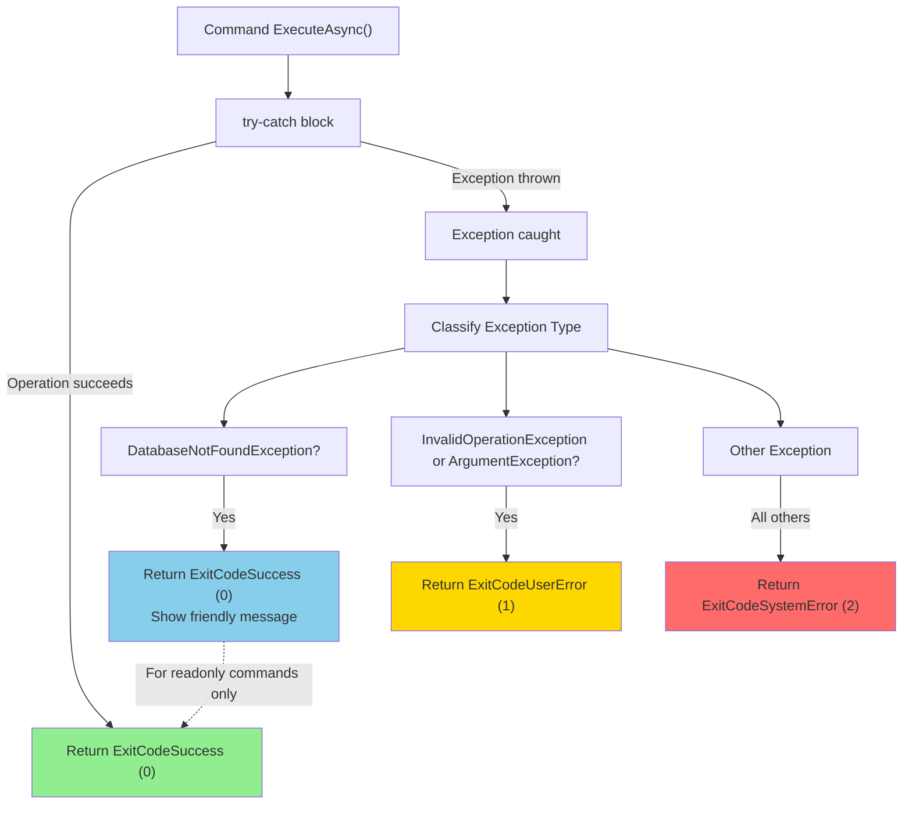
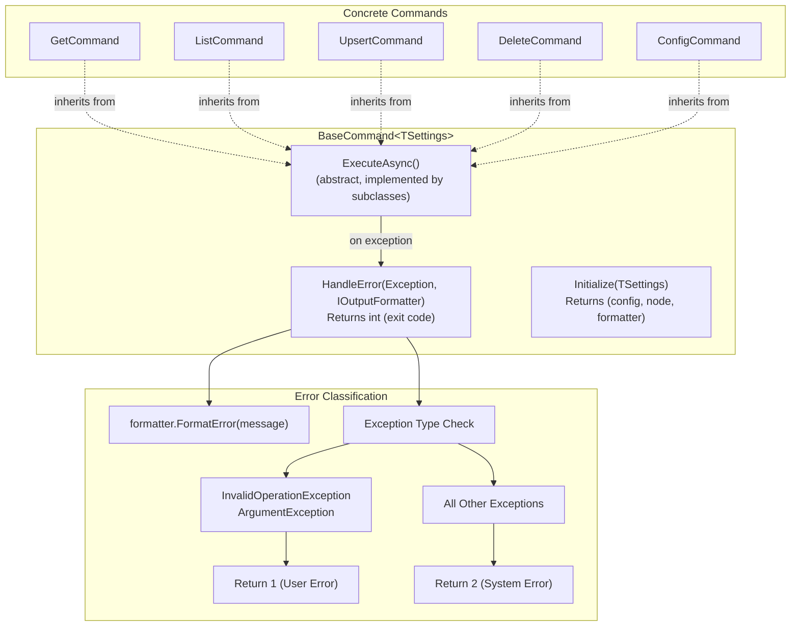
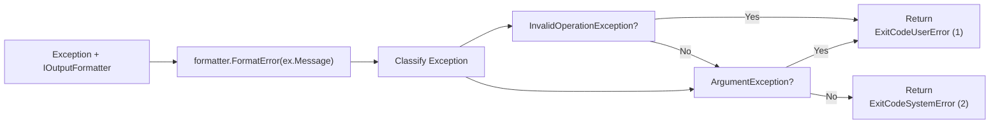
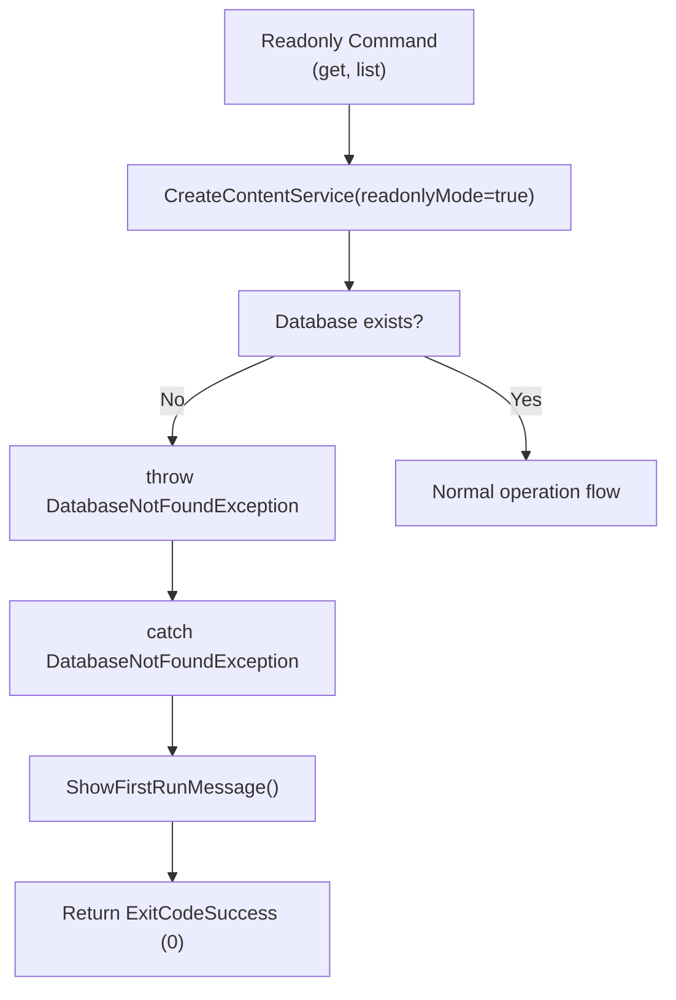
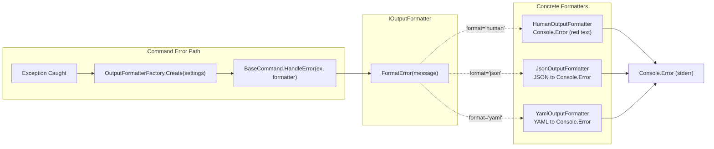
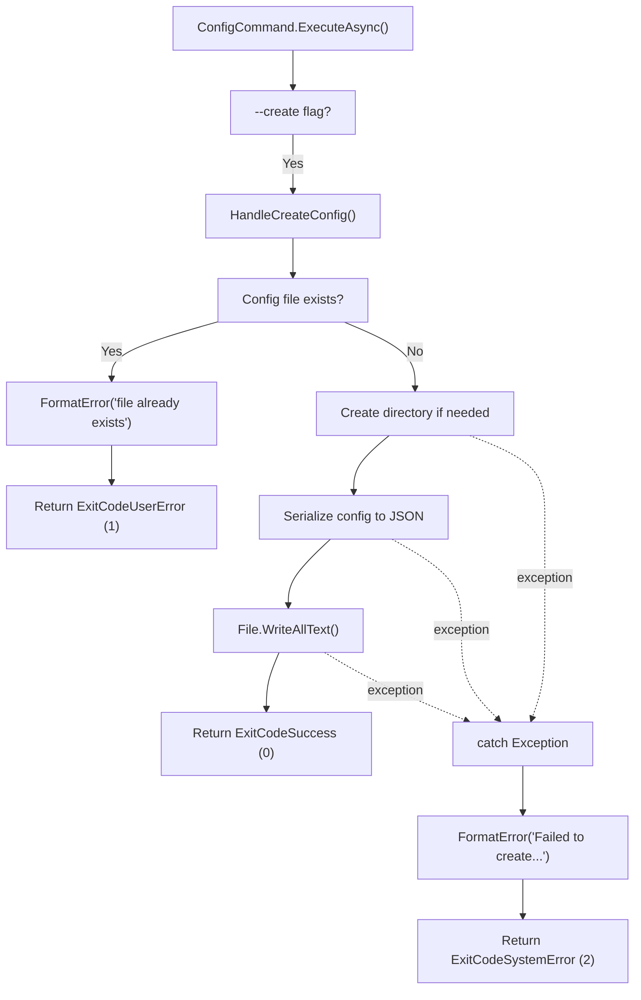
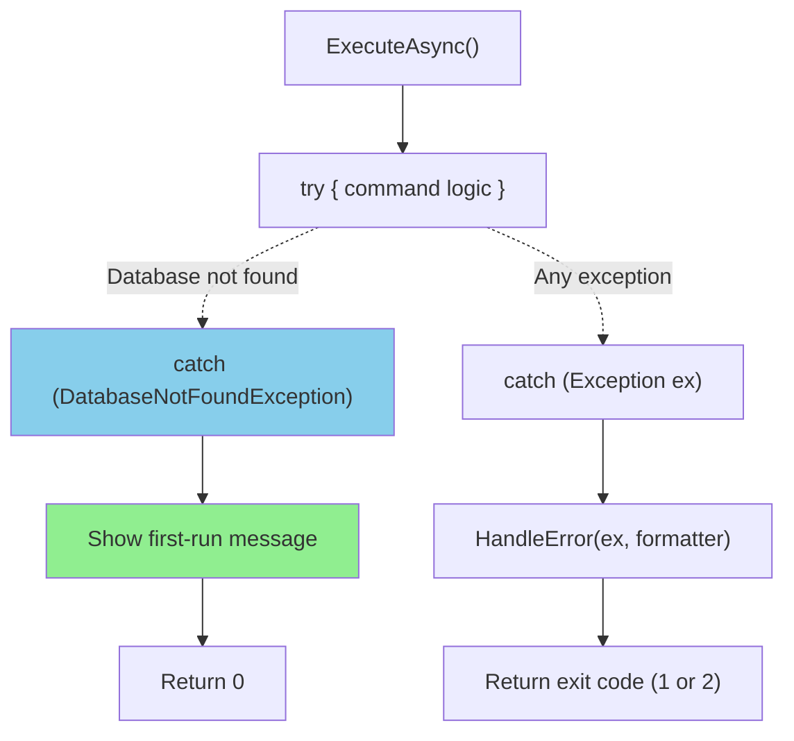

<!-- source: DeepWiki mcp.deepwiki.com · repo microsoft/kernel-memory · page 10.2 Error Handling and Exit Codes · fetched 2026-10-26 -->

# Error Handling and Exit Codes

<details>
<summary>Relevant source files</summary>

The following files were used as context for generating this wiki page:

- [src/Main/CLI/CliApplicationBuilder.cs](src/Main/CLI/CliApplicationBuilder.cs)
- [src/Main/CLI/Commands/BaseCommand.cs](src/Main/CLI/Commands/BaseCommand.cs)
- [src/Main/CLI/Commands/ConfigCommand.cs](src/Main/CLI/Commands/ConfigCommand.cs)
- [src/Main/CLI/Commands/DeleteCommand.cs](src/Main/CLI/Commands/DeleteCommand.cs)
- [src/Main/CLI/Commands/GetCommand.cs](src/Main/CLI/Commands/GetCommand.cs)
- [src/Main/CLI/Commands/ListCommand.cs](src/Main/CLI/Commands/ListCommand.cs)
- [src/Main/CLI/Commands/UpsertCommand.cs](src/Main/CLI/Commands/UpsertCommand.cs)
- [tests/Main.Tests/Integration/CliIntegrationTests.cs](tests/Main.Tests/Integration/CliIntegrationTests.cs)
- [tests/Main.Tests/Integration/CommandExecutionTests.cs](tests/Main.Tests/Integration/CommandExecutionTests.cs)
- [tests/Main.Tests/Integration/ConfigCommandTests.cs](tests/Main.Tests/Integration/ConfigCommandTests.cs)
- [tests/Main.Tests/Integration/ReadonlyCommandTests.cs](tests/Main.Tests/Integration/ReadonlyCommandTests.cs)

</details>


This page documents the error handling strategy and exit code conventions used throughout the KM² CLI application. It explains how commands classify exceptions, map them to exit codes, and format error messages for users.

For information about command execution flow and initialization, see [Getting Started](#2). For details about the CLI command structure, see [CLI Application](#4).

---

## Purpose and Scope

The KM² CLI uses a consistent error handling pattern across all commands to provide reliable exit codes for scripting and automation, and clear error messages for users. This document covers:

- The three exit codes used by the CLI (`0`, `1`, `2`)
- How exceptions are classified and mapped to exit codes
- Special handling for first-run scenarios
- Error message formatting and output
- Command-specific error handling patterns

---

## Exit Code System

KM² uses three exit codes, defined in the `Constants` class, following Unix conventions:

| Exit Code | Constant | Meaning | When Used |
|-----------|----------|---------|-----------|
| `0` | `Constants.App.ExitCodeSuccess` | Success | Operation completed successfully, or first-run scenario (no database exists yet) |
| `1` | `Constants.App.ExitCodeUserError` | User error | Invalid input, missing resource, configuration error, or validation failure |
| `2` | `Constants.App.ExitCodeSystemError` | System error | Unexpected exception, I/O error, or other system-level failure |

Sources: [src/Main/CLI/Commands/BaseCommand.cs:136-189](), [src/Main/CLI/Constants.cs]()

### Exit Code Decision Flow



**Exit Code Classification Flow**

Sources: [src/Main/CLI/Commands/BaseCommand.cs:172-190](), [src/Main/CLI/Commands/GetCommand.cs:64-94](), [src/Main/CLI/Commands/ListCommand.cs:70-102]()

---

## Error Handling Architecture

### BaseCommand Error Handling

All CLI commands inherit from `BaseCommand<TSettings>`, which provides centralized error handling through the `HandleError` method:



**BaseCommand Error Handling Architecture**

Sources: [src/Main/CLI/Commands/BaseCommand.cs:172-190](), [src/Main/CLI/Commands/GetCommand.cs:59-95](), [src/Main/CLI/Commands/UpsertCommand.cs:75-129]()

### HandleError Method Implementation

The `HandleError` method in `BaseCommand<TSettings>` performs two operations:

1. **Format error message** using the appropriate `IOutputFormatter`
2. **Classify exception** and return the appropriate exit code



**HandleError Method Logic**

The implementation at [src/Main/CLI/Commands/BaseCommand.cs:172-190]():

- Line 180: `formatter.FormatError(ex.Message)` outputs the error message
- Lines 182-186: User errors (`InvalidOperationException`, `ArgumentException`) return exit code 1
- Line 189: All other exceptions return exit code 2

Sources: [src/Main/CLI/Commands/BaseCommand.cs:172-190]()

---

## Exception Classification

### User Errors (Exit Code 1)

User errors indicate problems with input, configuration, or usage that the user can fix:

| Exception Type | Common Scenarios | Example Commands |
|----------------|------------------|------------------|
| `InvalidOperationException` | Node not found, no nodes configured, database doesn't exist (for existing DB queries) | All commands when node is invalid |
| `ArgumentException` | Invalid command arguments, validation failures | Commands with validated input |
| Content not found | ID doesn't exist in existing database | `GetCommand` with non-existent ID |

**Code Example from GetCommand:**

At [src/Main/CLI/Commands/GetCommand.cs:69-74](), when content is not found in an existing database:
```
if (result == null)
{
    formatter.FormatError($"Content with ID '{settings.Id}' not found");
    return Constants.App.ExitCodeUserError;
}
```

Sources: [src/Main/CLI/Commands/GetCommand.cs:69-74](), [src/Main/CLI/Commands/BaseCommand.cs:182-186](), [tests/Main.Tests/Integration/CliIntegrationTests.cs:197-212]()

### System Errors (Exit Code 2)

System errors indicate unexpected failures that are not user-recoverable:

| Error Category | Examples | Exit Code |
|----------------|----------|-----------|
| I/O Errors | File permission errors, disk full, network failures | 2 |
| Database Errors | SQLite errors (except missing DB), corruption | 2 |
| Serialization Errors | JSON parsing failures, invalid config structure | 2 |
| Unexpected Exceptions | Null references, unhandled states | 2 |

**Code Example from ConfigCommand:**

At [src/Main/CLI/Commands/ConfigCommand.cs:182-186](), when config file creation fails:
```
catch (Exception ex)
{
    formatter.FormatError($"Failed to create configuration file: {ex.Message}");
    return Constants.App.ExitCodeSystemError;
}
```

Sources: [src/Main/CLI/Commands/ConfigCommand.cs:182-186](), [src/Main/CLI/Commands/BaseCommand.cs:188-189]()

---

## First-Run Scenario Handling

A critical design decision in KM² is treating first-run scenarios (when no database exists yet) as **success, not error**. This provides a better user experience for new users.

### DatabaseNotFoundException

The `DatabaseNotFoundException` is thrown when a readonly command attempts to access a non-existent database. This is an expected state for first-run users.



**First-Run Exception Flow**

Sources: [src/Main/CLI/Commands/GetCommand.cs:84-89](), [src/Main/CLI/Commands/ListCommand.cs:92-97](), [src/Main/CLI/Exceptions/DatabaseNotFoundException.cs]()

### First-Run Message Display

When a readonly command encounters a missing database, it displays a helpful message guiding users on next steps:

**GetCommand First-Run Message** ([src/Main/CLI/Commands/GetCommand.cs:98-124]()):
- Lines 113-114: Explains the ID wasn't found and no database exists
- Lines 118-119: Shows how to create content with that ID
- Lines 121-122: Shows how to list available content

**ListCommand First-Run Message** ([src/Main/CLI/Commands/ListCommand.cs:104-136]()):
- Lines 126-128: Welcome message for new users
- Lines 130-131: Shows basic upsert command
- Lines 133-134: Shows example with ID

### Output Format Handling

First-run messages adapt to the output format:

| Format | First-Run Behavior | Exit Code |
|--------|-------------------|-----------|
| `json` | Returns valid JSON: `null` for get, `[]` for list | 0 |
| `yaml` | Returns valid YAML: `null` for get, `[]` for list | 0 |
| `human` | Shows friendly message with examples | 0 |

Sources: [src/Main/CLI/Commands/GetCommand.cs:105-109](), [src/Main/CLI/Commands/ListCommand.cs:114-117]()

---

## Error Output Formatting

Error messages are formatted through the `IOutputFormatter` interface, which provides consistent output across different formats.

### OutputFormatter Integration



**Error Output Formatting Pipeline**

Sources: [src/Main/CLI/OutputFormatters/IOutputFormatter.cs](), [src/Main/CLI/OutputFormatters/HumanOutputFormatter.cs](), [src/Main/CLI/Commands/BaseCommand.cs:178-180]()

### Error Output Destinations

All error messages are written to **stderr** (not stdout), allowing proper separation of data output and error output for scripting:

- **Success output** → `Console.Out` (stdout)
- **Error messages** → `Console.Error` (stderr)

This allows shell scripts to capture successful output while still seeing errors:
```bash
# Capture successful output, errors still visible
km get abc123 > output.json

# Separate error output from data
km list 2> errors.log > data.json
```

Sources: [src/Main/CLI/OutputFormatters/HumanOutputFormatter.cs](), [src/Main/CLI/OutputFormatters/JsonOutputFormatter.cs]()

---

## Command-Specific Error Handling

### ConfigCommand Error Handling

The `ConfigCommand` has special error handling for file creation operations:



**ConfigCommand --create Error Flow**

Key behaviors at [src/Main/CLI/Commands/ConfigCommand.cs:154-187]():
- Line 159-163: File already exists → User error (exit code 1)
- Line 182-186: File creation failure → System error (exit code 2)
- Lines 165-170: Directory is created if it doesn't exist

Sources: [src/Main/CLI/Commands/ConfigCommand.cs:154-187](), [tests/Main.Tests/Integration/ConfigCommandTests.cs:268-315]()

### Validation Errors

Command settings classes implement validation that runs before `ExecuteAsync`:

**GetCommandSettings Validation** ([src/Main/CLI/Commands/GetCommand.cs:28-42]()):
```
if (string.IsNullOrWhiteSpace(this.Id))
{
    return ValidationResult.Error("ID cannot be empty");
}
```

**ListCommandSettings Validation** ([src/Main/CLI/Commands/ListCommand.cs:30-49]()):
- Skip must be >= 0
- Take must be > 0

Validation errors prevent command execution and return appropriate error messages through Spectre.Console.Cli's validation system.

Sources: [src/Main/CLI/Commands/GetCommand.cs:28-42](), [src/Main/CLI/Commands/ListCommand.cs:30-49](), [src/Main/CLI/Commands/UpsertCommand.cs:44-58]()

---

## Readonly vs Write Command Error Handling

Commands are classified as readonly or write operations, which affects their error handling:

### Readonly Commands

Commands that only read data: `get`, `list`, `config`, `nodes`, `search`

**Readonly Mode Behavior** ([src/Main/CLI/Commands/BaseCommand.cs:86-107]()):
- Line 101-106: If database doesn't exist, throw `DatabaseNotFoundException`
- Commands catch this and show first-run message
- Return exit code 0 (success) for better UX

**Test Verification** ([tests/Main.Tests/Integration/ReadonlyCommandTests.cs:64-98]()):
- Readonly commands must NOT create directories or files
- Missing database is treated as first-run scenario
- Exit code is 0, with helpful message displayed

### Write Commands

Commands that modify data: `put` (upsert), `delete`

**Write Mode Behavior** ([src/Main/CLI/Commands/BaseCommand.cs:86-116]()):
- Lines 110-115: Automatically create directory if it doesn't exist
- Lines 127-131: Call `context.Database.EnsureCreated()` to create database
- Missing database is expected and handled transparently

```mermaid
graph TB
    subgraph "Readonly Commands (get, list)"
        ReadCmd["readonlyMode = true"]
        CheckDB1["Database exists?"]
        ThrowEx["Throw DatabaseNotFoundException"]
        ShowMsg["Show first-run message"]
        Exit0["Exit code 0"]
        
        ReadCmd --> CheckDB1
        CheckDB1 -->|"No"| ThrowEx
        ThrowEx --> ShowMsg
        ShowMsg --> Exit0
    end
    
    subgraph "Write Commands (put, delete)"
        WriteCmd["readonlyMode = false"]
        CheckDB2["Database exists?"]
        CreateDir["Create directory"]
        CreateDB["EnsureCreated()"]
        Normal["Normal operation"]
        
        WriteCmd --> CheckDB2
        CheckDB2 -->|"No"| CreateDir
        CreateDir --> CreateDB
        CreateDB --> Normal
        CheckDB2 -->|"Yes"| Normal
    end
```



**Readonly vs Write Error Handling Modes**

Sources: [src/Main/CLI/Commands/BaseCommand.cs:86-131](), [tests/Main.Tests/Integration/ReadonlyCommandTests.cs:64-169]()

---

## Top-Level Exception Handling

### Command Execution Wrapper

All commands wrap their `ExecuteAsync` implementation in try-catch blocks to ensure no unhandled exceptions escape:

**Suppression Attribute** at [src/Main/CLI/Commands/ConfigCommand.cs:64-65]():
```
[SuppressMessage("Design", "CA1031:Do not catch general exception types",
    Justification = "Top-level command handler must catch all exceptions...")]
```

This pattern appears in:
- [ConfigCommand.cs:64-143]() - Full try-catch in ExecuteAsync
- [GetCommand.cs:59-95]() - Catches all exceptions, returns appropriate exit code
- [UpsertCommand.cs:75-129]() - Catches all exceptions, calls HandleError
- [ListCommand.cs:70-102]() - Catches DatabaseNotFoundException separately, then all others

### Error Handling Pattern



**Command Try-Catch Pattern**

Sources: [src/Main/CLI/Commands/GetCommand.cs:64-94](), [src/Main/CLI/Commands/ConfigCommand.cs:71-143](), [src/Main/CLI/Commands/BaseCommand.cs:172-190]()

---

## Testing Error Paths

### Integration Test Coverage

The test suite extensively covers error scenarios to ensure consistent error handling:

**Error Path Tests** in [tests/Main.Tests/Integration/CommandExecutionTests.cs]():
- Line 76-102: Get with non-existent ID returns user error (exit code 1)
- Line 105-121: Delete is idempotent, returns success even for non-existent ID
- Line 124-157: List on empty database returns success

**First-Run Tests** in [tests/Main.Tests/Integration/ReadonlyCommandTests.cs]():
- Lines 64-98: List command doesn't create directories (Bug A fix)
- Lines 101-134: Get command doesn't create directories (Bug A fix)
- Lines 137-169: Nodes command doesn't create directories (Bug A fix)
- Lines 172-205: Config command doesn't create directories (Bug A fix)

### Exit Code Assertions

Test pattern for verifying exit codes ([tests/Main.Tests/Integration/CliIntegrationTests.cs:100-102]()):
```
var exitCode = await command.ExecuteAsync(context, settings, CancellationToken.None);
Assert.Equal(Constants.App.ExitCodeUserError, exitCode);
```

Tests verify three scenarios:
1. **Success paths** → exit code 0
2. **User errors** → exit code 1 (e.g., ID not found)
3. **First-run** → exit code 0 (not treated as error)

Sources: [tests/Main.Tests/Integration/CommandExecutionTests.cs:57-261](), [tests/Main.Tests/Integration/CliIntegrationTests.cs:181-212](), [tests/Main.Tests/Integration/ReadonlyCommandTests.cs:64-215]()

---

## Summary Table

| Scenario | Exception/Condition | Exit Code | User Experience |
|----------|-------------------|-----------|-----------------|
| Operation succeeds | None | 0 | Normal output |
| First-run (readonly) | `DatabaseNotFoundException` | 0 | Friendly welcome message |
| Content not found | `result == null` | 1 | Error message to stderr |
| Invalid node | `InvalidOperationException` | 1 | Error message to stderr |
| Invalid arguments | `ArgumentException` | 1 | Error message to stderr |
| Config file exists (--create) | File.Exists check | 1 | Error message to stderr |
| File I/O error | `IOException`, etc. | 2 | Error message to stderr |
| Unexpected error | Any other exception | 2 | Error message to stderr |

Sources: [src/Main/CLI/Commands/BaseCommand.cs:172-190](), [src/Main/CLI/Commands/ConfigCommand.cs:154-187](), [src/Main/CLI/Commands/GetCommand.cs:71-74]()

---

