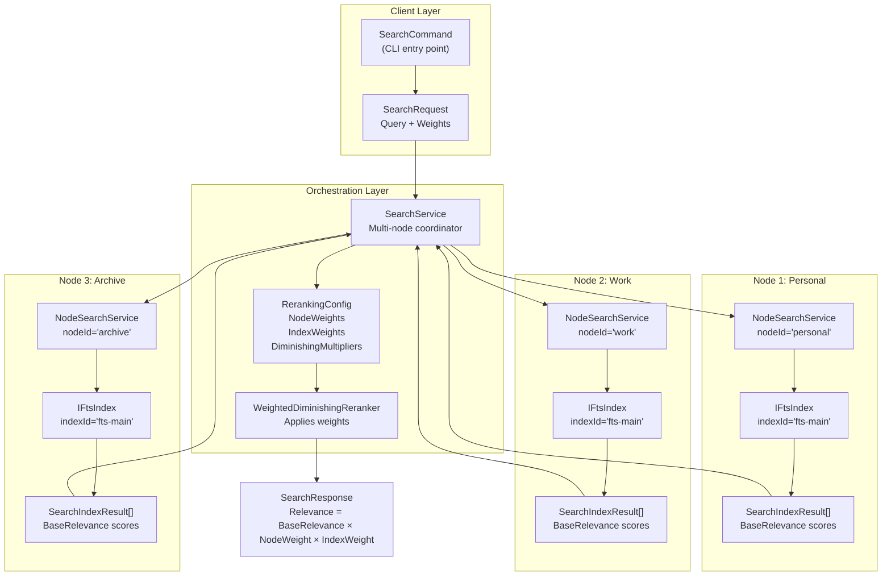
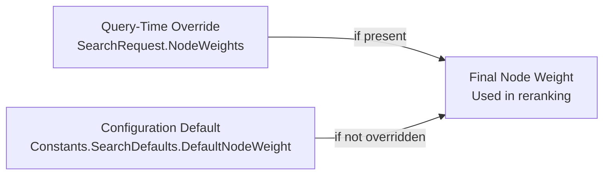
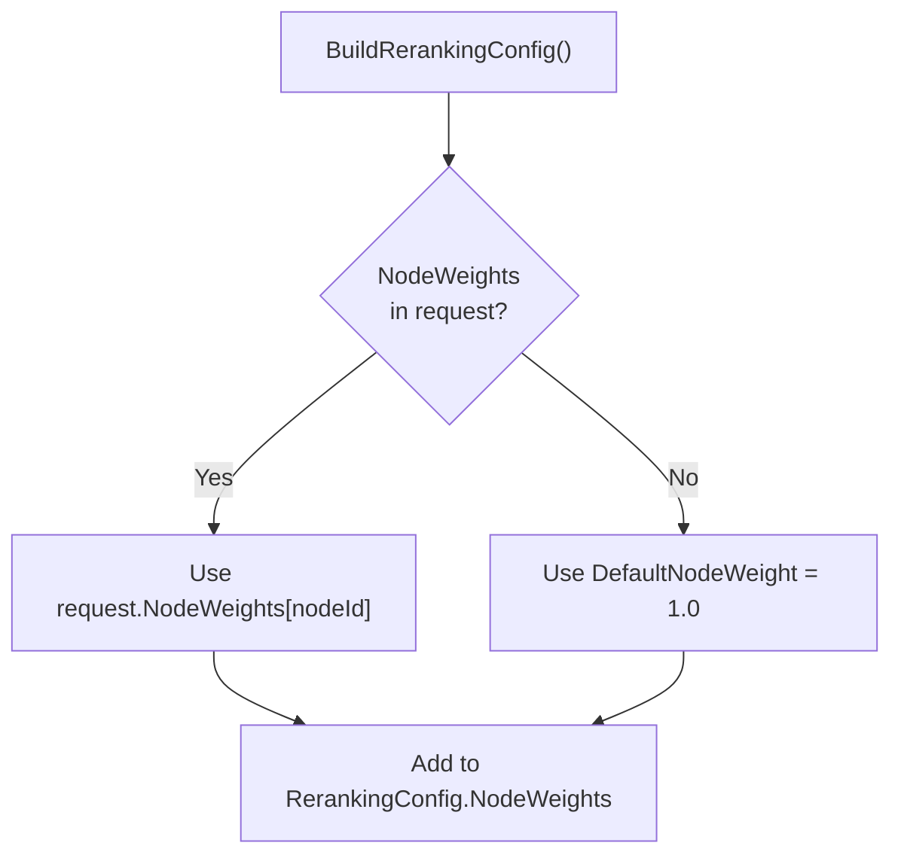
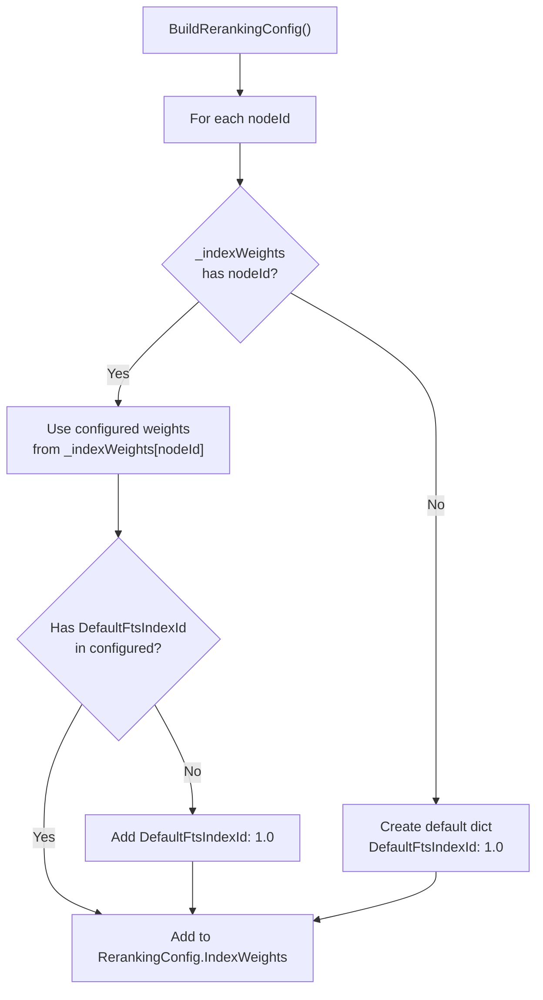
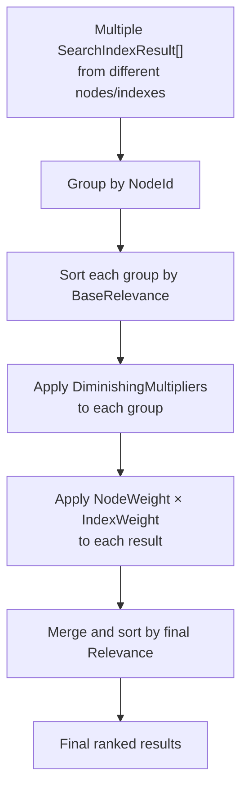

<!-- source: DeepWiki mcp.deepwiki.com · repo microsoft/kernel-memory · page 10.3 Multi-Node Search Strategies · fetched 2026-10-26 -->

# Multi-Node Search Strategies

<details>
<summary>Relevant source files</summary>

The following files were used as context for generating this wiki page:

- [KNOWN-ISSUES.md](KNOWN-ISSUES.md)
- [src/Core/Search/NodeSearchService.cs](src/Core/Search/NodeSearchService.cs)
- [src/Core/Search/Query/Parsers/InfixQueryParser.cs](src/Core/Search/Query/Parsers/InfixQueryParser.cs)
- [src/Core/Search/SearchService.cs](src/Core/Search/SearchService.cs)
- [src/Core/Search/SqliteFtsIndex.cs](src/Core/Search/SqliteFtsIndex.cs)
- [src/Main/CLI/Commands/ExamplesCommand.cs](src/Main/CLI/Commands/ExamplesCommand.cs)
- [src/Main/CLI/Commands/SearchCommand.cs](src/Main/CLI/Commands/SearchCommand.cs)
- [tests/Core.Tests/Search/FtsQueryExtractionTest.cs](tests/Core.Tests/Search/FtsQueryExtractionTest.cs)
- [tests/Core.Tests/Search/NodeSearchServiceIndexIdTests.cs](tests/Core.Tests/Search/NodeSearchServiceIndexIdTests.cs)
- [tests/Core.Tests/Search/Query/InfixQueryParserTests.cs](tests/Core.Tests/Search/Query/InfixQueryParserTests.cs)
- [tests/Core.Tests/Search/SearchEndToEndTests.cs](tests/Core.Tests/Search/SearchEndToEndTests.cs)
- [tests/Core.Tests/Search/SearchServiceIndexWeightsTests.cs](tests/Core.Tests/Search/SearchServiceIndexWeightsTests.cs)
- [tests/Main.Tests/Integration/ExamplesCommandE2ETests.cs](tests/Main.Tests/Integration/ExamplesCommandE2ETests.cs)

</details>


This page provides advanced guidance on configuring and optimizing search operations across multiple nodes in Kernel Memory. It covers node weight configuration, index weight configuration, reranking strategies, and query-time overrides to prioritize results from specific nodes or indexes.

For basic multi-node architecture concepts, see [Multi-Node Architecture](#3.3). For general search functionality, see [Search System](#5). For configuration file structure, see [Node Configuration](#6.2).

## Purpose and Scope

Multi-node search strategies allow you to:
- Prioritize results from certain nodes (e.g., personal notes over archived content)
- Balance multiple search indexes within a node (e.g., text search vs semantic search)
- Override weights at query time for specific search requirements
- Optimize search performance across heterogeneous content collections

This page focuses on the **strategic configuration of weights and reranking**. It does not cover query syntax (see [Query Syntax and Parsing](#5.2)) or result filtering (see [Result Ranking and Filtering](#5.4)).

## Multi-Node Search Architecture

### Search Request Flow

The following diagram shows how a search request flows through the multi-node search system, highlighting where weights are applied:



**Sources:** [src/Core/Search/SearchService.cs:1-267](), [src/Core/Search/NodeSearchService.cs:1-459](), [src/Main/CLI/Commands/SearchCommand.cs:1-579]()

### Key Components

| Component | File | Responsibility |
|-----------|------|----------------|
| `SearchService` | [src/Core/Search/SearchService.cs:14-266]() | Orchestrates multi-node searches, builds reranking config, applies weights |
| `NodeSearchService` | [src/Core/Search/NodeSearchService.cs:33-458]() | Executes search within a single node |
| `RerankingConfig` | [src/Core/Search/Reranking/RerankingConfig.cs]() | Encapsulates node weights, index weights, diminishing multipliers |
| `WeightedDiminishingReranker` | [src/Core/Search/Reranking/WeightedDiminishingReranker.cs]() | Applies weighted diminishing reranking algorithm |
| `SearchRequest.NodeWeights` | [src/Core/Search/Models/SearchRequest.cs]() | Query-time node weight overrides |

**Sources:** [src/Core/Search/SearchService.cs:1-267](), [src/Core/Search/NodeSearchService.cs:1-459]()

## Node Weight Configuration

Node weights control the relative importance of results from different nodes. Higher weights boost relevance scores from that node.

### Configuration Sources

Node weights can come from three sources, in order of precedence:



**Sources:** [src/Core/Search/SearchService.cs:214-228]()

### Default Node Weight

The default node weight is defined in [src/Core/Constants.cs]():

```csharp
public static class SearchDefaults
{
    public const float DefaultNodeWeight = 1.0f;
    // ...
}
```

All nodes receive a weight of `1.0` unless explicitly configured otherwise.

**Sources:** [src/Core/Constants.cs](), [src/Core/Search/SearchService.cs:226]()

### Query-Time Node Weight Overrides

You can override node weights at query time using the CLI `--node-weights` flag:

```bash
# Prioritize work node, de-prioritize archive
km search "project requirements" --node-weights work:1.5,personal:1.0,archive:0.3
```

The weight format is `nodeId:weight` pairs separated by commas. Weights must be between `0.0` and `1.0`, where:
- `1.0` = normal weight (no boost or penalty)
- `> 1.0` = boost results from this node (not currently supported, clamped at runtime)
- `< 1.0` = de-prioritize results from this node
- `0.0` = effectively exclude node results

**Sources:** [src/Main/CLI/Commands/SearchCommand.cs:83-86](), [src/Main/CLI/Commands/SearchCommand.cs:330-358](), [src/Main/CLI/Commands/ExamplesCommand.cs:357-361]()

### Node Weight Implementation

The `SearchService.BuildRerankingConfig` method constructs the final node weights:



**Sources:** [src/Core/Search/SearchService.cs:214-228]()

The implementation in [src/Core/Search/SearchService.cs:214-228]():

```csharp
private RerankingConfig BuildRerankingConfig(SearchRequest request, string[] nodeIds)
{
    // Node weights: use request overrides or defaults
    var nodeWeights = new Dictionary<string, float>();
    foreach (var nodeId in nodeIds)
    {
        if (request.NodeWeights?.TryGetValue(nodeId, out var weight) == true)
        {
            nodeWeights[nodeId] = weight;
        }
        else
        {
            nodeWeights[nodeId] = Constants.SearchDefaults.DefaultNodeWeight;
        }
    }
    // ...
}
```

## Index Weight Configuration

Index weights control the relative contribution of different search indexes within a node. For example, a node might have both a full-text search (FTS) index and a vector semantic search index, and you can control how much each contributes to the final relevance score.

### Configuration vs Query-Time

Unlike node weights, **index weights are only configurable via the configuration file**, not at query time:

| Weight Type | Configuration File | Query-Time Override |
|-------------|-------------------|---------------------|
| Node Weights | ❌ No | ✅ Yes (`--node-weights`) |
| Index Weights | ✅ Yes (`SearchIndexes[].Weight`) | ❌ No |

**Sources:** [src/Core/Search/SearchService.cs:214-265](), [tests/Core.Tests/Search/SearchServiceIndexWeightsTests.cs:1-265]()

### Index Weight Configuration Structure

Index weights are configured per-node in the configuration file:

```json
{
  "nodes": {
    "personal": {
      "searchIndexes": [
        {
          "id": "fts-main",
          "type": "SqliteFts",
          "weight": 1.0,
          "config": { ... }
        },
        {
          "id": "vector-main",
          "type": "VectorSearch",
          "weight": 0.7,
          "config": { ... }
        }
      ]
    }
  }
}
```

The `weight` property controls the index's contribution to final relevance. See [Search Index Configuration](#6.4) for full configuration schema.

**Sources:** [src/Core/Config/Models/SearchIndexConfig.cs](), [tests/Core.Tests/Search/SearchServiceIndexWeightsTests.cs:68-109]()

### Index Weight Resolution

The `SearchService` resolves index weights from configuration when building the reranking config:



**Sources:** [src/Core/Search/SearchService.cs:230-265]()

The implementation in [src/Core/Search/SearchService.cs:230-265]():

```csharp
// Index weights: use configured weights, fall back to defaults for missing entries
var indexWeights = new Dictionary<string, Dictionary<string, float>>();
foreach (var nodeId in nodeIds)
{
    // Check if we have configured index weights for this node
    if (this._indexWeights?.TryGetValue(nodeId, out var configuredNodeIndexWeights) == true
        && configuredNodeIndexWeights.Count > 0)
    {
        // Use configured weights, but ensure defaults for missing indexes
        var nodeIndexWeights = new Dictionary<string, float>(configuredNodeIndexWeights);

        // Ensure default FTS index has a weight (use configured or default)
        if (!nodeIndexWeights.ContainsKey(Constants.SearchDefaults.DefaultFtsIndexId))
        {
            nodeIndexWeights[Constants.SearchDefaults.DefaultFtsIndexId] = Constants.SearchDefaults.DefaultIndexWeight;
        }

        indexWeights[nodeId] = nodeIndexWeights;
    }
    else
    {
        // No configured weights for this node, use default
        indexWeights[nodeId] = new Dictionary<string, float>
        {
            [Constants.SearchDefaults.DefaultFtsIndexId] = Constants.SearchDefaults.DefaultIndexWeight
        };
    }
}
```

### Default Index Weight

The default index weight is `1.0`, defined in [src/Core/Constants.cs]():

```csharp
public static class SearchDefaults
{
    public const float DefaultIndexWeight = 1.0f;
    public const string DefaultFtsIndexId = "fts-main";
    // ...
}
```

**Sources:** [src/Core/Constants.cs](), [src/Core/Search/SearchService.cs:244]()

## Reranking Algorithm

The weighted diminishing reranking algorithm combines results from multiple nodes and indexes, applying weights to produce a final ranked list.

### Relevance Score Calculation

The final relevance score for each result is calculated as:

```
Relevance = BaseRelevance × NodeWeight × IndexWeight × DiminishingMultiplier
```

Where:
- `BaseRelevance`: Raw score from the search index (e.g., normalized BM25 score)
- `NodeWeight`: Weight for the node containing this result
- `IndexWeight`: Weight for the index that produced this result
- `DiminishingMultiplier`: Diminishing factor based on result position (prevents over-representation of single nodes)

**Sources:** [src/Core/Search/Reranking/WeightedDiminishingReranker.cs](), [src/Core/Search/SearchService.cs:76]()

### Diminishing Multipliers

Diminishing multipliers prevent a single high-scoring node from dominating all top results. The default diminishing factors are:

```csharp
public static readonly float[] DefaultDiminishingMultipliers = [1.0f, 0.9f, 0.8f, 0.7f, 0.6f];
```

This means:
- 1st result from a node: full weight (`1.0`)
- 2nd result from same node: 90% weight (`0.9`)
- 3rd result from same node: 80% weight (`0.8`)
- And so on...

This encourages diversity in search results across nodes.

**Sources:** [src/Core/Constants.cs](), [src/Core/Search/Reranking/WeightedDiminishingReranker.cs]()

### Reranking Flow



**Sources:** [src/Core/Search/Reranking/WeightedDiminishingReranker.cs](), [src/Core/Search/SearchService.cs:76]()

## CLI Usage Examples

### Example 1: Prioritize Work Node Over Archive

Scenario: You want to search for "meeting notes" but prioritize results from your work node and de-emphasize archived content.

```bash
km search "meeting notes" --node-weights work:1.5,personal:1.0,archive:0.3
```

Effect:
- Work node results get 50% boost (weight 1.5)
- Personal node results stay normal (weight 1.0)
- Archive node results are heavily de-prioritized (weight 0.3)

**Sources:** [src/Main/CLI/Commands/ExamplesCommand.cs:357-361]()

### Example 2: Search Only Specific Nodes

Scenario: You want to search only your personal and work nodes, completely excluding archive.

```bash
km search "project requirements" --nodes work,personal
```

Or equivalently, using exclusion:

```bash
km search "project requirements" --exclude-nodes archive
```

Note: This is **node selection**, not weighting. The `--nodes` flag controls which nodes are searched at all. Node weights control relevance scoring of results from included nodes.

**Sources:** [src/Main/CLI/Commands/SearchCommand.cs:28-34](), [src/Main/CLI/Commands/ExamplesCommand.cs:118-123]()

### Example 3: Combine Node Selection and Weighting

Scenario: Search personal and work nodes, but prioritize work.

```bash
km search "api documentation" --nodes personal,work --node-weights work:1.0,personal:0.8
```

Effect:
- Only personal and work nodes are searched (archive excluded)
- Work results are weighted normally (1.0)
- Personal results are slightly de-prioritized (0.8)

**Sources:** [src/Main/CLI/Commands/SearchCommand.cs:28-34](), [src/Main/CLI/Commands/SearchCommand.cs:83-86]()

## Configuration Strategies

### Strategy 1: Role-Based Node Weighting

Structure nodes by information sensitivity or importance, using weights to reflect priority:

```
personal (1.0)    - Current work, highest priority
work (0.9)        - Team content, slightly lower
reference (0.7)   - Documentation, lower priority
archive (0.3)     - Old content, lowest priority
```

This strategy works well when you have clear hierarchies of information importance.

**Sources:** [src/Main/CLI/Commands/ExamplesCommand.cs:357-361]()

### Strategy 2: Index Type Balancing

When a node has multiple index types (text + semantic), balance their contributions:

```json
{
  "nodes": {
    "main": {
      "searchIndexes": [
        {
          "id": "fts-main",
          "type": "SqliteFts",
          "weight": 1.0
        },
        {
          "id": "vector-main",
          "type": "VectorSearch",
          "weight": 0.7
        }
      ]
    }
  }
}
```

This gives text search results higher priority than semantic search, which can be useful when exact keyword matches are more important than semantic similarity.

**Sources:** [tests/Core.Tests/Search/SearchServiceIndexWeightsTests.cs:146-189](), [src/Core/Search/SearchService.cs:230-265]()

### Strategy 3: Experimental Index De-Prioritization

When testing new search indexes, set lower weights to avoid disrupting existing results:

```json
{
  "searchIndexes": [
    {
      "id": "fts-main",
      "weight": 1.0
    },
    {
      "id": "experimental-semantic",
      "weight": 0.3
    }
  ]
}
```

The experimental index contributes to results but won't dominate unless it has significantly higher relevance scores.

**Sources:** [src/Main/CLI/Commands/ExamplesCommand.cs:363-366]()

### Strategy 4: Query-Time Context Switching

Use query-time overrides to adapt search behavior for different contexts:

```bash
# Daily work: prioritize recent content
km search "standup notes" --node-weights current:1.0,archive:0.2

# Research: balance all nodes equally
km search "background research" --node-weights current:1.0,archive:1.0

# Compliance search: prioritize archive
km search "policy document" --node-weights current:0.5,archive:1.0
```

This allows the same configuration to support multiple search behaviors without reconfiguration.

**Sources:** [src/Main/CLI/Commands/SearchCommand.cs:316-321](), [src/Core/Search/SearchService.cs:214-228]()

## Testing and Validation

### Verifying Index Weight Configuration

Test that your configured index weights are applied correctly:

```bash
# Search and examine relevance scores in JSON output
km search "test query" --format json | jq '.results[] | {id, nodeId, indexId, relevance}'
```

Expected behavior:
- Results from high-weight indexes should have proportionally higher relevance scores
- Similar base relevance scores should show the weight differential

**Sources:** [tests/Core.Tests/Search/SearchServiceIndexWeightsTests.cs:66-109]()

### Comparing Node Weight Impact

Test different node weight configurations:

```bash
# Baseline: equal weights
km search "kubernetes" --node-weights work:1.0,personal:1.0

# Comparison: prioritize work
km search "kubernetes" --node-weights work:1.5,personal:0.8
```

Compare the result order and relevance scores to verify the impact of your weight configuration.

**Sources:** [tests/Main.Tests/Integration/ExamplesCommandE2ETests.cs:1-401]()

### Index Weight Test Cases

The codebase includes comprehensive tests for index weight functionality in [tests/Core.Tests/Search/SearchServiceIndexWeightsTests.cs:1-265](). Key test scenarios:

| Test | Purpose |
|------|---------|
| `SearchService_WithConfiguredIndexWeights_UsesConfiguredWeights` | Verifies custom index weights are applied |
| `SearchService_WithoutConfiguredIndexWeights_UsesDefaultWeight` | Verifies default behavior |
| `SearchService_WithIndexWeightsForMultipleIndexes_UsesCorrectWeights` | Verifies multi-index scenarios |
| `SearchService_WithMissingIndexWeight_UsesDefaultWeight` | Verifies fallback behavior |

**Sources:** [tests/Core.Tests/Search/SearchServiceIndexWeightsTests.cs:1-265]()

## Common Patterns and Anti-Patterns

### ✅ Good Patterns

| Pattern | Description | Rationale |
|---------|-------------|-----------|
| Gradual weight differences | Use weights like 1.0, 0.8, 0.6 instead of 1.0, 0.1, 0.01 | Maintains result diversity while showing preference |
| Query-time overrides for context | Use `--node-weights` for one-off searches | Avoids reconfiguring the system for temporary needs |
| Index weights for index types | Different weights for text vs semantic indexes | Balances different search paradigms appropriately |
| Test before deploying | Verify weight changes with sample queries | Prevents unexpected result ranking changes |

**Sources:** [src/Main/CLI/Commands/ExamplesCommand.cs:357-361](), [tests/Core.Tests/Search/SearchServiceIndexWeightsTests.cs:66-143]()

### ❌ Anti-Patterns

| Anti-Pattern | Problem | Solution |
|--------------|---------|----------|
| Extreme weights (0.01, 100.0) | Effectively eliminates nodes/indexes or over-weights them | Use moderate weights (0.3-1.5 range) |
| Conflicting node selection and weights | Using `--exclude-nodes` and then setting weights for excluded nodes | Only set weights for nodes you're actually searching |
| Ignoring diminishing multipliers | Expecting all results from high-weight node to rank first | Understand that diminishing multipliers promote diversity |
| Hardcoding weights in queries | Always using `--node-weights` instead of configuration | Use configuration for persistent preferences, overrides for exceptions |

**Sources:** [src/Main/CLI/Commands/SearchCommand.cs:330-358](), [src/Core/Search/SearchService.cs:214-265]()

## Implementation Details

### SearchService Constructor

The `SearchService` constructor accepts index weights from configuration:

```csharp
public SearchService(
    Dictionary<string, NodeSearchService> nodeServices,
    Dictionary<string, Dictionary<string, float>>? indexWeights = null,
    ISearchReranker? reranker = null)
{
    this._nodeServices = nodeServices;
    this._indexWeights = indexWeights;
    this._reranker = reranker ?? new WeightedDiminishingReranker();
}
```

The outer dictionary key is the node ID, the inner dictionary key is the index ID, and the value is the weight multiplier.

**Sources:** [src/Core/Search/SearchService.cs:30-38]()

### CLI Integration

The CLI `SearchCommand` extracts index weights from node configuration and passes them to `SearchService`:

```csharp
private SearchService CreateSearchService()
{
    var nodeServices = new Dictionary<string, NodeSearchService>();
    var indexWeights = new Dictionary<string, Dictionary<string, float>>();
    
    foreach (var (nodeId, nodeConfig) in this.Config.Nodes)
    {
        // ... create NodeSearchService ...
        
        // Extract index weights from configuration
        if (nodeConfig.SearchIndexes.Count > 0)
        {
            var nodeIndexWeights = new Dictionary<string, float>();
            foreach (var searchIndex in nodeConfig.SearchIndexes)
            {
                nodeIndexWeights[searchIndex.Id] = searchIndex.Weight;
            }
            indexWeights[nodeId] = nodeIndexWeights;
        }
    }
    
    return new SearchService(nodeServices, indexWeights);
}
```

**Sources:** [src/Main/CLI/Commands/SearchCommand.cs:463-534]()

### NodeSearchService Index ID

Each `NodeSearchService` is constructed with an explicit index ID that appears in search results:

```csharp
public NodeSearchService(
    string nodeId,
    IFtsIndex ftsIndex,
    IContentStorage contentStorage,
    string indexId = Constants.SearchDefaults.DefaultFtsIndexId)
{
    this._nodeId = nodeId;
    this._indexId = indexId;
    this._ftsIndex = ftsIndex;
    this._contentStorage = contentStorage;
}
```

This index ID is included in `SearchIndexResult.IndexId`, enabling the reranking algorithm to look up the correct weight for that index.

**Sources:** [src/Core/Search/NodeSearchService.cs:47-57](), [tests/Core.Tests/Search/NodeSearchServiceIndexIdTests.cs:1-232]()

### Weight Resolution Priority

The complete priority order for weight resolution:

1. **Query-time node weights** (highest priority, `SearchRequest.NodeWeights`)
2. **Configured index weights** (from `config.json` → `NodeConfig.SearchIndexes[].Weight`)
3. **Default weights** (lowest priority, `Constants.SearchDefaults.DefaultNodeWeight` / `DefaultIndexWeight`)

Node weights support query-time overrides; index weights do not.

**Sources:** [src/Core/Search/SearchService.cs:214-265](), [src/Main/CLI/Commands/SearchCommand.cs:316-321]()

## Future Considerations

While this page documents the current implementation, be aware that:

1. **Index weight query-time overrides** are not currently supported but may be added in future versions
2. **Automatic weight optimization** based on user feedback could be implemented
3. **Per-query custom reranking algorithms** could be supported beyond the default weighted diminishing approach
4. **Node weight validation** currently allows any float value; future versions may enforce ranges

As noted in [Project Status and Warnings](#1.1), KM² is experimental software under active development. Weight configuration APIs may change.

**Sources:** [src/Core/Search/SearchService.cs:1-267](), [tests/Core.Tests/Search/SearchServiceIndexWeightsTests.cs:1-265]()