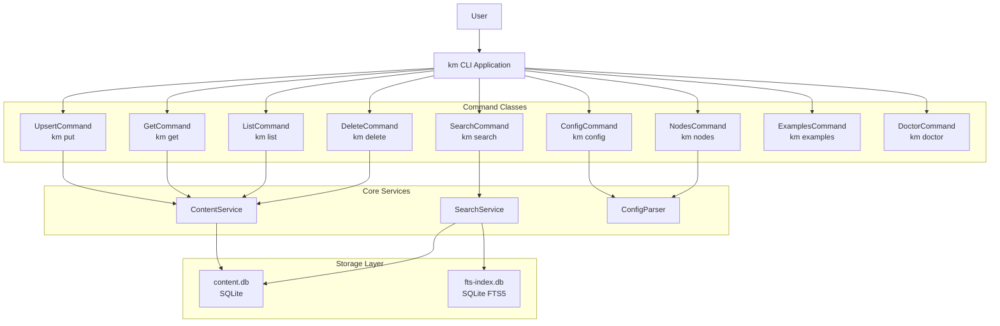
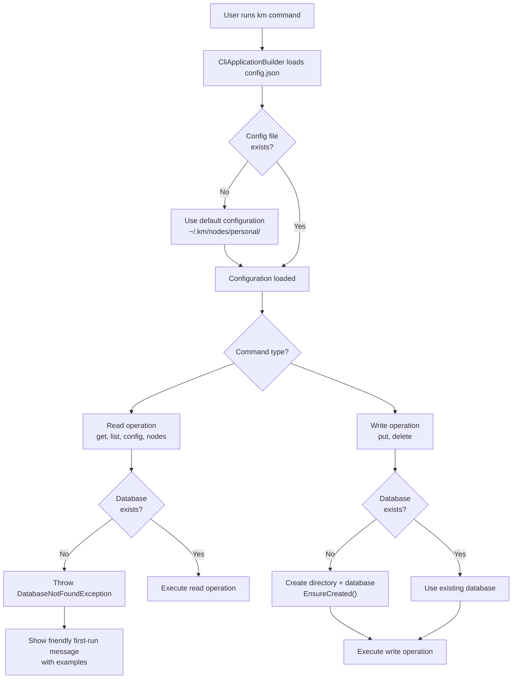

<!-- source: DeepWiki mcp.deepwiki.com · repo microsoft/kernel-memory · page 2 Getting Started · fetched 2026-10-26 -->

# Getting Started

<details>
<summary>Relevant source files</summary>

The following files were used as context for generating this wiki page:

- [.gitignore](.gitignore)
- [.gitmodules](.gitmodules)
- [README.md](README.md)
- [src/Main/CLI/CliApplicationBuilder.cs](src/Main/CLI/CliApplicationBuilder.cs)
- [src/Main/CLI/Commands/BaseCommand.cs](src/Main/CLI/Commands/BaseCommand.cs)
- [src/Main/CLI/Commands/ConfigCommand.cs](src/Main/CLI/Commands/ConfigCommand.cs)
- [src/Main/CLI/Commands/DeleteCommand.cs](src/Main/CLI/Commands/DeleteCommand.cs)
- [src/Main/CLI/Commands/GetCommand.cs](src/Main/CLI/Commands/GetCommand.cs)
- [src/Main/CLI/Commands/ListCommand.cs](src/Main/CLI/Commands/ListCommand.cs)
- [src/Main/CLI/Commands/UpsertCommand.cs](src/Main/CLI/Commands/UpsertCommand.cs)
- [tests/Main.Tests/Integration/CliIntegrationTests.cs](tests/Main.Tests/Integration/CliIntegrationTests.cs)
- [tests/Main.Tests/Integration/CommandExecutionTests.cs](tests/Main.Tests/Integration/CommandExecutionTests.cs)
- [tests/Main.Tests/Integration/ConfigCommandTests.cs](tests/Main.Tests/Integration/ConfigCommandTests.cs)
- [tests/Main.Tests/Integration/ReadonlyCommandTests.cs](tests/Main.Tests/Integration/ReadonlyCommandTests.cs)

</details>


This guide walks you through installing, configuring, and using the KM² (Kernel Memory²) command-line interface. KM² is an active research project focused on exploring AI memory concepts through a CLI application for content management and search.

> **Important**: KM² is experimental software. Expect things to break. There are no stability or compatibility guarantees. This project is intended as a learning resource, not production-ready software.

For detailed information about KM²'s architecture, see [Architecture](3). For configuration options, see [Configuration System](6).

Sources: [README.md:1-34]()

## What is KM²?

KM² is a command-line tool that provides content management and full-text search capabilities. It uses a multi-node architecture with SQLite databases for storage and indexing. The CLI application provides commands for managing content, querying configuration, and searching across nodes.

**Key Characteristics:**

| Aspect | Description |
|--------|-------------|
| **Project Status** | Active research project, rapidly evolving |
| **Primary Interface** | Command-line application (`km` command) |
| **Storage Backend** | SQLite (content index + FTS5 search) |
| **Architecture** | Multi-node with configurable access modes |
| **Configuration** | JSON-based (`~/.km/config.json`) |

Sources: [README.md:1-34](), [src/Main/CLI/CliApplicationBuilder.cs:48-104]()

## Prerequisites

Before installing KM², ensure you have:

1. **.NET 8.0 SDK or later** - Required to build and run the CLI application
2. **Git** - For cloning the repository
3. **Text editor** - For editing configuration files (any text editor will work)

No AI service credentials or external dependencies are required for basic operation. KM² uses local SQLite databases for storage.

Sources: [README.md:1-34](), [.gitignore:1-73]()

## Installation

### Clone and Build

```bash
# Clone the repository
git clone https://github.com/microsoft/kernel-memory.git
cd kernel-memory

# Build the CLI application
dotnet build

# Run the CLI
dotnet run --project src/Main/CLI/CLI.csproj
```

The CLI application is located at [src/Main/CLI/CLI.csproj](). After building, you can invoke commands using:

```bash
dotnet run --project src/Main/CLI/CLI.csproj -- <command> [options]
```

For convenience, you can create an alias:

```bash
# Linux/macOS
alias km='dotnet run --project /path/to/kernel-memory/src/Main/CLI/CLI.csproj --'

# Windows (PowerShell)
function km { dotnet run --project C:\path\to\kernel-memory\src\Main\CLI\CLI.csproj -- $args }
```

Sources: [src/Main/CLI/CLI.csproj:1-35](), [src/Main/CLI/CliApplicationBuilder.cs:1-268]()

## Understanding the File System Layout

KM² stores data in a directory structure under `~/.km` by default. Understanding this layout helps when working with configurations and debugging.

**Default Directory Structure:**

```
~/.km/                          # Default KM² directory
├── config.json                 # Configuration file
└── nodes/                      # Node data directories
    ├── personal/               # Default "personal" node
    │   ├── content.db          # SQLite content index
    │   └── fts-index.db        # SQLite FTS5 search index
    └── shared/                 # Optional additional nodes
        ├── content.db
        └── fts-index.db
```

**File Purposes:**

| File/Directory | Purpose | Created When |
|----------------|---------|--------------|
| `~/.km/config.json` | Application configuration | `km config --create` |
| `nodes/<name>/content.db` | SQLite content storage | First write operation (put/delete) |
| `nodes/<name>/fts-index.db` | SQLite FTS5 search index | First content insertion |
| `nodes/<name>/embeddings-cache.db` | Optional embedding cache | If configured in config.json |

Sources: [src/Main/CLI/CliApplicationBuilder.cs:124-129](), [src/Main/CLI/Commands/BaseCommand.cs:90-116]()

## Configuration Basics

KM² uses a JSON configuration file located at `~/.km/config.json` by default. You can view, create, or specify an alternate path for this file.

### Viewing Current Configuration

```bash
# View the entire configuration
km config

# View only node configurations
km config --show-nodes

# View only cache configurations
km config --show-cache

# Output in JSON format (easier to copy/paste)
km config -f json
```

The `ConfigCommand` class [src/Main/CLI/Commands/ConfigCommand.cs:39-188]() handles configuration display. Note that the command succeeds even if no configuration file exists yet - it will display the default configuration and suggest creating a file.

Sources: [src/Main/CLI/Commands/ConfigCommand.cs:39-188](), [tests/Main.Tests/Integration/ConfigCommandTests.cs:72-121]()

### Creating a Configuration File

```bash
# Create default configuration file at ~/.km/config.json
km config --create

# Create at a custom path
km config --config /path/to/custom-config.json --create
```

This creates a configuration file with default settings. The file uses this structure:

```json
{
  "nodes": {
    "personal": {
      "id": "personal",
      "access": "ReadWrite",
      "contentIndex": {
        "type": "sqlite",
        "path": "~/.km/nodes/personal/content.db"
      },
      "searchIndexes": [
        {
          "type": "sqliteFTS",
          "path": "~/.km/nodes/personal/fts-index.db"
        }
      ]
    }
  },
  "embeddingsCache": null,
  "llmCache": null
}
```

**Configuration Structure:**

| Property | Description | Required |
|----------|-------------|----------|
| `nodes` | Dictionary of node configurations | Yes |
| `embeddingsCache` | Optional embedding cache configuration | No |
| `llmCache` | Optional LLM cache configuration | No |
| `logging` | Optional logging configuration | No |

Sources: [src/Main/CLI/Commands/ConfigCommand.cs:154-187](), [tests/Main.Tests/Integration/ConfigCommandTests.cs:231-265]()

### Using a Custom Configuration Path

```bash
# Specify config path for any command
km list --config /path/to/custom-config.json
km put "content" --config ~/my-project/km-config.json
```

The `--config` (or `-c`) flag is a global option available on all commands. The configuration is loaded once at startup by `CliApplicationBuilder` [src/Main/CLI/CliApplicationBuilder.cs:62-104]().

Sources: [src/Main/CLI/CliApplicationBuilder.cs:108-129](), [src/Main/CLI/Commands/BaseCommand.cs:35-49]()

## First Steps: Basic CLI Commands

The KM² CLI provides commands for content management, search, and configuration. All commands follow this pattern:

```bash
km <command> [arguments] [options]
```

**Available CLI Commands and Their Classes:**



Sources: [src/Main/CLI/CliApplicationBuilder.cs:198-267](), [src/Main/CLI/Commands/BaseCommand.cs:24-80]()

### Content Management Commands

**Create or Update Content:**

```bash
# Add content with auto-generated ID
km put "Hello, world!"

# Add content with custom ID
km put "Einstein's formula: E = mc²" --id physics-formula

# Add content with metadata
km put "Meeting notes" --title "Q4 Planning" --tags "meeting,q4"

# Quiet output (returns only the ID)
km put "content" -v quiet
```

The `UpsertCommand` [src/Main/CLI/Commands/UpsertCommand.cs:64-130]() creates or updates content. On first run, it automatically creates the SQLite database at `~/.km/nodes/personal/content.db`.

**Retrieve Content:**

```bash
# Get content by ID
km get physics-formula

# Output in JSON format
km get physics-formula -f json

# Show full internal details
km get physics-formula --full
```

The `GetCommand` [src/Main/CLI/Commands/GetCommand.cs:48-125]() retrieves content by ID. If the database doesn't exist, it displays a friendly first-run message with examples.

**List All Content:**

```bash
# List all content (default: 20 items)
km list

# List with pagination
km list --skip 0 --take 50

# Output in YAML format
km list -f yaml
```

The `ListCommand` [src/Main/CLI/Commands/ListCommand.cs:55-137]() displays paginated content. On an empty database, it shows a welcome message with getting started instructions.

**Delete Content:**

```bash
# Delete by ID (idempotent - no error if not found)
km delete physics-formula

# Quiet mode
km delete old-content -v quiet
```

The `DeleteCommand` [src/Main/CLI/Commands/DeleteCommand.cs:42-90]() removes content. Delete operations are idempotent and succeed even if the ID doesn't exist.

Sources: [src/Main/CLI/Commands/UpsertCommand.cs:64-130](), [src/Main/CLI/Commands/GetCommand.cs:48-125](), [src/Main/CLI/Commands/ListCommand.cs:55-137](), [src/Main/CLI/Commands/DeleteCommand.cs:42-90]()

### Configuration and Information Commands

**View Nodes:**

```bash
# List all configured nodes
km nodes

# Output in JSON
km nodes -f json
```

**View Configuration:**

```bash
# View entire configuration
km config

# Create configuration file
km config --create

# View specific sections
km config --show-nodes
km config --show-cache
```

**Show Examples:**

```bash
# Show all command examples
km examples

# Show examples for specific command
km examples --command search
```

**System Health Check:**

```bash
# Validate configuration and check system health
km doctor

# Output diagnostics in JSON
km doctor -f json
```

Sources: [src/Main/CLI/Commands/ConfigCommand.cs:39-188](), [src/Main/CLI/CliApplicationBuilder.cs:232-263]()

## Understanding the First-Run Experience

KM² is designed to "just work" on first run, with intelligent behavior based on whether you're performing read or write operations.

**First-Run Behavior Flow:**



**Read vs. Write Operations:**

| Operation Type | Commands | Database Exists? | Behavior |
|----------------|----------|------------------|----------|
| Read | `get`, `list`, `config`, `nodes` | No | Shows friendly welcome message with examples |
| Read | `get`, `list`, `config`, `nodes` | Yes | Executes normally, returns data or error |
| Write | `put`, `delete` | No | Creates directory + database, then executes |
| Write | `put`, `delete` | Yes | Executes normally |

**Implementation Details:**

The distinction between read and write operations is enforced by the `readonlyMode` parameter in `BaseCommand.CreateContentService()` [src/Main/CLI/Commands/BaseCommand.cs:90-170]():

- **Write operations** call with `readonlyMode: false`, which creates directories and databases as needed [src/Main/CLI/Commands/BaseCommand.cs:110-131]()
- **Read operations** call with `readonlyMode: true`, which throws `DatabaseNotFoundException` if the database doesn't exist [src/Main/CLI/Commands/BaseCommand.cs:100-107]()

When `DatabaseNotFoundException` is caught, commands like `GetCommand` [src/Main/CLI/Commands/GetCommand.cs:100-124]() and `ListCommand` [src/Main/CLI/Commands/ListCommand.cs:109-136]() display helpful first-run messages instead of error codes.

Sources: [src/Main/CLI/Commands/BaseCommand.cs:90-170](), [src/Main/CLI/Commands/GetCommand.cs:84-124](), [src/Main/CLI/Commands/ListCommand.cs:92-136](), [tests/Main.Tests/Integration/ReadonlyCommandTests.cs:64-98]()

## Common Output Formats

All commands support multiple output formats via the `-f` or `--format` flag:

| Format | Description | Use Case |
|--------|-------------|----------|
| `human` | Formatted tables and colored output | Interactive terminal use |
| `json` | Structured JSON output | Scripting, parsing |
| `yaml` | YAML format | Configuration review |

**Examples:**

```bash
# Human-readable format (default)
km list

# JSON for scripting
km list -f json | jq '.items[].id'

# YAML for readability
km config -f yaml
```

The `OutputFormatterFactory` creates the appropriate formatter based on the format flag [src/Main/CLI/OutputFormatters/OutputFormatterFactory.cs:1-30]().

Sources: [src/Main/CLI/OutputFormatters/OutputFormatterFactory.cs:1-30]()

## Global Options

All commands accept these global options:

| Option | Short | Description | Default |
|--------|-------|-------------|---------|
| `--config` | `-c` | Path to config file | `~/.km/config.json` |
| `--node` | `-n` | Target node name | First node in config |
| `--format` | `-f` | Output format (human/json/yaml) | `human` |
| `--verbosity` | `-v` | Logging level (silent/quiet/normal/verbose) | `normal` |
| `--log-file` |  | Path to log file | None |
| `--no-color` |  | Disable colored output | false |

These are defined in the `GlobalOptions` base class used by all command settings classes.

Sources: [src/Main/CLI/Commands/BaseCommand.cs:24-80](), [src/Main/CLI/CliApplicationBuilder.cs:108-163]()

## Next Steps

- **Architecture Overview**: Learn about Kernel Memory's components and design patterns in [Architecture](#2)
- **Pipeline Customization**: Understand the data processing pipeline in [Data Processing Pipeline](#2.1)  
- **Client Interfaces**: Explore different ways to interact with Kernel Memory in [Client Interfaces](#4)
- **AI Service Integration**: Configure different AI providers in [AI Service Integrations](#5)
- **Storage Extensions**: Set up vector databases and file storage in [Storage Extensions](#6)
- **Production Deployment**: Deploy Kernel Memory in production environments using [Deployment](#7)

Sources: [README.md:439-536](), [examples/README.md]()

---

