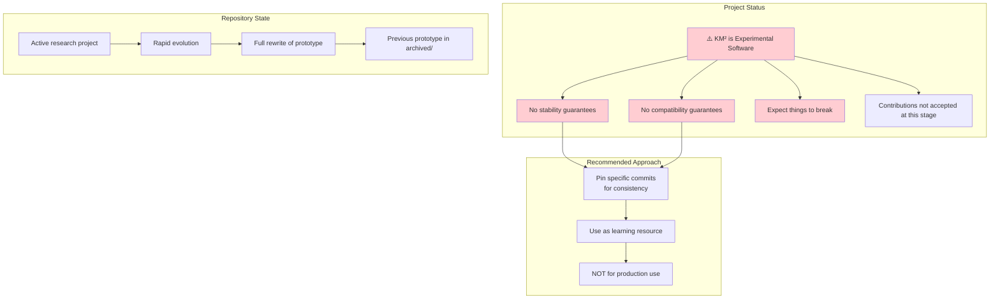
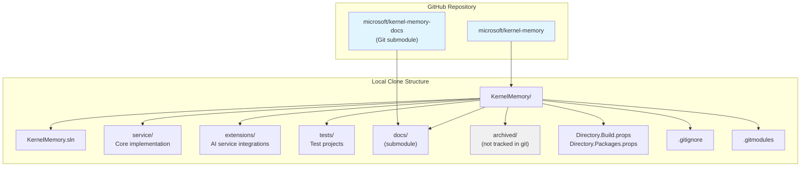
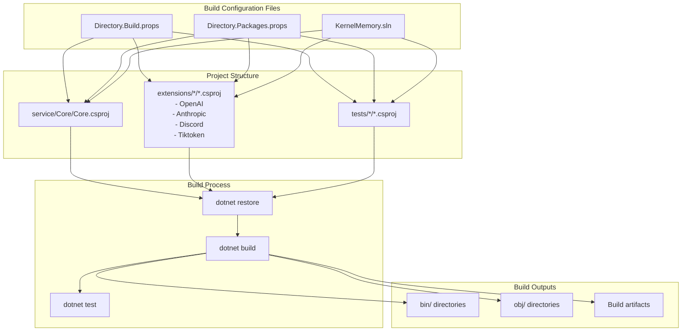

<!-- source: DeepWiki mcp.deepwiki.com · repo microsoft/kernel-memory · page 2.1 Installation and Setup · fetched 2026-10-26 -->

# Installation and Setup

<details>
<summary>Relevant source files</summary>

The following files were used as context for generating this wiki page:

- [.gitignore](.gitignore)
- [.gitmodules](.gitmodules)
- [README.md](README.md)

</details>


This page covers the prerequisites, build requirements, and initial setup steps required to install and build KM² (Kernel Memory squared) from source. This is intended for developers and researchers who want to run the system locally.

For detailed information about the configuration file structure, see [Configuration Basics](#2.2). For guidance on using the CLI commands after installation, see [First Steps with the CLI](#2.3).

---

## Prerequisites and System Requirements

KM² is a polyglot system with the following runtime and build requirements:

### Required Components

| Component | Version | Purpose |
|-----------|---------|---------|
| .NET SDK | 8.0 or later | Primary language runtime and build tools |
| Git | Latest | Source control and submodule management |

### Optional Components

| Component | Version | Purpose |
|-----------|---------|---------|
| Python | 3.x | Supporting components in extensions |
| Node.js | LTS | JavaScript-based supporting components |

### Development Environment

Any of the following IDEs can be used:
- **Visual Studio** (Windows/Mac) - Full .NET development support
- **JetBrains Rider** - Cross-platform .NET IDE
- **Visual Studio Code** - Lightweight, with C# extension

SQLite is embedded and does not require separate installation.

**Sources:** [README.md:1-34](), Technology Stack diagram from overview

---

## Important Pre-Installation Warnings



**Diagram: Project Status and Important Warnings**

KM² is an **active research project** with no stability or compatibility guarantees. The system evolves rapidly and may change without notice. This software is intended as a learning resource, not for production use.

**Sources:** [README.md:6-33]()

---

## Cloning the Repository

### Repository Structure



**Diagram: Repository Structure After Clone**

### Clone Commands

**Basic clone (without documentation submodule):**
```bash
git clone https://github.com/microsoft/kernel-memory.git
cd kernel-memory
```

**Clone with documentation submodule:**
```bash
git clone --recurse-submodules https://github.com/microsoft/kernel-memory.git
cd kernel-memory
```

If you've already cloned without submodules, initialize them separately:
```bash
git submodule update --init --recursive
```

### What Gets Excluded

The [.gitignore:1-73]() file excludes several categories of files from version control:

| Category | Patterns | Reason |
|----------|----------|--------|
| **Previous prototype** | `archived/` | Old research code, not tracked |
| **Build outputs** | `bin/`, `obj/`, `Debug/`, `Release/` | Generated at build time |
| **Test results** | `TestResult*/`, `coverage*.json`, `coverage*.xml` | Generated during testing |
| **IDE files** | `.vs/`, `.idea/`, `.vscode/` (settings) | User/IDE-specific |
| **Sensitive data** | `.env`, `*.development.json`, `*.cer`, `*.key` | Configuration with credentials |
| **Dependencies** | `node_modules/`, `__pycache__/` | Package manager artifacts |

**Sources:** [.gitignore:1-73](), [.gitmodules:1-3]()

---

## Building the Project

### Build Process Overview



**Diagram: Build Process and Dependencies**

### Build Commands

**From the repository root:**

1. **Restore NuGet packages:**
   ```bash
   dotnet restore
   ```

2. **Build the solution:**
   ```bash
   dotnet build
   ```

3. **Build in Release configuration:**
   ```bash
   dotnet build --configuration Release
   ```

4. **Run tests (optional):**
   ```bash
   dotnet test
   ```

### Solution Structure

The solution file `KernelMemory.sln` references multiple projects organized by purpose:

- **service/Core/** - Core service implementation
- **extensions/** - AI service integrations (OpenAI, Anthropic, Discord, Tiktoken)
- **tests/** - Unit and integration tests

The build system uses centralized configuration via `Directory.Build.props` and `Directory.Packages.props` for consistent package versioning across all projects. This is a modern .NET development practice that simplifies dependency management.

**Sources:** [.gitignore:7-8](), [.gitignore:28-41](), solution structure from architecture diagrams

---

## Verifying the Installation

### Build Verification

After a successful build, verify the following:

1. **Build output directories exist:**
   - `service/Core/bin/Debug/net8.0/` (or `Release`)
   - Extension projects have similar output directories

2. **No build errors in output:**
   ```bash
   dotnet build --no-restore
   ```
   Should complete with `Build succeeded` message.

3. **Core assemblies are present:**
   - `service/Core/bin/Debug/net8.0/Core.dll`
   - Extension DLLs in their respective output directories

### Runtime Verification

Verify the CLI application can be executed:

```bash
dotnet run --project service/CLI/CLI.csproj -- --help
```

This should display the KM² command-line interface help information. If this succeeds, the installation is complete.

> **Note:** The first execution of certain commands may initialize SQLite databases and storage directories. See [First Steps with the CLI](#2.3) for details on the first-run experience.

**Sources:** Build output structure from architecture diagrams

---

## Troubleshooting Common Issues

### Build Failures

| Issue | Possible Cause | Solution |
|-------|---------------|----------|
| NuGet restore fails | Network issues or package source problems | Clear NuGet cache: `dotnet nuget locals all --clear` |
| Missing SDK version | Wrong .NET SDK version | Install .NET 8.0 SDK or later |
| Project reference errors | Incomplete clone | Ensure all project files are present |

### Platform-Specific Considerations

**Windows:**
- Ensure long path support is enabled if you encounter path length errors
- Some extensions may require additional Windows SDK components

**macOS/Linux:**
- File permissions may need to be set on scripts
- Case-sensitive filesystems may expose issues in cross-platform code

### Pinning to Specific Commits

Since KM² is under active development with no stability guarantees, consider pinning to a specific commit:

```bash
git checkout <commit-hash>
```

To track which commit you're using:
```bash
git rev-parse HEAD
```

**Sources:** [README.md:24-33]()

---

## Next Steps

After successful installation:

1. **Configure the system:** Learn about the configuration file structure in [Configuration Basics](#2.2)
2. **Run first commands:** Try the CLI commands in [First Steps with the CLI](#2.3)
3. **Explore the architecture:** Understand system design in [Architecture](#3)
4. **Set up your IDE:** For development, see [IDE Setup and Development Environment](#9.4)

---

## File References

The following files are particularly relevant for understanding installation requirements:

- [README.md:1-80]() - Project overview, warnings, and status
- [.gitignore:1-73]() - Files excluded from version control
- [.gitmodules:1-3]() - Git submodule configuration
- Build configuration files (referenced but not shown): `Directory.Build.props`, `Directory.Packages.props`, `KernelMemory.sln`

**Sources:** All referenced files above

---

